> The 2026-selected NASDAQ model artifacts were subsequently retired and deleted by user request. Their numerical audit remains historical evidence. The active replacement is the [historical monthly NASDAQ-100 fallback study](nasdaq_monthly_pit/CHARTS.md).

# Original random samples charts and audit

NYSX is the passive Global X NYSE 100 ETF. It launched March 25, 2026 and has no tradable 2022–2025 history. Its index covers technology and growth companies across exchanges, not the 100 largest NYSE-listed companies. NYSX performance is unavailable here. NYSE historical charts use the simulated equal-weight cohort basket (scheduled rebalances and modeled costs), not an ETF. NASDAQ charts retain QQQ; SPY supplies broad-market context. [Issuer and inception](https://www.globalxetfs.com/funds/nysx/) and [prospectus](https://assets.globalxetfs.com/funds/documents/nysx/prospectus-regulatory/Summary-Prospectus_NYSX.pdf).

The audit reproduced saved momentum and ridge forecasts and replayed THINK variants. A separate ledger in share units agreed with all 384 selected/fixed portfolio paths across the two studies. Future-price perturbations preserved earlier features, momentum, masks, scaling and graph construction. This supports the forecast/accounting implementation. It does not remove future-universe selection, survivorship bias or repeated examination of test results.

Current top-100 membership was chosen in 2026 and applied to 2022–2025. The original samples recover only 68 NYSE and 67 NASDAQ issuer histories. These are different, biased populations. Strong top-100 results need not transfer to random samples.

[Audited metrics](audited_metrics.csv) · [Dated curves](audited_curves.csv)

126-session momentum scores each eligible stock as adjusted close today / adjusted close 126 sessions ago − 1. It ranks past winners, then trades at the next session close; it does not predict using future prices. This implementation includes the most recent month. Ridge pools eligible training stock/date observations and fits 80 lagged features plus an intercept by minimizing squared forecast error + 10 × squared coefficient size (intercept unpenalized). Features are scaled on training data only. It forecasts next-close-to-exit returns; the portfolio ranks those forecasts. Both baselines use earlier validation to choose K and allocation.

THINK+mixer adds a learned cross-stock residual to THINK scores. Extra parameters can help one cohort and overfit another. A higher return in one panel is insufficient evidence of an architectural advantage. Compare the same fixed portfolio, seed spread and paired uncertainty before attributing a difference to the mixer.

## NASDAQ_recent, 5-session forecasts

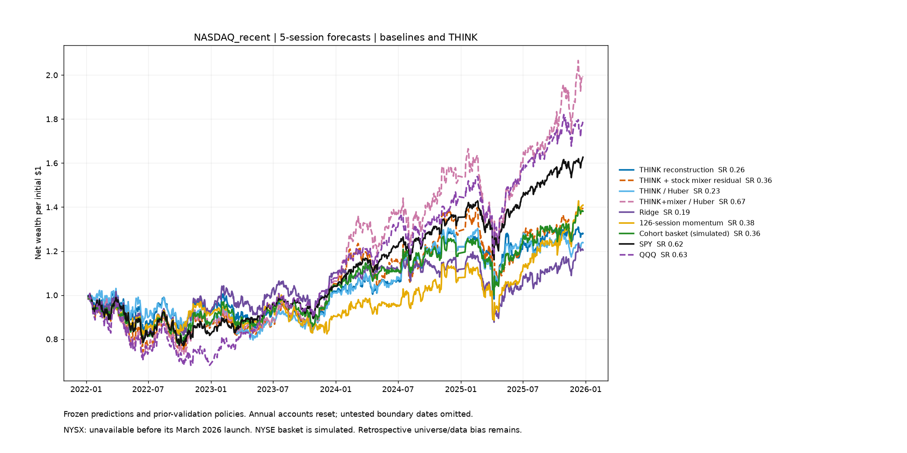

| Model | Net Sharpe | Annualized net return | Net total return | Drawdown | ΔSharpe vs cohort reference [95% interval] |
|---|---:|---:|---:|---:|---:|
| THINK reconstruction | 0.265 | 6.6% | 28.0% | -24.1% | -0.361 [-0.935, 0.279] |
| THINK + stock mixer residual | 0.356 | 9.0% | 39.6% | -25.8% | -0.270 [-0.843, 0.358] |
| THINK / Huber | 0.228 | 5.7% | 23.8% | -22.7% | -0.398 [-1.063, 0.259] |
| THINK+mixer / Huber | 0.675 | 19.5% | 99.5% | -30.0% | 0.049 [-0.445, 0.596] |
| Ridge | 0.194 | 4.9% | 20.5% | -26.7% | -0.432 [-0.998, 0.147] |
| 126-session momentum | 0.381 | 9.3% | 40.9% | -22.7% | -0.245 [-0.863, 0.397] |
| Cohort basket (simulated) | 0.364 | 8.7% | 38.1% | -22.2% | -0.262 [-0.816, 0.339] |
| SPY | 0.621 | 13.4% | 62.7% | -23.4% | -0.004 [-0.290, 0.271] |
| QQQ | 0.626 | 16.2% | 78.8% | -32.4% | 0.000 [0.000, 0.000] |

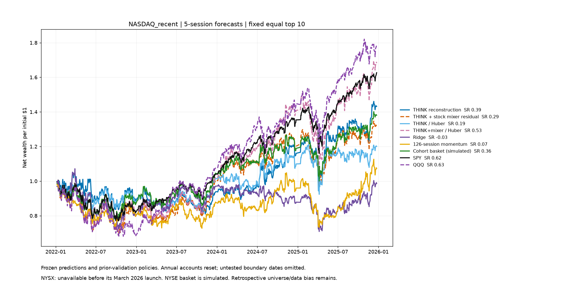

The fixed-top-10 panel holds allocation constant across models. SPY/QQQ and the full-cohort basket retain their control rules.

## NYSE_recent, 5-session forecasts

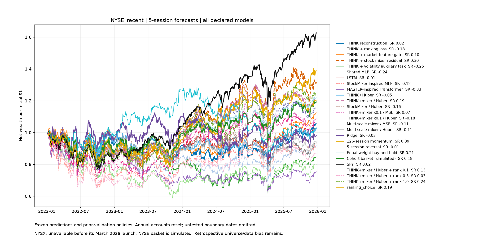

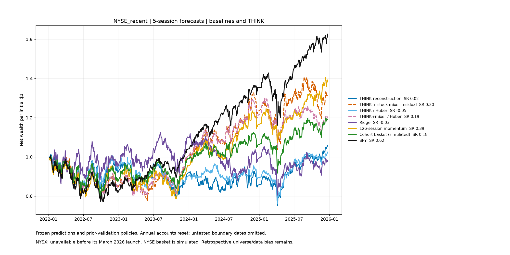

| Model | Net Sharpe | Annualized net return | Net total return | Drawdown | ΔSharpe vs cohort reference [95% interval] |
|---|---:|---:|---:|---:|---:|
| THINK reconstruction | 0.017 | 1.5% | 5.9% | -25.8% | -0.162 [-0.539, 0.225] |
| THINK + stock mixer residual | 0.301 | 7.4% | 31.6% | -22.4% | 0.122 [-0.294, 0.552] |
| THINK / Huber | -0.054 | 0.6% | 2.4% | -24.4% | -0.232 [-0.680, 0.178] |
| THINK+mixer / Huber | 0.194 | 5.0% | 20.6% | -20.7% | 0.015 [-0.303, 0.297] |
| Ridge | -0.030 | -0.5% | -1.8% | -28.5% | -0.208 [-0.727, 0.241] |
| 126-session momentum | 0.393 | 8.9% | 39.2% | -21.4% | 0.215 [-0.227, 0.656] |
| Cohort basket (simulated) | 0.179 | 4.7% | 19.3% | -19.9% | 0.000 [0.000, 0.000] |
| SPY | 0.621 | 13.4% | 62.7% | -23.4% | 0.443 [-0.052, 0.942] |

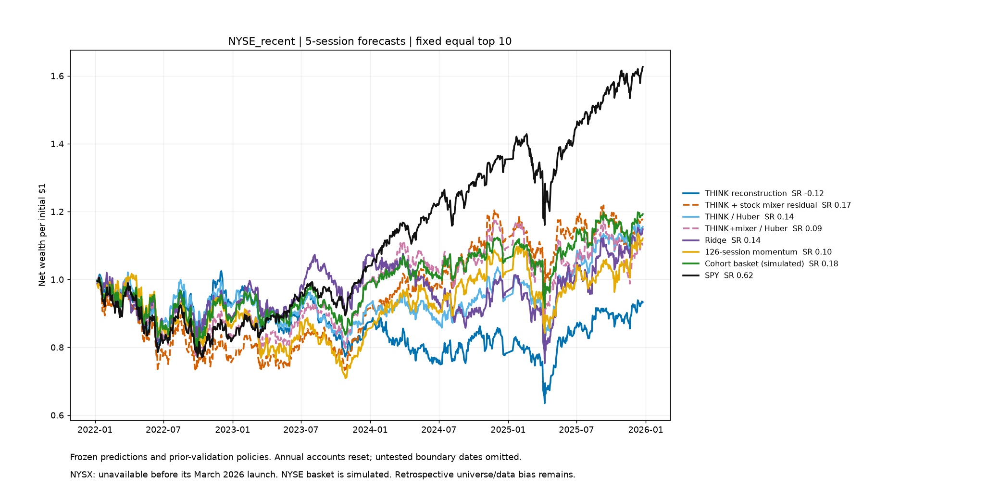

The fixed-top-10 panel holds allocation constant across models. SPY/QQQ and the full-cohort basket retain their control rules.

## NASDAQ_recent, 1-session forecasts

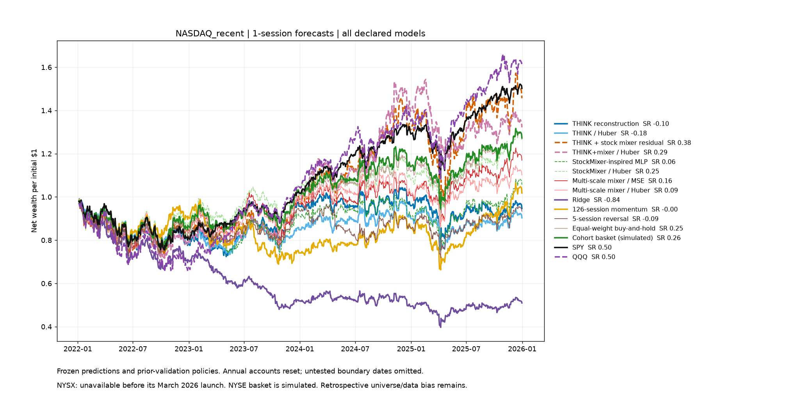

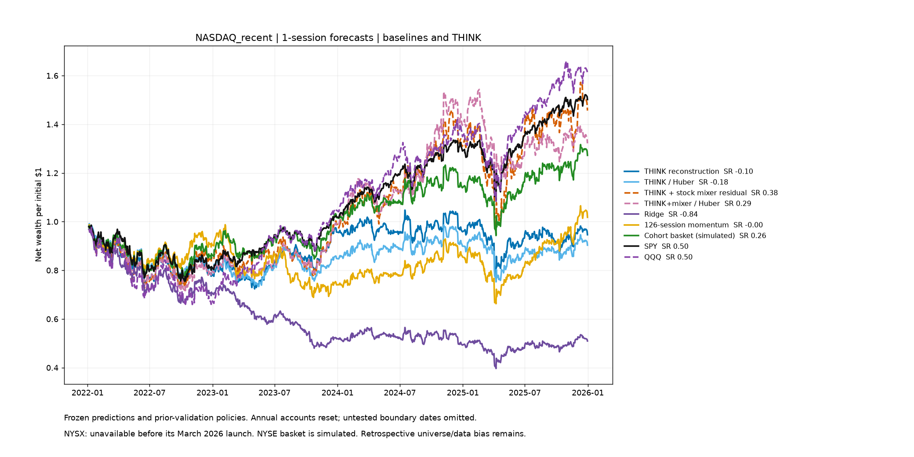

| Model | Net Sharpe | Annualized net return | Net total return | Drawdown | ΔSharpe vs cohort reference [95% interval] |
|---|---:|---:|---:|---:|---:|
| THINK reconstruction | -0.097 | -1.4% | -5.4% | -27.6% | -0.596 [-1.232, 0.066] |
| THINK / Huber | -0.182 | -2.5% | -9.7% | -26.7% | -0.681 [-1.264, -0.055] |
| THINK + stock mixer residual | 0.383 | 10.0% | 45.6% | -32.6% | -0.115 [-0.730, 0.517] |
| THINK+mixer / Huber | 0.291 | 7.3% | 32.2% | -28.4% | -0.208 [-0.832, 0.456] |
| Ridge | -0.842 | -15.7% | -49.0% | -60.3% | -1.341 [-1.989, -0.653] |
| 126-session momentum | -0.004 | 0.5% | 1.8% | -33.7% | -0.503 [-1.122, 0.142] |
| Cohort basket (simulated) | 0.255 | 6.3% | 27.2% | -23.6% | -0.243 [-0.780, 0.316] |
| SPY | 0.497 | 10.8% | 50.2% | -24.5% | -0.002 [-0.264, 0.263] |
| QQQ | 0.499 | 12.7% | 60.5% | -34.0% | 0.000 [0.000, 0.000] |

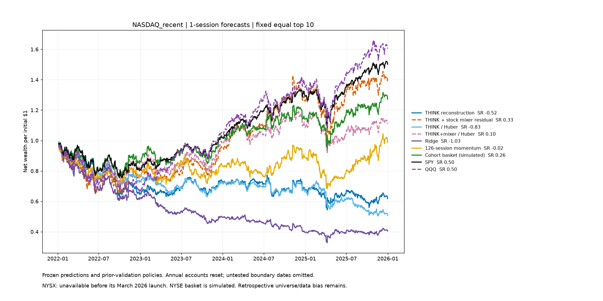

The fixed-top-10 panel holds allocation constant across models. SPY/QQQ and the full-cohort basket retain their control rules.

## NYSE_recent, 1-session forecasts

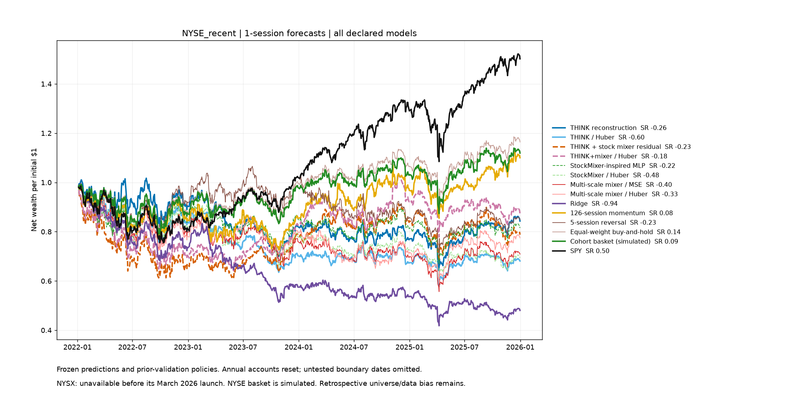

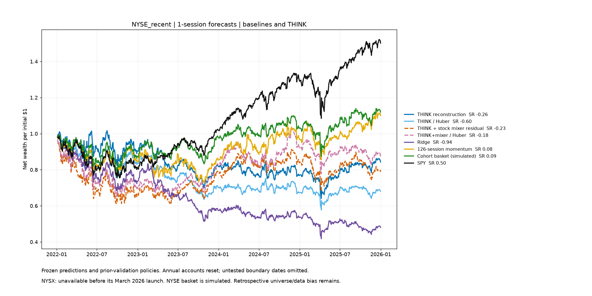

| Model | Net Sharpe | Annualized net return | Net total return | Drawdown | ΔSharpe vs cohort reference [95% interval] |
|---|---:|---:|---:|---:|---:|
| THINK reconstruction | -0.262 | -4.2% | -15.7% | -36.9% | -0.348 [-0.665, -0.010] |
| THINK / Huber | -0.597 | -9.3% | -31.9% | -42.3% | -0.683 [-1.019, -0.335] |
| THINK + stock mixer residual | -0.229 | -5.9% | -21.2% | -39.0% | -0.315 [-0.809, 0.166] |
| THINK+mixer / Huber | -0.180 | -3.4% | -12.7% | -35.9% | -0.265 [-0.722, 0.263] |
| Ridge | -0.939 | -16.9% | -52.0% | -58.2% | -1.025 [-1.450, -0.595] |
| 126-session momentum | 0.079 | 2.4% | 10.0% | -27.4% | -0.006 [-0.475, 0.453] |
| Cohort basket (simulated) | 0.086 | 2.9% | 11.9% | -21.0% | 0.000 [0.000, 0.000] |
| SPY | 0.497 | 10.8% | 50.2% | -24.5% | 0.411 [-0.076, 0.872] |

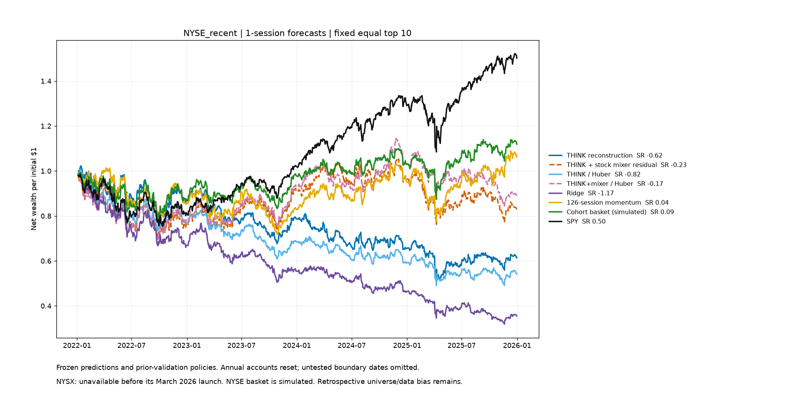

The fixed-top-10 panel holds allocation constant across models. SPY/QQQ and the full-cohort basket retain their control rules.

## Fresh random draws

[Three fresh samples per exchange](random_trials_20261010/CHARTS.md). These draws use the full published source pools before downloading prices.

[Detailed audit explanation and limits](audit/backtests_20261010/EXPLANATION.md).

The three fresh draws did not reproduce the extreme top-100 baseline returns. Fixed-top-10 mean annualized net momentum returns were 10.2% NYSE and 9.8% NASDAQ; ridge returned 5.4% and −2.6%. All fresh mixer-versus-THINK paired intervals include zero.
