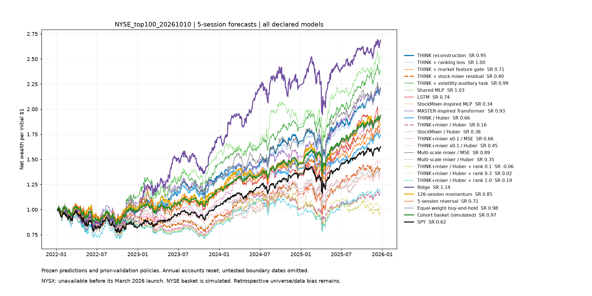
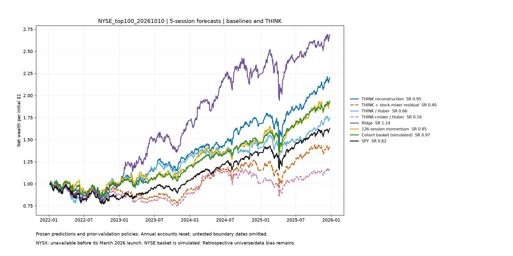
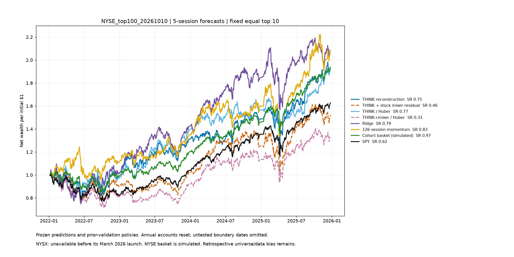
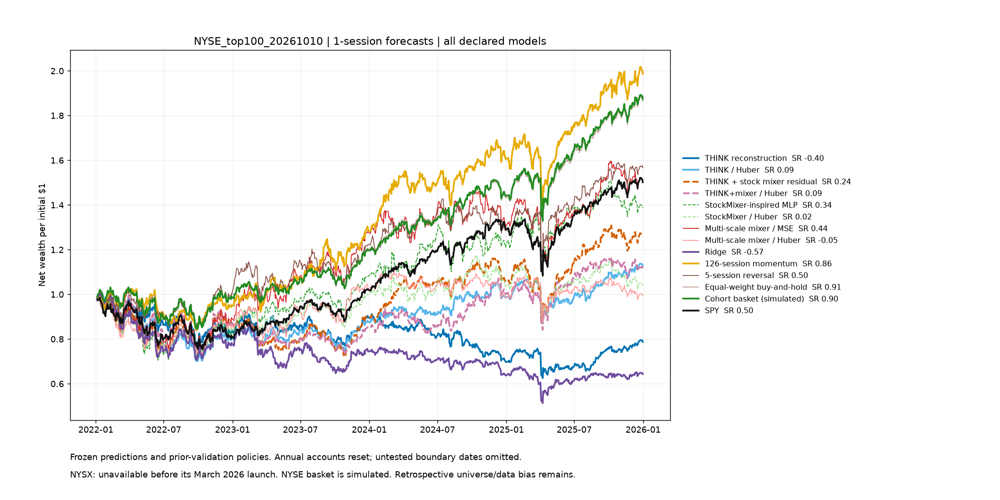
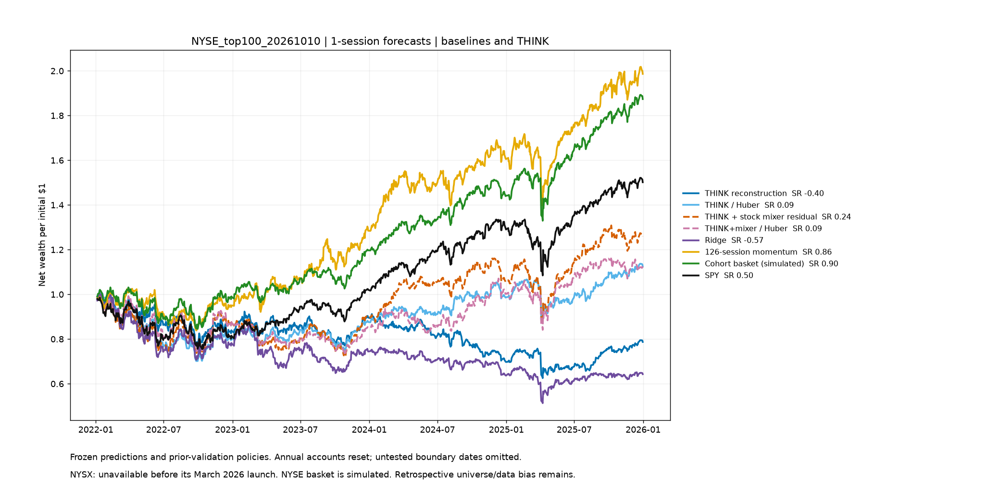
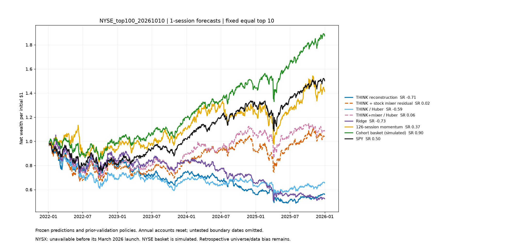

> Archived evidence. NYSE work is deferred. The 2026-selected NASDAQ models were deleted by user request; historical monthly NASDAQ is the active study.

# Archived NYSE 2026-selected cohort

NYSX is the passive Global X NYSE 100 ETF. It launched March 25, 2026 and has no tradable 2022–2025 history. Its index covers technology and growth companies across exchanges, not the 100 largest NYSE-listed companies. NYSX performance is unavailable here. NYSE historical charts use the simulated equal-weight cohort basket (scheduled rebalances and modeled costs), not an ETF. NASDAQ charts retain QQQ; SPY supplies broad-market context. [Issuer and inception](https://www.globalxetfs.com/funds/nysx/) and [prospectus](https://assets.globalxetfs.com/funds/documents/nysx/prospectus-regulatory/Summary-Prospectus_NYSX.pdf).

The audit reproduced saved momentum and ridge forecasts and replayed THINK variants. A separate ledger in share units agreed with all 384 selected/fixed portfolio paths across the two studies. Future-price perturbations preserved earlier features, momentum, masks, scaling and graph construction. This supports the forecast/accounting implementation. It does not remove future-universe selection, survivorship bias or repeated examination of test results.

Current top-100 membership was chosen in 2026 and applied to 2022–2025. The original samples recover only 68 NYSE and 67 NASDAQ issuer histories. These are different, biased populations. Strong top-100 results need not transfer to random samples.

[Audited metrics](audited_metrics.csv) · [Dated curves](audited_curves.csv)

126-session momentum scores each eligible stock as adjusted close today / adjusted close 126 sessions ago − 1. It ranks past winners, then trades at the next session close; it does not predict using future prices. This implementation includes the most recent month. Ridge pools eligible training stock/date observations and fits 80 lagged features plus an intercept by minimizing squared forecast error + 10 × squared coefficient size (intercept unpenalized). Features are scaled on training data only. It forecasts next-close-to-exit returns; the portfolio ranks those forecasts. Both baselines use earlier validation to choose K and allocation.

THINK+mixer adds a learned cross-stock residual to THINK scores. Extra parameters can help one cohort and overfit another. A higher return in one panel is insufficient evidence of an architectural advantage. Compare the same fixed portfolio, seed spread and paired uncertainty before attributing a difference to the mixer.

## NYSE_top100_20261010, 5-session forecasts

| Model | Net Sharpe | Annualized net return | Net total return | Drawdown | ΔSharpe vs cohort reference [95% interval] |
|---|---:|---:|---:|---:|---:|
| THINK reconstruction | 0.955 | 22.6% | 119.9% | -22.7% | -0.019 [-0.474, 0.426] |
| THINK + stock mixer residual | 0.404 | 9.5% | 42.0% | -24.5% | -0.569 [-1.094, -0.096] |
| THINK / Huber | 0.660 | 15.5% | 74.3% | -24.4% | -0.313 [-0.899, 0.337] |
| THINK+mixer / Huber | 0.155 | 4.1% | 16.9% | -28.0% | -0.819 [-1.381, -0.317] |
| Ridge | 1.139 | 29.1% | 168.8% | -22.8% | 0.165 [-0.479, 0.769] |
| 126-session momentum | 0.854 | 18.5% | 93.0% | -19.6% | -0.120 [-0.664, 0.349] |
| Cohort basket (simulated) | 0.974 | 18.6% | 93.7% | -17.8% | 0.000 [0.000, 0.000] |
| SPY | 0.621 | 13.4% | 62.7% | -23.4% | -0.352 [-0.793, 0.074] |

The fixed-top-10 panel holds allocation constant across models. SPY/QQQ and the full-cohort basket retain their control rules.

## NYSE_top100_20261010, 1-session forecasts

| Model | Net Sharpe | Annualized net return | Net total return | Drawdown | ΔSharpe vs cohort reference [95% interval] |
|---|---:|---:|---:|---:|---:|
| THINK reconstruction | -0.397 | -5.9% | -21.3% | -38.7% | -1.299 [-1.841, -0.786] |
| THINK / Huber | 0.093 | 3.0% | 12.5% | -30.8% | -0.809 [-1.201, -0.433] |
| THINK + stock mixer residual | 0.243 | 6.0% | 26.0% | -28.0% | -0.659 [-1.109, -0.227] |
| THINK+mixer / Huber | 0.093 | 2.8% | 11.4% | -26.6% | -0.809 [-1.294, -0.349] |
| Ridge | -0.570 | -10.6% | -35.7% | -49.7% | -1.472 [-2.006, -0.939] |
| 126-session momentum | 0.863 | 19.0% | 98.7% | -18.7% | -0.039 [-0.582, 0.442] |
| Cohort basket (simulated) | 0.902 | 17.2% | 87.4% | -18.0% | 0.000 [0.000, 0.000] |
| SPY | 0.497 | 10.8% | 50.2% | -24.5% | -0.405 [-0.882, 0.022] |

The fixed-top-10 panel holds allocation constant across models. SPY/QQQ and the full-cohort basket retain their control rules.

## Data and selection limitations

The NYSE top-100 is a custom market-cap cohort, not the official NYSE 100 growth index. NASDAQ includes 101 share classes for 100 companies. Current membership creates future selection. Revised public prices and missing delistings remain unresolved. Intervals use 1,000 paired 20-session block samples within annual folds and are exploratory, with no correction for repeated comparisons.

[Detailed audit explanation and limits](../audit/backtests_20261010/EXPLANATION.md).

The three fresh draws did not reproduce the extreme top-100 baseline returns. Fixed-top-10 mean annualized net momentum returns were 10.2% NYSE and 9.8% NASDAQ; ridge returned 5.4% and −2.6%. All fresh mixer-versus-THINK paired intervals include zero.
