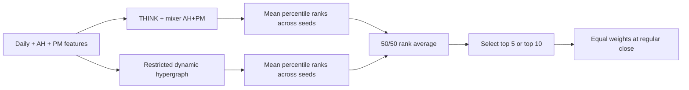

# NASDAQ-100 master charts

Updated October 24, 2026. Historical monthly NASDAQ-100 membership, January 3, 2022–December 31, 2025. All paths use the same 1,003 sessions.

## New findings: losses, optimizers and complementary networks

The fixed THINK+mixer AH+PM + restricted dynamic-hypergraph rank blend is the strongest new historical candidate. Its ten-seed portfolio returned **31.87% CAGR / 0.896 Sharpe at five holdings**, or **23.92% / 0.755 at ten**. Five-holding momentum SGD returned **25.05% / 0.719**, with 0.759 and 0.799 Sharpe in its two fixed seed halves. Top ten was primary; top five was a predeclared secondary portfolio test. No genuinely untouched-period result exists yet.

| Strategy | Holdings | Ten-seed CAGR | Ten-seed SR | Original-five SR | New-five SR | Max drawdown | 95% SR interval |
| --- | ---: | ---: | ---: | ---: | ---: | ---: | --- |
| THINK+mixer AH+PM / MSE / fixed AdamW | 10 | 15.36% | 0.519 | 0.700 | 0.480 | -38.32% | [-0.345, 1.425] |
| THINK+mixer AH+PM + dynamic HG / 50:50 ranks | 10 | 23.92% | 0.755 | 0.848 | 0.467 | -34.88% | [-0.095, 1.649] |
| THINK+mixer AH+PM / MSE / tuned momentum SGD | 10 | 19.22% | 0.626 | 0.634 | 0.466 | -33.81% | [-0.277, 1.553] |
| THINK+mixer AH+PM / MSE / fixed AdamW | 5 | 16.73% | 0.531 | 0.485 | 0.106 | -44.05% | [-0.360, 1.467] |
| THINK+mixer AH+PM + dynamic HG / 50:50 ranks | 5 | 31.87% | 0.896 | 0.919 | 0.633 | -40.94% | [0.001, 1.829] |
| THINK+mixer AH+PM / MSE / tuned momentum SGD | 5 | 25.05% | 0.719 | 0.759 | 0.799 | -45.29% | [-0.227, 1.715] |

SPY: 10.85% CAGR / 0.498 Sharpe. QQQ: 11.93% / 0.469. Huber and pseudo-Huber weakened this AH+PM recipe. Standalone MASTER and PRISM-VQ transfers also underperformed. The restricted dynamic network alone returned 15.32% / 0.530, showing why a complementary blend can be more useful than choosing the strongest standalone CAGR. All negative cells remain in the workbook and gallery.

## Does the dynamic blend still use THINK?

**Yes.** One branch is the original THINK+mixer daily core plus its bounded AH+PM correction, trained with MSE and AdamW. The other is a separately trained dynamic hypergraph network using the same 25 stock-feature channels. Within each branch, fixed-seed forecasts are converted to eligible-stock percentile ranks and averaged. The final score is the fixed average of those two ensemble rank scores. One top-five or top-ten equal-weight portfolio is selected from it. This is not a 50/50 capital allocation between two portfolios.

Features end at 09:15 ET, the decision is at 09:20, and execution occurs at that session’s regular close. Portfolios rebalance every five exchange sessions. No after-hours trades or test-fitted blend weights are used.

## Seed robustness and uncertainty

The ten-holding blend’s original-five/new-five Sharpe split is 0.848 versus 0.467; its new-five result does not improve the matched baseline’s 0.480. At five holdings the blend improves on the matched baseline in both halves, while SGD is more consistent across those halves. These are initialization diagnostics on one shared history, not independent market replications. SGD’s low turnover appears partly related to stable stock-specific mixer preferences, which also need testing on new dates.

For the primary ten-holding blend, the paired 95% SR difference versus SPY is approximately [-0.161, 0.649]. Its improvement versus the baseline is not conclusive after the within-batch comparison adjustment. An additional secondary five-holding sensitivity gives a paired SR difference versus SPY of [-0.077, 0.849]; accounting for both holding counts and tested methods also leaves superiority over QQQ inconclusive. These secondary diagnostics do not turn the selected historical leader into a prespecified confirmation result. [Additional secondary sensitivity](outputs/01a15702-86c3-7463-ae6c-24606895c7cf/strategy_comparison_20261020/new_holdings_uncertainty.csv).

Absolute SR intervals use a fixed 3% annual hurdle and 10,000 circular-block draws, with 20 sessions primary and 5/60-session sensitivity. They condition on fitted paths, omit the full prior research search and retraining uncertainty, and do not give the probability of beating a benchmark.

The author networks are NASDAQ transfers with declared feature and training adaptations. The restricted dynamic model replaces the full sector/lead-lag graph inputs with one train-only correlation snapshot. PRISM’s current factor vintage does not establish historical publication availability. These are not reproductions of published paper performance.

## Best observed historical results

These are retrospective rankings across all 346 base-cost strategies, including diagnostic seed halves and portfolio variants. The ten-seed comparison above remains separate.

| Historical distinction | Strategy | Sharpe | CAGR | RankIC | Max drawdown | 95% SR interval |
| --- | --- | ---: | ---: | ---: | ---: | --- |
| Highest observed CAGR | THINK+mixer AH+PM + dynamic HG / 50:50 ranks / original five seeds / top 5 | 0.919 | 32.94% | 0.0180 | -34.89% | [0.041, 1.833] |
| Highest observed Sharpe | THINK+mixer AH+PM + dynamic HG / 50:50 ranks / original five seeds / top 5 | 0.919 | 32.94% | 0.0180 | -34.89% | [0.041, 1.833] |
| Highest top-ten CAGR | THINK+mixer AH+PM + dynamic HG / 50:50 ranks / original five seeds / top 10 | 0.848 | 27.79% | 0.0180 | -35.04% | [-0.006, 1.739] |
| Ten-seed blend, secondary five holdings | THINK+mixer AH+PM + dynamic HG / 50:50 ranks / ten seeds / top 5 | 0.896 | 31.87% | 0.0189 | -40.94% | [0.001, 1.829] |
| Ten-seed SGD, five holdings | THINK+mixer AH+PM / MSE / tuned momentum SGD / ten seeds / top 5 | 0.719 | 25.05% | 0.0238 | -45.29% | [-0.227, 1.715] |
| Original daily reference | THINK + mixer (original five seeds) | 0.629 | 19.60% | 0.0074 | -39.44% | [-0.186, 1.505] |

## Earlier unblended AH+PM holding-count test

Before the new optimizer/network tests, the original-five unblended AH+PM ensemble returned 14.51% CAGR / 0.485 SR at five holdings versus 22.39% / 0.700 at ten. Those saved-forecast results are preserved in AH PM holding counts and [the audited report](docs/ndx_extended_hours_top5_20261024/REPORT.md). They are a different strategy from the new dynamic rank blend.

## Files and scope

- [Updated comparison workbook](docs/NASDAQ100_strategy_comparison.xlsx): 346 distinct base-cost strategies; 105 Models, 31 Defensive and 210 Portfolio variants. Benchmarks repeat in the latter tabs for convenience.
- [Every extended-hours account](outputs/01a15702-86c3-7463-ae6c-24606895c7cf/strategy_comparison_20261020/extended_hours_all_accounts.csv): all 66 accounts, including individual seeds and 2x/4x fees, also in Extended-hours.
- [Chart catalog](docs/strategy_comparison_20261024/chart_catalog.csv): 634 chart-panel entries covering 346 main strategies and 288 additional diagnostic accounts. Repeated reference accounts are represented once.
- [All strategy metrics](outputs/01a15702-86c3-7463-ae6c-24606895c7cf/strategy_comparison_20261020/all_strategies.csv) and [5/20/60-session SR sensitivity](outputs/01a15702-86c3-7463-ae6c-24606895c7cf/strategy_comparison_20261020/sharpe_block_sensitivity.csv).

Defensive uses the fixed QQQ/MA200 half-exposure rule. Portfolio variants change holding count or long/cash/short allocation. All main rows are ensemble or declared selection procedures; individual extended-hours seeds are diagnostics. Failed and negative strategies are retained.

For fee-stress charts the red/purple comparators remain the base-cost SPY/QQQ references; the strategy fee multiplier is stated in each panel. No new models were fit for this consolidation. Retired 2026-selected survivor universes and unrelated/deferred NYSE studies are excluded from this active-model ranking.

- [All 346 new experiment accounts](outputs/01a15702-86c3-7463-ae6c-24606895c7cf/strategy_comparison_20261020/new_experiment_all_accounts.csv). New findings compares seed halves; New accounts includes individual seeds and fee stresses.

## Source reports and uncertainty

- [Original monthly study](docs/nasdaq_monthly_pit/CHARTS.md)
- [Original holding-count/loss comparison](docs/nasdaq_monthly_pit/topk_pseudohuber/metrics.csv)
- [Original long/short allocations](docs/nasdaq_monthly_pit/long_short/primary_metrics.csv)
- [Alpaca regular-session features](docs/nasdaq_alpaca_20261019/REPORT.md)
- [Ranking and residual objectives](docs/ndx_ranking_20261020/REPORT.md)
- [Broad features and model families](docs/ndx_broad_20261020/REPORT.md)
- [Frozen-core corrections](docs/ndx_corrections_20261020/REPORT.md)
- [25-seed expansion](docs/ndx_seed_expansion_20261020/REPORT.md)
- [After-hours and premarket experiment](docs/ndx_extended_hours_20261024/REPORT.md)

- [Sealed loss/optimizer metrics](runs/ndx_loss_optimizer_20261024/metrics.csv) and [audit](runs/ndx_loss_optimizer_20261024/AUDIT.json)
- [Sealed reference-network metrics](runs/ndx_reference_networks_20261024/metrics.csv) and [audit](runs/ndx_reference_networks_20261024/AUDIT.json)

## Complete model and strategy gallery

Each panel compares one strategy with SPY and QQQ. Titles report net CAGR, Sharpe and maximum drawdown. All declared main strategies appear, including equal realized paths from distinct selection rules. Numeric results and unique IDs are searchable in the linked catalog.

### Models / Original daily

### Models / Alpaca matched features

### Models / Ranking objectives

### Models / Broad features

### Models / Frozen-core corrections

### Models / Seed expansion

### Models / Extended-hours information

### Defensive / Broad features

### Defensive / Frozen-core corrections

### Defensive / Seed expansion

### Portfolio variants / Original daily

### Portfolio variants / Alpaca matched features

### Portfolio variants / Original allocations

### Extended-hours / Individual-seed diagnostic

### Extended-hours / Cost sensitivity

### All additional five-holding follow-up accounts

### All new loss, optimizer, reference and rank-blend accounts

