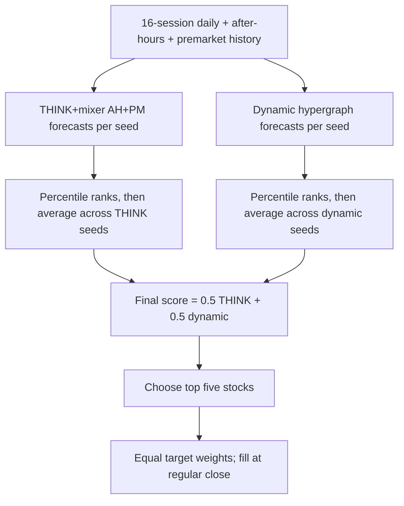

# NASDAQ-100 master charts

Updated October 27, 2026. Historical monthly NASDAQ-100 membership, January 3, 2022–December 31, 2025. Every path uses the same 1,003 sessions.

## Highest observed Sharpe: model hedge experiment

**The new highest observed Sharpe is 1.454 for the original-five stock blend with a continuous partial QQQ hedge: 27.79% CAGR / −14.56% maximum drawdown. The ten-seed version reaches 1.325 Sharpe: 24.83% CAGR / −14.78% drawdown.** This is an always-on hedge control. Its timing does not come from the trained models.

**Our own models did not supply a useful hedge trigger in this test.** All four raw-forecast signals stayed off at all 201 rebalances in every seed group. Their account paths exactly match the unhedged baseline. All four bias-corrected signals fired at the same 50 rebalances in 2023 and stayed off in 2022/2024/2025. They missed 2022's weakness and hedged during 2023's rebound. The best active model-signal results were 1.111 Sharpe for original-five and 1.045 for ten seeds, below their unhedged 1.178/1.112 baselines. Equal-Sharpe calibrated variants are ties, not distinct replications.

|Strategy|Seeds|Sharpe|CAGR|Max drawdown|95% SR interval|
|---|---|---:|---:|---:|---|
|Continuous / hedge up to 50%|Original five|1.454|27.79%|-14.56%|[0.463, 2.441]|
|QQQ MA200 / hedge up to 50%|Original five|1.315|28.10%|-17.05%|[0.325, 2.309]|
|Calibrated family agreement / hedge up to 50%|Original five|1.111|26.27%|-20.56%|[0.154, 2.078]|
|Five issuers + 20% volatility target|Original five|1.178|28.57%|-20.56%|[0.223, 2.137]|
|SPY|Benchmark|0.498|10.85%|-24.55%|[-0.367, 1.419]|
|QQQ|Benchmark|0.469|11.93%|-34.87%|[-0.408, 1.394]|
|Continuous / hedge up to 50%|Ten seeds|1.325|24.83%|-14.78%|[0.388, 2.238]|
|QQQ MA200 / hedge up to 50%|Ten seeds|1.234|26.24%|-14.82%|[0.300, 2.178]|
|Calibrated family agreement / hedge up to 25%|Ten seeds|1.045|24.64%|-21.69%|[0.130, 1.984]|
|Five issuers + 20% volatility target|Ten seeds|1.112|26.81%|-21.69%|[0.190, 2.047]|

All neural rows select **five stock issuers**, regardless of seed count. Hedge rows add a short QQQ position capped at 25% or 50% NAV, available cash budget and a 20% QQQ volatility target. The highest-SR control keeps the 50% cap on continuously; the model rules use only their predictions to turn hedging on. QQQ's trailing volatility still sizes the short. Gross target exposure is capped at 100%; positions can drift between regular-close fills. Cash earns zero. Base modeled trading costs and assumed 3% annual borrow are included.

**495 accounts / 37 recipes:** eight own-model signals crossed with cash exit, 25% hedge, 50% hedge and 50% short switch, plus unhedged, QQQ-MA200 and continuous-hedge controls, across original-five/new-five/ten-seed groups and cost/borrow assumptions. The strongest Sharpe control is selected from inspected historical results. Confidence intervals condition on fitted paths and do not adjust prior model searches. The newer five-seed half remains materially weaker. No claim of prospective superiority follows.

[Complete signal definitions, seed/cost results and audit](docs/ndx_model_hedge_20261027/REPORT.md) · [All 495 accounts](docs/ndx_model_hedge_20261027/metrics.csv) · [All signal decisions](docs/ndx_model_hedge_20261027/signals.csv) · [Comparison workbook](docs/NASDAQ100_strategy_comparison.xlsx)

## Updated master graph: all 472 main strategy accounts

The previous 364 accounts are preserved, with 108 new nonbaseline hedge-study accounts added. Different rules can produce identical paths; 472 counts declared accounts, not 472 independent strategies. Full cost/borrow cases remain in the workbook's Hedge accounts sheet. Open Model hedges for the new comparison charts.

## Previous published comparison: October 26 snapshot

The sections below preserve the preceding dated comparison. The October 27 results above supersede its headline leader claims.

Updated October 26, 2026. Historical monthly NASDAQ-100 membership, January 3, 2022–December 31, 2025. Every path uses the same 1,003 sessions.

## Highest-Sharpe models versus SPY and QQQ

**The highest observed Sharpe is now 1.199** for the original-five blend with a 20% basket-volatility target: **28.96% CAGR and -17.78% drawdown**. The **highest ten-seed Sharpe is 1.112**, using five-issuer selection plus a 20% volatility target: **26.81% CAGR and -21.69% drawdown**. The 25% target plus issuer/trend control retains more ten-seed return at **28.70% CAGR / 1.085 Sharpe / -22.98% drawdown**.

| Strategy | Seed ensemble | Sharpe | CAGR | Max drawdown | 95% SR interval |
| --- | --- | ---: | ---: | ---: | --- |
| **20% basket volatility target** | **Original five** | **1.199** | **28.96%** | **-17.78%** | **[0.264, 2.146]** |
| 25% volatility target + trend cap | Original five | 1.190 | 31.50% | -18.99% | [0.273, 2.118] |
| 20% volatility target + trend cap | Original five | 1.190 | 28.08% | -17.16% | [0.254, 2.130] |
| Five issuers + 25% volatility target + trend cap | Original five | 1.169 | 31.20% | -21.68% | [0.232, 2.110] |
| Five issuers + 20% volatility target | Original five | 1.178 | 28.57% | -20.56% | [0.234, 2.147] |
| **Five issuers + 20% volatility target** | **Ten seeds** | **1.112** | **26.81%** | **-21.69%** | **[0.209, 2.045]** |
| Five issuers + 25% volatility target + trend cap | Ten seeds | 1.085 | 28.70% | -22.98% | [0.191, 1.998] |
| Full-exposure blend | Original five | 0.919 | 32.94% | -34.89% | [0.041, 1.833] |
| Full-exposure blend | Ten seeds | 0.896 | 31.87% | -40.94% | [0.001, 1.829] |
| **SPY** | **Benchmark** | **0.498** | **10.85%** | **-24.55%** | **[-0.367, 1.419]** |
| **QQQ** | **Benchmark** | **0.469** | **11.93%** | **-34.87%** | **[-0.408, 1.394]** |

The figure compares four new risk-control recipes, the corresponding full-exposure blend, and SPY/QQQ. Left: original five seeds; right: all ten seeds. Each panel has its own legend with full-period SR and CAGR for every line. Drawdown panels below the wealth charts show the percentage decline from each account's previous peak; 0% means a new or matched high. The original-five leader is a diagnostic ensemble; the ten-seed comparison remains the broader seed check.

**Historical development findings:** six of 305 frozen recipes passed the screen. All 915 base-cost accounts and 54 additional cost stresses are retained in the workbook's Drawdown accounts sheet and the study report. The new-five half remains weaker, and paired SR-improvement intervals include zero. These results are selected from repeatedly inspected 2022-2025 history.

The new rules keep the THINK/dynamic forecasts and 50:50 rank blend. They change issuer selection and/or stock exposure using prior-close basket volatility and an optional QQQ/200-session-average cap. Five-session decisions remain at 09:20 ET with regular-close fills. No leverage; idle cash earns zero. A volatility target is not a guaranteed drawdown limit. [Complete drawdown study and audit](docs/ndx_drawdown_20261026/REPORT.md).

## Master graph: all 364 main strategies

The thick blue and teal lines identify the original-five and ten-seed Sharpe leaders. SPY and QQQ are emphasized in red and purple. The other 360 paths are thin gray lines. This combines the previous 346 main strategies with 18 seed-group accounts from the six qualifying risk-control recipes. The complete 305-recipe search remains separately disclosed, including failures.

## New drawdown-control gallery

## October 24 full-exposure snapshot: THINK+mixer AH+PM + dynamic hypergraph

**The highest-Sharpe full-exposure model in the October 24 comparison was the 50:50 rank blend of THINK+mixer AH+PM and a restricted dynamic hypergraph network, using the original five seeds and five holdings: 0.919 Sharpe / 32.94% CAGR.** The same recipe across all ten seeds returned **0.896 / 31.87%**. The table keeps these seed ensembles separate and emphasizes the leader and matched SPY/QQQ benchmarks.

| Strategy / seed ensemble                                                           |      Holdings |          Sharpe |             CAGR |           RankIC |      Max drawdown | 95% SR interval           |
| ---------------------------------------------------------------------------------- | ------------: | --------------: | ---------------: | ---------------: | ----------------: | ------------------------- |
| **Best model: THINK+mixer AH+PM + dynamic HG / original five / 50:50 ranks** |   **5** | **0.919** | **32.94%** | **0.0180** | **-34.89%** | **[0.041, 1.833]**  |
| Same blend / ten seeds                                                             |             5 |           0.896 |           31.87% |           0.0189 |           -40.94% | [0.001, 1.829]            |
| Same blend / original five                                                         |            10 |           0.848 |           27.79% |           0.0180 |           -35.04% | [-0.006, 1.739]           |
| Same blend / ten seeds / primary portfolio                                         |            10 |           0.755 |           23.92% |           0.0189 |           -34.88% | [-0.095, 1.649]           |
| THINK+mixer AH+PM / tuned momentum SGD / ten seeds                                 |             5 |           0.719 |           25.05% |           0.0238 |           -45.29% | [-0.227, 1.715]           |
| Original daily THINK+mixer / original five                                         |            10 |           0.629 |           19.60% |           0.0074 |           -39.44% | [-0.186, 1.505]           |
| **SPY / buy and hold**                                                       | **ETF** | **0.498** | **10.85%** |               — | **-24.55%** | **[-0.367, 1.419]** |
| **QQQ / buy and hold**                                                       | **ETF** | **0.469** | **11.93%** |               — | **-34.87%** | **[-0.408, 1.394]** |

The leader has both the highest Sharpe and highest CAGR across the 346 base-cost strategies. This is a retrospective development ranking, including diagnostic seed halves and portfolio variants. Top ten was primary; top five was a declared secondary test. The repeatedly inspected history does not supply an untouched confirmation result.

## Earlier master graph: October 24 models

All 346 main base-cost strategies are included. The **best model is the thick blue line**, **SPY is the thick dashed red line**, and **QQQ is the thick purple line**; the other 343 paths are thin gray lines. Each starts with $100 before the common evaluation period and compounds its saved daily returns after modeled costs. Additional individual-seed and cost-stress diagnostics remain in the complete gallery below. [Figure provenance and verification](docs/strategy_comparison_20261024/overview_20261026/MANIFEST.json).

## What the dynamic hypergraph does, in plain language

Think of each stock as having a recent trading history and several overlapping groups of peers. The network asks two questions: **"What has this stock been doing?"** and **"What are related stocks doing that helps interpret it?"** It learns how to combine the answers into a forecast of that stock's next five-session return.

An ordinary graph connects stocks in pairs. A **hypergraph connects a whole group at once**. A stock can belong to several groups, with different strengths of membership. In this model, there are **64 learned groups**. Their memberships are calculated from the latest stock representations at each forecast date, so a stock can participate differently as its trading pattern changes. Those groups have no supplied industry names; interpreting one as a particular sector would require a separate analysis.

The network first reads each stock's 16-session history, using attention to combine past observations and a learned decay mechanism to represent how historical influences accumulate and fade. It then gathers information from stocks into the learned groups, mixes the group information, and passes it back to the stocks. This lets a stock's forecast reflect a broader pattern that may be hard to see in that stock alone.

Alongside those changing groups, a fixed relationship map is built from **training-period return correlations**. It gives the network another route for sharing information between historically related stocks. Learned weights combine the stock's own history, the dynamic group information, and this fixed-map information. A small prediction head produces one return forecast per stock.

"Restricted" describes the adaptation used here: one training-only correlation snapshot replaces the author pipeline's broader sector and lead/lag snapshots. It is a NASDAQ transfer, with the project's own inputs and training budget. [Dynamic network adapter](latest/models/ndx_reference_models.py).

## How its scores combine with THINK+mixer

**There are two levels of averaging: seeds within each model family, then a fixed 50:50 average between families.** A seed is a separate training initialization of the same model recipe.

1. Each trained THINK+mixer and dynamic network predicts returns for the eligible stocks.
2. Each network's forecasts become cross-sectional percentile ranks: rank the eligible stocks from lowest to highest forecast, then divide by the eligible stock count. Higher is better; tied forecasts receive average ranks.
3. Average those percentile ranks across the fixed seeds within each family. The historical leader uses five THINK+mixer networks and five dynamic networks; the ten-seed version uses ten of each.
4. Calculate **final score = 0.5 × THINK family average + 0.5 × dynamic family average**. The family averages enter this calculation directly, without another ranking step first.
5. Select the five highest final scores and assign equal 20% target weights. Boundary ties receive fractional allocation across tied names; trading constraints can make actual weights differ from targets.

For example, suppose the family averages for three hypothetical stocks are:

| Stock | THINK+mixer average percentile | Dynamic average percentile | Final 50:50 score |
| ----- | -----------------------------: | -------------------------: | ----------------: |
| A     |                           0.96 |                       0.90 |    **0.93** |
| B     |                           1.00 |                       0.50 |    **0.75** |
| C     |                           0.72 |                       0.94 |    **0.83** |

The combined order is A, C, B. Agreement near the top helps A outrank B even though THINK alone prefers B. Converting forecasts to ranks gives both families comparable influence regardless of the numerical scale of their predicted returns. **The average combines stock rankings into one portfolio.** Its 50:50 weights are fixed in advance; they are not fitted to test returns. [Seed averaging](research/training/run_robust_research.py), [family blending](latest/reporting/report_ndx_reference_networks.py).

## Architecture, inputs and training behind the leader

Both families use **16 sessions and 25 stock-feature channels**. Five daily channels describe return, price relative to its 5- and 20-day averages, 20-day volatility, and relative dollar volume. Ten after-hours and ten premarket channels describe return, range, within-bar volatility, price relative to VWAP, dollar volume, last-hour return, late volume share, coverage, first-trade delay, and last-trade age. Train-only normalization clips inputs at eight standard deviations and scales them by 0.2; missing extended-hours summaries use training means.

The **THINK daily core** maps inputs into a Poincaré ball with curvature -1, compresses 16 sessions to four using a kernel of four, exchanges group information through distance-modulated hypergraph attention, then compresses the remaining four positions into one forecast. Its hidden width is 16. Each training-derived group contains a stock and up to its four most positively correlated peers. A cross-stock mixer adds a learned correction through an N-to-16-to-N network, where N is the fixed security-ID universe. This THINK implementation is an equation-based reconstruction, with documented choices where the paper was ambiguous.

The **AH+PM correction branch** flattens each stock's 16 × 20 extended-hours channels into a 320-to-16-to-1 network with GELU and a final tanh. Its output layer starts at zero. The correction is `0.5 × core score SD × (stock tanh output − eligible-stock mean tanh output)`, with the SD detached from gradient computation. This constrains the correction relative to the core's forecast spread. The core and auxiliary branch train jointly. [THINK core](research/models/think_model.py), [mixer](research/models/research_models.py), [extended-hours branch](research/models/ndx_extended_hours.py).

The **dynamic network** embeds 25 inputs into 32 dimensions, uses four-head causal attention plus a learned intensity/decay function and temporal attention, and combines two wavelet graph-convolution layers with 64 learned dynamic hyperedges. Learned softmax weights fuse the three representations before a 32-to-32-to-1 prediction head. It has 25,445 parameters in the saved fits.

| Training setting                         | THINK+mixer AH+PM                                                | Restricted dynamic hypergraph                   |
| ---------------------------------------- | ---------------------------------------------------------------- | ----------------------------------------------- |
| Target                                   | Five-session economic stock return, in percentage points         | Same target                                     |
| Optimizer                                | AdamW                                                            | Adam                                            |
| Learning rate                            | 0.001                                                            | 0.0001                                          |
| Weight decay                             | 0.001                                                            | 0                                               |
| Training loss                            | Masked mean squared error                                        | Per-date sqrt(masked MSE + 1e-8)                |
| Update batch                             | Eight chronological forecast dates                               | One forecast date, across stocks                |
| Hidden width                             | 16; auxiliary width 16                                           | 32; four attention heads; 64 learned hyperedges |
| Dropout                                  | No explicit dropout in this branch                               | 0.1                                             |
| Maximum epochs / early-stopping patience | 30 / 6                                                           | 30 / 6                                          |
| Gradient norm cap                        | 1.0                                                              | 1.0                                             |
| Checkpoint selection                     | Earliest prior-year validation MSE improvement greater than 1e-7 | Same rule                                       |

Each test year receives fresh annual fits. Training/validation/test periods advance chronologically: July 2019–2020 / 2021 / 2022; July 2019–2021 / 2022 / 2023; July 2019–2022 / 2023 / 2024; and 2020–2023 / 2024 / 2025. Outcomes crossing fold boundaries are purged. Normalization and correlation maps use training data only. The leader's original seeds are **7, 19, 42, 61 and 97** in each family. Neither winning branch directly optimizes Sharpe or a pairwise ranking loss; validation MSE selects checkpoints, and the fixed ranking rule converts forecasts into holdings. [Parent protocol](config/ndx_extended_hours_20261024.json), [reference protocol](latest/config/ndx_reference_networks_20261024.json).

Premarket inputs end at **09:15 ET**, the decision is at **09:20**, and execution occurs at that session's regular close. Daily inputs end at the preceding regular close. Rebalancing occurs every five exchange sessions. Accounts include modeled fees and participation-dependent costs, liquidity caps, cash constraints, and corporate-action accounting.

## Why the blend looks useful in this history

At five holdings, the ten-seed THINK+mixer AH+PM branch returned **0.531 Sharpe / 16.73% CAGR**, the dynamic branch returned **0.657 / 20.53%**, and their blend returned **0.896 / 31.87%**. The two families' rankings correlate about **0.41**, and their top-ten selections overlap about **29%**, so they contribute substantially different stock choices. Averaging across seeds reduces dependence on one initialization; averaging across families combines different ways of interpreting the same inputs.

These diagnostics support complementarity as an explanation, without establishing that any one architectural feature causes the gain. Raw forecast errors remain highly correlated (about 0.998). The original-five leader's RankIC is only 0.018, so the full ranking signal is weak even though the selected top-five portfolio did well. Its annual net returns were approximately **-23.1%, +72.9%, +30.7% and +78.8%** for 2022–2025. The wider uncertainty and seed comparisons below remain essential context. [Complementarity](latest/results/reference_networks/complementarity.csv), [annual results](latest/results/reference_networks/annual.csv).

## New findings: losses, optimizers and complementary networks

The fixed THINK+mixer AH+PM + restricted dynamic-hypergraph rank blend is the strongest new historical candidate. Its ten-seed portfolio returned **31.87% CAGR / 0.896 Sharpe at five holdings**, or **23.92% / 0.755 at ten**. Five-holding momentum SGD returned **25.05% / 0.719**, with 0.759 and 0.799 Sharpe in its two fixed seed halves. Top ten was primary; top five was a predeclared secondary portfolio test. No genuinely untouched-period result exists yet.

| Strategy                                     | Holdings | Ten-seed CAGR | Ten-seed SR | Original-five SR | New-five SR | Max drawdown | 95% SR interval |
| -------------------------------------------- | -------: | ------------: | ----------: | ---------------: | ----------: | -----------: | --------------- |
| THINK+mixer AH+PM / MSE / fixed AdamW        |       10 |        15.36% |       0.519 |            0.700 |       0.480 |      -38.32% | [-0.345, 1.425] |
| THINK+mixer AH+PM + dynamic HG / 50:50 ranks |       10 |        23.92% |       0.755 |            0.848 |       0.467 |      -34.88% | [-0.095, 1.649] |
| THINK+mixer AH+PM / MSE / tuned momentum SGD |       10 |        19.22% |       0.626 |            0.634 |       0.466 |      -33.81% | [-0.277, 1.553] |
| THINK+mixer AH+PM / MSE / fixed AdamW        |        5 |        16.73% |       0.531 |            0.485 |       0.106 |      -44.05% | [-0.360, 1.467] |
| THINK+mixer AH+PM + dynamic HG / 50:50 ranks |        5 |        31.87% |       0.896 |            0.919 |       0.633 |      -40.94% | [0.001, 1.829]  |
| THINK+mixer AH+PM / MSE / tuned momentum SGD |        5 |        25.05% |       0.719 |            0.759 |       0.799 |      -45.29% | [-0.227, 1.715] |

SPY: 10.85% CAGR / 0.498 Sharpe. QQQ: 11.93% / 0.469. Huber and pseudo-Huber weakened this AH+PM recipe. Standalone MASTER and PRISM-VQ transfers also underperformed. The restricted dynamic network alone returned 15.32% / 0.530, showing why a complementary blend can be more useful than choosing the strongest standalone CAGR. All negative cells remain in the workbook and gallery.

## Seed robustness and uncertainty

The ten-holding blend’s original-five/new-five Sharpe split is 0.848 versus 0.467; its new-five result does not improve the matched baseline’s 0.480. At five holdings the blend improves on the matched baseline in both halves, while SGD is more consistent across those halves. These are initialization diagnostics on one shared history, not independent market replications. SGD’s low turnover appears partly related to stable stock-specific mixer preferences, which also need testing on new dates.

For the primary ten-holding blend, the paired 95% SR difference versus SPY is approximately [-0.161, 0.649]. Its improvement versus the baseline is not conclusive after the within-batch comparison adjustment. An additional secondary five-holding sensitivity gives a paired SR difference versus SPY of [-0.077, 0.849]; accounting for both holding counts and tested methods also leaves superiority over QQQ inconclusive. These secondary diagnostics do not turn the selected historical leader into a prespecified confirmation result. [Additional secondary sensitivity](outputs/01a15702-86c3-7463-ae6c-24606895c7cf/strategy_comparison_20261020/new_holdings_uncertainty.csv).

Absolute SR intervals use a fixed 3% annual hurdle and 10,000 circular-block draws, with 20 sessions primary and 5/60-session sensitivity. They condition on fitted paths, omit the full prior research search and retraining uncertainty, and do not give the probability of beating a benchmark.

The author networks are NASDAQ transfers with declared feature and training adaptations. The restricted dynamic model replaces the full sector/lead-lag graph inputs with one train-only correlation snapshot. PRISM’s current factor vintage does not establish historical publication availability. These are not reproductions of published paper performance.

## Historical leaders in closer detail

## Earlier unblended AH+PM holding-count test

Before the new optimizer/network tests, the original-five unblended AH+PM ensemble returned 14.51% CAGR / 0.485 SR at five holdings versus 22.39% / 0.700 at ten. Those saved-forecast results are preserved in AH PM holding counts and [the audited report](docs/ndx_extended_hours_top5_20261024/REPORT.md). They are a different strategy from the new dynamic rank blend.

## Files and scope

- [Updated comparison workbook](docs/NASDAQ100_strategy_comparison.xlsx): 364 distinct base-cost strategies; 105 Models, 49 Defensive and 210 Portfolio variants. Benchmarks repeat in the latter tabs for convenience.
- [Every extended-hours account](outputs/01a15702-86c3-7463-ae6c-24606895c7cf/strategy_comparison_20261020/extended_hours_all_accounts.csv): all 66 accounts, including individual seeds and 2x/4x fees, also in Extended-hours.
- [Chart catalog](docs/strategy_comparison_20261024/chart_catalog.csv): 652 chart-panel entries covering 364 main strategies and 288 additional diagnostic accounts. Repeated reference accounts are represented once.
- [All strategy metrics](outputs/01a15702-86c3-7463-ae6c-24606895c7cf/strategy_comparison_20261020/all_strategies.csv) and [5/20/60-session SR sensitivity](outputs/01a15702-86c3-7463-ae6c-24606895c7cf/strategy_comparison_20261020/sharpe_block_sensitivity.csv).

Defensive uses the fixed QQQ/MA200 half-exposure rule. Portfolio variants change holding count or long/cash/short allocation. All main rows are ensemble or declared selection procedures; individual extended-hours seeds are diagnostics. Failed and negative strategies are retained.

For fee-stress charts the red/purple comparators remain the base-cost SPY/QQQ references; the strategy fee multiplier is stated in each panel. No new models were fit for this consolidation. Retired 2026-selected survivor universes and unrelated/deferred NYSE studies are excluded from this active-model ranking.

- [All 346 new experiment accounts](outputs/01a15702-86c3-7463-ae6c-24606895c7cf/strategy_comparison_20261020/new_experiment_all_accounts.csv). New findings compares seed halves; New accounts includes individual seeds and fee stresses.

## Source reports and uncertainty

- [Original monthly study](docs/nasdaq_monthly_pit/CHARTS.md)
- [Original holding-count/loss comparison](docs/nasdaq_monthly_pit/topk_pseudohuber/metrics.csv)
- [Original long/short allocations](docs/nasdaq_monthly_pit/long_short/primary_metrics.csv)
- [Alpaca regular-session features](docs/nasdaq_alpaca_20261019/REPORT.md)
- [Ranking and residual objectives](docs/ndx_ranking_20261020/REPORT.md)
- [Broad features and model families](docs/ndx_broad_20261020/REPORT.md)
- [Frozen-core corrections](docs/ndx_corrections_20261020/REPORT.md)
- [25-seed expansion](docs/ndx_seed_expansion_20261020/REPORT.md)
- [After-hours and premarket experiment](docs/ndx_extended_hours_20261024/REPORT.md)

- [Sealed loss/optimizer metrics](runs/ndx_loss_optimizer_20261024/metrics.csv) and [audit](runs/ndx_loss_optimizer_20261024/AUDIT.json)
- [Sealed reference-network metrics](runs/ndx_reference_networks_20261024/metrics.csv) and [audit](runs/ndx_reference_networks_20261024/AUDIT.json)

## Complete model and strategy gallery

Each panel compares one strategy with SPY and QQQ. Titles report net CAGR, Sharpe and maximum drawdown. All declared main strategies appear, including equal realized paths from distinct selection rules. Numeric results and unique IDs are searchable in the linked catalog.

### Models / Original daily

### Models / Alpaca matched features

### Models / Ranking objectives

### Models / Broad features

### Models / Frozen-core corrections

### Models / Seed expansion

### Models / Extended-hours information

### Defensive / Broad features

### Defensive / Frozen-core corrections

### Defensive / Seed expansion

### Portfolio variants / Original daily

### Portfolio variants / Alpaca matched features

### Portfolio variants / Original allocations

### Extended-hours / Individual-seed diagnostic

### Extended-hours / Cost sensitivity

### All additional five-holding follow-up accounts

### All new loss, optimizer, reference and rank-blend accounts

