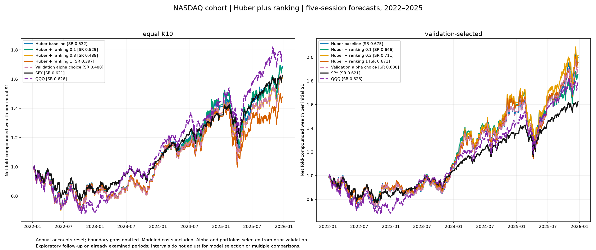
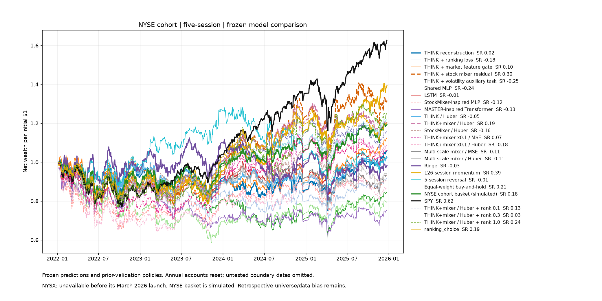

# THINK+mixer: Huber plus ranking follow-up

> Historical scope: the earlier Huber-plus-ranking cohort follow-up. The separate October 24 AH/PM MSE/Huber/pseudo-Huber and optimizer test is summarized in the [master charts](../charts.md). Commands below use the current root launcher for this older study.

<!-- benchmark-audit-20261010:start -->
NYSX is the passive Global X NYSE 100 ETF. It launched March 25, 2026 and has no tradable 2022–2025 history. Its index covers technology and growth companies across exchanges, not the 100 largest NYSE-listed companies. NYSX performance is unavailable here. NYSE historical charts use the simulated equal-weight cohort basket (scheduled rebalances and modeled costs), not an ETF. NASDAQ charts retain QQQ; SPY supplies broad-market context. [Issuer and inception](https://www.globalxetfs.com/funds/nysx/) and [prospectus](https://assets.globalxetfs.com/funds/documents/nysx/prospectus-regulatory/Summary-Prospectus_NYSX.pdf).

The refreshed CHARTS.md pages are the current visual record. Earlier ETF-overlay descriptions are superseded by this correction. Audited return paths and training selections remain preserved.
<!-- benchmark-audit-20261010:end -->

<!-- nyse-benchmark:start -->
**Comparison benchmark:** NYSE tables use **NYSE basket — passive benchmark** (saved `equal_universe` portfolio: equal weights across all stocks eligible at each scheduled rebalance, with modeled execution constraints and costs). Earlier tables use their original NYSE cohort; top-100 tables use the new NYSE cohort. This is a simulated portfolio, not an ETF. Nasdaq retains QQQ; SPY remains a secondary reference. A mixed-cohort “benchmark” column means NYSE basket for NYSE rows and QQQ for Nasdaq rows. Paired confidence intervals were recalculated on identical dates using 1,000 circular 20-session block resamples within each annual fold (seed 20261005). Saved model returns and selection choices are unchanged. Embedded charts retain their previous benchmark overlays; this update applies to tables.

<!-- nyse-benchmark:end -->

## Main result: validation-selected ranking weight, fixed equal K10

| Cohort | Huber net SR | Validation-chosen procedure net SR | Paired gain [95% CI] |
| --- | ---: | ---: | --- |
| NASDAQ_recent | 0.532 | 0.488 | -0.044 [-0.129, 0.053] |
| NYSE_recent | 0.089 | 0.148 | +0.059 [-0.137, 0.260] |

These are the predefined primary comparisons. Fixed-weight variants and model-specific portfolio comparisons below are secondary; their best test result must not be substituted for the validation-selected procedure. A positive estimate alone does not establish improvement.

**Conclusion:** this batch does not establish a robust advantage from adding ranking loss. Both primary gain intervals contain zero. The NASDAQ point estimate declines and the NYSE point estimate rises with fixed K10; neither is a convincing cross-cohort improvement.

The secondary NASDAQ lambda 0.3 variant reaches 0.711 net Sharpe versus Huber 0.675, SPY 0.621 and QQQ 0.626. Its paired gain over Huber is +0.037 with 95% CI [-0.178, 0.252]. This same loss produces only 0.488 versus Huber 0.532 at equal K10. Its turnover falls from 5.21x to 3.93x/year with its selected portfolio, while RankIC and NDCG@10 slightly decline and drawdown remains about 30%. This suggests a portfolio interaction, rather than demonstrated broadly better prediction. The causal validation-chosen secondary NASDAQ procedure yields 0.638, below Huber 0.675.

For NYSE, lambda 1.0 reaches 0.239 with its selected portfolio versus Huber 0.194, but its gain interval [-0.433, 0.473] is wide; all candidates remain below the ETF point estimates. Ranking weights do not uniformly improve K or seed results. NASDAQ lambda 1.0 at equal K20 improves over Huber in all four years (pooled 0.412 vs 0.330; paired gain CI [-0.034, 0.197]), a narrower exploratory finding that still trails both ETFs and must not be used to retroactively select K20.

Completed October 8, 2026. Three ranking strengths (0.1, 0.3, 1.0) were declared before training; 72 new fits cover two cohorts, four annual folds and three seeds. Another 72 baseline fits were reused only after exact predictions, initialization architecture, preprocessing and fold verification. No further candidates were added after viewing results.

This is a five-session experiment. Previously tested daily models are unchanged. All 2022–2025 windows were already examined: this is exploratory follow-up evidence, not a fresh confirmation test.

## What changed

`Loss = 2 × Huber(delta=1 percentage point) + lambda × pairwise logistic ranking loss`. The ranking term compares stocks on the same prediction date, uses only observed eligible labels, counts each pair once and ignores return differences smaller than 0.1 percentage point. It teaches which stock outperforms which without scaling penalties by the magnitude of extreme returns. Scores use a fixed 1-percentage-point temperature. Pair losses are averaged within date, then across dates with pairs.

Architecture, initialization seeds, training data, feature scaling, correlation groups, optimizer and validation-MSE early stopping are identical. Validation MSE is retained so the controlled change is the training loss; this may not choose the best ranking epoch. Max 30 epochs, patience 6, AdamW lr 0.001/decay 0.001, batch 8, gradient clip 1, 16-session inputs. Three seeds 7/19/42 are combined as an equal-weight rank ensemble.

## Validation selection and comparisons

**Primary:** equal-weight K10 throughout, with ranking weight selected from {0,0.1,0.3,1} using current-and-prior validation scores only. Zero retains the Huber baseline. **Secondary:** the same ranking-weight selection over each model’s own prior-validation-selected portfolio. The causal selection rule is median historical validation score minus 0.25 standard deviation; each score already summarizes validation halves and seeds. No future validation year can choose an earlier test model. All individual weights are reported even when they perform poorly.

Portfolios use equal, confidence, inverse-volatility and retention-buffer rules with K5/10/20 selected only on validation. Fixed equal K5/10/20 and individual-seed results are diagnostics. Confidence weighting operates on ensemble ranks, not calibrated return magnitudes. Long-short results in the raw run remain hypothetical due to unavailable historical borrow data.

## Pooled returns and paired uncertainty

95% intervals use 1,000 matched circular 20-session block resamples separately within each annual fold (seed20261005). Absolute Sharpe intervals differ from paired Sharpe-gain intervals. Models are not retrained inside bootstrap, and no multiplicity correction is applied. Any interval crossing zero fails to establish an advantage. Annual accounts reset and boundary sessions are omitted; pooled returns are compounded folds rather than a continuous account. Sharpe uses the existing 3% annual hurdle.

### NASDAQ_recent: equal K10

| Model | Net SR | 95% SR CI | Gross SR | CAGR | Cum. return | Vol. | Max DD | Turnover/year | Win periods |
| --- | ---: | --- | ---: | ---: | ---: | ---: | ---: | ---: | ---: |
| THINK reconstruction | 0.388 | [-0.428, 1.268] | 0.534 | 9.7% | 43.2% | 23.2% | -24.2% | 38.51x | 52.3% |
| THINK + stock mixer residual | 0.293 | [-0.595, 1.250] | 0.333 | 7.4% | 32.0% | 25.1% | -30.2% | 11.72x | 53.3% |
| THINK+mixer / Huber | 0.532 | [-0.390, 1.484] | 0.563 | 14.4% | 68.2% | 26.1% | -29.5% | 9.68x | 57.9% |
| THINK+mixer / Huber+ranking (lambda 0.1) | 0.529 | [-0.399, 1.482] | 0.558 | 14.3% | 67.6% | 25.9% | -30.0% | 8.79x | 57.9% |
| THINK+mixer / Huber+ranking (lambda 0.3) | 0.488 | [-0.435, 1.426] | 0.516 | 13.0% | 60.7% | 25.9% | -30.3% | 8.55x | 57.9% |
| THINK+mixer / Huber+ranking (lambda 1.0) | 0.397 | [-0.496, 1.354] | 0.428 | 10.5% | 47.4% | 26.8% | -30.7% | 9.69x | 55.4% |
| Validation choice of ranking weight | 0.488 | [-0.435, 1.427] | 0.516 | 13.0% | 60.7% | 25.9% | -30.3% | 8.54x | 57.9% |
| SPY | 0.621 | [-0.215, 1.542] | 0.629 | 13.4% | 62.7% | 18.1% | -23.4% | 2.07x | 62.1% |
| QQQ | 0.626 | [-0.234, 1.524] | 0.632 | 16.2% | 78.8% | 23.8% | -32.4% | 2.07x | 60.5% |

| Model | ΔSR vs Huber [95% CI] | ΔSR vs SPY [95% CI] | ΔSR vs QQQ [95% CI] | Years beating Huber |
| --- | --- | --- | --- | ---: |
| THINK+mixer / Huber+ranking (lambda 0.1) | -0.002 [-0.104, 0.098] | -0.092 [-0.435, 0.276] | -0.096 [-0.519, 0.365] | 2/4 |
| THINK+mixer / Huber+ranking (lambda 0.3) | -0.044 [-0.128, 0.055] | -0.133 [-0.471, 0.247] | -0.138 [-0.573, 0.325] | 1/4 |
| THINK+mixer / Huber+ranking (lambda 1.0) | -0.135 [-0.269, 0.011] | -0.224 [-0.603, 0.174] | -0.229 [-0.671, 0.271] | 0/4 |
| Validation choice of ranking weight | -0.044 [-0.129, 0.053] | -0.133 [-0.470, 0.247] | -0.138 [-0.574, 0.325] | 1/4 |
### NASDAQ_recent: validation-selected

| Model | Net SR | 95% SR CI | Gross SR | CAGR | Cum. return | Vol. | Max DD | Turnover/year | Win periods |
| --- | ---: | --- | ---: | ---: | ---: | ---: | ---: | ---: | ---: |
| THINK reconstruction | 0.265 | [-0.532, 1.167] | 0.372 | 6.6% | 28.0% | 22.1% | -24.1% | 27.77x | 51.8% |
| THINK + stock mixer residual | 0.356 | [-0.564, 1.299] | 0.386 | 9.0% | 39.6% | 24.0% | -25.8% | 8.67x | 54.4% |
| THINK+mixer / Huber | 0.675 | [-0.264, 1.652] | 0.690 | 19.5% | 99.5% | 27.8% | -30.0% | 5.21x | 56.4% |
| THINK+mixer / Huber+ranking (lambda 0.1) | 0.646 | [-0.285, 1.604] | 0.667 | 17.2% | 85.1% | 24.8% | -28.8% | 6.51x | 55.9% |
| THINK+mixer / Huber+ranking (lambda 0.3) | 0.711 | [-0.191, 1.702] | 0.723 | 19.9% | 101.5% | 26.1% | -30.0% | 3.93x | 55.4% |
| THINK+mixer / Huber+ranking (lambda 1.0) | 0.671 | [-0.256, 1.637] | 0.685 | 18.9% | 95.6% | 26.8% | -32.8% | 4.50x | 54.9% |
| Validation choice of ranking weight | 0.638 | [-0.279, 1.633] | 0.653 | 18.3% | 91.6% | 27.7% | -30.0% | 4.87x | 56.4% |
| SPY | 0.621 | [-0.215, 1.542] | 0.629 | 13.4% | 62.7% | 18.1% | -23.4% | 2.07x | 62.1% |
| QQQ | 0.626 | [-0.234, 1.524] | 0.632 | 16.2% | 78.8% | 23.8% | -32.4% | 2.07x | 60.5% |

| Model | ΔSR vs Huber [95% CI] | ΔSR vs SPY [95% CI] | ΔSR vs QQQ [95% CI] | Years beating Huber |
| --- | --- | --- | --- | ---: |
| THINK+mixer / Huber+ranking (lambda 0.1) | -0.029 [-0.243, 0.195] | +0.024 [-0.380, 0.489] | +0.020 [-0.497, 0.559] | 1/4 |
| THINK+mixer / Huber+ranking (lambda 0.3) | +0.037 [-0.178, 0.252] | +0.090 [-0.336, 0.562] | +0.085 [-0.391, 0.601] | 2/4 |
| THINK+mixer / Huber+ranking (lambda 1.0) | -0.003 [-0.240, 0.238] | +0.050 [-0.385, 0.531] | +0.045 [-0.464, 0.592] | 1/4 |
| Validation choice of ranking weight | -0.037 [-0.138, 0.062] | +0.017 [-0.416, 0.468] | +0.012 [-0.507, 0.529] | 0/4 |




### NYSE_recent: equal K10

| Model | Net SR | 95% SR CI | Gross SR | CAGR | Cum. return | Vol. | Max DD | Turnover/year | Win periods |
| --- | ---: | --- | ---: | ---: | ---: | ---: | ---: | ---: | ---: |
| THINK reconstruction | -0.121 | [-1.090, 0.865] | 0.020 | -1.8% | -6.7% | 21.0% | -38.0% | 34.59x | 48.7% |
| THINK + stock mixer residual | 0.170 | [-0.699, 1.067] | 0.216 | 4.4% | 17.9% | 22.5% | -27.0% | 12.38x | 58.5% |
| THINK+mixer / Huber | 0.089 | [-0.907, 1.059] | 0.130 | 2.6% | 10.3% | 21.7% | -25.2% | 10.84x | 54.4% |
| THINK+mixer / Huber+ranking (lambda 0.1) | 0.154 | [-0.755, 1.059] | 0.199 | 4.0% | 16.5% | 21.7% | -23.6% | 11.74x | 53.8% |
| THINK+mixer / Huber+ranking (lambda 0.3) | 0.109 | [-0.845, 1.051] | 0.165 | 3.0% | 12.2% | 21.7% | -25.3% | 14.53x | 51.8% |
| THINK+mixer / Huber+ranking (lambda 1.0) | 0.101 | [-0.859, 1.067] | 0.159 | 2.8% | 11.2% | 22.2% | -26.8% | 15.69x | 52.8% |
| Validation choice of ranking weight | 0.148 | [-0.781, 1.098] | 0.200 | 3.9% | 15.8% | 22.2% | -25.7% | 13.84x | 53.8% |
| SPY | 0.621 | [-0.215, 1.542] | 0.629 | 13.4% | 62.7% | 18.1% | -23.4% | 2.07x | 62.1% |
| NYSE basket — passive benchmark | 0.179 | [-0.720, 1.082] | 0.196 | 4.7% | 19.3% | 18.4% | -19.9% | 4.10x | 55.9% |

| Model | ΔSR vs Huber [95% CI] | ΔSR vs SPY [95% CI] | ΔSR vs NYSE basket [95% CI] | Years beating Huber |
| --- | --- | --- | --- | ---: |
| THINK+mixer / Huber+ranking (lambda 0.1) | +0.065 [-0.141, 0.259] | -0.467 [-1.019, 0.094] | -0.025 [-0.377, 0.327] | 1/4 |
| THINK+mixer / Huber+ranking (lambda 0.3) | +0.021 [-0.209, 0.228] | -0.512 [-1.141, 0.088] | -0.069 [-0.479, 0.306] | 2/4 |
| THINK+mixer / Huber+ranking (lambda 1.0) | +0.012 [-0.198, 0.207] | -0.520 [-1.150, 0.032] | -0.078 [-0.504, 0.294] | 1/4 |
| Validation choice of ranking weight | +0.059 [-0.137, 0.260] | -0.473 [-1.072, 0.097] | -0.031 [-0.404, 0.327] | 1/4 |
### NYSE_recent: validation-selected

| Model | Net SR | 95% SR CI | Gross SR | CAGR | Cum. return | Vol. | Max DD | Turnover/year | Win periods |
| --- | ---: | --- | ---: | ---: | ---: | ---: | ---: | ---: | ---: |
| THINK reconstruction | 0.017 | [-0.974, 0.972] | 0.127 | 1.5% | 5.9% | 19.0% | -25.8% | 24.50x | 54.9% |
| THINK + stock mixer residual | 0.301 | [-0.640, 1.181] | 0.341 | 7.4% | 31.6% | 21.4% | -22.4% | 10.25x | 55.9% |
| THINK+mixer / Huber | 0.194 | [-0.716, 1.151] | 0.218 | 5.0% | 20.6% | 18.2% | -20.7% | 5.38x | 57.4% |
| THINK+mixer / Huber+ranking (lambda 0.1) | 0.135 | [-0.798, 1.107] | 0.161 | 3.8% | 15.6% | 18.6% | -21.5% | 5.97x | 55.4% |
| THINK+mixer / Huber+ranking (lambda 0.3) | 0.032 | [-0.847, 0.925] | 0.072 | 1.6% | 6.1% | 20.4% | -29.9% | 10.04x | 54.4% |
| THINK+mixer / Huber+ranking (lambda 1.0) | 0.239 | [-0.662, 1.120] | 0.270 | 6.0% | 25.1% | 21.7% | -24.3% | 8.34x | 53.3% |
| Validation choice of ranking weight | 0.189 | [-0.767, 1.131] | 0.213 | 4.9% | 20.2% | 18.9% | -21.0% | 5.59x | 55.9% |
| SPY | 0.621 | [-0.215, 1.542] | 0.629 | 13.4% | 62.7% | 18.1% | -23.4% | 2.07x | 62.1% |
| NYSE basket — passive benchmark | 0.179 | [-0.720, 1.082] | 0.196 | 4.7% | 19.3% | 18.4% | -19.9% | 4.10x | 55.9% |

| Model | ΔSR vs Huber [95% CI] | ΔSR vs SPY [95% CI] | ΔSR vs NYSE basket [95% CI] | Years beating Huber |
| --- | --- | --- | --- | ---: |
| THINK+mixer / Huber+ranking (lambda 0.1) | -0.059 [-0.184, 0.064] | -0.486 [-1.020, 0.038] | -0.044 [-0.378, 0.269] | 2/4 |
| THINK+mixer / Huber+ranking (lambda 0.3) | -0.162 [-0.471, 0.117] | -0.589 [-1.182, -0.025] | -0.146 [-0.548, 0.234] | 1/4 |
| THINK+mixer / Huber+ranking (lambda 1.0) | +0.045 [-0.433, 0.473] | -0.382 [-1.042, 0.249] | +0.060 [-0.459, 0.556] | 1/4 |
| Validation choice of ranking weight | -0.005 [-0.232, 0.218] | -0.432 [-1.010, 0.117] | +0.011 [-0.382, 0.370] | 2/4 |




## Full-universe ranking metrics

These metrics compare ensemble scores with actual subsequent returns across all eligible securities with observed outcomes, rather than only selected holdings. NDCG uses realized-return percentile relevance with nonnegative linear gains. ICIR and RankICIR are period mean/std, unannualized.

| Cohort | Model | IC | RankIC | ICIR | RankICIR | NDCG@5 | NDCG@10 | NDCG@20 |
| --- | --- | ---: | ---: | ---: | ---: | ---: | ---: | ---: |
| NASDAQ_recent | THINK + stock mixer residual | 0.005 | -0.000 | 0.027 | -0.001 | 0.525 | 0.537 | 0.579 |
| NASDAQ_recent | THINK+mixer / Huber | 0.012 | 0.011 | 0.064 | 0.059 | 0.529 | 0.547 | 0.585 |
| NASDAQ_recent | THINK+mixer / Huber+ranking (lambda 0.1) | 0.012 | 0.011 | 0.064 | 0.060 | 0.531 | 0.547 | 0.584 |
| NASDAQ_recent | THINK+mixer / Huber+ranking (lambda 0.3) | 0.012 | 0.011 | 0.065 | 0.057 | 0.531 | 0.546 | 0.585 |
| NASDAQ_recent | THINK+mixer / Huber+ranking (lambda 1.0) | 0.011 | 0.009 | 0.056 | 0.048 | 0.530 | 0.542 | 0.585 |
| NASDAQ_recent | Validation choice of ranking weight | 0.012 | 0.011 | 0.064 | 0.056 | 0.531 | 0.545 | 0.585 |
| NYSE_recent | THINK + stock mixer residual | 0.012 | 0.021 | 0.070 | 0.125 | 0.514 | 0.533 | 0.576 |
| NYSE_recent | THINK+mixer / Huber | 0.010 | 0.017 | 0.057 | 0.099 | 0.516 | 0.534 | 0.575 |
| NYSE_recent | THINK+mixer / Huber+ranking (lambda 0.1) | 0.006 | 0.013 | 0.036 | 0.072 | 0.511 | 0.532 | 0.571 |
| NYSE_recent | THINK+mixer / Huber+ranking (lambda 0.3) | 0.008 | 0.015 | 0.043 | 0.084 | 0.517 | 0.534 | 0.575 |
| NYSE_recent | THINK+mixer / Huber+ranking (lambda 1.0) | 0.009 | 0.016 | 0.051 | 0.095 | 0.514 | 0.532 | 0.573 |
| NYSE_recent | Validation choice of ranking weight | 0.008 | 0.015 | 0.047 | 0.086 | 0.514 | 0.532 | 0.572 |

## Annual stability and selected weights

Annual results for every candidate are shown before the validation-selected procedure. A strong pooled result can conceal weak individual years.

### NASDAQ_recent: equal K10 annual net Sharpe

| Model | 2022 | 2023 | 2024 | 2025 |
| --- | ---: | ---: | ---: | ---: |
| THINK+mixer / Huber | -0.570 | 1.198 | 1.593 | 0.664 |
| THINK+mixer / Huber+ranking (lambda 0.1) | -0.595 | 1.225 | 1.676 | 0.624 |
| THINK+mixer / Huber+ranking (lambda 0.3) | -0.604 | 1.226 | 1.483 | 0.624 |
| THINK+mixer / Huber+ranking (lambda 1.0) | -0.579 | 1.168 | 1.298 | 0.369 |
| Validation choice of ranking weight | -0.604 | 1.225 | 1.483 | 0.624 |
| SPY | -0.853 | 1.738 | 1.987 | 0.926 |
| QQQ | -1.153 | 2.559 | 1.616 | 0.922 |

### NASDAQ_recent: validation-selected annual net Sharpe

| Model | 2022 | 2023 | 2024 | 2025 |
| --- | ---: | ---: | ---: | ---: |
| THINK+mixer / Huber | -0.363 | 1.087 | 1.655 | 0.911 |
| THINK+mixer / Huber+ranking (lambda 0.1) | -0.516 | 1.225 | 1.655 | 0.563 |
| THINK+mixer / Huber+ranking (lambda 0.3) | -0.542 | 1.107 | 1.666 | 0.783 |
| THINK+mixer / Huber+ranking (lambda 1.0) | -0.443 | 1.131 | 1.484 | 0.743 |
| Validation choice of ranking weight | -0.363 | 1.087 | 1.655 | 0.783 |
| SPY | -0.853 | 1.738 | 1.987 | 0.926 |
| QQQ | -1.153 | 2.559 | 1.616 | 0.922 |

### NYSE_recent: equal K10 annual net Sharpe

| Model | 2022 | 2023 | 2024 | 2025 |
| --- | ---: | ---: | ---: | ---: |
| THINK+mixer / Huber | -0.789 | 0.991 | 0.470 | 0.054 |
| THINK+mixer / Huber+ranking (lambda 0.1) | -0.831 | 0.991 | 0.817 | 0.039 |
| THINK+mixer / Huber+ranking (lambda 0.3) | -0.876 | 0.991 | 0.602 | 0.105 |
| THINK+mixer / Huber+ranking (lambda 1.0) | -0.963 | 0.991 | 0.858 | 0.028 |
| Validation choice of ranking weight | -0.831 | 0.991 | 0.817 | 0.028 |
| SPY | -0.853 | 1.738 | 1.987 | 0.926 |
| NYSE basket — passive benchmark | -0.599 | 0.704 | 0.350 | 0.600 |

### NYSE_recent: validation-selected annual net Sharpe

| Model | 2022 | 2023 | 2024 | 2025 |
| --- | ---: | ---: | ---: | ---: |
| THINK+mixer / Huber | -0.824 | 1.012 | 1.167 | -0.092 |
| THINK+mixer / Huber+ranking (lambda 0.1) | -0.722 | 1.012 | 0.617 | -0.040 |
| THINK+mixer / Huber+ranking (lambda 0.3) | -1.021 | 0.907 | 0.921 | -0.049 |
| THINK+mixer / Huber+ranking (lambda 1.0) | -0.832 | 0.907 | 0.728 | 0.384 |
| Validation choice of ranking weight | -0.722 | 0.907 | 0.921 | -0.040 |
| SPY | -0.853 | 1.738 | 1.987 | 0.926 |
| NYSE basket — passive benchmark | -0.599 | 0.704 | 0.350 | 0.600 |

| Cohort | Portfolio rule | Test year | Validation-chosen weight | Net SR | Huber SR | SPY SR | Benchmark SR |
| --- | --- | ---: | ---: | ---: | ---: | ---: | ---: |
| NASDAQ_recent | validation-selected | 2022 | 0 | -0.363 | -0.363 | -0.853 | -1.153 |
| NASDAQ_recent | equal K10 | 2022 | 0.3 | -0.604 | -0.570 | -0.853 | -1.153 |
| NASDAQ_recent | validation-selected | 2023 | 0 | 1.087 | 1.087 | 1.738 | 2.559 |
| NASDAQ_recent | equal K10 | 2023 | 0.1 | 1.225 | 1.198 | 1.738 | 2.559 |
| NASDAQ_recent | validation-selected | 2024 | 0 | 1.655 | 1.655 | 1.987 | 1.616 |
| NASDAQ_recent | equal K10 | 2024 | 0.3 | 1.483 | 1.593 | 1.987 | 1.616 |
| NASDAQ_recent | validation-selected | 2025 | 0.3 | 0.783 | 0.911 | 0.926 | 0.922 |
| NASDAQ_recent | equal K10 | 2025 | 0.3 | 0.624 | 0.664 | 0.926 | 0.922 |
| NYSE_recent | validation-selected | 2022 | 0.1 | -0.722 | -0.824 | -0.853 | -0.599 |
| NYSE_recent | equal K10 | 2022 | 0.1 | -0.831 | -0.789 | -0.853 | -0.599 |
| NYSE_recent | validation-selected | 2023 | 1 | 0.907 | 1.012 | 1.738 | 0.704 |
| NYSE_recent | equal K10 | 2023 | 0.1 | 0.991 | 0.991 | 1.738 | 0.704 |
| NYSE_recent | validation-selected | 2024 | 0.3 | 0.921 | 1.167 | 1.987 | 0.350 |
| NYSE_recent | equal K10 | 2024 | 0.1 | 0.817 | 0.470 | 1.987 | 0.350 |
| NYSE_recent | validation-selected | 2025 | 0.1 | -0.040 | -0.092 | 0.926 | 0.600 |
| NYSE_recent | equal K10 | 2025 | 1 | 0.028 | 0.054 | 0.926 | 0.600 |

## K sensitivity and individual seeds

| Cohort | Model | K | Pooled net SR | ΔSR vs Huber at same K [95% CI] | Years improving |
| --- | --- | ---: | ---: | ---: | ---: |
| NASDAQ_recent | THINK+mixer / Huber | 5 | 0.452 | +0.000 [0.000, 0.000] | 0/4 |
| NASDAQ_recent | THINK+mixer / Huber | 10 | 0.532 | +0.000 [0.000, 0.000] | 0/4 |
| NASDAQ_recent | THINK+mixer / Huber | 20 | 0.330 | +0.000 [0.000, 0.000] | 0/4 |
| NASDAQ_recent | THINK+mixer / Huber+ranking (lambda 0.1) | 5 | 0.466 | +0.014 [-0.080, 0.116] | 2/4 |
| NASDAQ_recent | THINK+mixer / Huber+ranking (lambda 0.1) | 10 | 0.529 | -0.002 [-0.104, 0.098] | 2/4 |
| NASDAQ_recent | THINK+mixer / Huber+ranking (lambda 0.1) | 20 | 0.299 | -0.031 [-0.078, 0.016] | 1/4 |
| NASDAQ_recent | THINK+mixer / Huber+ranking (lambda 0.3) | 5 | 0.497 | +0.045 [-0.094, 0.188] | 3/4 |
| NASDAQ_recent | THINK+mixer / Huber+ranking (lambda 0.3) | 10 | 0.488 | -0.044 [-0.128, 0.055] | 1/4 |
| NASDAQ_recent | THINK+mixer / Huber+ranking (lambda 0.3) | 20 | 0.328 | -0.002 [-0.076, 0.069] | 3/4 |
| NASDAQ_recent | THINK+mixer / Huber+ranking (lambda 1.0) | 5 | 0.452 | +0.001 [-0.177, 0.198] | 2/4 |
| NASDAQ_recent | THINK+mixer / Huber+ranking (lambda 1.0) | 10 | 0.397 | -0.135 [-0.269, 0.011] | 0/4 |
| NASDAQ_recent | THINK+mixer / Huber+ranking (lambda 1.0) | 20 | 0.412 | +0.082 [-0.034, 0.197] | 4/4 |
| NYSE_recent | THINK+mixer / Huber | 5 | 0.004 | +0.000 [0.000, 0.000] | 0/4 |
| NYSE_recent | THINK+mixer / Huber | 10 | 0.089 | +0.000 [0.000, 0.000] | 0/4 |
| NYSE_recent | THINK+mixer / Huber | 20 | 0.199 | +0.000 [0.000, 0.000] | 0/4 |
| NYSE_recent | THINK+mixer / Huber+ranking (lambda 0.1) | 5 | -0.115 | -0.120 [-0.453, 0.184] | 1/4 |
| NYSE_recent | THINK+mixer / Huber+ranking (lambda 0.1) | 10 | 0.154 | +0.065 [-0.141, 0.259] | 1/4 |
| NYSE_recent | THINK+mixer / Huber+ranking (lambda 0.1) | 20 | 0.062 | -0.137 [-0.272, -0.027] | 2/4 |
| NYSE_recent | THINK+mixer / Huber+ranking (lambda 0.3) | 5 | -0.132 | -0.137 [-0.495, 0.195] | 0/4 |
| NYSE_recent | THINK+mixer / Huber+ranking (lambda 0.3) | 10 | 0.109 | +0.021 [-0.209, 0.228] | 2/4 |
| NYSE_recent | THINK+mixer / Huber+ranking (lambda 0.3) | 20 | 0.103 | -0.096 [-0.212, 0.008] | 2/4 |
| NYSE_recent | THINK+mixer / Huber+ranking (lambda 1.0) | 5 | 0.227 | +0.223 [-0.241, 0.692] | 2/4 |
| NYSE_recent | THINK+mixer / Huber+ranking (lambda 1.0) | 10 | 0.101 | +0.012 [-0.198, 0.207] | 1/4 |
| NYSE_recent | THINK+mixer / Huber+ranking (lambda 1.0) | 20 | 0.090 | -0.109 [-0.246, 0.005] | 0/4 |

| Cohort | Model | Median seed/year SR | Worst seed/year SR | Seed/year cases beating Huber |
| --- | --- | ---: | ---: | ---: |
| NASDAQ_recent | THINK+mixer / Huber | 0.640 | -0.772 | 0/12 |
| NASDAQ_recent | THINK+mixer / Huber+ranking (lambda 0.1) | 0.534 | -0.600 | 6/12 |
| NASDAQ_recent | THINK+mixer / Huber+ranking (lambda 0.3) | 0.459 | -0.600 | 7/12 |
| NASDAQ_recent | THINK+mixer / Huber+ranking (lambda 1.0) | 0.823 | -0.603 | 8/12 |
| NYSE_recent | THINK+mixer / Huber | 0.430 | -0.906 | 0/12 |
| NYSE_recent | THINK+mixer / Huber+ranking (lambda 0.1) | 0.492 | -0.951 | 3/12 |
| NYSE_recent | THINK+mixer / Huber+ranking (lambda 0.3) | 0.305 | -1.207 | 4/12 |
| NYSE_recent | THINK+mixer / Huber+ranking (lambda 1.0) | 0.406 | -1.128 | 6/12 |

Seed diagnostics use each model’s validation-selected policy, so differences include portfolio-policy changes. The fixed-K comparisons above provide the cleaner loss ablation.


## Training chronology, execution and limits

| Test year | Training signals | Validation signals | Last training outcome | Last validation outcome |
| --- | --- | --- | --- | --- |
| 2022 | 2019-01-15 to 2020-12-16 | 2021-01-08 to 2021-12-21 | 2020-12-24 | 2021-12-30 |
| 2023 | 2019-01-15 to 2021-12-21 | 2022-01-05 to 2022-12-19 | 2021-12-30 | 2022-12-28 |
| 2024 | 2019-01-15 to 2022-12-19 | 2023-01-04 to 2023-12-18 | 2022-12-28 | 2023-12-27 |
| 2025 | 2020-01-06 to 2023-12-18 | 2024-01-03 to 2024-12-16 | 2023-12-27 | 2024-12-24 |

All eight folds passed reconstructed-index/scaler checks, label maturity purges, and future-price/volume/benchmark perturbation checks for earlier features, eligibility, ADV, labels and relationships. All 24 tests passed, including masking, date-local pairs, loss gradients and identical initialization. The raw frozen data hashes and training-code snapshot were verified.

Execution and costs are unchanged: signal after close, fill next close, five-session holding, $1m starting NAV, signal-time ADV >=$1m, trades capped at 1% lagged ADV, 2bp commission +5bp slippage +3bp square-root impact at 1% participation, per side. Annual liquidation uses the existing uncapped terminal-cost approximation. Gross paths retain matched holdings; cash earns zero. Fixed historical cohorts include funds and preferred shares. Turnover is two-sided absolute traded notional divided by NAV, annualized. Missing delisted histories, later vendor adjustments and repeated test inspection limit generalization.

## Reproduction and complete tables

```powershell
.\.venv\Scripts\python.exe -m hypershift test -v test_research test_robust_research test_huber_ranking
.\.venv\Scripts\python.exe -m hypershift run run_robust_research --out runs/huber_ranking_2022_2025 --experiment-plan config/huber_ranking_experiment_plan.json --reuse-fits-from runs/robust_2022_2025_final --variants think_mix_huber think_mix think think_mix_huber_rank_01 think_mix_huber_rank_03 think_mix_huber_rank_10 --workers 3
.\.venv\Scripts\python.exe -m hypershift run report_huber_ranking
.\.venv\Scripts\python.exe -m hypershift run publish_research_docs
```

Use a fresh output directory to retrain; completed runs are immutable. This reporting script reads the named completed run.

- [Pooled metrics and all confidence intervals](huber_ranking_pooled.csv)
- [Annual metrics](huber_ranking_annual.csv)
- [Dated daily returns and curves](huber_ranking_curves.csv)
- [Validation-selected weights and portfolios](huber_ranking_selections.csv)
- [Fixed equal K5/10/20 sensitivity](huber_ranking_k_sensitivity.csv)
- [Pooled K sensitivity](huber_ranking_k_pooled.csv)
- [All individual seed metrics](huber_ranking_seed_metrics.csv)
- [Seed stability summary](huber_ranking_seed_summary.csv)
- [Transaction-cost stress](huber_ranking_cost_stress.csv)
- [Fold chronology](huber_ranking_chronology.csv)
- [Frozen plan](../config/huber_ranking_experiment_plan.json)
- [Run, checkpoints, prediction arrays and audits](../runs/huber_ranking_2022_2025/PROTOCOL.json)
