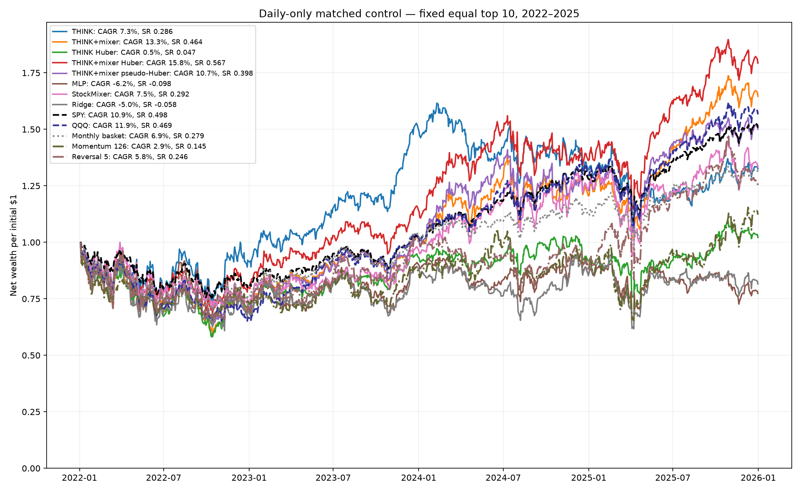
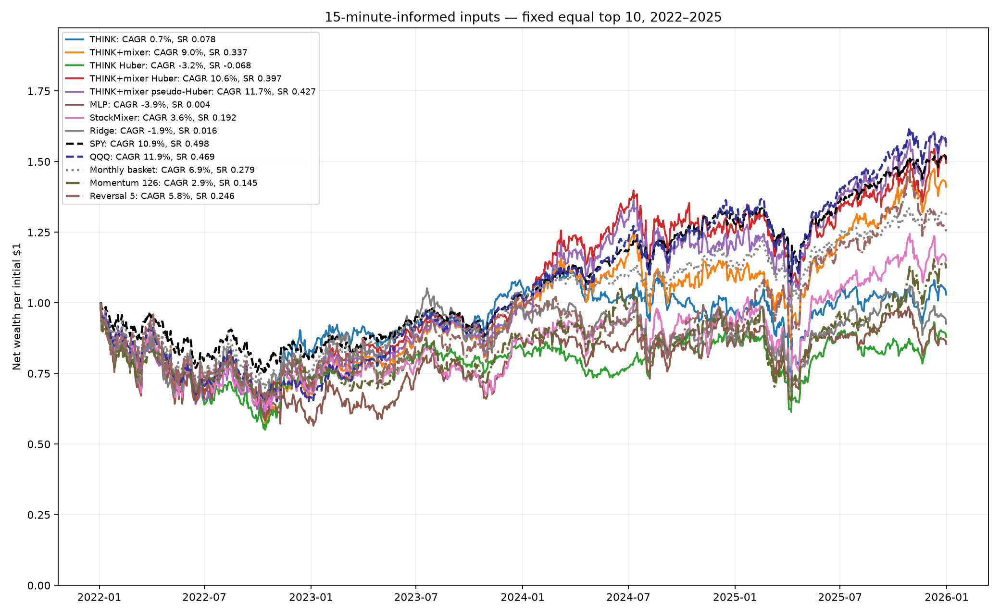
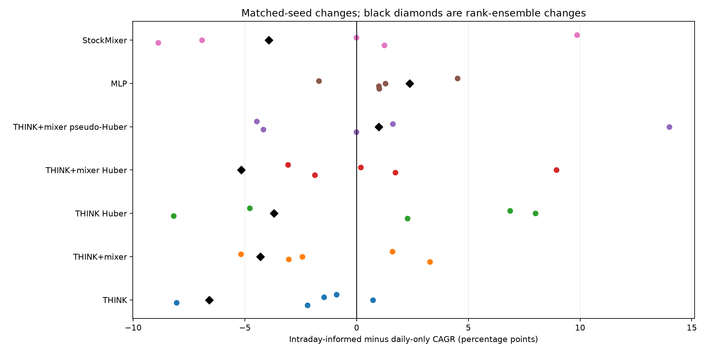
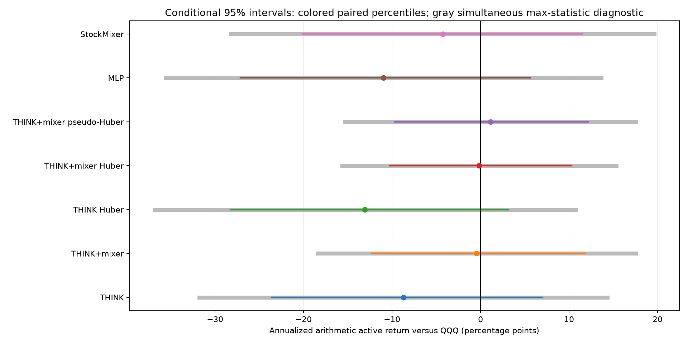

# NASDAQ-100: Alpaca 15-minute-informed model comparison

**Complete: 280 neural fits, eight ridge fits, 241 continuous portfolios; independent audit passed.**

The download contains **10,839,262 15-minute SIP bars** in 1,288 symbol/year chunks, covering 2018–2025. The regular-session review found **99.81% complete sessions** across historical member/tradable days.

The identity review quarantined **865 source sessions** outside verified issuer/ticker validity dates. In particular, META referred to a Roundhill ETF before Facebook adopted that ticker on June 9, 2022. FB and META histories are joined only within their verified date windows; the other rename chains have explicit boundaries too. Rejected records remain in the raw download and in rejected_symbol_sessions.csv, and never enter model features. [Meta SEC announcement](https://www.sec.gov/Archives/edgar/data/1326801/000132680122000070/may312022-exhibit991.htm) and [Roundhill issuer record](https://www.roundhillinvestments.com/etf/metv/) support this correction.

Intraday-informed inputs improve ensemble CAGR for **2/7** neural variants relative to matched daily controls. The highest observed primary neural intraday CAGR belongs to **THINK+mixer pseudo-Huber**, with 11.7% CAGR, 0.427 Sharpe and -38.9% maximum drawdown. This is a descriptive leader on inspected dates, not an independently selected future strategy.

QQQ: 11.9% CAGR, 0.469 Sharpe, -34.9% drawdown. SPY: 10.9% CAGR, 0.498 Sharpe, -24.6% drawdown.

0/14 augmented-versus-ETF contrasts have a positive lower bound in the declared 21-comparison, 20-session max-statistic diagnostic. These conditional intervals do not account for the prior research search or training uncertainty, and the inspected years remain exploratory.

## What was tested

Monthly historical NASDAQ-100 eligibility is unchanged: 100 companies can produce 101–104 included share classes per month, with 156 stable security IDs across the full panel. Models still forecast five-session returns and use next-close execution. This is a test of information derived from 15-minute bars; it is **not** a 15-minute trading strategy or a replacement of the reviewed daily economic return labels.

Both input views use 13-feature models with identical starting parameters for matched model/seed pairs. Daily controls retain the five daily features and pad intraday channels. Augmented inputs add seven regular-session summaries plus observed coverage: session return/range, within-bar realized volatility, first/last-hour returns, last-hour volume share, and close-to-VWAP distance. Both views use 16-session windows, prior-year validation-MSE stopping, and five seeds. They are new capacity-matched controls, not exact reruns of the old five-feature checkpoints.

| Test year | Training: first signal → last label | Validation: first signal → last label | Train / validation / test origins |
| --- | --- | --- | --- |
| 2022 | 2019-07-03 → 2020-12-29 | 2021-01-05 → 2021-12-27 | 75 / 49 / 51 |
| 2023 | 2019-07-03 → 2021-12-27 | 2022-01-07 → 2022-12-30 | 125 / 49 / 50 |
| 2024 | 2019-07-03 → 2022-12-30 | 2023-01-06 → 2023-12-29 | 176 / 49 / 50 |
| 2025 | 2020-01-08 → 2023-12-29 | 2024-01-05 → 2024-12-27 | 200 / 49 / 50 |

Earlier 2018 data supplies warmup. Outcomes crossing split boundaries are purged. There are 200 complete five-session test periods plus one final partial holding period, which is valued and liquidated but excluded from forecast-error/ranking labels.

Every account starts with $1 million and carries cash and holdings continuously across model years. Base per-trade costs are 7 basis points plus 3 basis points times the square root of participation divided by 1%; normal orders are capped at 1% of lagged 20-session average dollar volume. The cost multipliers scale both terms. ETF controls buy at the same initial close and liquidate at the common terminal close with the same cost formula. No interest is credited to cash.

Calendar opens/closes include early closes. A bar is usable only at its end. Incomplete sessions have missing numeric intraday features, imputed with training-only means; their observed coverage remains a feature. No historical member is removed for missing Alpaca data. Corporate-action settlement and portfolio returns retain the reviewed daily engine.

Coverage is not uniform. The lowest completeness security/year slices are disclosed below; these securities retain the same daily eligibility and labels, with explicit missing intraday features on incomplete days. The missing bar inventory alone does not identify its market-data cause.

| Year | Security | Member/tradable sessions | Complete sessions | Complete fraction |
| --- | --- | --- | --- | --- |
| 2025 | BKNG | 250 | 151 | 60.4% |
| 2024 | BKNG | 252 | 185 | 73.4% |
| 2023 | FISV | 124 | 107 | 86.3% |
| 2024 | ANSS | 252 | 239 | 94.8% |
| 2024 | MELI | 252 | 239 | 94.8% |
| 2023 | BKNG | 250 | 240 | 96.0% |
| 2025 | MELI | 250 | 240 | 96.0% |
| 2024 | ORLY | 252 | 242 | 96.0% |

## Primary matched comparison

| Model | Daily CAGR | Intraday CAGR | CAGR change | Intraday Sharpe | Intraday drawdown | Return-forecast MSE (pp²) |
| --- | --- | --- | --- | --- | --- | --- |
| THINK | 7.3% | 0.7% | -6.60 pp | 0.078 | -37.3% | 29.386 → 29.308 |
| THINK+mixer | 13.3% | 9.0% | -4.31 pp | 0.337 | -43.0% | 28.932 → 28.903 |
| THINK Huber | 0.5% | -3.2% | -3.71 pp | -0.068 | -44.9% | 29.277 → 29.274 |
| THINK+mixer Huber | 15.8% | 10.6% | -5.16 pp | 0.397 | -36.1% | 28.910 → 28.902 |
| THINK+mixer pseudo-Huber | 10.7% | 11.7% | +0.99 pp | 0.427 | -38.9% | 28.904 → 28.906 |
| MLP | -6.2% | -3.9% | +2.37 pp | 0.004 | -43.5% | 29.093 → 28.981 |
| StockMixer | 7.5% | 3.6% | -3.94 pp | 0.192 | -38.4% | 28.876 → 28.857 |
| Ridge | -5.0% | -1.9% | +3.08 pp | 0.016 | -35.0% | 30.324 → 32.474 |

MSE uses the mean of the five neural return forecasts; Ridge uses its single shared return forecast. Neural portfolio scores instead average eligible-stock ranks. A smaller MSE therefore need not imply better portfolio returns. CAGR changes are differences of standalone CAGRs, unlike the arithmetic active-return means in the interval tables.

## Annual and monthly consistency

| Intraday model / control | 2022 | 2023 | 2024 | 2025 |
| --- | --- | --- | --- | --- |
| THINK | -16.9% | 28.0% | -9.7% | 7.1% |
| THINK+mixer | -31.9% | 46.3% | 8.2% | 30.9% |
| THINK Huber | -29.1% | 19.1% | 0.7% | 3.4% |
| THINK+mixer Huber | -28.1% | 42.8% | 21.5% | 19.9% |
| THINK+mixer pseudo-Huber | -30.1% | 41.5% | 20.0% | 31.1% |
| MLP | -40.2% | 45.8% | -3.2% | 1.3% |
| StockMixer | -29.2% | 24.0% | 4.4% | 25.4% |
| Ridge | -25.4% | 31.3% | -12.1% | 7.7% |
| Monthly basket | -23.8% | 36.3% | 7.8% | 16.5% |
| Momentum 126 | -26.2% | 19.9% | 0.4% | 26.4% |
| Reversal 5 | -28.1% | 41.0% | -13.0% | 41.9% |
| SPY | -18.7% | 26.2% | 24.9% | 17.6% |
| QQQ | -33.3% | 54.9% | 25.6% | 20.7% |

Annual rows are net calendar-year returns from the continuous accounts; accounts do not reset.

| Intraday model | Months above QQQ | Months above SPY | Monthly QQQ excess SD |
| --- | --- | --- | --- |
| THINK | 20/48 | 22/48 | 4.3% |
| THINK+mixer | 23/48 | 23/48 | 3.3% |
| THINK Huber | 18/48 | 16/48 | 4.5% |
| THINK+mixer Huber | 23/48 | 23/48 | 2.8% |
| THINK+mixer pseudo-Huber | 22/48 | 26/48 | 3.0% |
| MLP | 19/48 | 18/48 | 4.6% |
| StockMixer | 24/48 | 23/48 | 4.4% |
| Ridge | 18/48 | 19/48 | 4.9% |

## Training-seed sensitivity

| Intraday model | Minimum CAGR | Median CAGR | Maximum CAGR | Seeds above QQQ |
| --- | --- | --- | --- | --- |
| THINK | -1.9% | 1.8% | 6.9% | 0/5 |
| THINK+mixer | 0.3% | 3.6% | 13.0% | 1/5 |
| THINK Huber | -3.9% | 9.3% | 12.9% | 1/5 |
| THINK+mixer Huber | 4.1% | 7.6% | 13.2% | 1/5 |
| THINK+mixer pseudo-Huber | 2.8% | 9.7% | 10.2% | 0/5 |
| MLP | -5.3% | -4.4% | -1.2% | 0/5 |
| StockMixer | -4.5% | 5.6% | 10.0% | 0/5 |

The five seeds share the same market history. Rank ensembling creates a different portfolio, so ensemble CAGR need not equal the average seed CAGR.

## Fixed size sensitivity

Top five and top twenty are secondary fixed sensitivities. They do not change the trained forecasts. No best portfolio size is selected from this table. Cells show base-cost CAGR / Sharpe / maximum drawdown.

Daily-only controls

| Model | Top 5: CAGR / Sharpe / drawdown | Top 10 | Top 20 |
| --- | --- | --- | --- |
| THINK | 9.9% / 0.362 / -37.5% | 7.3% / 0.286 / -34.7% | 3.4% / 0.150 / -31.5% |
| THINK+mixer | 9.5% / 0.350 / -38.7% | 13.3% / 0.464 / -40.7% | 9.0% / 0.341 / -35.1% |
| THINK Huber | -2.7% / -0.053 / -47.5% | 0.5% / 0.047 / -41.9% | 7.2% / 0.284 / -31.3% |
| THINK+mixer Huber | 21.6% / 0.684 / -29.7% | 15.8% / 0.567 / -31.3% | 8.0% / 0.314 / -33.3% |
| THINK+mixer pseudo-Huber | 17.8% / 0.574 / -33.1% | 10.7% / 0.398 / -37.5% | 7.7% / 0.301 / -32.7% |
| MLP | -2.7% / 0.056 / -36.6% | -6.2% / -0.098 / -34.0% | -4.4% / -0.075 / -40.1% |
| StockMixer | -1.6% / 0.060 / -41.0% | 7.5% / 0.292 / -29.6% | 11.0% / 0.403 / -30.3% |
| Ridge | -13.7% / -0.260 / -56.5% | -5.0% / -0.058 / -39.1% | 5.1% / 0.216 / -34.4% |

Intraday-informed inputs

| Model | Top 5: CAGR / Sharpe / drawdown | Top 10 | Top 20 |
| --- | --- | --- | --- |
| THINK | -6.7% / -0.139 / -46.0% | 0.7% / 0.078 / -37.3% | 1.4% / 0.082 / -33.1% |
| THINK+mixer | 5.5% / 0.246 / -46.3% | 9.0% / 0.337 / -43.0% | 10.2% / 0.380 / -32.8% |
| THINK Huber | -5.6% / -0.138 / -46.8% | -3.2% / -0.068 / -44.9% | 0.6% / 0.044 / -41.1% |
| THINK+mixer Huber | 12.3% / 0.435 / -37.4% | 10.6% / 0.397 / -36.1% | 6.2% / 0.247 / -33.7% |
| THINK+mixer pseudo-Huber | 13.7% / 0.468 / -40.0% | 11.7% / 0.427 / -38.9% | 6.8% / 0.268 / -34.0% |
| MLP | -6.9% / -0.017 / -44.3% | -3.9% / 0.004 / -43.5% | -2.4% / 0.006 / -45.8% |
| StockMixer | 1.3% / 0.166 / -41.5% | 3.6% / 0.192 / -38.4% | 3.3% / 0.166 / -36.1% |
| Ridge | 1.9% / 0.158 / -32.9% | -1.9% / 0.016 / -35.0% | -0.5% / 0.028 / -37.7% |

## Costs and uncertainty

| Intraday model | 1× cost CAGR | 2× cost CAGR | 4× cost CAGR | Base annual traded-notional/NAV |
| --- | --- | --- | --- | --- |
| THINK | 0.7% | -4.0% | -12.7% | 65.0× |
| THINK+mixer | 9.0% | 7.6% | 4.7% | 18.4× |
| THINK Huber | -3.2% | -8.1% | -17.1% | 70.7× |
| THINK+mixer Huber | 10.6% | 9.1% | 6.0% | 19.6× |
| THINK+mixer pseudo-Huber | 11.7% | 10.1% | 6.9% | 20.3× |
| MLP | -3.9% | -8.0% | -15.8% | 60.4× |
| StockMixer | 3.6% | -0.8% | -8.9% | 58.2× |
| Ridge | -1.9% | -7.6% | -18.0% | 81.4× |

| Intraday model | QQQ beta | SPY beta | QQQ tracking error | QQQ OLS alpha/year | Unadjusted 95% HAC alpha interval |
| --- | --- | --- | --- | --- | --- |
| THINK | 1.12 | 1.45 | 15.5% | -10.02 pp | [-25.80, +5.76] pp |
| THINK+mixer | 1.19 | 1.48 | 15.0% | -2.58 pp | [-14.45, +9.29] pp |
| THINK Huber | 1.07 | 1.37 | 14.4% | -13.85 pp | [-29.84, +2.14] pp |
| THINK+mixer Huber | 1.06 | 1.32 | 11.8% | -0.78 pp | [-11.11, +9.55] pp |
| THINK+mixer pseudo-Huber | 1.09 | 1.36 | 12.5% | +0.09 pp | [-11.11, +11.28] pp |
| MLP | 1.33 | 1.67 | 22.0% | -14.66 pp | [-30.42, +1.09] pp |
| StockMixer | 1.27 | 1.60 | 20.1% | -7.32 pp | [-23.56, +8.92] pp |

Exposure regressions are supplemental single-factor descriptions, with a fixed 3% annual hurdle and 20-lag normal HAC intervals. They do not control all sector/style exposures, training uncertainty or research selection, and they are not allocation signals or additional confirmation tests.

| Intraday model | Comparison | Active mean/year | Paired 95% interval | Simultaneous diagnostic | Sharpe-difference interval |
| --- | --- | --- | --- | --- | --- |
| THINK | intraday_minus_daily | -5.89 pp | [-18.27, +6.94] pp | [-24.75, +12.97] pp | [-0.642, +0.222] |
| THINK | SPY | -6.58 pp | [-20.82, +8.06] pp | [-28.33, +15.18] pp | [-1.008, +0.100] |
| THINK | QQQ | -8.72 pp | [-23.61, +7.01] pp | [-31.78, +14.34] pp | [-1.012, +0.187] |
| THINK+mixer | intraday_minus_daily | -3.62 pp | [-9.39, +2.46] pp | [-12.32, +5.09] pp | [-0.319, +0.067] |
| THINK+mixer | SPY | +1.70 pp | [-12.69, +15.76] pp | [-19.53, +22.93] pp | [-0.618, +0.243] |
| THINK+mixer | QQQ | -0.44 pp | [-12.25, +11.87] pp | [-18.41, +17.53] pp | [-0.555, +0.268] |
| THINK Huber | intraday_minus_daily | -3.24 pp | [-17.75, +11.60] pp | [-25.13, +18.65] pp | [-0.643, +0.417] |
| THINK Huber | SPY | -10.93 pp | [-26.05, +4.57] pp | [-34.14, +12.28] pp | [-1.203, -0.009] |
| THINK Huber | QQQ | -13.08 pp | [-28.29, +3.13] pp | [-36.86, +10.71] pp | [-1.173, +0.059] |
| THINK+mixer Huber | intraday_minus_daily | -4.43 pp | [-11.70, +2.71] pp | [-15.13, +6.27] pp | [-0.429, +0.091] |
| THINK+mixer Huber | SPY | +2.00 pp | [-9.71, +13.49] pp | [-15.28, +19.27] pp | [-0.520, +0.284] |
| THINK+mixer Huber | QQQ | -0.15 pp | [-10.24, +10.28] pp | [-15.64, +15.34] pp | [-0.482, +0.317] |
| THINK+mixer pseudo-Huber | intraday_minus_daily | +1.06 pp | [-6.26, +8.77] pp | [-10.16, +12.28] pp | [-0.234, +0.302] |
| THINK+mixer pseudo-Huber | SPY | +3.26 pp | [-9.24, +15.65] pp | [-15.29, +21.80] pp | [-0.537, +0.347] |
| THINK+mixer pseudo-Huber | QQQ | +1.11 pp | [-9.72, +12.15] pp | [-15.36, +17.58] pp | [-0.479, +0.365] |
| MLP | intraday_minus_daily | +3.56 pp | [-6.03, +13.03] pp | [-10.67, +17.79] pp | [-0.156, +0.378] |
| MLP | SPY | -8.82 pp | [-28.06, +10.60] pp | [-37.69, +20.06] pp | [-1.073, +0.010] |
| MLP | QQQ | -10.96 pp | [-27.12, +5.58] pp | [-35.54, +13.62] pp | [-0.988, +0.007] |
| StockMixer | intraday_minus_daily | -2.58 pp | [-13.92, +8.67] pp | [-19.54, +14.38] pp | [-0.427, +0.216] |
| StockMixer | SPY | -2.13 pp | [-19.54, +14.54] pp | [-27.97, +23.71] pp | [-0.893, +0.200] |
| StockMixer | QQQ | -4.28 pp | [-20.12, +11.44] pp | [-28.19, +19.64] pp | [-0.857, +0.228] |

Intervals use 10,000 paired circular block samples. The table uses 20-session blocks; every declared 5/20/60-session result is retained in paired_intervals.csv. The simultaneous diagnostic applies one joint max-statistic family to seven augmented-minus-daily and fourteen augmented-minus-ETF active-mean contrasts. It is a fixed-path dependence approximation, not a correction for all earlier research, a training-refit interval, or a probability of future outperformance. Rolling or annual subsamples are dependent. More bars do not create more independent market years.

## Independent verification and remaining limits

The consolidated acquisition, timing, masking, feature, inference, and accounting unit suite passed **39 tests**.

The audit reproduced 280 checkpoints and all validation/test exports, refitted eight ridge controls, independently reconstructed ranking ensembles and metrics, and replayed 241 continuous accounts. Maximum NAV discrepancy was $0.00000006. It rehashed all raw chunks and independently recomputed 40 sampled regular-session summaries.

The maximum independently recomputed ranking-metric difference was 6.01e-10. Pearson IC uses a 1e-8 absolute audit tolerance because the production calculation centers float32 targets while independent NumPy correlation promotes them to float64; RankIC and NDCG retain the tighter 1e-10 tolerance.

This verifies the specified mathematics and timing. Historical ticker identities and corporate actions retain the prior research-grade limitations; every vendor row is not independently certified. Adjusted daily accounts approximate total returns and fills. New-feature missingness, ticker-specific mixer cold starts, concentration, execution assumptions, seed sensitivity and already-inspected 2022–2025 dates limit investment conclusions. Vendor revisions, as-published bar vintages and real-time feed latency are not independently reconstructed. No adaptive feature/K/seed search or trading orders were performed.

## What this adds, and the next improvements

The project now has consolidated intraday inputs, date-bounded ticker identities, matched-capacity daily controls, a shared ridge baseline, checkpoint-consistent validation exports, complete seed/cost disclosure and independent account replay. These strengthen the research process even when an augmented model fails to improve returns.

The main model gaps remain short effective time history, dense ticker-specific mixer cold starts, raw-return MSE versus a benchmark-relative ranking objective, and abrupt concentrated top-K orders. The new intraday inputs summarize sessions; they do not model the full sequence of 15-minute bars or identify which bar patterns are predictive.

| Model | Daily QQQ tracking error | Intraday QQQ tracking error | Intraday / daily |
| --- | --- | --- | --- |
| THINK | 14.2% | 15.5% | 1.10× |
| THINK+mixer | 13.8% | 15.0% | 1.09× |
| THINK Huber | 13.7% | 14.4% | 1.05× |
| THINK+mixer Huber | 11.3% | 11.8% | 1.04× |
| THINK+mixer pseudo-Huber | 12.2% | 12.5% | 1.02× |
| MLP | 20.6% | 22.0% | 1.07× |
| StockMixer | 17.2% | 20.1% | 1.17× |

Tracking error measures benchmark-relative volatility, not skill. At unchanged long-run dependence and history length it is a rough driver of mean-active-return interval width. The ratios above are descriptive; they are not confidence-interval ratios or promotion criteria.

1. Freeze a small candidate family and the complete refit/allocation rule before evaluating genuinely untouched dates. Use nested chronological development and confirmation, including every attempt in the research ledger. More 15-minute rows do not replace independent years or erase prior inspection.
2. In one declared ablation, compare the current mixer with a shared permutation-equivariant aggregator or a residual gated off for securities without training support. Report newly admitted member cohorts separately. Compare benchmark-residual targets and one ranking-aware objective against the current MSE criterion, retaining simple regularized baselines.
3. Test a fixed issuer/sector-aware active-risk budget, turnover penalty and retention buffer through full-account simulation. Reduce uncompensated benchmark-relative risk without selecting the most attractive backtested K. Scaling the active sleeve alone shrinks both its return and volatility and does not create statistical evidence of an edge.
4. Extend reliable point-in-time history and independently check corporate actions and execution. Retain paired dependence-aware inference, separate training uncertainty from market-path uncertainty, and declare the benchmark, economic hurdle and evaluation schedule before confirmation. For a fixed stationary process, roughly four times the effective history halves standard-error width; additional resampling iterations merely reduce simulation noise.

## Complete artifacts

[Protocol](PROTOCOL.json) · [Audit](AUDIT.json) · [All metrics](metrics.csv) · [Every daily path](curves.csv) · [Annual returns](annual.csv) · [Monthly returns](monthly.csv) · [Seed summaries](seed_summary.csv) · [Ranking](ranking.csv) · [Forecast accuracy](prediction_accuracy.csv) · [Exposure diagnostics](exposure_diagnostics.csv) · [Exact folds](folds.csv) · [All paired intervals](paired_intervals.csv) · [Leave-one-year-out diagnostic](leave_one_year_out.csv) · [Input review](INPUT_REVIEW.json) · [Coverage by security/year](coverage_by_security_year.csv) · [Identity rules and sources](alpaca_symbol_identity_20261019.json) · [Quarantined sessions](rejected_symbol_sessions.csv)

Leave-one-year-out statistics omit fixed saved daily returns for influence diagnosis; they are not counterfactual accounts retraded with that year absent. Full checkpoints, forecasts, preprocessing, histories and integrity locks remain in runs/nasdaq100_alpaca_20261019.
