# Historical monthly NASDAQ-100 charts, 2022–2025

**Original batch — Completed: 120 neural fits, 120 continuous portfolio paths; independent audit passed.**
QQQ returned 11.9% CAGR (Sharpe 0.469); SPY returned 10.9% CAGR (Sharpe 0.498). No neural ensemble beat QQQ in every calendar year. No neural variant had all five individual seeds exceed QQQ’s full-period CAGR.

Original top-10 comparison: THINK + mixer has the highest primary net CAGR (19.6%) and Sharpe (0.629), but is **not a definitive best model**. Its maximum drawdown is -39.4%. Its Sharpe lead over THINK has an exploratory 95% interval [-0.331, 0.758], which includes zero; only three of five individual seeds beat QQQ, and the ensemble trails QQQ in 2024. Higher return in this inspected sample does not establish reliable future superiority.

This uses the user-authorized **official NASDAQ-100 fallback**, selected at each
historical month start, rather than the unavailable custom 100-largest-NASDAQ-company
ranking. Financial companies are excluded. Every included share class is retained
(101–104 securities); the 2026-selected NASDAQ models are retired and deleted.

## Why top five and top ten differ

**Diagnostic analysis only: existing models and forecasts; no new training.**
The relevant robust variant is **THINK + mixer pseudo-Huber**, whose top-ten
CAGR is 11.4%.
Ordinary THINK + mixer Huber is a separate model and returned 6.0% at top ten.

| Model / benchmark | Top-5 net CAGR | Top-10 net CAGR |
| --- | --- | --- |
| StockMixer | 22.5% | 8.6% |
| THINK + mixer | 11.9% | 19.6% |
| THINK + mixer pseudo-Huber | 22.4% | 11.4% |
| QQQ | 11.9% | 11.9% |
| SPY | 10.9% | 10.9% |

### Adding five stocks also halves the weight in the first five

Top five targets roughly 20% per selected stock; top ten targets roughly 10%.
For the same frozen ranking, the top-ten **signal weights** equal half the
top-five weights plus half the ranks-six-to-ten weights, including fractional
boundary ties. We replayed ranks six through ten as a fully invested diagnostic
basket using the same next-close orders, liquidity limits, costs and settlements.
Its returns expose what the additional selections contributed. Different account
values, compounding and execution mean its CAGR cannot simply be averaged with
top-five CAGR to reconstruct top ten.

| Model | Top-5 CAGR | Ranks 6–10 CAGR | Top-10 CAGR | Mean 5-session return: ranks 1–5 | Mean: ranks 6–10 |
| --- | --- | --- | --- | --- | --- |
| StockMixer | 22.5% | -8.2% | 8.6% | 0.590% | 0.025% |
| THINK + mixer | 11.9% | 23.7% | 19.6% | 0.369% | 0.577% |
| THINK + mixer pseudo-Huber | 22.4% | -1.9% | 11.4% | 0.541% | 0.112% |

The last two columns are arithmetic averages of observed five-session labels,
before execution costs; the final partial holding period has no full label and
is excluded. They are diagnostics, not annualized or executable portfolio returns.

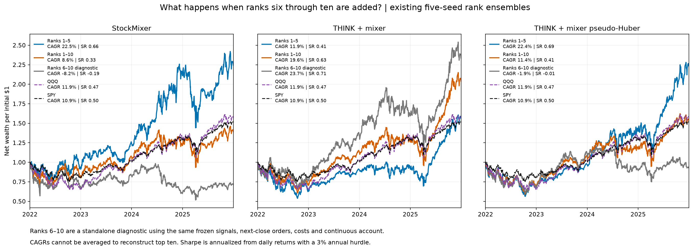

**StockMixer:** ranks six through ten are weak overall and especially poor in
2022 and 2024. Expanding to ten both adds those positions and reduces exposure
to the profitable first five. Its top-five/top-ten gap is predominantly a
2024 concentration effect, not a uniformly repeated advantage in every year.

**THINK + mixer:** ranks six through ten are strong in this sample, especially
in 2023. Expanding to ten improves the portfolio; its first five alone are not
the strongest part of its ranking.

**THINK + mixer pseudo-Huber:** it has the same qualitative dilution problem
as StockMixer. Its ranks-six-to-ten basket loses money over the full period;
top ten remains near the ETFs because its profitable first five offset those
weaker additions. It falls from 22.4% to 11.4% CAGR, a substantial drop even
though the final level is close to SPY/QQQ.

### The calendar-year evidence

| Model | Diagnostic portfolio | 2022 net return | 2023 | 2024 | 2025 |
| --- | --- | --- | --- | --- | --- |
| StockMixer | Ranks 1–5 | -6.0% | 34.3% | 67.0% | 6.4% |
| StockMixer | Ranks 1–10 | -17.0% | 30.0% | 12.5% | 14.7% |
| StockMixer | Ranks 6–10 diagnostic | -30.5% | 20.5% | -28.1% | 18.4% |
| THINK + mixer | Ranks 1–5 | -35.1% | 40.0% | 0.8% | 70.7% |
| THINK + mixer | Ranks 1–10 | -28.0% | 58.6% | 10.6% | 61.3% |
| THINK + mixer | Ranks 6–10 diagnostic | -23.2% | 78.0% | 17.1% | 45.8% |
| THINK + mixer pseudo-Huber | Ranks 1–5 | -30.9% | 41.5% | 42.6% | 60.3% |
| THINK + mixer pseudo-Huber | Ranks 1–10 | -29.1% | 51.8% | 8.6% | 31.5% |
| THINK + mixer pseudo-Huber | Ranks 6–10 diagnostic | -29.9% | 60.8% | -20.3% | 3.1% |

StockMixer top five returned 67.0% in 2024 versus 12.5%
for top ten. SMCI, NVIDIA and Tesla together contributed
56.8 percentage points, about 85% of the top-five account's
net 2024 gain. The contributions below sum to each account's calendar-year
return; they are **portfolio P&L contributions**, not each stock's own return
and not additive contributions to annualized CAGR.

| Stock / remainder | Top-5 contribution | Top-10 contribution | Contribution to the gap |
| --- | --- | --- | --- |
| SMCI | +19.9 pp | +4.9 pp | +15.0 pp |
| NVDA | +19.1 pp | +7.1 pp | +12.0 pp |
| TSLA | +17.8 pp | +9.4 pp | +8.5 pp |
| All other stocks and their fees | +10.1 pp | -8.8 pp | +19.0 pp |

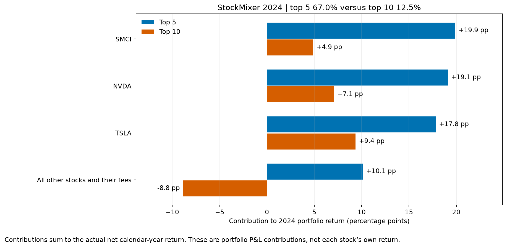

SMCI's largest selected holding windows included 2024-11-13 to 2024-11-20
(+26.9% adjusted-price return) and 2024-11-20 to 2024-11-27 (+35.9%). StockMixer
targeted 20% at top five. These were rebounds after its historical index entry,
not a claim that the strategy captured its early-2024 rally. The reviewed monthly
membership first permits SMCI in August 2024, following its July 22 index addition
([Nasdaq announcement](https://ir.nasdaq.com/node/107766/pdf)). Its October 1
10-for-1 split was already reflected in the adjusted series
([Nasdaq corporate-action notice](https://classic.nasdaqtrader.com/TraderNews.aspx?id=ECA2024-451)).

### This does not establish a stable top-five specialization

| Model | Individual-seed median CAGR: top 5 | Top 10 | Seeds where top 5 wins | Median paired seed gap | Ensemble gap |
| --- | --- | --- | --- | --- | --- |
| StockMixer | 7.1% | 6.5% | 3/5 | +0.45 pp | +13.88 pp |
| THINK + mixer | 14.7% | 12.4% | 4/5 | +1.93 pp | -7.70 pp |
| THINK + mixer pseudo-Huber | 6.1% | 10.4% | 2/5 | -0.28 pp | +11.01 pp |

StockMixer's individual seeds have a much smaller median paired advantage than
the ensemble, and two of five favor top ten. Pseudo-Huber favors top five in
only two of five individual seeds. Regular THINK + mixer's ensemble favors ten,
while four of five individual seeds favor five. Averaging ranks creates a new
selected portfolio; it does not average individual-seed returns. These findings
make the exact optimal K sensitive to the particular ensemble and market path.

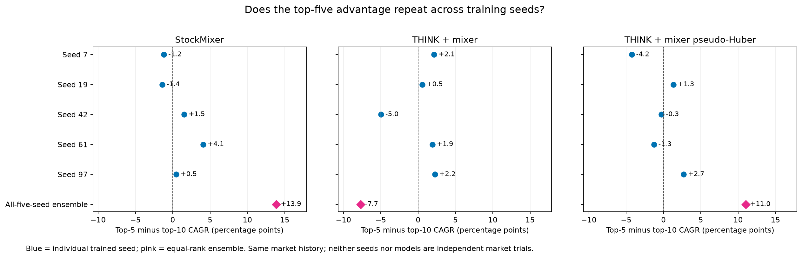

### Neither transaction costs nor a ranking metric alone explains the result

| Model | Top 5: base costs | Top 10: base costs | Top 5: zero costs | Top 10: zero costs |
| --- | --- | --- | --- | --- |
| StockMixer | 22.5% | 8.6% | 27.8% | 12.6% |
| THINK + mixer | 11.9% | 19.6% | 14.5% | 21.8% |
| THINK + mixer pseudo-Huber | 22.4% | 11.4% | 25.2% | 13.5% |

The zero-cost counterfactual retains the same signals and liquidity caps. The
ordering survives with trading costs removed. StockMixer actually turns over
more at top five (55.6 times NAV annually) than top ten (48.4); costs narrow
its top-five advantage rather than create it.

| Model | IC | RankIC | NDCG@5 | NDCG@10 |
| --- | --- | --- | --- | --- |
| StockMixer | 0.0228 | 0.0186 | 0.5206 | 0.5208 |
| THINK + mixer | 0.0125 | 0.0074 | 0.5316 | 0.5392 |
| THINK + mixer pseudo-Huber | 0.0077 | 0.0045 | 0.5403 | 0.5377 |

StockMixer has higher overall IC/RankIC than these THINK+mixer variants, while
its NDCG@10 (0.5208) is only slightly above the
matched random-ranking expectation (0.5176). Neither fact establishes
reliable ordering specifically around the fifth/tenth cutoff. This study's NDCG
uses **return percentiles**, so an extreme 35.9% winner need not contribute more
than a modest winner with the same realized percentile. Portfolio profits depend
on return magnitudes, weights, timing and costs. Architecture and loss alone
cannot causally explain this particular sample's portfolio differences.

Paired top-five minus top-ten Sharpe intervals, using 1,000 circular resamples
of 20-session blocks, include zero for all three models:

| Model | Observed Sharpe difference | Exploratory 95% interval |
| --- | --- | --- |
| StockMixer | +0.334 | [-0.042, +0.700] |
| THINK + mixer | -0.214 | [-0.547, +0.113] |
| THINK + mixer pseudo-Huber | +0.277 | [-0.023, +0.595] |

These are Sharpe intervals, not CAGR intervals, and are not adjusted for the
many inspected models and sizes. The descriptive accounting explanation is
well established here; a permanent top-five advantage remains unproven.
Repeated selection among historical configurations can inflate observed performance
([Bailey and López de Prado](https://www.davidhbailey.com/dhbpapers/deflated-sharpe.pdf)).

### Verification and reproducibility

All 18 diagnostic account paths match the frozen production accounting engine.
An additional independent replay checks the 12 top-five/top-ten base- and
zero-cost paths. All six previously published base-cost paths remain unchanged.
Every stock-level dollar contribution reconciles to cumulative account return;
yearly contributions reconcile to calendar-year returns. No model was retrained
and no source forecast, membership, price or selected checkpoint was changed.

[Stock-level attribution](rank_depth/stock_attribution.csv) · [Attribution by year](rank_depth/year_stock_attribution.csv) ·
[Diagnostic curves](rank_depth/curves.csv) · [Diagnostic metrics](rank_depth/metrics.csv) ·
[Forecast buckets](rank_depth/forecast_buckets.csv) · [Paired seed results](rank_depth/seed_pairs.csv) ·
[Sharpe intervals](rank_depth/paired_bootstrap.csv) · [Reconciliation audit](rank_depth/AUDIT.json).

### Why MSE and pseudo-Huber can produce very different portfolios

**Matched inspection: 20 same-year/same-seed checkpoint pairs; no new training.**
Both use exactly the same THINK+mixer architecture, inputs, target units,
training/validation/test splits, training-derived normalization and correlation
groups, seed rule, optimizer settings and deterministic GPU runtime. Recreating
their initialization gives identical starting parameters for all 20 pairs;
this checks the code/seed rule, since no initial-state checkpoint was saved.
All 20 final parameter sets differ, and 13/20 select different
checkpoint epochs under the same prior-validation MSE rule. For 2025 seed 7,
MSE selected epoch 8 and pseudo-Huber epoch 19.
Their validation MSEs were close (24.558 and
24.443), which does not guarantee identical ordering at
a trading cutoff. The corrected selected-checkpoint validation exports were
used; the previously disclosed stale final-epoch validation arrays were not.

**Same architecture does not imply the same learned function.** The intended
loss change changes the optimization path and the resulting weights. Delta was
fixed at **1 percentage point**, not an extremely large value that would make
pseudo-Huber approximately MSE for most errors. At the selected checkpoints,
an average 78.6% of MSE validation errors exceed that scale.
This describes validation residuals, not the residuals at every training step.

| Absolute prediction error | MSE loss derivative | Pseudo-Huber derivative | Relative influence |
| --- | --- | --- | --- |
| 0.1 pp | 0.20 | 0.20 | 99.5% |
| 1 pp | 2.00 | 1.41 | 70.7% |
| 5 pp | 10.00 | 1.96 | 19.6% |
| 10 pp | 20.00 | 1.99 | 10.0% |
| 20 pp | 40.00 | 2.00 | 5.0% |

These are derivatives of our implemented per-observation losses, before
averaging, AdamW and global norm clipping. Pseudo-Huber's derivative saturates
while MSE's grows with the error ([SciPy pseudo-Huber definition](https://docs.scipy.org/doc/scipy/reference/generated/scipy.special.pseudo_huber.html)).
Thus the formula change substantially changes the relative treatment of large
errors, even though both losses have matching curvature near zero.

### Similar broad rankings can still mean different five-stock baskets

The two ensembles have mean same-date rank correlation 0.827
across eligible stocks. However, their selected portfolios overlap much less:

| Portfolio | Average common target weight | Equivalent common position count |
| --- | --- | --- |
| Top 5 | 64.2% | 3.21 of 5 equal-weight positions |
| Top 10 | 61.5% | 6.15 of 10 equal-weight positions |
| Ranks 6–10 | 42.4% | 2.12 of 5 equal-weight positions |

Common weight sums the minimum allocation to each security in both portfolios,
then averages over the 201 signal dates. It handles fractional ties; the position
count is an equal-weight equivalent, not a claim that exactly two names always
overlap. Both models rank the same stock universe, but much of the small selected
basket differs. At roughly 20% per position, moving a few names across rank five
or rank ten can materially change portfolio returns.

| Test year | Cross-model rank correlation | Ranks-6–10 common target weight |
| --- | --- | --- |
| 2022 | 0.802 | 23.7% |
| 2023 | 0.995 | 81.8% |
| 2024 | 0.773 | 35.2% |
| 2025 | 0.737 | 29.2% |

### Does the return difference mostly boil down to random chance?

**The results show sensitivity, but do not identify what fraction is chance.**
The large ensemble CAGR gap is not representative of matched individual seeds:

| Matched fit | MSE ranks-6–10 CAGR | Pseudo-Huber CAGR | MSE minus pseudo-Huber |
| --- | --- | --- | --- |
| Seed 7 | 7.2% | 11.2% | -4.02 pp |
| Seed 19 | 17.0% | 16.6% | +0.37 pp |
| Seed 42 | 11.5% | 0.0% | +11.44 pp |
| Seed 61 | 3.3% | 3.6% | -0.29 pp |
| Seed 97 | 5.9% | 5.9% | -0.01 pp |
| Five-seed rank ensemble | 23.7% | -1.9% | +25.64 pp |

MSE wins only 2/5 matched seed portfolios. Their median
paired difference is -0.01 percentage points, essentially
zero, compared with 25.64 points for the ensemble.
Every pseudo-Huber individual-seed ranks-six-to-ten account has a positive CAGR,
although its rank ensemble is negative. The ensemble sorts average ranks and
creates a different portfolio, so constituent CAGRs cannot be averaged to
reconstruct it. Training-seed and cutoff sensitivity are evident; a consistent
MSE advantage has not been demonstrated.

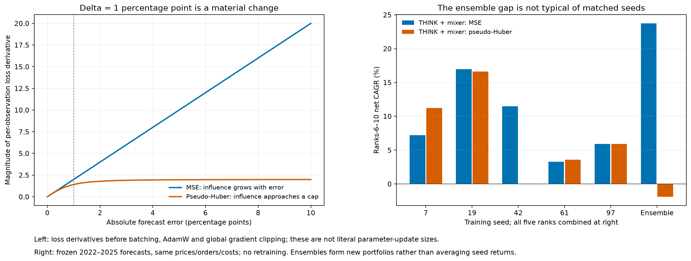

For completeness, the **fixed ensemble** return difference survives an
exploratory paired 20-session block bootstrap: CAGR-gap interval
[+5.3, +50.0] percentage points and Sharpe-gap
interval [+0.129, +1.341]. Both exclude zero. It would be
incorrect to claim these particular intervals prove the gap is merely sampling
noise. However, they condition on already selected ensembles, omit training-seed
uncertainty, and are not adjusted for the many inspected models, losses, sizes
and rank buckets. They do not establish that MSE will beat pseudo-Huber on
unseen dates or across alternative training seeds.

The supported interpretation is: **a material loss change produced different
fitted weights and stock selections; a highly selective, seed-sensitive portfolio
rule amplified that difference into a large historical CAGR gap.** Market luck,
selection effects and concentration may influence its magnitude, but their
separate causal shares cannot be estimated from these experiments. The evidence
does not justify treating either loss as reliably superior or calling the two
trained models functionally identical.

Twelve individual/ensemble marginal-bucket accounts matched the frozen
production engine. Source checkpoint and forecast hashes were checked, and no
optimization steps or retraining occurred. This diagnostic does not independently
eliminate every data limitation documented in the parent study.

[Matched fits](loss_similarity/matched_fits.csv) · [Selection overlap](loss_similarity/agreement_summary.csv) ·
[Every signal date](loss_similarity/agreement_by_period.csv) · [Validation residual summaries](loss_similarity/validation_residuals.csv) ·
[Individual/ensemble marginal portfolios](loss_similarity/marginal_seed_metrics.csv) ·
[Conditional ensemble intervals](loss_similarity/conditional_bootstrap.json) · [Inspection audit](loss_similarity/AUDIT.json).

## Long highest / short lowest predicted returns

**Completed: no retraining; 600 disclosed portfolio paths, including 570 new signed accounts independently replayed and 30 unchanged long-only ensemble paths.**
All allocations were fixed before this extension's returns were calculated.
Forecasts, membership, annual model folds, all five seeds and K = 5/10/20 are
unchanged. This tests the portfolio rule, not a new predictor.

Across the 60 base-cost ensemble short portfolios, 37/60 have positive
net CAGR, 3/60 beat QQQ's 11.9% CAGR, and 58/60 have a
smaller maximum drawdown than the corresponding 100% long portfolio.
Only 5/60 exceed their **same-long-allocation plus cash** control's
CAGR. These counts span related models and overlapping stock portfolios;
they are not 60 independent market trials.

A favorable example is StockMixer at K = 5: 75% long / 25% short has
19.5% CAGR and -22.5% maximum drawdown,
versus 18.4% and -28.0% for
75% long / 25% cash. However, its five individual seeds have median CAGR
8.3% (range 0.7% to 10.0%).
All five are positive but none beat QQQ. Its Sharpe difference versus the cash
control has an exploratory 95% interval [-0.129, 0.302],
which includes zero. This example was identified after viewing all fixed
results; it is not a validated allocation recommendation.

The 50% long / 50% short ensembles have measured daily QQQ betas ranging from
-0.12 to 0.30. Equal long/short dollars
do not enforce zero beta or equal sector exposure, and positions drift between
five-session rebalances. A lowest-ranked stock can still rise; a short then loses.

### What the allocations mean

| Policy | Long target | Short target | Gross stock exposure | Net stock exposure |
| --- | --- | --- | --- | --- |
| 100% long | 100% | 0% | 100% | 100% |
| 75% long / 25% cash | 75% | 0% | 75% | 75% |
| 50% long / 50% cash | 50% | 0% | 50% | 50% |
| 75% long / 25% short | 75% | 25% | 100% | 50% |
| 50% long / 50% short | 50% | 50% | 100% | 0% |

At K = 10, the 75/25 short policy targets 7.5% of NAV in each top-ranked stock
and shorts 2.5% in each bottom-ranked stock. The 50/50 policy targets 5% each
on both sides. Orders use only signal-close information and fill the next close.
The same K applies to each side. Fractional boundary ties cancel overlapping
long/short weights; under 2K eligible stocks the short portfolio stays in cash.
Short proceeds remain in the cash/collateral account; they do not increase the
declared investment budgets. Actual cash balances differ from net exposure.

### Previously discussed model comparisons

All full-period wealth legends show net CAGR alongside Sharpe (SR), including
QQQ and SPY. Shared legends on four-panel yearly figures describe the complete
2022–2025 account; each panel is rebased for that calendar year. Sharpe is
annualized from daily returns and uses a 3% annual hurdle.

| Model | K | Allocation | Net CAGR | Max drawdown | Sharpe |
| --- | --- | --- | --- | --- | --- |
| THINK + mixer | 10 | 100% long | 19.6% | -39.4% | 0.629 |
| THINK + mixer | 10 | 75% long / 25% cash | 15.4% | -30.4% | 0.595 |
| THINK + mixer | 10 | 50% long / 50% cash | 10.6% | -20.9% | 0.529 |
| THINK + mixer | 10 | 75% long / 25% short | 10.2% | -27.1% | 0.442 |
| THINK + mixer | 10 | 50% long / 50% short | -0.2% | -18.7% | -0.250 |
| THINK + mixer pseudo-Huber | 5 | 100% long | 22.4% | -43.6% | 0.689 |
| THINK + mixer pseudo-Huber | 5 | 75% long / 25% cash | 17.6% | -33.9% | 0.659 |
| THINK + mixer pseudo-Huber | 5 | 50% long / 50% cash | 12.1% | -23.5% | 0.595 |
| THINK + mixer pseudo-Huber | 5 | 75% long / 25% short | 12.2% | -32.4% | 0.505 |
| THINK + mixer pseudo-Huber | 5 | 50% long / 50% short | 1.0% | -26.4% | -0.078 |
| StockMixer | 5 | 100% long | 22.5% | -36.1% | 0.659 |
| StockMixer | 5 | 75% long / 25% cash | 18.4% | -28.0% | 0.645 |
| StockMixer | 5 | 50% long / 50% cash | 12.6% | -19.3% | 0.583 |
| StockMixer | 5 | 75% long / 25% short | 19.5% | -22.5% | 0.738 |
| StockMixer | 5 | 50% long / 50% short | 13.5% | -18.9% | 0.704 |

### Allocation comparison, K = 5

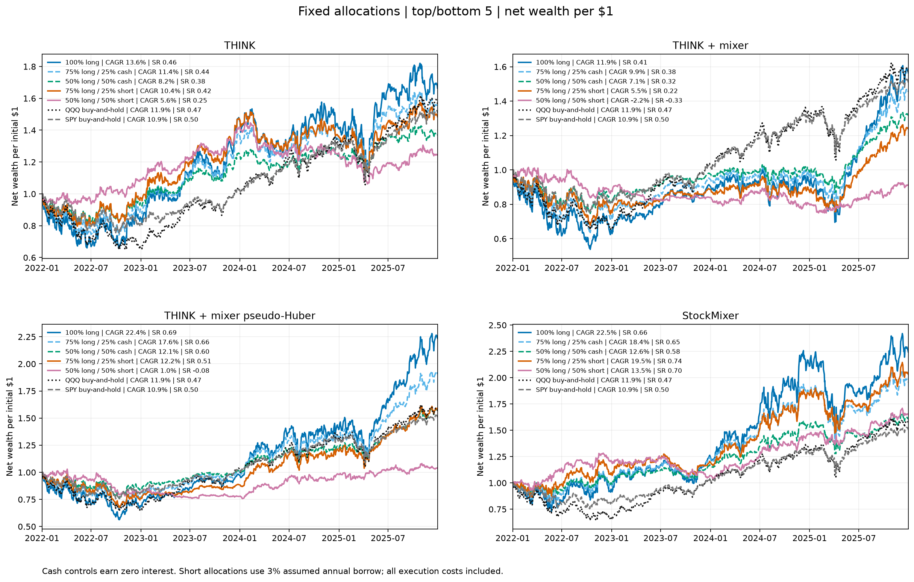

### Allocation comparison, K = 10

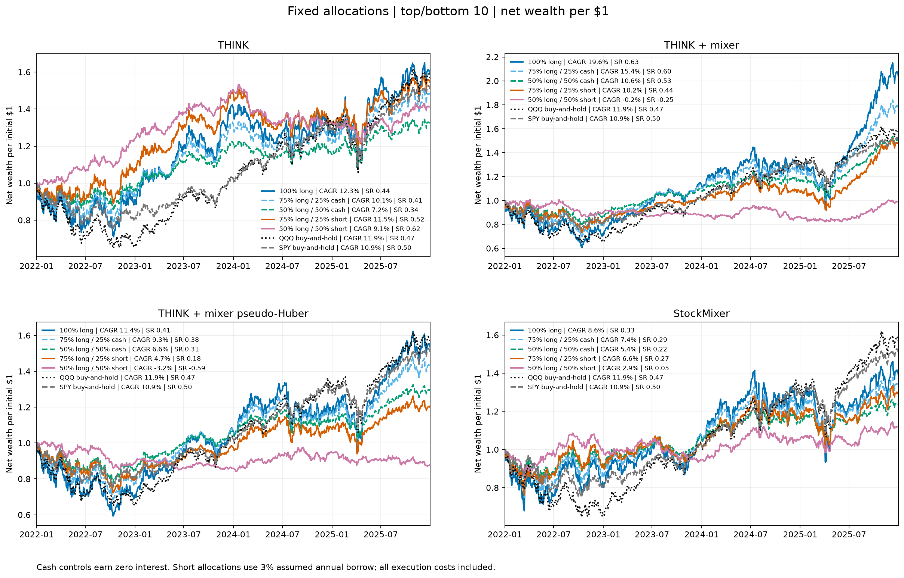

### Allocation comparison, K = 20

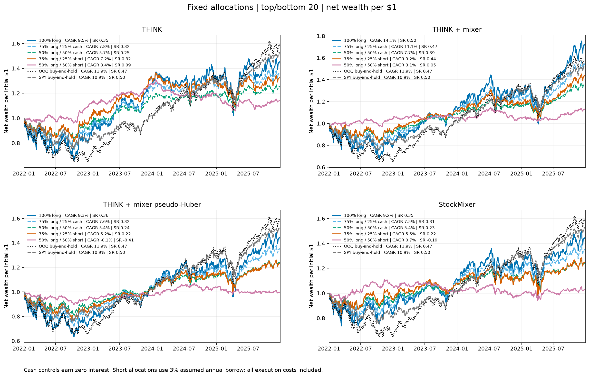

### Every model and portfolio size

Each cell reports **annualized net return / worst peak-to-trough loss**.
All results include trading fees; short portfolios additionally use assumed
3% annual borrowing fees. Long-only controls have no borrow charge.

### K = 5: CAGR / maximum drawdown

| Model | 100% long | 75% long / 25% cash | 50% long / 50% cash | 75% long / 25% short | 50% long / 50% short |
| --- | --- | --- | --- | --- | --- |
| THINK | 13.6% / -34.1% | 11.4% / -26.2% | 8.2% / -18.0% | 10.4% / -25.4% | 5.6% / -26.8% |
| THINK + mixer | 11.9% / -46.2% | 9.9% / -36.4% | 7.1% / -25.4% | 5.5% / -32.2% | -2.2% / -26.1% |
| THINK Huber | 13.1% / -38.5% | 10.9% / -29.7% | 7.8% / -20.4% | 9.4% / -24.9% | 4.0% / -24.3% |
| THINK + mixer Huber | 15.8% / -44.3% | 12.5% / -34.9% | 8.8% / -24.3% | 7.2% / -34.2% | -2.3% / -27.4% |
| MLP | -6.8% / -40.3% | -3.7% / -31.0% | -1.6% / -20.8% | -8.9% / -32.2% | -12.5% / -41.6% |
| StockMixer | 22.5% / -36.1% | 18.4% / -28.0% | 12.6% / -19.3% | 19.5% / -22.5% | 13.5% / -18.9% |
| Ridge | -13.7% / -56.5% | -9.4% / -44.2% | -5.6% / -30.0% | -13.9% / -50.0% | -15.7% / -50.2% |
| Momentum 126 | 8.6% / -40.9% | 7.4% / -31.5% | 5.6% / -21.4% | 8.0% / -29.5% | 4.7% / -24.5% |
| Reversal 5 | 5.9% / -43.4% | 5.6% / -33.5% | 4.5% / -22.7% | 2.2% / -41.4% | -3.4% / -48.9% |
| THINK + mixer pseudo-Huber | 22.4% / -43.6% | 17.6% / -33.9% | 12.1% / -23.5% | 12.2% / -32.4% | 1.0% / -26.4% |

### K = 10: CAGR / maximum drawdown

| Model | 100% long | 75% long / 25% cash | 50% long / 50% cash | 75% long / 25% short | 50% long / 50% short |
| --- | --- | --- | --- | --- | --- |
| THINK | 12.3% / -29.0% | 10.1% / -21.7% | 7.2% / -14.5% | 11.5% / -20.5% | 9.1% / -20.5% |
| THINK + mixer | 19.6% / -39.4% | 15.4% / -30.4% | 10.6% / -20.9% | 10.2% / -27.1% | -0.2% / -18.7% |
| THINK Huber | 13.7% / -36.7% | 11.1% / -28.3% | 7.8% / -19.3% | 10.6% / -22.9% | 5.8% / -24.2% |
| THINK + mixer Huber | 6.0% / -41.7% | 5.3% / -32.5% | 4.0% / -22.5% | -0.1% / -29.0% | -7.3% / -27.0% |
| MLP | -10.1% / -44.5% | -6.6% / -32.9% | -3.8% / -21.5% | -10.2% / -37.3% | -11.7% / -39.4% |
| StockMixer | 8.6% / -34.0% | 7.4% / -26.0% | 5.4% / -17.7% | 6.6% / -23.9% | 2.9% / -15.0% |
| Ridge | -5.0% / -39.1% | -2.9% / -30.3% | -1.2% / -20.7% | -5.8% / -32.6% | -8.1% / -31.4% |
| Momentum 126 | 2.9% / -38.4% | 2.9% / -29.7% | 2.5% / -20.2% | 2.7% / -27.5% | 0.5% / -24.9% |
| Reversal 5 | 5.8% / -35.8% | 5.4% / -27.5% | 4.2% / -18.5% | 2.1% / -24.0% | -3.2% / -34.8% |
| THINK + mixer pseudo-Huber | 11.4% / -40.7% | 9.3% / -31.6% | 6.6% / -21.9% | 4.7% / -27.8% | -3.2% / -16.6% |

### K = 20: CAGR / maximum drawdown

| Model | 100% long | 75% long / 25% cash | 50% long / 50% cash | 75% long / 25% short | 50% long / 50% short |
| --- | --- | --- | --- | --- | --- |
| THINK | 9.5% / -33.9% | 7.8% / -25.9% | 5.7% / -17.6% | 7.2% / -21.3% | 3.4% / -19.2% |
| THINK + mixer | 14.1% / -32.5% | 11.1% / -24.8% | 7.7% / -16.8% | 9.2% / -20.8% | 3.1% / -11.5% |
| THINK Huber | 12.3% / -34.0% | 9.9% / -26.0% | 7.0% / -17.7% | 8.6% / -22.1% | 3.6% / -20.6% |
| THINK + mixer Huber | 9.0% / -33.5% | 7.4% / -25.5% | 5.2% / -17.4% | 4.2% / -21.1% | -1.7% / -14.3% |
| MLP | -1.8% / -37.8% | -0.5% / -29.1% | 0.2% / -19.9% | -3.9% / -26.0% | -7.1% / -27.4% |
| StockMixer | 9.2% / -27.7% | 7.5% / -21.1% | 5.4% / -14.1% | 5.5% / -19.8% | 0.7% / -15.1% |
| Ridge | 5.1% / -34.4% | 4.5% / -26.5% | 3.5% / -18.0% | 0.6% / -22.9% | -4.8% / -23.3% |
| Momentum 126 | 4.7% / -31.1% | 4.1% / -24.0% | 3.1% / -16.5% | 1.4% / -23.2% | -3.3% / -28.1% |
| Reversal 5 | 5.9% / -35.7% | 5.2% / -27.5% | 3.9% / -18.7% | 3.0% / -21.0% | -1.3% / -23.9% |
| THINK + mixer pseudo-Huber | 9.3% / -36.5% | 7.6% / -28.0% | 5.4% / -19.2% | 5.2% / -23.6% | -0.1% / -10.2% |

### K = 5: 75% long / 25% short

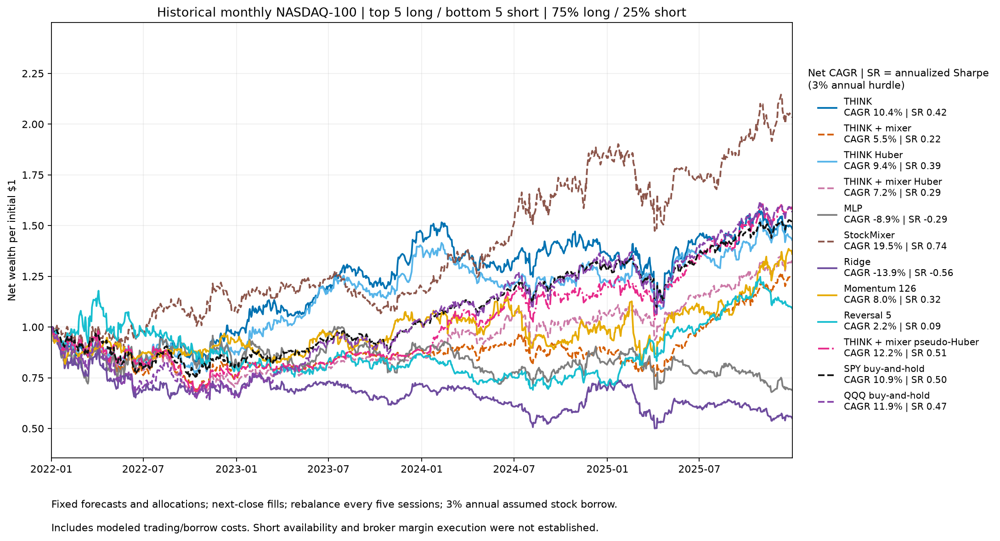

### K = 5: 50% long / 50% short

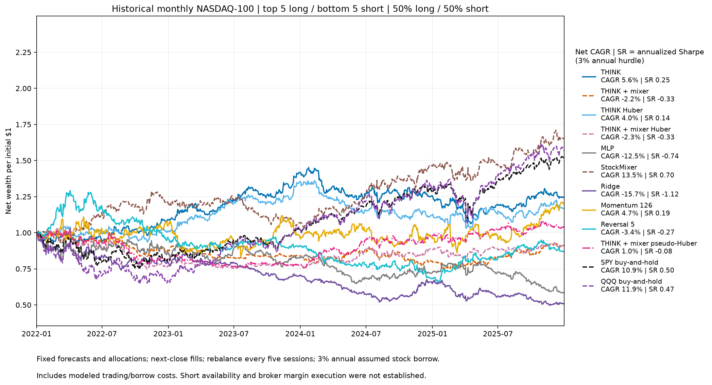

### K = 10: 75% long / 25% short

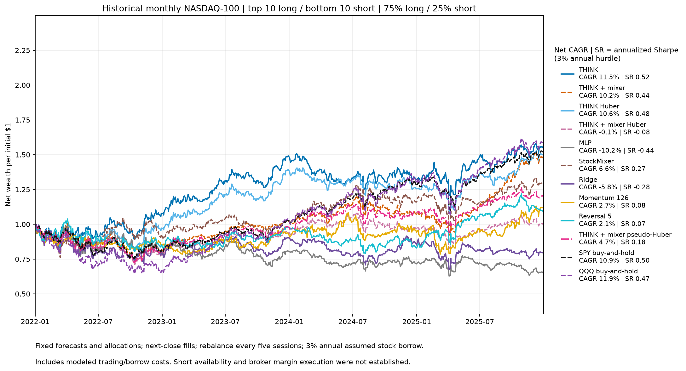

### K = 10: 50% long / 50% short

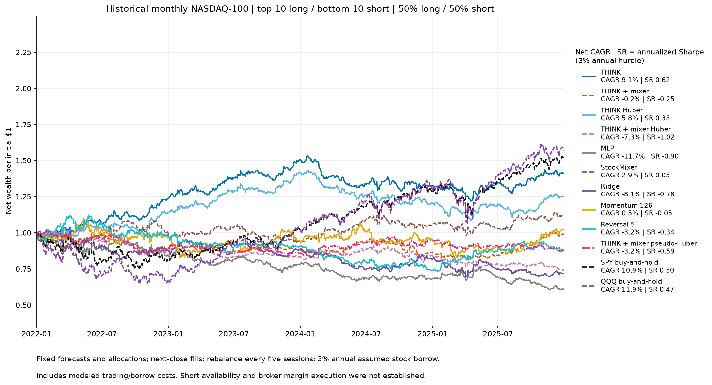

### K = 20: 75% long / 25% short

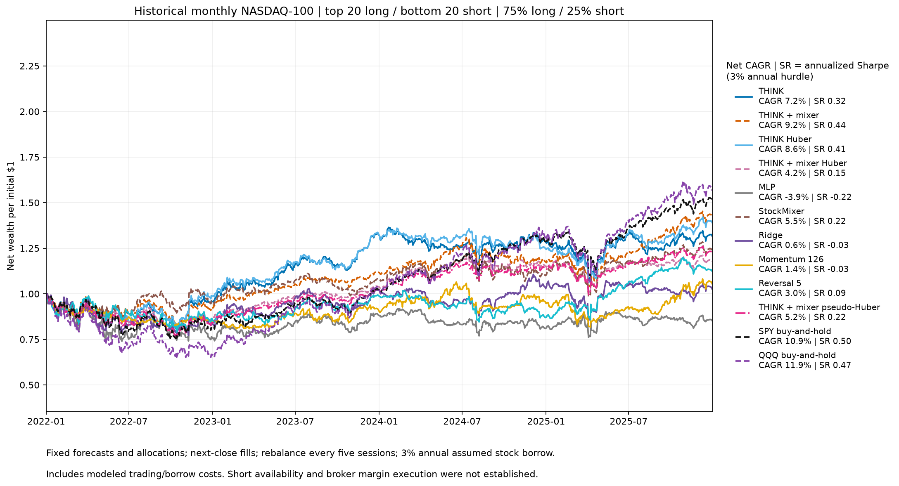

### K = 20: 50% long / 50% short

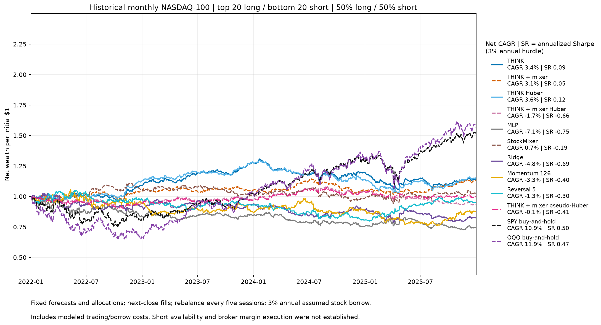

### Top/bottom 10 risk and market exposure

Sharpe uses the same 3% annual hurdle as the earlier charts. Sharpe at 0%
is shown too, because these research cash accounts earn zero interest.
Beta and correlation are measured against matched daily QQQ returns after costs;
they describe this sample, not a beta constraint imposed on trading.

| Model | Allocation | Sharpe 3% | Sharpe 0% | Volatility | QQQ beta | QQQ corr. | Mean net exposure | Worst year |
| --- | --- | --- | --- | --- | --- | --- | --- | --- |
| THINK | 75% long / 25% short | 0.521 | 0.680 | 18.6% | 0.63 | 0.80 | 50.1% | -11.4% |
| THINK | 50% long / 50% short | 0.616 | 0.908 | 10.1% | 0.13 | 0.29 | 0.2% | -11.7% |
| THINK + mixer | 75% long / 25% short | 0.442 | 0.594 | 19.5% | 0.69 | 0.83 | 50.0% | -18.5% |
| THINK + mixer | 50% long / 50% short | -0.250 | 0.029 | 10.6% | 0.16 | 0.37 | 0.0% | -10.3% |
| THINK Huber | 75% long / 25% short | 0.483 | 0.647 | 18.1% | 0.62 | 0.80 | 50.1% | -10.0% |
| THINK Huber | 50% long / 50% short | 0.325 | 0.629 | 9.7% | 0.10 | 0.23 | 0.2% | -15.2% |
| THINK + mixer Huber | 75% long / 25% short | -0.082 | 0.085 | 17.7% | 0.62 | 0.83 | 50.0% | -21.4% |
| THINK + mixer Huber | 50% long / 50% short | -1.015 | -0.715 | 9.9% | 0.12 | 0.29 | -0.0% | -12.6% |
| MLP | 75% long / 25% short | -0.439 | -0.319 | 24.5% | 0.74 | 0.72 | 50.0% | -18.8% |
| MLP | 50% long / 50% short | -0.904 | -0.715 | 15.6% | 0.28 | 0.42 | -0.1% | -14.9% |
| StockMixer | 75% long / 25% short | 0.269 | 0.413 | 20.6% | 0.65 | 0.75 | 50.0% | -7.4% |
| StockMixer | 50% long / 50% short | 0.054 | 0.297 | 12.2% | 0.16 | 0.32 | -0.0% | -5.7% |
| Ridge | 75% long / 25% short | -0.280 | -0.150 | 22.8% | 0.73 | 0.76 | 50.0% | -20.3% |
| Ridge | 50% long / 50% short | -0.778 | -0.558 | 13.5% | 0.22 | 0.39 | 0.0% | -11.9% |
| Momentum 126 | 75% long / 25% short | 0.080 | 0.233 | 19.2% | 0.43 | 0.53 | 49.9% | -14.4% |
| Momentum 126 | 50% long / 50% short | -0.053 | 0.115 | 17.6% | -0.12 | -0.15 | -0.0% | -3.5% |
| Reversal 5 | 75% long / 25% short | 0.073 | 0.206 | 22.2% | 0.62 | 0.66 | 50.0% | -15.2% |
| Reversal 5 | 50% long / 50% short | -0.338 | -0.140 | 14.9% | 0.11 | 0.17 | 0.0% | -18.1% |
| THINK + mixer pseudo-Huber | 75% long / 25% short | 0.178 | 0.343 | 18.0% | 0.63 | 0.83 | 50.0% | -19.5% |
| THINK + mixer pseudo-Huber | 50% long / 50% short | -0.586 | -0.286 | 9.8% | 0.13 | 0.30 | -0.0% | -10.9% |

### Calendar-year returns, K = 10

| Model | Allocation | 2022 | 2023 | 2024 | 2025 |
| --- | --- | --- | --- | --- | --- |
| THINK | 75% long / 25% short | 7.6% | 38.6% | -11.4% | 16.9% |
| THINK | 50% long / 50% short | 23.7% | 21.7% | -11.7% | 6.3% |
| THINK + mixer | 75% long / 25% short | -18.5% | 25.3% | 5.1% | 37.0% |
| THINK + mixer | 50% long / 50% short | -10.3% | -2.1% | -1.4% | 14.3% |
| THINK Huber | 75% long / 25% short | -2.9% | 43.6% | -10.0% | 18.9% |
| THINK Huber | 50% long / 50% short | 13.8% | 24.9% | -15.2% | 3.9% |
| THINK + mixer Huber | 75% long / 25% short | -21.4% | 20.2% | 2.4% | 3.2% |
| THINK + mixer Huber | 50% long / 50% short | -12.6% | -4.7% | 1.1% | -12.1% |
| MLP | 75% long / 25% short | -18.8% | -0.9% | -11.1% | -9.1% |
| MLP | 50% long / 50% short | -14.9% | -8.4% | -12.9% | -10.1% |
| StockMixer | 75% long / 25% short | -7.4% | 11.5% | 12.4% | 11.1% |
| StockMixer | 50% long / 50% short | 0.5% | -5.7% | 11.2% | 6.4% |
| Ridge | 75% long / 25% short | -20.3% | 13.2% | -5.6% | -7.5% |
| Ridge | 50% long / 50% short | -11.6% | -0.3% | -7.9% | -11.9% |
| Momentum 126 | 75% long / 25% short | -14.4% | 9.2% | 0.9% | 17.8% |
| Momentum 126 | 50% long / 50% short | -3.5% | -2.0% | 0.4% | 7.3% |
| Reversal 5 | 75% long / 25% short | -14.6% | 14.5% | -15.2% | 31.3% |
| Reversal 5 | 50% long / 50% short | -1.3% | -8.6% | -18.1% | 19.1% |
| THINK + mixer pseudo-Huber | 75% long / 25% short | -19.5% | 21.7% | 10.1% | 11.2% |
| THINK + mixer pseudo-Huber | 50% long / 50% short | -10.9% | -3.6% | 10.5% | -7.6% |

### K = 5: 75% long / 25% short by year

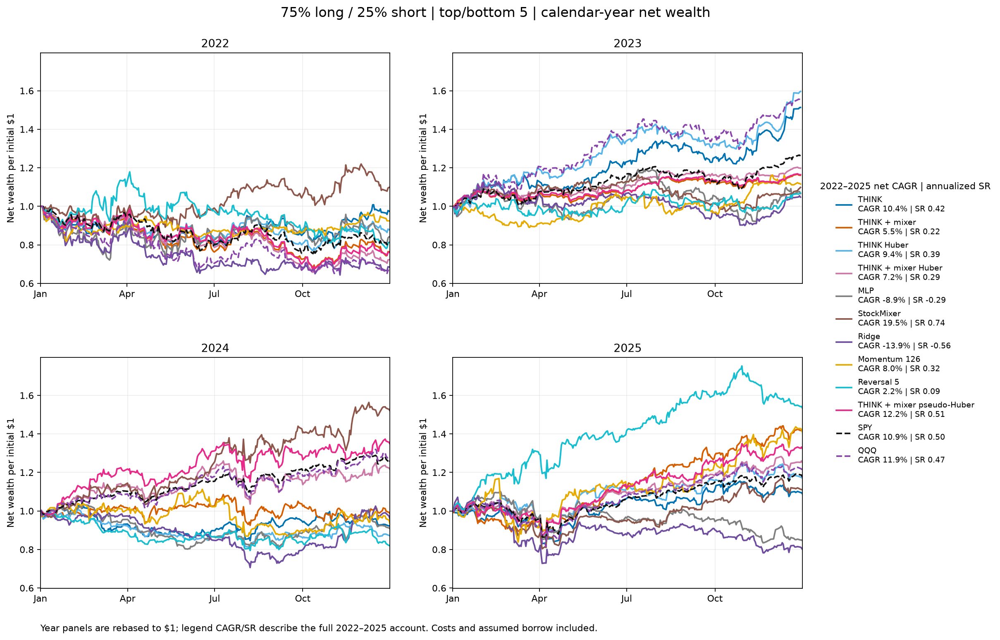

### K = 5: 50% long / 50% short by year

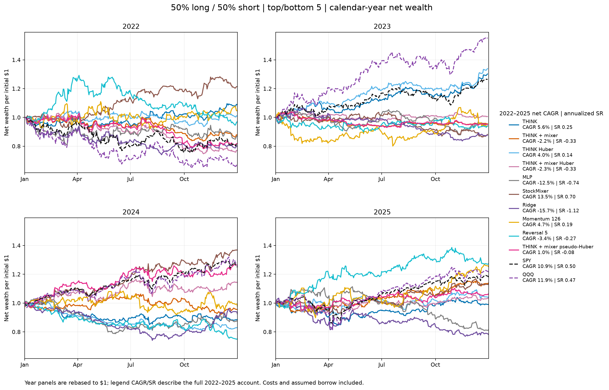

### K = 10: 75% long / 25% short by year

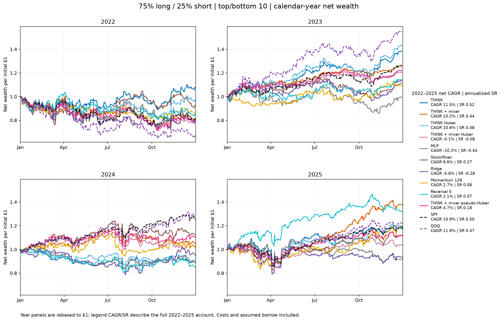

### K = 10: 50% long / 50% short by year

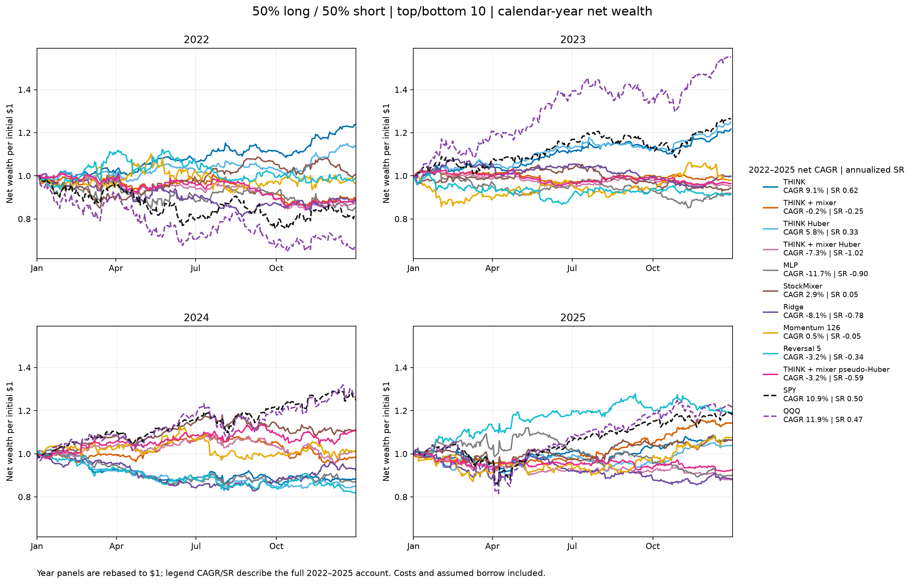

### K = 20: 75% long / 25% short by year

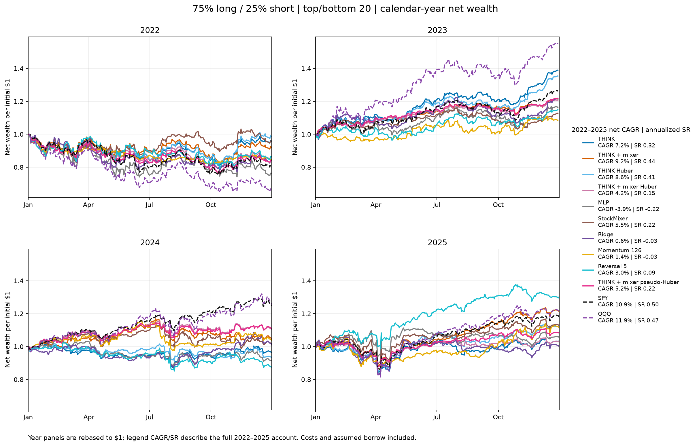

### K = 20: 50% long / 50% short by year

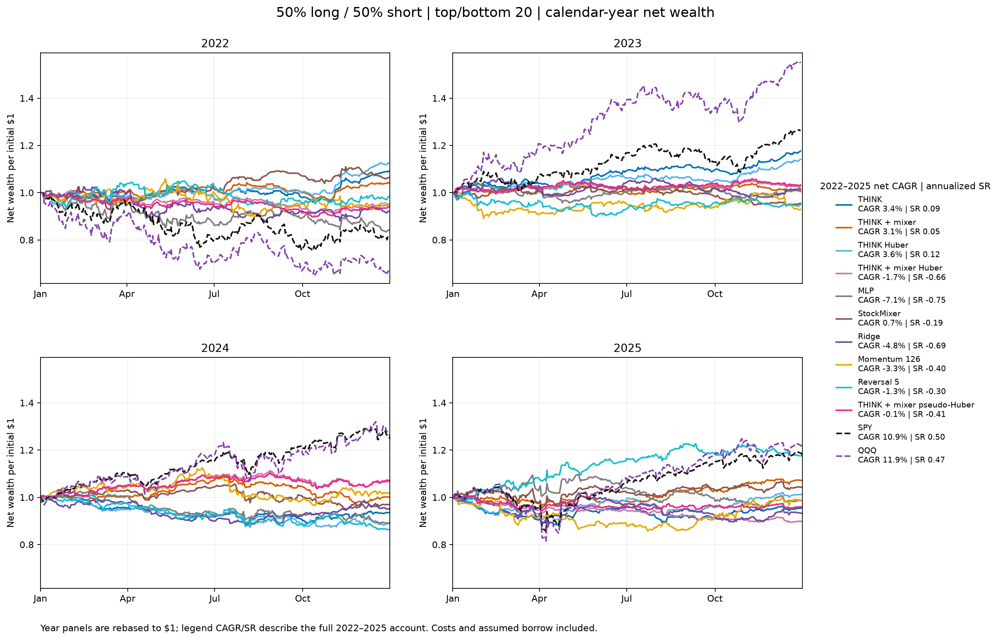

### Training-seed consistency

Ensembles average ranks across all five seeds; their returns are not the mean
individual-seed returns. Seed ranges measure training sensitivity on the same
historical market path, not independent economic evidence. The non-neural
baselines have no training-seed variation.

### K = 5: individual training seeds

| Model | Allocation | Median CAGR | Seed range | Positive CAGR | Beat QQQ |
| --- | --- | --- | --- | --- | --- |
| THINK | 75% long / 25% short | 0.7% | 0.2% to 7.3% | 5/5 | 0/5 |
| THINK | 50% long / 50% short | -2.1% | -3.9% to 1.9% | 2/5 | 0/5 |
| THINK + mixer | 75% long / 25% short | 9.3% | 1.9% to 15.2% | 5/5 | 2/5 |
| THINK + mixer | 50% long / 50% short | 2.5% | -3.4% to 12.0% | 4/5 | 1/5 |
| THINK Huber | 75% long / 25% short | 3.4% | -3.1% to 6.4% | 3/5 | 0/5 |
| THINK Huber | 50% long / 50% short | -3.6% | -8.0% to 2.0% | 1/5 | 0/5 |
| THINK + mixer Huber | 75% long / 25% short | 6.5% | -3.0% to 8.4% | 4/5 | 0/5 |
| THINK + mixer Huber | 50% long / 50% short | 1.8% | -9.1% to 4.6% | 3/5 | 0/5 |
| MLP | 75% long / 25% short | -8.8% | -10.3% to -4.3% | 0/5 | 0/5 |
| MLP | 50% long / 50% short | -11.4% | -15.1% to -8.2% | 0/5 | 0/5 |
| StockMixer | 75% long / 25% short | 8.3% | 0.7% to 10.0% | 5/5 | 0/5 |
| StockMixer | 50% long / 50% short | 6.7% | -2.3% to 12.4% | 4/5 | 1/5 |
| THINK + mixer pseudo-Huber | 75% long / 25% short | 6.5% | -1.8% to 16.0% | 4/5 | 1/5 |
| THINK + mixer pseudo-Huber | 50% long / 50% short | 1.6% | -8.0% to 7.4% | 3/5 | 0/5 |

### K = 10: individual training seeds

| Model | Allocation | Median CAGR | Seed range | Positive CAGR | Beat QQQ |
| --- | --- | --- | --- | --- | --- |
| THINK | 75% long / 25% short | 6.2% | 2.1% to 8.8% | 5/5 | 0/5 |
| THINK | 50% long / 50% short | 2.1% | -5.0% to 3.5% | 4/5 | 0/5 |
| THINK + mixer | 75% long / 25% short | 7.5% | 4.9% to 14.9% | 5/5 | 1/5 |
| THINK + mixer | 50% long / 50% short | 2.6% | -0.0% to 7.2% | 4/5 | 0/5 |
| THINK Huber | 75% long / 25% short | 3.9% | 1.2% to 8.6% | 5/5 | 0/5 |
| THINK Huber | 50% long / 50% short | -0.6% | -4.9% to 3.5% | 2/5 | 0/5 |
| THINK + mixer Huber | 75% long / 25% short | 3.8% | -1.2% to 14.1% | 4/5 | 1/5 |
| THINK + mixer Huber | 50% long / 50% short | -1.3% | -6.6% to 6.4% | 2/5 | 0/5 |
| MLP | 75% long / 25% short | -7.0% | -9.4% to -6.6% | 0/5 | 0/5 |
| MLP | 50% long / 50% short | -10.4% | -12.4% to -9.5% | 0/5 | 0/5 |
| StockMixer | 75% long / 25% short | 5.6% | -0.9% to 7.5% | 4/5 | 0/5 |
| StockMixer | 50% long / 50% short | 2.2% | -4.3% to 6.4% | 4/5 | 0/5 |
| THINK + mixer pseudo-Huber | 75% long / 25% short | 5.6% | 0.6% to 14.0% | 5/5 | 1/5 |
| THINK + mixer pseudo-Huber | 50% long / 50% short | 0.2% | -3.5% to 5.4% | 3/5 | 0/5 |

### K = 20: individual training seeds

| Model | Allocation | Median CAGR | Seed range | Positive CAGR | Beat QQQ |
| --- | --- | --- | --- | --- | --- |
| THINK | 75% long / 25% short | 5.5% | 2.2% to 6.7% | 5/5 | 0/5 |
| THINK | 50% long / 50% short | 1.6% | -5.0% to 1.7% | 3/5 | 0/5 |
| THINK + mixer | 75% long / 25% short | 4.4% | 1.6% to 9.4% | 5/5 | 0/5 |
| THINK + mixer | 50% long / 50% short | -1.0% | -1.5% to 3.6% | 1/5 | 0/5 |
| THINK Huber | 75% long / 25% short | 7.4% | 3.6% to 8.6% | 5/5 | 0/5 |
| THINK Huber | 50% long / 50% short | 2.0% | -2.7% to 3.2% | 4/5 | 0/5 |
| THINK + mixer Huber | 75% long / 25% short | 2.6% | 0.1% to 9.4% | 5/5 | 0/5 |
| THINK + mixer Huber | 50% long / 50% short | -2.8% | -4.6% to 3.4% | 1/5 | 0/5 |
| MLP | 75% long / 25% short | -4.5% | -5.9% to -2.6% | 0/5 | 0/5 |
| MLP | 50% long / 50% short | -8.4% | -9.0% to -6.5% | 0/5 | 0/5 |
| StockMixer | 75% long / 25% short | 4.9% | 3.2% to 6.7% | 5/5 | 0/5 |
| StockMixer | 50% long / 50% short | 0.1% | -2.6% to 1.4% | 3/5 | 0/5 |
| THINK + mixer pseudo-Huber | 75% long / 25% short | 3.5% | 0.6% to 10.9% | 5/5 | 0/5 |
| THINK + mixer pseudo-Huber | 50% long / 50% short | -2.5% | -3.3% to 4.6% | 1/5 | 0/5 |

### Borrowing and execution sensitivity

The fee rates below are **assumptions**, not observed historical lending quotes.
Trading-cost stresses and borrow-fee stresses are separate scenarios.
Fees accrue on prior-close short notional using calendar days / 365, including
weekends; no cash interest or short-proceeds rebate is credited.

### K = 5: cost and borrow sensitivity (net CAGR)

| Model | Allocation | Base 3% borrow | 5% borrow | 10% borrow | 2× trading costs | 4× trading costs |
| --- | --- | --- | --- | --- | --- | --- |
| THINK | 75% long / 25% short | 10.4% | 9.9% | 8.5% | 4.8% | -5.6% |
| THINK | 50% long / 50% short | 5.6% | 4.6% | 2.0% | 0.0% | -10.3% |
| THINK + mixer | 75% long / 25% short | 5.5% | 5.0% | 3.7% | 3.4% | -0.7% |
| THINK + mixer | 50% long / 50% short | -2.2% | -3.2% | -5.6% | -4.0% | -7.4% |
| THINK Huber | 75% long / 25% short | 9.4% | 8.8% | 7.5% | 3.9% | -6.1% |
| THINK Huber | 50% long / 50% short | 4.0% | 3.0% | 0.4% | -1.3% | -11.0% |
| THINK + mixer Huber | 75% long / 25% short | 7.2% | 6.6% | 5.3% | 5.0% | 0.7% |
| THINK + mixer Huber | 50% long / 50% short | -2.3% | -3.2% | -5.6% | -4.1% | -7.6% |
| MLP | 75% long / 25% short | -8.9% | -9.4% | -10.5% | -13.2% | -21.0% |
| MLP | 50% long / 50% short | -12.5% | -13.4% | -15.6% | -16.8% | -24.6% |
| StockMixer | 75% long / 25% short | 19.5% | 18.9% | 17.5% | 14.6% | 5.4% |
| StockMixer | 50% long / 50% short | 13.5% | 12.4% | 9.6% | 8.8% | -0.0% |
| Ridge | 75% long / 25% short | -13.9% | -14.4% | -15.4% | -19.1% | -28.4% |
| Ridge | 50% long / 50% short | -15.7% | -16.6% | -18.7% | -20.9% | -30.3% |
| Momentum 126 | 75% long / 25% short | 8.0% | 7.5% | 6.2% | 6.0% | 2.1% |
| Momentum 126 | 50% long / 50% short | 4.7% | 3.6% | 1.1% | 2.8% | -0.8% |
| Reversal 5 | 75% long / 25% short | 2.2% | 1.7% | 0.5% | -4.6% | -17.0% |
| Reversal 5 | 50% long / 50% short | -3.4% | -4.4% | -6.7% | -9.9% | -21.5% |
| THINK + mixer pseudo-Huber | 75% long / 25% short | 12.2% | 11.6% | 10.2% | 9.9% | 5.4% |
| THINK + mixer pseudo-Huber | 50% long / 50% short | 1.0% | -0.0% | -2.5% | -0.9% | -4.6% |

### K = 10: cost and borrow sensitivity (net CAGR)

| Model | Allocation | Base 3% borrow | 5% borrow | 10% borrow | 2× trading costs | 4× trading costs |
| --- | --- | --- | --- | --- | --- | --- |
| THINK | 75% long / 25% short | 11.5% | 11.0% | 9.6% | 6.5% | -2.8% |
| THINK | 50% long / 50% short | 9.1% | 8.0% | 5.3% | 4.0% | -5.4% |
| THINK + mixer | 75% long / 25% short | 10.2% | 9.6% | 8.3% | 8.4% | 5.0% |
| THINK + mixer | 50% long / 50% short | -0.2% | -1.2% | -3.7% | -1.6% | -4.4% |
| THINK Huber | 75% long / 25% short | 10.6% | 10.0% | 8.7% | 5.7% | -3.3% |
| THINK Huber | 50% long / 50% short | 5.8% | 4.8% | 2.2% | 1.2% | -7.3% |
| THINK + mixer Huber | 75% long / 25% short | -0.1% | -0.6% | -1.8% | -1.8% | -5.2% |
| THINK + mixer Huber | 50% long / 50% short | -7.3% | -8.2% | -10.5% | -8.7% | -11.6% |
| MLP | 75% long / 25% short | -10.2% | -10.7% | -11.8% | -13.9% | -20.9% |
| MLP | 50% long / 50% short | -11.7% | -12.5% | -14.7% | -15.5% | -22.5% |
| StockMixer | 75% long / 25% short | 6.6% | 6.1% | 4.7% | 2.8% | -4.3% |
| StockMixer | 50% long / 50% short | 2.9% | 1.9% | -0.6% | -0.7% | -7.6% |
| Ridge | 75% long / 25% short | -5.8% | -6.3% | -7.5% | -11.0% | -20.5% |
| Ridge | 50% long / 50% short | -8.1% | -9.0% | -11.3% | -13.3% | -22.8% |
| Momentum 126 | 75% long / 25% short | 2.7% | 2.2% | 0.9% | 1.0% | -2.2% |
| Momentum 126 | 50% long / 50% short | 0.5% | -0.5% | -3.0% | -1.1% | -4.1% |
| Reversal 5 | 75% long / 25% short | 2.1% | 1.6% | 0.4% | -4.3% | -15.9% |
| Reversal 5 | 50% long / 50% short | -3.2% | -4.1% | -6.5% | -9.2% | -20.2% |
| THINK + mixer pseudo-Huber | 75% long / 25% short | 4.7% | 4.1% | 2.8% | 2.8% | -0.7% |
| THINK + mixer pseudo-Huber | 50% long / 50% short | -3.2% | -4.2% | -6.6% | -4.8% | -7.8% |

### K = 20: cost and borrow sensitivity (net CAGR)

| Model | Allocation | Base 3% borrow | 5% borrow | 10% borrow | 2× trading costs | 4× trading costs |
| --- | --- | --- | --- | --- | --- | --- |
| THINK | 75% long / 25% short | 7.2% | 6.6% | 5.3% | 3.2% | -4.4% |
| THINK | 50% long / 50% short | 3.4% | 2.4% | -0.1% | -0.4% | -7.7% |
| THINK + mixer | 75% long / 25% short | 9.2% | 8.7% | 7.3% | 8.0% | 5.6% |
| THINK + mixer | 50% long / 50% short | 3.1% | 2.0% | -0.5% | 1.9% | -0.3% |
| THINK Huber | 75% long / 25% short | 8.6% | 8.1% | 6.8% | 4.7% | -2.8% |
| THINK Huber | 50% long / 50% short | 3.6% | 2.6% | 0.1% | -0.1% | -7.2% |
| THINK + mixer Huber | 75% long / 25% short | 4.2% | 3.7% | 2.4% | 2.7% | -0.1% |
| THINK + mixer Huber | 50% long / 50% short | -1.7% | -2.7% | -5.1% | -3.0% | -5.6% |
| MLP | 75% long / 25% short | -3.9% | -4.4% | -5.6% | -7.2% | -13.4% |
| MLP | 50% long / 50% short | -7.1% | -8.0% | -10.3% | -10.4% | -16.6% |
| StockMixer | 75% long / 25% short | 5.5% | 5.0% | 3.7% | 2.5% | -3.3% |
| StockMixer | 50% long / 50% short | 0.7% | -0.3% | -2.8% | -2.2% | -7.7% |
| Ridge | 75% long / 25% short | 0.6% | 0.1% | -1.1% | -4.2% | -13.3% |
| Ridge | 50% long / 50% short | -4.8% | -5.7% | -8.1% | -9.5% | -18.3% |
| Momentum 126 | 75% long / 25% short | 1.4% | 0.9% | -0.4% | 0.1% | -2.5% |
| Momentum 126 | 50% long / 50% short | -3.3% | -4.3% | -6.7% | -4.6% | -7.1% |
| Reversal 5 | 75% long / 25% short | 3.0% | 2.5% | 1.2% | -2.9% | -13.6% |
| Reversal 5 | 50% long / 50% short | -1.3% | -2.3% | -4.7% | -6.9% | -17.1% |
| THINK + mixer pseudo-Huber | 75% long / 25% short | 5.2% | 4.7% | 3.4% | 3.8% | 1.0% |
| THINK + mixer pseudo-Huber | 50% long / 50% short | -0.1% | -1.1% | -3.5% | -1.3% | -3.8% |

### What was verified and what remains approximate

An independent implementation reproduced all 570 new daily signed cash accounts,
fees and borrow debits; largest ledger difference was
$0.00000000. The signed engine also reproduced all
30 original long-only ensemble paths. A future-price/liquidity/score perturbation
left 500 earlier daily account marks unchanged.
Return metrics and calendar-year compounding were checked independently.

The models and IC/RankIC/NDCG are unchanged: shorting changes which positions
are held, not the existing forecasts or their ranking accuracy. Forecast audits
from the parent and pseudo-Huber experiments still apply. Paired Sharpe
intervals compare every short portfolio with its matched cash control, full-long
portfolio and QQQ using 1,000 resamples of 20-session blocks. They remain
exploratory, overlapping and unadjusted for multiple comparisons.

These signed holdings use the same **adjusted economic-price total-return proxy**
as the parent study. Dividend effects enter with the position's sign; adding a
second dividend debit would double-count them. Acquisition consideration is
settled at the reviewed completion close with an absolute positive cost for
stock consideration, including when settling a short obligation. This retains
the parent's settlement-timing approximation and is not a raw-share broker replay.

Historical stock locates, recalls, stock-specific changing borrowing fees,
broker margin liquidations, settlement financing and short-sale execution
restrictions were not established. No borrowing of cash is simulated; short
sale proceeds and idle cash earn zero. Actual shorting costs depend on stock
borrowing fees and proceeds interest ([IBKR explanation](https://www.interactivebrokers.com/en/pricing/short-sale-cost.php?menu=A));
short sellers owe dividend-equivalent payments ([SEC explanation](https://www.investor.gov/introduction-investing/investing-basics/how-stock-markets-work/stock-purchases-and-sales-long-and)).
Therefore the charts estimate the signed strategy under explicit assumptions;
they do not establish that every historical short was executable. 2022–2025
has already been inspected extensively; unseen dates remain necessary.

[All 600 path metrics](long_short/metrics.csv) · [150 primary ensemble curves](long_short/primary_curves.csv) ·
[All calendar years](long_short/annual.csv) · [Monthly returns](long_short/monthly.csv) ·
[Seed summaries](long_short/seed_summary.csv) · [All paired intervals](long_short/paired_bootstrap.csv) ·
[Frozen protocol](long_short/PROTOCOL.json) · [Independent audit](long_short/AUDIT.json).

## Top-5/top-10/top-20 and pseudo-Huber follow-up

**Completed: 20 additional pseudo-Huber fits; 204 compared portfolio paths independently audited.**
The user substituted the already-available top 20 for top 15. All 120 parent
paths are unchanged; 84 additional paths cover the new loss and the old neural
models' individual seeds at top 5 and top 20. No old model was refitted.

The new **THINK + mixer pseudo-Huber** uses exactly the existing mixer
architecture, features, purged train/validation folds, five seeds and training
settings. Pseudo-Huber is a smooth robust loss: near small errors it behaves
like squared error; large errors have bounded gradient influence. Its fixed
scale is **one percentage point** of return, matching the previous Huber scale.
We use twice the usual pseudo-Huber loss to match MSE curvature near zero:
`2 × δ² × (sqrt(1 + (error/δ)²) − 1)`. Epoch selection still uses prior-year
validation MSE. All 20 fits were locked before these new financial metrics.

Top 5 targets about **20% per name**, top 10 **10%**, and top 20 **5%**. Rebalancing
remains every **five sessions**, with frozen signal-time orders filling at the
next close, the same cash account, costs and liquidity limits. ETF and monthly
basket control policies stay the same at every K.

At the unchanged top-10 policy, pseudo-Huber has net CAGR 11.4%, Sharpe 0.412, and maximum drawdown -40.7%. MSE THINK + mixer has 19.6% CAGR and 0.629 Sharpe; Huber THINK + mixer has 6.0% CAGR and 0.245 Sharpe. Changing K changes concentration and turnover, not the forecasts or fitted coefficients. All three sizes are reported; none is selected as a new primary strategy from these results.

Highest observed CAGR at each size: top 5: StockMixer (22.5% CAGR); top 10: THINK + mixer (19.6% CAGR); top 20: THINK + mixer (14.1% CAGR). These are descriptive leaders, not statistically established winners.

Pseudo-Huber top 5 has 22.4% CAGR but a -43.6% maximum drawdown. Individual seed CAGRs range from 3.0% to 22.9%, with median 6.1%; 2/5 seeds beat QQQ. Its Sharpe advantage over QQQ has exploratory 95% interval [-0.281, 0.704]. An ensemble combines rankings and its return need not equal the mean or median individual-seed return. The larger ensemble return is not evidence of reliable performance across training seeds.

Cells below show **net CAGR / Sharpe / maximum drawdown**:

| Model | Top 5 | Top 10 | Top 20 |
| --- | --- | --- | --- |
| THINK | 13.6% / 0.461 / -34.1% | 12.3% / 0.435 / -29.0% | 9.5% / 0.354 / -33.9% |
| THINK + mixer | 11.9% / 0.415 / -46.2% | 19.6% / 0.629 / -39.4% | 14.1% / 0.503 / -32.5% |
| THINK Huber | 13.1% / 0.453 / -38.5% | 13.7% / 0.475 / -36.7% | 12.3% / 0.445 / -34.0% |
| THINK + mixer Huber | 15.8% / 0.527 / -44.3% | 6.0% / 0.245 / -41.7% | 9.0% / 0.350 / -33.5% |
| MLP | -6.8% / -0.046 / -40.3% | -10.1% / -0.208 / -44.5% | -1.8% / 0.012 / -37.8% |
| StockMixer | 22.5% / 0.659 / -36.1% | 8.6% / 0.326 / -34.0% | 9.2% / 0.347 / -27.7% |
| Ridge | -13.7% / -0.260 / -56.5% | -5.0% / -0.058 / -39.1% | 5.1% / 0.216 / -34.4% |
| Momentum 126 | 8.6% / 0.327 / -40.9% | 2.9% / 0.145 / -38.4% | 4.7% / 0.191 / -31.1% |
| Reversal 5 | 5.9% / 0.259 / -43.4% | 5.8% / 0.246 / -35.8% | 5.9% / 0.240 / -35.7% |
| THINK + mixer pseudo-Huber | 22.4% / 0.689 / -43.6% | 11.4% / 0.412 / -40.7% | 9.3% / 0.358 / -36.5% |
| Monthly equal basket | 6.9% / 0.279 / -30.5% | 6.9% / 0.279 / -30.5% | 6.9% / 0.279 / -30.5% |
| SPY | 10.9% / 0.498 / -24.6% | 10.9% / 0.498 / -24.6% | 10.9% / 0.498 / -24.6% |
| QQQ | 11.9% / 0.469 / -34.9% | 11.9% / 0.469 / -34.9% | 11.9% / 0.469 / -34.9% |

All-model wealth charts share one linear vertical scale across K. The annual
charts rebase the continuous accounts to $1 for display, with one vertical
scale across all years and sizes. They do not restart trading accounts.

### Equal top 5

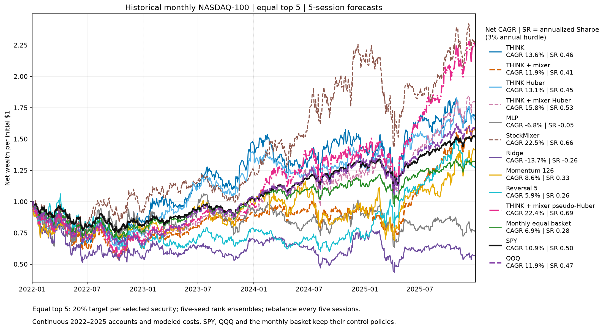

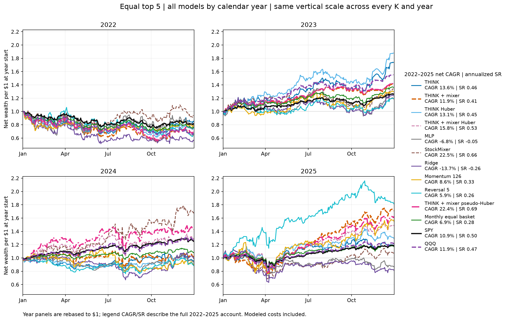

| Model | 2022 net return | 2023 | 2024 | 2025 |
| --- | --- | --- | --- | --- |
| THINK | -15.1% | 73.8% | -4.3% | 17.7% |
| THINK + mixer | -35.1% | 40.0% | 0.8% | 70.7% |
| THINK Huber | -25.5% | 87.8% | -9.3% | 28.8% |
| THINK + mixer Huber | -33.4% | 41.7% | 28.3% | 47.8% |
| MLP | -21.1% | 18.9% | -6.7% | -13.7% |
| StockMixer | -6.0% | 34.3% | 67.0% | 6.4% |
| Ridge | -43.4% | 23.7% | -1.6% | -19.2% |
| Momentum 126 | -21.4% | 29.8% | -11.6% | 53.9% |
| Reversal 5 | -34.2% | 19.8% | -11.7% | 80.6% |
| THINK + mixer pseudo-Huber | -30.9% | 41.5% | 42.6% | 60.3% |
| Monthly equal basket | -23.8% | 36.3% | 7.8% | 16.5% |
| SPY | -18.7% | 26.2% | 24.9% | 17.6% |
| QQQ | -33.3% | 54.9% | 25.6% | 20.7% |

### Equal top 10

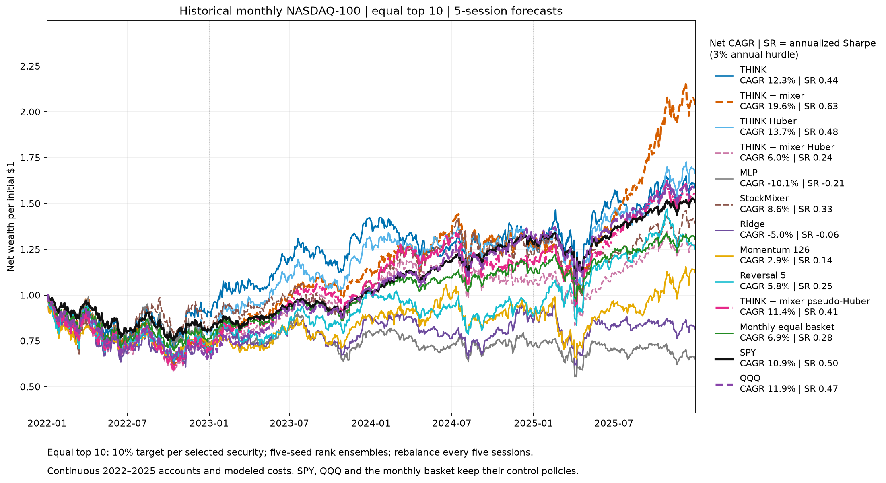

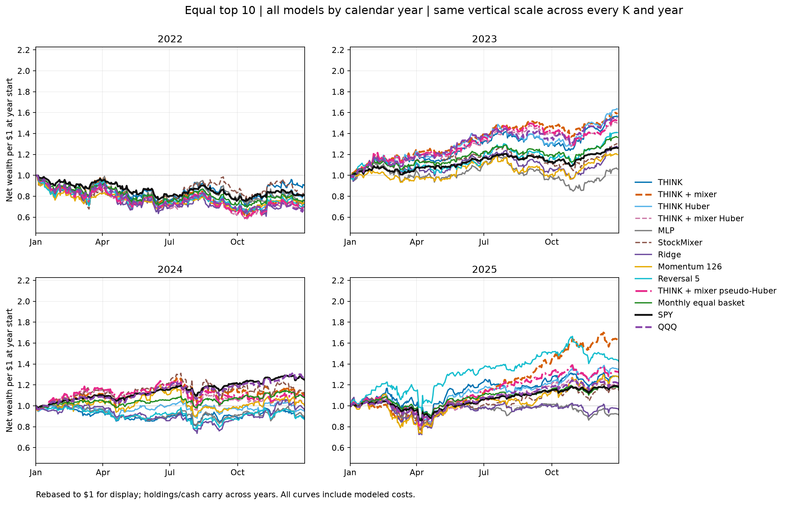

| Model | 2022 net return | 2023 | 2024 | 2025 |
| --- | --- | --- | --- | --- |
| THINK | -9.2% | 56.5% | -11.7% | 26.5% |
| THINK + mixer | -28.0% | 58.6% | 10.6% | 61.3% |
| THINK Huber | -19.6% | 63.4% | -5.2% | 33.7% |
| THINK + mixer Huber | -31.1% | 49.7% | 2.8% | 19.2% |
| MLP | -24.6% | 6.0% | -10.0% | -9.1% |
| StockMixer | -17.0% | 30.0% | 12.5% | 14.7% |
| Ridge | -30.1% | 27.0% | -4.1% | -4.3% |
| Momentum 126 | -26.2% | 19.9% | 0.4% | 26.4% |
| Reversal 5 | -28.1% | 41.0% | -13.0% | 41.9% |
| THINK + mixer pseudo-Huber | -29.1% | 51.8% | 8.6% | 31.5% |
| Monthly equal basket | -23.8% | 36.3% | 7.8% | 16.5% |
| SPY | -18.7% | 26.2% | 24.9% | 17.6% |
| QQQ | -33.3% | 54.9% | 25.6% | 20.7% |

### Equal top 20

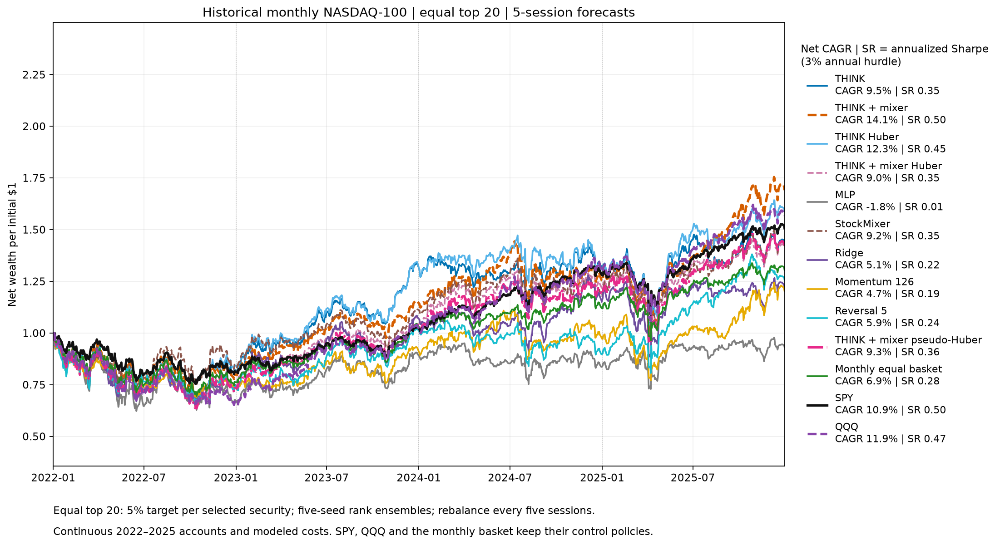

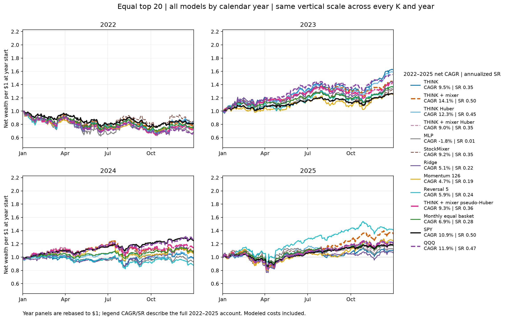

| Model | 2022 net return | 2023 | 2024 | 2025 |
| --- | --- | --- | --- | --- |
| THINK | -18.0% | 62.6% | -1.3% | 8.9% |
| THINK + mixer | -20.3% | 44.6% | 8.8% | 34.8% |
| THINK Huber | -15.8% | 59.0% | -2.5% | 21.5% |
| THINK + mixer Huber | -23.8% | 40.8% | 13.5% | 15.8% |
| MLP | -32.4% | 32.9% | -7.0% | 11.4% |
| StockMixer | -15.3% | 31.6% | 5.9% | 20.3% |
| Ridge | -25.1% | 43.6% | 6.9% | 5.8% |
| Momentum 126 | -26.0% | 25.2% | 5.0% | 23.5% |
| Reversal 5 | -25.7% | 37.1% | -12.1% | 40.1% |
| THINK + mixer pseudo-Huber | -26.6% | 42.1% | 13.8% | 20.0% |
| Monthly equal basket | -23.8% | 36.3% | 7.8% | 16.5% |
| SPY | -18.7% | 26.2% | 24.9% | 17.6% |
| QQQ | -33.3% | 54.9% | 25.6% | 20.7% |

### Training-seed stability across portfolio sizes

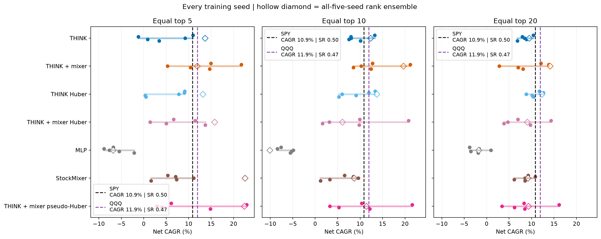

| Model | K | Seed CAGR min | Median | Max | Seeds CAGR > QQQ |
| --- | --- | --- | --- | --- | --- |
| THINK | 5 | -1.2% | 3.4% | 11.0% | 0/5 |
| THINK + mixer | 5 | 5.3% | 14.7% | 21.7% | 3/5 |
| THINK Huber | 5 | 0.3% | 7.8% | 9.1% | 0/5 |
| THINK + mixer Huber | 5 | 1.4% | 6.6% | 13.7% | 1/5 |
| MLP | 5 | -8.9% | -6.8% | -2.1% | 0/5 |
| StockMixer | 5 | 1.6% | 7.1% | 11.1% | 0/5 |
| THINK + mixer pseudo-Huber | 5 | 3.0% | 6.1% | 22.9% | 2/5 |
| THINK | 10 | 7.5% | 8.0% | 13.3% | 1/5 |
| THINK + mixer | 10 | 8.5% | 12.4% | 21.2% | 3/5 |
| THINK Huber | 10 | 5.3% | 9.1% | 13.3% | 1/5 |
| THINK + mixer Huber | 10 | 1.6% | 9.8% | 20.8% | 1/5 |
| MLP | 10 | -8.5% | -5.6% | -4.9% | 0/5 |
| StockMixer | 10 | 1.2% | 6.5% | 9.6% | 0/5 |
| THINK + mixer pseudo-Huber | 10 | 3.2% | 10.4% | 21.6% | 2/5 |
| THINK | 20 | 6.8% | 8.4% | 10.4% | 0/5 |
| THINK + mixer | 20 | 2.8% | 8.1% | 13.8% | 2/5 |
| THINK Huber | 20 | 8.8% | 10.4% | 12.6% | 1/5 |
| THINK + mixer Huber | 20 | 3.8% | 6.9% | 14.3% | 1/5 |
| MLP | 20 | -3.8% | -1.9% | 0.9% | 0/5 |
| StockMixer | 20 | 6.1% | 8.5% | 10.8% | 0/5 |
| THINK + mixer pseudo-Huber | 20 | 3.4% | 8.3% | 16.1% | 1/5 |

Five seeds share the same market history; their range measures sensitivity to
training initialization, not five independent market trials. Full 2×/4× cost
stress results remain visible in the linked metrics file.

Pseudo-Huber ensemble net CAGR under the declared cost stresses:

| K | Base costs | 2× costs | 4× costs |
| --- | --- | --- | --- |
| 5 | 22.4% | 19.6% | 14.3% |
| 10 | 11.4% | 9.3% | 5.2% |
| 20 | 9.3% | 7.7% | 4.6% |

### Pseudo-Huber forecast quality and uncertainty

| Model | IC | RankIC | ICIR | RankICIR | NDCG@5 | NDCG@10 | NDCG@20 |
| --- | --- | --- | --- | --- | --- | --- | --- |
| THINK + mixer | 0.0125 | 0.0074 | 0.0966 | 0.0569 | 0.5316 | 0.5392 | 0.5553 |
| THINK + mixer Huber | 0.0062 | 0.0038 | 0.0511 | 0.0311 | 0.5310 | 0.5300 | 0.5494 |
| THINK + mixer pseudo-Huber | 0.0077 | 0.0045 | 0.0630 | 0.0365 | 0.5403 | 0.5377 | 0.5523 |

The same forecasts drive every K, so IC and RankIC do not change merely because
we buy a different number of names. These diagnostics average 200 full
five-session periods. Pseudo-Huber's NDCG@10 is 0.5377, versus
0.5176 expected for random ordering of the same observed stocks. NDCG is
relative ranking quality, not percentage accuracy or net portfolio return.

Exploratory **pseudo-Huber minus comparator** Sharpe differences:

| K | Comparator | Sharpe difference | 95% paired interval |
| --- | --- | --- | --- |
| 5 | THINK + mixer | 0.275 | [-0.122, 0.695] |
| 5 | THINK + mixer Huber | 0.162 | [-0.017, 0.341] |
| 5 | QQQ | 0.220 | [-0.281, 0.704] |
| 10 | THINK + mixer | -0.217 | [-0.582, 0.122] |
| 10 | THINK + mixer Huber | 0.167 | [0.057, 0.270] |
| 10 | QQQ | -0.057 | [-0.524, 0.323] |
| 20 | THINK + mixer | -0.145 | [-0.378, 0.091] |
| 20 | THINK + mixer Huber | 0.009 | [-0.077, 0.108] |
| 20 | QQQ | -0.111 | [-0.419, 0.189] |

Intervals use the same 1,000 paired circular 20-session block resamples as the
parent study and are not adjusted for multiple comparisons. An interval that
includes zero does not establish an advantage. The 2022–2025 years were already
inspected before this user-requested follow-up: this is exploratory research,
not fresh confirmation. Original public-data, membership and settlement limits
remain. No delta, epoch, seed or K was selected by these test returns.

The extension audit reproduced all 20 checkpoints and validation epochs,
independently checked ranking metrics for ten signals, and replayed all 204
share/cash paths. It confirmed all 120 parent paths unchanged; the largest NAV
difference was $0.00000006.

The audit caught a validation-export issue: the originally saved validation
arrays were from the final epoch, while the checkpoint and test forecasts were
from the selected best-validation epoch. Selected-checkpoint validation arrays
were regenerated separately, matched to the recorded best validation MSE,
and all test forecasts reproduced unchanged. Original fit files and hashes
are preserved. No model was retrained or selected by test returns to make this
correction. [Validation export correction](topk_pseudohuber/VALIDATION_EXPORT_CORRECTION.json).

[Extension protocol](topk_pseudohuber/PROTOCOL.json) · [Independent audit](topk_pseudohuber/AUDIT.json) ·
[All sizes, seeds and cost stresses](topk_pseudohuber/metrics.csv) · [All dated paths](topk_pseudohuber/curves.csv) ·
[Annual returns](topk_pseudohuber/annual.csv) · [Monthly returns](topk_pseudohuber/monthly.csv) ·
[All forecast diagnostics](topk_pseudohuber/ranking.csv) · [Forecast diagnostics by year](topk_pseudohuber/ranking_by_year.csv) ·
[Every forecast period](topk_pseudohuber/ranking_periods.csv) · [Paired intervals](topk_pseudohuber/paired_bootstrap.csv) ·
[Twenty new fits](topk_pseudohuber/training_records.csv) · [Input/code lock](topk_pseudohuber/INPUT_CODE_LOCK.json) ·
[Parent artifact lock](topk_pseudohuber/SOURCE_ARTIFACT_LOCK.json) · [Fit-completion lock](topk_pseudohuber/FITS_COMPLETE_LOCK.json) ·
[Completion record](topk_pseudohuber/completion.json)

## NASDAQ-100 historical monthly universe, 5-session forecasts

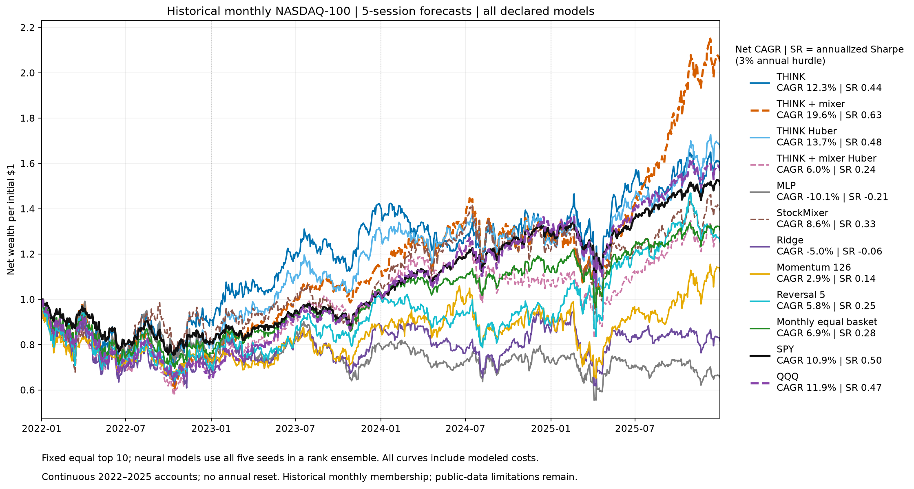

All six neural variants, three simple signals, the monthly basket, SPY and QQQ
share one linear wealth axis. Net wealth per initial $1 is the cumulative product
of one plus each daily net return, including entry and exit fees. The legend
shows net CAGR and annualized net Sharpe (SR) together for each curve, including
QQQ and SPY. Sharpe is calculated from daily returns and uses a 3% annual hurdle.

The primary portfolio is fixed equal top 10, long only, rebalanced every five
sessions. Signals freeze at the prior close; share orders fill at the next close.
Accounts start with $1 million on 2022-01-03 and end with liquidation on
2025-12-31. Holdings and cash carry across annual model changes. ETF controls use
the same dates and entry/exit cost schedule. Neural primary results average
eligible-stock ranks from all five seeds; no best seed or best portfolio size is chosen.

**Fixed equal top 10** means the portfolio targets the ten highest-scoring
eligible securities at each rebalance, with 10% of signal-time account value
allocated to each, long only and without leverage. For a $1 million account,
that is a $100,000 target per security before fees and execution constraints.
"Fixed" refers to the predeclared count of ten, not ten permanently held names;
the selected names can change every five trading sessions. "Equal" means score
size does not change the target allocation. The strategy still buys the highest
scores even when all predicted returns are negative. Ties at the tenth-place
boundary split the remaining allocation fairly and can produce more than ten
positions. Prices move between the signal and fill; fees, liquidity caps and
cash limits can leave actual weights unequal or leave residual cash. Weights
also drift between rebalances. Top 5 and top 20 are sensitivity checks, not
choices made after seeing which returned the most.

| Model | Net CAGR | Sharpe | Max drawdown | Worst year | Total return |
| --- | --- | --- | --- | --- | --- |
| THINK | 12.3% | 0.435 | -29.0% | -11.7% | 58.7% |
| THINK + mixer | 19.6% | 0.629 | -39.4% | -28.0% | 103.9% |
| THINK Huber | 13.7% | 0.475 | -36.7% | -19.6% | 66.5% |
| THINK + mixer Huber | 6.0% | 0.245 | -41.7% | -31.1% | 26.2% |
| MLP | -10.1% | -0.208 | -44.5% | -24.6% | -34.7% |
| StockMixer | 8.6% | 0.326 | -34.0% | -17.0% | 39.1% |
| Ridge | -5.0% | -0.058 | -39.1% | -30.1% | -18.4% |
| Momentum 126 | 2.9% | 0.145 | -38.4% | -26.2% | 12.2% |
| Reversal 5 | 5.8% | 0.246 | -35.8% | -28.1% | 25.2% |
| Monthly equal basket | 6.9% | 0.279 | -30.5% | -23.8% | 30.4% |
| SPY | 10.9% | 0.498 | -24.6% | -18.7% | 50.7% |
| QQQ | 11.9% | 0.469 | -34.9% | -33.3% | 56.6% |

Sharpe uses daily net returns, 252 sessions/year and a fixed 3% annual hurdle;
CAGR uses compounded net returns. Drawdowns include initial cash. These are
research backtests, not verified executable returns or a future-return forecast.

## Forecast ranking: IC, RankIC and NDCG

| Model | IC | RankIC | ICIR | RankICIR | NDCG@5 | NDCG@10 | NDCG@20 |
| --- | --- | --- | --- | --- | --- | --- | --- |
| THINK | 0.0250 | 0.0206 | 0.1503 | 0.1164 | 0.5150 | 0.5257 | 0.5471 |
| THINK + mixer | 0.0125 | 0.0074 | 0.0966 | 0.0569 | 0.5316 | 0.5392 | 0.5553 |
| THINK Huber | 0.0234 | 0.0197 | 0.1488 | 0.1170 | 0.5179 | 0.5305 | 0.5520 |
| THINK + mixer Huber | 0.0062 | 0.0038 | 0.0511 | 0.0311 | 0.5310 | 0.5300 | 0.5494 |
| MLP | -0.0079 | -0.0108 | -0.0341 | -0.0451 | 0.4820 | 0.4944 | 0.5248 |
| StockMixer | 0.0228 | 0.0186 | 0.1379 | 0.1101 | 0.5206 | 0.5208 | 0.5446 |
| Ridge | -0.0005 | -0.0009 | -0.0027 | -0.0041 | 0.4811 | 0.5015 | 0.5321 |
| Momentum 126 | 0.0098 | 0.0139 | 0.0400 | 0.0563 | 0.5254 | 0.5275 | 0.5465 |
| Reversal 5 | 0.0118 | 0.0183 | 0.0567 | 0.0851 | 0.5044 | 0.5174 | 0.5446 |

These are equally weighted averages across **200 complete five-session forecast
periods** in 2022–2025, calculated across signal-time eligible stocks with
observed next-close-to-five-sessions-later returns. They are gross forecast
diagnostics; transaction costs enter the wealth chart, not these metrics.
Neural rows use the same five-seed average rank scores that drive the primary
portfolio, so their IC measures ensemble score/return correlation rather than
calibration of a predicted return magnitude. The final partial holding period
has no complete target and is excluded; 101 eligible stock/period targets in
total are unobserved, including that final period. SPY, QQQ and the monthly
equal basket do not produce cross-sectional stock forecasts, so these metrics
are not applicable to them.

- **IC (information coefficient):** Pearson correlation between the model's
  scores and subsequent realized returns within each forecast period.
- **RankIC:** Spearman correlation, using average ranks for ties. Both
  correlations range from -1 to +1; zero indicates no linear or rank association
  respectively. They describe the whole eligible stock ranking.
- **ICIR / RankICIR:** mean period correlation divided by its sample standard
  deviation. These are not annualized and are not significance tests.
- **NDCG@k:** normalized discounted cumulative gain for the first k predicted
  positions. Realized-return percentile ranks supply nonnegative linear gains;
  positions receive a 1/log2(position + 1) discount, with positions numbered
  from one. Prediction ties average their possible position discounts. One
  equals the hindsight ideal ranking for those outcomes. **0.539 does not mean
  53.9% correct predictions**: random orderings also receive positive gain.
  Even an all-negative-return period can have high NDCG because this metric
  judges relative ordering, not whether buying those stocks makes money.

THINK + mixer: IC 0.0125, RankIC 0.0074, NDCG@10 0.5392; its matched random-ranking expectation is 0.5176. Regular THINK has higher IC (0.0250) and RankIC (0.0206); THINK + mixer has the highest mean NDCG@10 among these nine signals. Its ranking advantage is small in absolute terms and has not been established as statistically significant. These metrics do not identify a universal winner.

The ranking summaries were independently recomputed from frozen predictions
and ridge coefficients using separate rank, correlation and discount
calculations. [Ranking audit](RANKING_AUDIT.json) ·
[Pooled ranking metrics](ranking.csv) · [Ranking metrics by year](ranking_by_year.csv) ·
[Every forecast period and matched random NDCG expectation](ranking_periods.csv).

## Year-by-year wealth charts

Each chart shows all twelve primary model and control paths for one calendar
year, with the same colors, line styles and vertical scale. Curves are rebased
to $1 at the start of each year so that within-year gains and losses can be
compared; this is display normalization of the existing continuous account.
Holdings and cash still carry across years. Each legend reports that year's
annualized CAGR and annualized net Sharpe, and each curve's final value minus one equals the net annual
return in the table below. The four annual growth factors compound to the
full-period return shown above.

### 2022

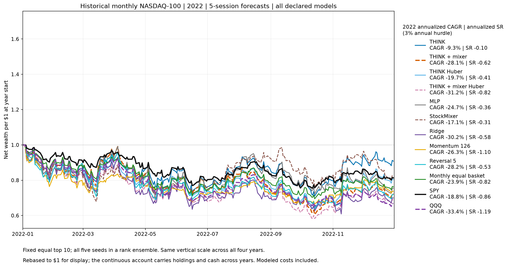
### 2023

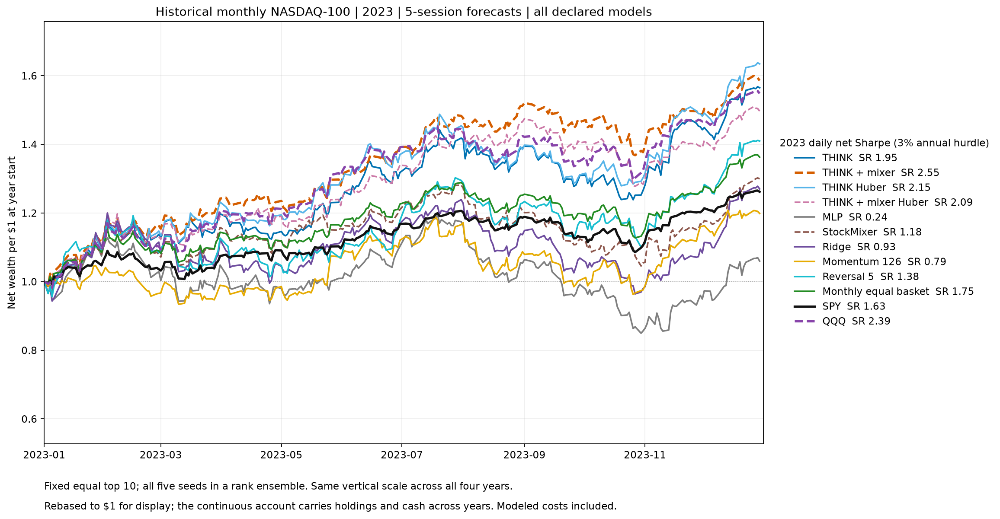
### 2024

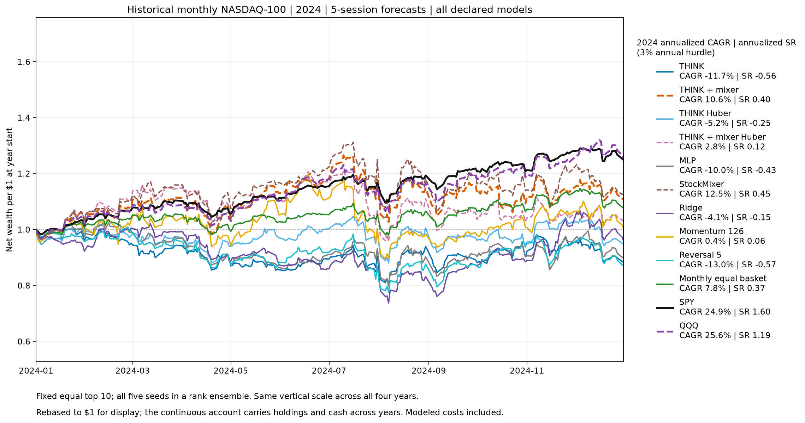
### 2025

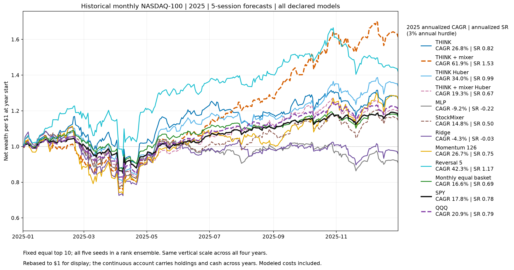

## Consistency by year, month and training seed

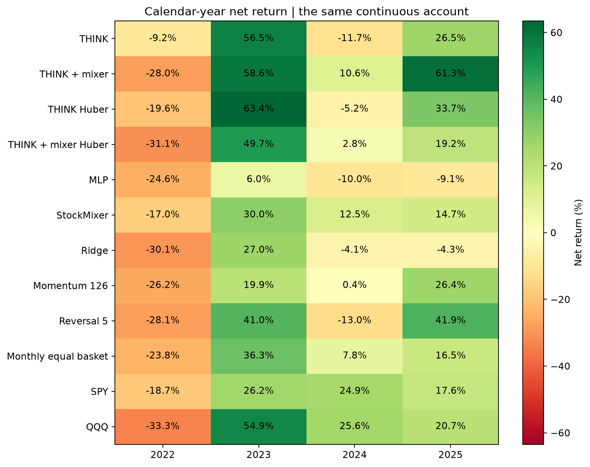

| Model | 2022 | 2023 | 2024 | 2025 |
| --- | --- | --- | --- | --- |
| THINK | -9.2% | 56.5% | -11.7% | 26.5% |
| THINK + mixer | -28.0% | 58.6% | 10.6% | 61.3% |
| THINK Huber | -19.6% | 63.4% | -5.2% | 33.7% |
| THINK + mixer Huber | -31.1% | 49.7% | 2.8% | 19.2% |
| MLP | -24.6% | 6.0% | -10.0% | -9.1% |
| StockMixer | -17.0% | 30.0% | 12.5% | 14.7% |
| Ridge | -30.1% | 27.0% | -4.1% | -4.3% |
| Momentum 126 | -26.2% | 19.9% | 0.4% | 26.4% |
| Reversal 5 | -28.1% | 41.0% | -13.0% | 41.9% |
| Monthly equal basket | -23.8% | 36.3% | 7.8% | 16.5% |
| SPY | -18.7% | 26.2% | 24.9% | 17.6% |
| QQQ | -33.3% | 54.9% | 25.6% | 20.7% |

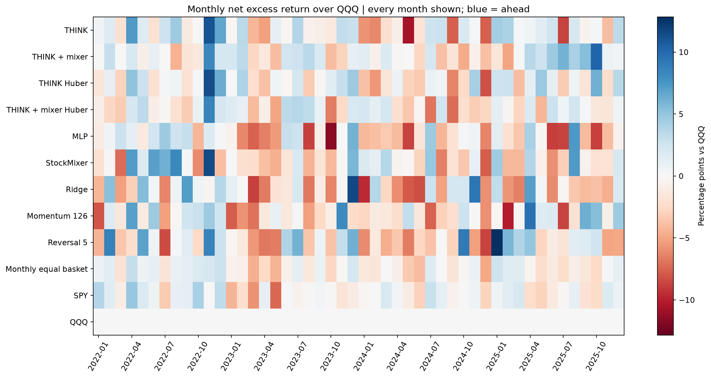

| Model | Months > QQQ | Years > QQQ | Months > SPY | Years > SPY | Positive years | Monthly QQQ excess SD |
| --- | --- | --- | --- | --- | --- | --- |
| THINK | 27/48 | 3/4 | 25/48 | 3/4 | 2/4 | 4.2% |
| THINK + mixer | 28/48 | 3/4 | 24/48 | 2/4 | 3/4 | 3.3% |
| THINK Huber | 27/48 | 3/4 | 23/48 | 2/4 | 2/4 | 3.7% |
| THINK + mixer Huber | 23/48 | 1/4 | 25/48 | 2/4 | 3/4 | 3.1% |
| MLP | 19/48 | 1/4 | 19/48 | 0/4 | 1/4 | 4.5% |
| StockMixer | 18/48 | 1/4 | 26/48 | 2/4 | 3/4 | 4.4% |
| Ridge | 20/48 | 1/4 | 18/48 | 1/4 | 1/4 | 5.0% |
| Momentum 126 | 19/48 | 2/4 | 17/48 | 1/4 | 3/4 | 4.5% |
| Reversal 5 | 20/48 | 2/4 | 24/48 | 2/4 | 2/4 | 5.1% |
| Monthly equal basket | 21/48 | 1/4 | 19/48 | 1/4 | 3/4 | 2.0% |
| SPY | 24/48 | 1/4 | 0/48 | 0/4 | 3/4 | 2.4% |
| QQQ | 0/48 | 0/4 | 24/48 | 3/4 | 3/4 | 0.0% |

Equal returns count as ties rather than wins. Monthly excess SD is measured in
percentage points; a low spread alone is not success if returns remain poor.
The basket is equal weighted at the first scheduled fill of each month; QQQ
uses index weights and actual fund returns, so they are different controls.

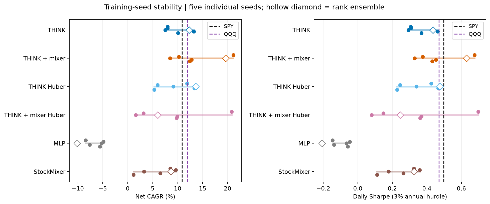

| Model | Seed CAGR: min / median / max | Seed Sharpe: min / median / max | Seeds CAGR > QQQ | Worst seed/year | Seed/year wins vs QQQ |
| --- | --- | --- | --- | --- | --- |
| THINK | 7.5% / 8.0% / 13.3% | 0.293 / 0.307 / 0.463 | 1/5 | -18.3% | 9/20 |
| THINK + mixer | 8.5% / 12.4% / 21.2% | 0.329 / 0.430 / 0.676 | 3/5 | -27.3% | 10/20 |
| THINK Huber | 5.3% / 9.1% / 13.3% | 0.228 / 0.340 / 0.465 | 1/5 | -16.2% | 7/20 |
| THINK + mixer Huber | 1.6% / 9.8% / 20.8% | 0.080 / 0.362 / 0.697 | 1/5 | -26.7% | 7/20 |
| MLP | -8.5% / -5.6% / -4.9% | -0.146 / -0.066 / -0.046 | 0/5 | -30.5% | 5/20 |
| StockMixer | 1.2% / 6.5% / 9.6% | 0.112 / 0.263 / 0.358 | 0/5 | -34.7% | 6/20 |

Seeds 7, 19, 42, 61 and 97 vary initialization within the same dated universe.
They are not five independent market histories. The earlier three random draws
tested cohort sensitivity separately and had substantial dispersion; see
[all earlier random-sample charts](../random_trials_20261010/CHARTS.md).
Those draws requested 100 names but recovered only 54–70 price histories, so
they are not complete historical random samples of 100. Neither averaging
seeds nor averaging draws removes a biased universe. Historical
membership addresses that selection problem; unseen forward data remain necessary.

## Fixed sensitivity checks and uncertainty

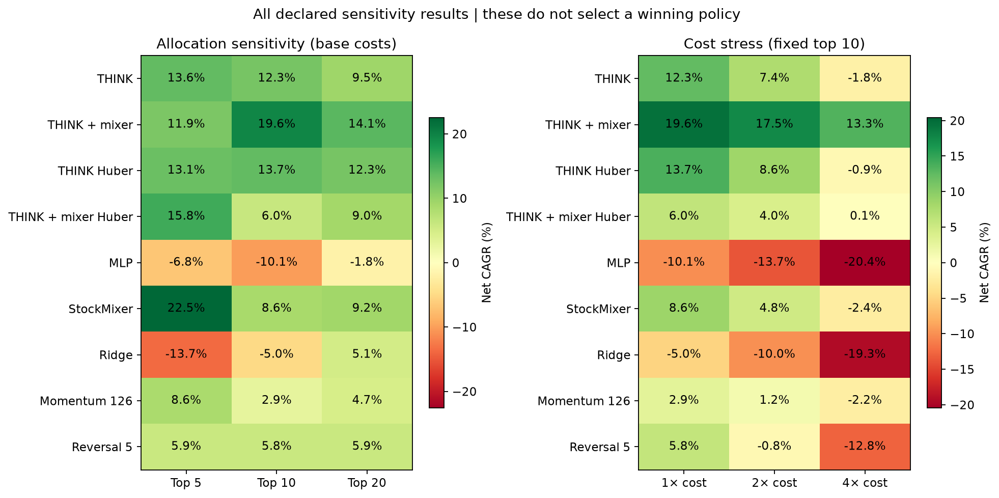

Base costs are 7 basis points plus 3 basis points times the square root of
participation divided by 1%. Trades are capped at 1% of signal-time 20-session
average dollar volume. Cash-short buy orders resize proportionally; missing
fills cancel without reranking. Both costs and impact are multiplied in the
2×/4× stress paths. This remains a fractional-unit, adjusted-total-return account
approximation; auction fill quality, integer lots, taxes and cash interest are
not modeled. No alternative size or cost scenario becomes the primary result.

| Model | Comparison | Sharpe difference | Exploratory 95% interval | Zero check |
| --- | --- | --- | --- | --- |
| THINK | QQQ | -0.034 | [-0.585, 0.453] | includes zero |
| THINK + mixer | QQQ | 0.160 | [-0.262, 0.559] | includes zero |
| THINK Huber | QQQ | 0.006 | [-0.425, 0.420] | includes zero |
| THINK + mixer Huber | QQQ | -0.225 | [-0.663, 0.162] | includes zero |
| MLP | QQQ | -0.678 | [-1.309, -0.142] | excludes zero |
| StockMixer | QQQ | -0.144 | [-0.716, 0.344] | includes zero |
| Ridge | QQQ | -0.527 | [-1.111, -0.009] | excludes zero |
| Momentum 126 | QQQ | -0.325 | [-0.860, 0.229] | includes zero |
| Reversal 5 | QQQ | -0.223 | [-0.810, 0.353] | includes zero |
| Monthly equal basket | QQQ | -0.191 | [-0.492, 0.104] | includes zero |
| THINK + mixer | THINK | 0.194 | [-0.331, 0.758] | includes zero |
| THINK + mixer Huber | THINK Huber | -0.231 | [-0.697, 0.172] | includes zero |

The intervals use 1,000 paired circular 20-session block resamples of daily
returns. They preserve same-date pairing but are not adjusted for multiple
comparisons, data revisions or repeated use of these test years.

THINK + mixer versus THINK has a Sharpe difference of 0.194 with exploratory 95% interval [-0.331, 0.758]. The interval includes zero, so this study does not establish a consistent mixer advantage. THINK + mixer Huber versus THINK Huber has a Sharpe difference of -0.231 with exploratory 95% interval [-0.697, 0.172]. The interval includes zero, so this study does not establish a consistent mixer advantage.

Adding a mixer changes the learned cross-stock interactions and adds parameters;
it need not improve returns. Training minimizes forecast loss, while the traded
portfolio depends on the ranking near the top-10 boundary. Better forecast loss
does not automatically mean a better portfolio. The earlier NASDAQ/NYSE
difference cannot establish an exchange-specific advantage from one sample.

## What the models do

**126-session momentum** scores a stock as adjusted close today divided by
adjusted close 126 trading sessions ago, minus one: roughly six months of
total-return momentum. It has no fitted coefficients and does not skip the
latest month. Here it buys the ten highest available scores every five sessions.
Large gains can occur when recent winners keep winning; concentrated exposure
also loses when leadership reverses. The earlier spectacular result used
2026-selected survivors and a different annual-reset experiment, so it is not
directly comparable to this historical, continuous account.

**Ridge** is one shared linear return forecast fitted across the eligible
historical stocks and dates. Each stock contributes 16 sessions of five
features (80 numbers), plus an intercept. It forecasts the next five-session
return with squared-error loss and an L2 coefficient penalty of 10; the
intercept is unpenalized. Shrinkage controls large fitted weights. It does not
directly optimize Sharpe, CAGR or portfolio returns.

**THINK** is this repository's local hyperbolic temporal/hypergraph adaptation.
Its graph links stocks using positive correlations computed only on training
history and historical membership. **THINK + mixer** adds a learned cross-stock
residual to its scores. The **Huber** variants cap the influence of large
forecast errors beyond one percentage point; they still select epochs using
prior-year validation MSE. **MLP** applies a small shared nonlinear network to
each stock's feature window. **StockMixer** combines temporal, feature and
cross-stock mixing and includes a pairwise ranking penalty. These implementations
are controlled local comparisons, not certified reproductions of published papers.
**Reversal 5** ranks by negative recent five-session return and is unfitted.

All learned forecasts use daily return, distance from 5/20-session moving
averages, 20-session return volatility and dollar-volume relative to its
20-session average. Training-only normalization, monthly masks and inactive-node
sanitization prevent future members from entering active graph/mixer calculations.
Targets are next-close to five sessions later; outcomes crossing train/validation
boundaries are purged. Architecture and seed comparisons were declared before
these replacement test metrics; no live candidate is selected from this table.

## Data and audit limits

Training begins July 2019, a declared free-source amendment made before these
metrics. The four folds have 1.5, 2.5, 3.5 and four training years, respectively,
and the preceding calendar year for validation. The first fold has materially
less training history. Earlier prices only warm up features.

| Test year | Train forecasts | Validation forecasts | Test forecasts | Unobserved train / validation targets |
| --- | --- | --- | --- | --- |
| 2022 | 75 | 49 | 51 | 1 / 3 |
| 2023 | 125 | 49 | 50 | 4 / 0 |
| 2024 | 176 | 49 | 50 | 4 / 0 |
| 2025 | 200 | 49 | 50 | 3 / 0 |

Four unique supervised targets spanning older unpriced mergers are unobserved;
fold rows overlap, so those counts should not be summed into distinct targets.
They are excluded from loss without removing their signal-time members. The
last partial test holding period is valued and liquidated but has no full
five-session supervised target.

Membership is a pinned historical event reconstruction with annual closure
checks and Nasdaq annual-announcement cross-checks. It is not a fully licensed
as-published constituent database. The exact 2025 SOLS off-cycle dates conflict
across sources; both produce the same November monthly snapshot, and IPO warmup
keeps SOLS outside the forecasting portfolios. Monthly membership is intentionally
frozen even when the actual index changes within the month.

Tiingo supplies recovered former-member histories; Yahoo supplies continuing
prices. Reused/unidentified histories were rejected. No unexplained selected-stock
trading-price gaps remain. Vendor rows after acquisition were trimmed. XLNX,
SGEN, SPLK and ANSS use verified cash/share acquisition consideration; old
holdings become cash rather than being carried indefinitely at their last quote.
Stock consideration is sold at completion close with fees and cash is available
then: actual broker settlement can be later, and no settlement-delay stress was
run. Retrospectively adjusted public prices can still contain revisions/errors.

The audit reproduced **120 checkpoints**,
training-only scaling/graphs and ridge coefficients, independently replayed
**120 share/cash paths** and recomputed their
metrics. The largest NAV difference was **$0.00000006**.
Accounting reproduction checks arithmetic and timing; it does not certify every
provider fact. The 2022–2025 years were already inspected in earlier experiments,
so these results remain exploratory. Consistently good future performance still
requires an unseen period or paper trading with the frozen strategy.

[Data sources and acquisition terms](DATA_REQUIREMENTS.md) ·
[Frozen protocol](PROTOCOL.json) · [Independent audit](AUDIT.json) ·
[120-fit record](training_records.csv) · [All metrics/sensitivities](metrics.csv) ·
[Annual returns](annual.csv) · [Monthly returns](monthly.csv) ·
[Primary daily curves](primary_curves.csv) · [Paired intervals](paired_bootstrap.csv) ·
[Input/code fingerprints](INPUT_CODE_LOCK.json) · [Imported dependency fingerprints](DEPENDENCY_CODE_LOCK.json) ·
[2026 NASDAQ retirement record](../audit/nasdaq_2026_retirement.json)
