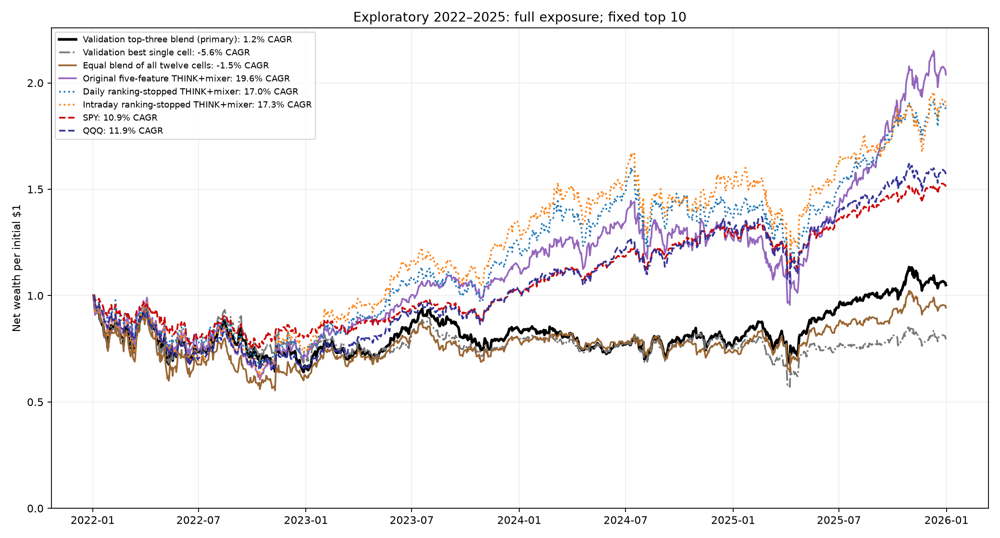
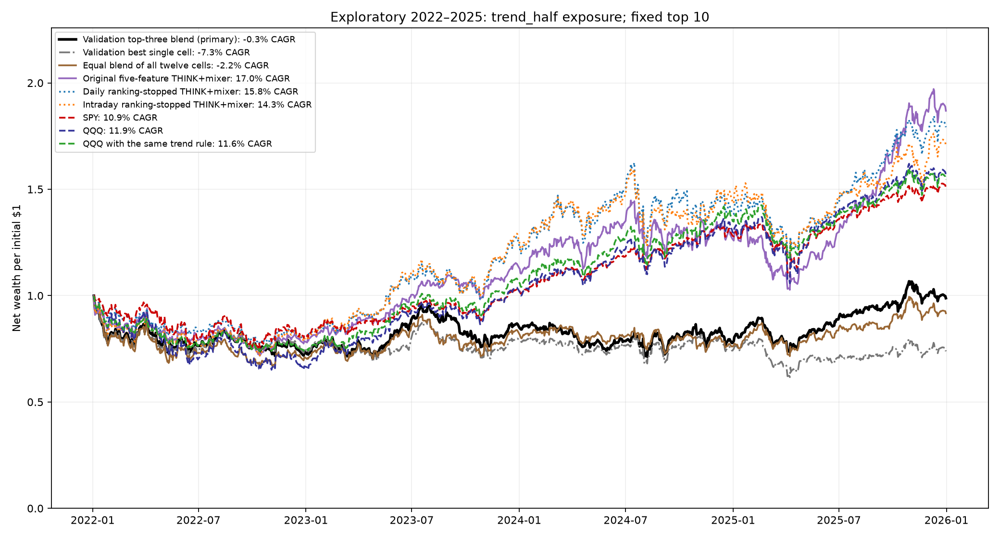
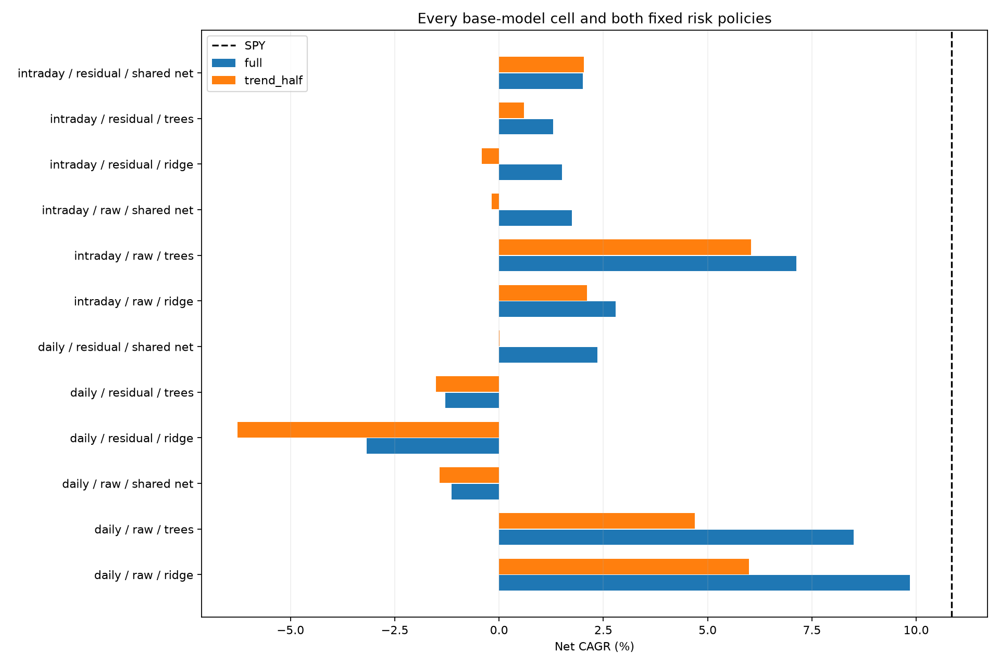
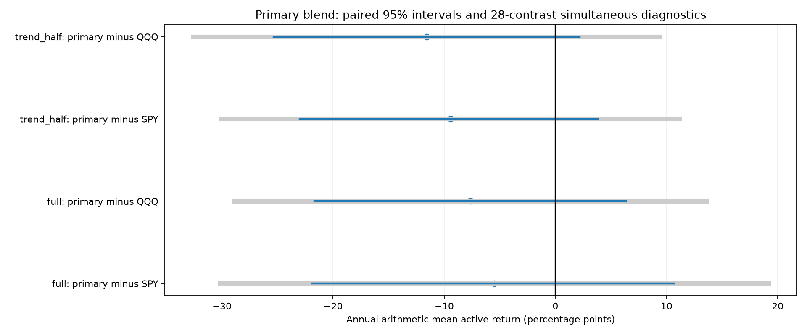

# NASDAQ-100: broader feature, model and risk-policy research

**Complete: 208 candidate fits, 176 selected fold models and 216 continuous portfolio accounts; independent audit passed.**

The validation-selected top-three blend returned **1.2% CAGR** at full exposure and **-0.3% CAGR** under the fixed trend rule. SPY returned **10.9% CAGR** over the same 2022–2025 account dates.

The highest observed development CAGR among the twelve base cells and three selector policies was 9.9% for daily / raw / ridge / full. This is a descriptive, after-the-fact observation. The primary strategy remains the validation-selected top-three rule.

**All 2022–2025 results remain exploratory. These dates were examined in earlier research. Passing a historical screen or finding a higher curve does not establish reliable future outperformance.**

## Prespecified reliability screen

The primary development screen requires CAGR above SPY at base and double costs, at least three of four years and 28 of 48 months above SPY, and maximum drawdown no more than five percentage points worse than SPY. Matched seed blends and simultaneous comparisons against every base model are additional diagnostics. The screen is not a significance test.

| Primary risk policy | Historical screen passed | Years above SPY | Months above SPY | Drawdown limit passed | Matched seeds above SPY | Positive simultaneous contrasts |
| --- | --- | --- | --- | --- | --- | --- |
| full | False | 2/4 | 22/48 | False | 0/5 | 0/14 |
| trend_half | False | 1/4 | 20/48 | True | 0/5 | 0/14 |

## Features, models and causal selection

The inputs contain 65 channels. Daily features include 1–252-session trends, QQQ-relative trends, moving-average distances, realized and downside volatility, drawdown, relative dollar volume, shrunk lagged beta, market context and cross-sectional trend ranks. The intraday view adds current, five-session and twenty-session summaries of the reviewed Alpaca bars. Daily controls pad those channels. Missing values are imputed using training means; no historical member is removed for missing long-history or intraday features.

The finite family crosses two input views, raw versus QQQ-beta-residual targets and three model types: ridge, shallow histogram gradient boosting and a shared masked neural network. The network pools eligible-stock context and uses shared parameters, so it has no ticker-specific output rows and supports a changing security count. This addresses one architectural cold-start problem; missing history and universe quality still matter. The tree and network descriptions are local implementations, not reproductions of an author’s investment results. [Tree implementation reference](https://scikit-learn.org/stable/modules/generated/sklearn.ensemble.HistGradientBoostingRegressor.html); [shared-set architecture background](https://arxiv.org/abs/1703.06114).

Training uses daily origins with overlapping five-session labels: 375/627/878/1,000 training origins in the four folds and 245–248 prior-year validation origins. All label maturities are purged across boundaries. Daily origin density increases training examples, not independent market years. Test accounts retain the original 201 forecast origins, of which 200 have complete five-session labels. Normalization uses only eligible training observations.

Ridge chooses among three fixed penalties, trees among 50/100/200 stages of a fixed shallow 200-stage fit, and the network uses validation stopping up to 30 epochs. The common criterion is median monthly validation residual RankIC minus one quarter of its monthly standard deviation. Tree automatic/random validation splitting is disabled. Family selection reads saved validation predictions only, and all four annual choices were locked before any new financial test metric. Every attempted cell is disclosed.

| Test year | Top three selected using prior-year validation only | Validation stability scores |
| --- | --- | --- |
| 2022 | daily / residual / ridge; intraday / residual / trees; intraday / residual / ridge | +0.0052; -0.0026; -0.0054 |
| 2023 | daily / residual / shared net; intraday / residual / shared net; intraday / residual / ridge | +0.0525; +0.0359; +0.0345 |
| 2024 | daily / residual / shared net; intraday / residual / shared net; intraday / raw / shared net | +0.0155; +0.0152; +0.0094 |
| 2025 | daily / residual / trees; daily / raw / shared net; daily / residual / shared net | +0.0273; +0.0233; +0.0147 |

## Net results for every cell and comparison

| Model / selector | Full CAGR | Full Sharpe | Full drawdown | Trend-rule CAGR | Trend-rule Sharpe | Trend-rule drawdown |
| --- | --- | --- | --- | --- | --- | --- |
| daily / raw / ridge | 9.9% | 0.359 | -31.2% | 6.0% | 0.239 | -26.7% |
| daily / raw / trees | 8.5% | 0.322 | -46.4% | 4.7% | 0.187 | -35.0% |
| daily / raw / shared net | -1.1% | 0.077 | -49.8% | -1.4% | -0.021 | -41.3% |
| daily / residual / ridge | -3.2% | -0.035 | -38.2% | -6.3% | -0.294 | -36.8% |
| daily / residual / trees | -1.3% | 0.034 | -45.5% | -1.5% | -0.083 | -34.2% |
| daily / residual / shared net | 2.4% | 0.147 | -38.4% | 0.0% | -0.007 | -30.7% |
| intraday / raw / ridge | 2.8% | 0.149 | -34.9% | 2.1% | 0.076 | -24.9% |
| intraday / raw / trees | 7.1% | 0.283 | -33.2% | 6.0% | 0.241 | -24.1% |
| intraday / raw / shared net | 1.7% | 0.161 | -40.3% | -0.2% | 0.031 | -34.6% |
| intraday / residual / ridge | 1.5% | 0.113 | -33.0% | -0.4% | -0.031 | -28.1% |
| intraday / residual / trees | 1.3% | 0.127 | -43.1% | 0.6% | 0.032 | -32.8% |
| intraday / residual / shared net | 2.0% | 0.146 | -39.7% | 2.0% | 0.089 | -31.7% |
| Validation top-three blend (primary) | 1.2% | 0.107 | -35.9% | -0.3% | -0.020 | -29.5% |
| Validation best single cell | -5.6% | -0.115 | -43.0% | -7.3% | -0.342 | -38.3% |
| Equal blend of all twelve cells | -1.5% | 0.036 | -44.6% | -2.2% | -0.100 | -33.5% |
| Original five-feature THINK+mixer | 19.6% | 0.629 | -39.4% | 17.0% | 0.654 | -29.0% |
| Daily ranking-stopped THINK+mixer | 17.0% | 0.573 | -33.0% | 15.8% | 0.609 | -26.7% |
| Intraday ranking-stopped THINK+mixer | 17.3% | 0.560 | -38.4% | 14.3% | 0.545 | -28.1% |
| Momentum 126 | 2.9% | 0.145 | -38.4% | 0.9% | 0.046 | -35.3% |
| Monthly basket | 6.9% | 0.279 | -30.5% | — | — | — |
| SPY | 10.9% | 0.498 | -24.6% | — | — | — |
| QQQ | 11.9% | 0.469 | -34.9% | — | — | — |
| QQQ with the same trend rule | — | — | — | 11.6% | 0.547 | -26.1% |

Full exposure targets 100% stocks. The fixed trend rule targets 100% when signal-close QQQ is at or above its trailing 200-session mean and 50% plus cash otherwise. Both use equal top ten targets, frozen signal-close share orders, next-close execution, 1% ADV caps, modeled fees, continuous cash and reviewed economic-price acquisition settlement. Cash earns no interest. Exposure applies to every five-session model and the separate QQQ timing control. The monthly basket is a full-exposure monthly reference. No risk threshold or K was selected from test outcomes. Accounts start with $1 million; Sharpe retains the fixed 3% hurdle.

## Consistency, seeds and costs

| Model / selector | Policy | 2022 | 2023 | 2024 | 2025 |
| --- | --- | --- | --- | --- | --- |
| Validation top-three blend (primary) | full | -32.9% | 26.6% | -10.2% | 37.7% |
| Validation top-three blend (primary) | trend_half | -26.5% | 17.9% | -10.2% | 27.0% |
| Validation best single cell | full | -28.3% | 12.6% | -7.1% | 5.9% |
| Validation best single cell | trend_half | -25.2% | 6.7% | -7.1% | -0.5% |
| Equal blend of all twelve cells | full | -37.3% | 28.3% | -8.7% | 28.5% |
| Equal blend of all twelve cells | trend_half | -29.0% | 17.6% | -8.7% | 20.4% |
| Original five-feature THINK+mixer | full | -28.0% | 58.6% | 10.6% | 61.3% |
| Original five-feature THINK+mixer | trend_half | -21.5% | 45.7% | 10.6% | 47.7% |
| QQQ with the same trend rule | trend_half | -25.1% | 43.6% | 25.6% | 14.4% |
| SPY | full | -18.7% | 26.2% | 24.9% | 17.6% |
| QQQ | full | -33.3% | 54.9% | 25.6% | 20.7% |

| Model / selector | Policy | Months above SPY |
| --- | --- | --- |
| Validation top-three blend (primary) | full | 22/48 |
| Validation top-three blend (primary) | trend_half | 20/48 |
| Validation best single cell | full | 18/48 |
| Validation best single cell | trend_half | 19/48 |
| Equal blend of all twelve cells | full | 20/48 |
| Equal blend of all twelve cells | trend_half | 19/48 |
| Original five-feature THINK+mixer | full | 24/48 |
| Original five-feature THINK+mixer | trend_half | 24/48 |
| QQQ with the same trend rule | trend_half | 25/48 |
| SPY | full | 0/48 |
| QQQ | full | 24/48 |

| Model / selector | Policy | Minimum seed CAGR | Median seed CAGR | Maximum seed CAGR | Seeds above SPY |
| --- | --- | --- | --- | --- | --- |
| daily / raw / trees | full | 8.5% | 8.5% | 8.5% | 0/5 |
| daily / raw / trees | trend_half | 4.7% | 4.7% | 4.7% | 0/5 |
| daily / raw / shared net | full | -2.3% | 1.5% | 7.6% | 0/5 |
| daily / raw / shared net | trend_half | -1.5% | 0.1% | 3.5% | 0/5 |
| daily / residual / trees | full | -1.3% | -1.3% | -1.3% | 0/5 |
| daily / residual / trees | trend_half | -1.5% | -1.5% | -1.5% | 0/5 |
| daily / residual / shared net | full | -7.7% | -3.3% | 4.1% | 0/5 |
| daily / residual / shared net | trend_half | -6.1% | -3.8% | 1.8% | 0/5 |
| intraday / raw / trees | full | 7.1% | 7.1% | 7.1% | 0/5 |
| intraday / raw / trees | trend_half | 6.0% | 6.0% | 6.0% | 0/5 |
| intraday / raw / shared net | full | -3.0% | -0.7% | 4.6% | 0/5 |
| intraday / raw / shared net | trend_half | -2.8% | -1.9% | 2.3% | 0/5 |
| intraday / residual / trees | full | 1.3% | 1.3% | 1.3% | 0/5 |
| intraday / residual / trees | trend_half | 0.6% | 0.6% | 0.6% | 0/5 |
| intraday / residual / shared net | full | -4.6% | -0.2% | 9.4% | 0/5 |
| intraday / residual / shared net | trend_half | -4.8% | 0.1% | 7.3% | 0/5 |
| Validation top-three blend (primary) | full | -1.2% | -1.0% | 2.7% | 0/5 |
| Validation top-three blend (primary) | trend_half | -2.6% | -2.1% | 1.4% | 0/5 |

Primary matched-seed blends hold the annual validation-selected cells fixed and use the matching seed from each selected stochastic model, or the single deterministic ridge. They diagnose initialization sensitivity and do not refit the selection policy independently. Different tree seed labels can produce identical predictions. Distinct forecast counts are disclosed below; even different forecasts share one historical market path.

| Base cell | Seed runs | Distinct test-forecast arrays |
| --- | --- | --- |
| daily / raw / ridge | 1 | 1 |
| daily / raw / trees | 5 | 1 |
| daily / raw / shared net | 5 | 5 |
| daily / residual / ridge | 1 | 1 |
| daily / residual / trees | 5 | 1 |
| daily / residual / shared net | 5 | 5 |
| intraday / raw / ridge | 1 | 1 |
| intraday / raw / trees | 5 | 1 |
| intraday / raw / shared net | 5 | 5 |
| intraday / residual / ridge | 1 | 1 |
| intraday / residual / trees | 5 | 1 |
| intraday / residual / shared net | 5 | 5 |

| Model / selector | Policy | 1× cost CAGR | 2× cost CAGR | 4× cost CAGR | Base annual traded-notional/NAV |
| --- | --- | --- | --- | --- | --- |
| daily / raw / ridge | full | 9.9% | 4.3% | -5.9% | 70.8× |
| daily / raw / ridge | trend_half | 6.0% | 1.4% | -7.1% | 60.4× |
| daily / raw / trees | full | 8.5% | 4.8% | -2.1% | 47.4× |
| daily / raw / trees | trend_half | 4.7% | 1.9% | -3.5% | 37.4× |
| daily / raw / shared net | full | -1.1% | -4.7% | -11.4% | 50.4× |
| daily / raw / shared net | trend_half | -1.4% | -4.4% | -10.2% | 42.5× |
| daily / residual / ridge | full | -3.2% | -8.0% | -17.0% | 70.4× |
| daily / residual / ridge | trend_half | -6.3% | -10.2% | -17.7% | 59.4× |
| daily / residual / trees | full | -1.3% | -5.1% | -12.3% | 54.0× |
| daily / residual / trees | trend_half | -1.5% | -4.6% | -10.5% | 43.7× |
| daily / residual / shared net | full | 2.4% | -2.3% | -10.9% | 63.2× |
| daily / residual / shared net | trend_half | 0.0% | -3.8% | -11.0% | 53.0× |
| intraday / raw / ridge | full | 2.8% | -2.7% | -12.9% | 75.2× |
| intraday / raw / ridge | trend_half | 2.1% | -2.6% | -11.3% | 64.2× |
| intraday / raw / trees | full | 7.1% | 2.0% | -7.6% | 67.3× |
| intraday / raw / trees | trend_half | 6.0% | 1.7% | -6.5% | 57.3× |
| intraday / raw / shared net | full | 1.7% | -2.5% | -10.4% | 57.8× |
| intraday / raw / shared net | trend_half | -0.2% | -3.7% | -10.4% | 49.3× |
| intraday / residual / ridge | full | 1.5% | -3.8% | -13.6% | 73.3× |
| intraday / residual / ridge | trend_half | -0.4% | -4.8% | -13.0% | 61.9× |
| intraday / residual / trees | full | 1.3% | -2.7% | -10.2% | 55.3× |
| intraday / residual / trees | trend_half | 0.6% | -2.7% | -8.9% | 45.2× |
| intraday / residual / shared net | full | 2.0% | -2.4% | -10.5% | 59.7× |
| intraday / residual / shared net | trend_half | 2.0% | -1.7% | -8.7% | 50.6× |
| Validation top-three blend (primary) | full | 1.2% | -3.3% | -11.7% | 62.5× |
| Validation top-three blend (primary) | trend_half | -0.3% | -4.0% | -10.9% | 51.6× |
| Validation best single cell | full | -5.6% | -9.8% | -17.4% | 61.0× |
| Validation best single cell | trend_half | -7.3% | -10.7% | -17.0% | 50.0× |
| Equal blend of all twelve cells | full | -1.5% | -6.6% | -15.9% | 72.5× |
| Equal blend of all twelve cells | trend_half | -2.2% | -6.4% | -14.4% | 61.0× |

## Paired uncertainty and competing models

| Primary contrast | Mean active return/year | Paired 95% interval | 28-contrast simultaneous diagnostic |
| --- | --- | --- | --- |
| full: primary minus SPY | -5.50 pp | [-21.85, +10.68] pp | [-30.15, +19.14] pp |
| full: primary minus QQQ | -7.65 pp | [-21.70, +6.34] pp | [-28.91, +13.62] pp |
| full: primary minus daily__raw__ridge | -8.19 pp | [-22.74, +5.94] pp | [-30.03, +13.65] pp |
| full: primary minus daily__raw__boosted_trees | -7.49 pp | [-23.30, +8.12] pp | [-31.54, +16.56] pp |
| full: primary minus daily__raw__shared_network | +0.57 pp | [-11.16, +12.10] pp | [-17.16, +18.31] pp |
| full: primary minus daily__residual__ridge | +4.59 pp | [-5.78, +15.51] pp | [-11.79, +20.97] pp |
| full: primary minus daily__residual__boosted_trees | +2.33 pp | [-11.37, +16.28] pp | [-18.86, +23.52] pp |
| full: primary minus daily__residual__shared_network | -1.47 pp | [-11.64, +9.21] pp | [-17.31, +14.36] pp |
| full: primary minus intraday__raw__ridge | -1.18 pp | [-14.58, +12.03] pp | [-21.59, +19.23] pp |
| full: primary minus intraday__raw__boosted_trees | -5.80 pp | [-19.69, +8.49] pp | [-27.32, +15.72] pp |
| full: primary minus intraday__raw__shared_network | -2.76 pp | [-15.28, +9.48] pp | [-21.42, +15.91] pp |
| full: primary minus intraday__residual__ridge | -0.12 pp | [-9.98, +10.33] pp | [-15.66, +15.41] pp |
| full: primary minus intraday__residual__boosted_trees | -1.02 pp | [-14.08, +12.31] pp | [-21.36, +19.33] pp |
| full: primary minus intraday__residual__shared_network | -1.67 pp | [-10.06, +6.71] pp | [-14.48, +11.13] pp |
| trend_half: primary minus SPY | -9.44 pp | [-23.02, +3.83] pp | [-30.06, +11.17] pp |
| trend_half: primary minus QQQ | -11.59 pp | [-25.34, +2.17] pp | [-32.56, +9.39] pp |
| trend_half: primary minus daily__raw__ridge | -6.01 pp | [-17.58, +5.77] pp | [-23.75, +11.74] pp |
| trend_half: primary minus daily__raw__boosted_trees | -4.84 pp | [-17.92, +8.12] pp | [-24.84, +15.15] pp |
| trend_half: primary minus daily__raw__shared_network | +0.10 pp | [-9.86, +9.74] pp | [-14.78, +14.98] pp |
| trend_half: primary minus daily__residual__ridge | +6.29 pp | [-3.40, +16.49] pp | [-8.83, +21.41] pp |
| trend_half: primary minus daily__residual__boosted_trees | +1.41 pp | [-10.30, +13.34] pp | [-16.75, +19.58] pp |
| trend_half: primary minus daily__residual__shared_network | -0.31 pp | [-8.43, +8.23] pp | [-12.86, +12.24] pp |
| trend_half: primary minus intraday__raw__ridge | -2.22 pp | [-14.01, +9.33] pp | [-19.97, +15.54] pp |
| trend_half: primary minus intraday__raw__boosted_trees | -6.24 pp | [-18.71, +6.61] pp | [-25.49, +13.01] pp |
| trend_half: primary minus intraday__raw__shared_network | -1.35 pp | [-11.62, +8.84] pp | [-16.84, +14.14] pp |
| trend_half: primary minus intraday__residual__ridge | +0.23 pp | [-8.33, +9.07] pp | [-13.09, +13.55] pp |
| trend_half: primary minus intraday__residual__boosted_trees | -1.29 pp | [-12.22, +9.82] pp | [-18.12, +15.53] pp |
| trend_half: primary minus intraday__residual__shared_network | -2.75 pp | [-9.12, +3.70] pp | [-12.47, +6.98] pp |

The primary blend is compared with SPY, QQQ and every one of the twelve base cells under the matching risk policy. ETF benchmark rows remain buy-and-hold. One joint max-statistic family covers all 28 contrasts. Each interval uses 10,000 whole-day paired circular-block resamples; the primary block is 20 sessions and 5/60-session sensitivities are retained. Arithmetic active means differ from CAGR gaps. The intervals condition on fitted paths and do not account for the full historical research search, training uncertainty or regime change. Prior published references are descriptive controls outside this comparison family.

## Verification and remaining work

The broad training suite passed 56 tests, including actual future-input perturbations, permutation equivariance, inactive-NaN masking, normalization and known risk-account fixtures. Additional evaluation tests verify that changing test predictions cannot alter annual validation selections. Independent checks reproduced all 176 fold model exports, refitted all 48 ridge candidate coefficients and 16 tree models, reproduced all four annual selections and replayed all 216 accounts. Maximum NAV discrepancy was $0.00000006.

The original data, models and published studies remain unchanged. Corporate-action and total-return approximations, missing historical labels, revised vendor histories, market dependence and repeated examination limit conclusions. The reserved confirmation dates from October 21, 2026 onward are not evaluated here. Updated point-in-time membership, corporate actions, input coverage, the selected model/refit policy and execution must be reviewed and locked before any future run. A model that passes historical screens can still fail on those unseen dates. No trading orders or recurring jobs were created.

## Complete artifacts

[Protocol](PROTOCOL.json) · [Audit](AUDIT.json) · [All metrics](metrics.csv) · [Every daily path](curves.csv) · [Historical screen](historical_screen.csv) · [Annual validation selections](SELECTION_LOCK.json) · [Annual returns](annual.csv) · [Monthly returns](monthly.csv) · [Seed summaries](seed_summary.csv) · [Distinct forecasts](seed_distinctness.csv) · [All confidence intervals](paired_intervals.csv) · [Ranking summary](ranking_summary.csv) · [Exposure](exposure.csv) · [Feature inventory](FEATURES.json) · [Fitting environment](ENVIRONMENT.json)

Checkpoints, tree objects, coefficients, preprocessing, validation/test exports, trial histories and integrity locks are under `runs/ndx_broad_20261020`. Resume with `.\.venv\Scripts\python.exe run_ndx_broad.py --stage all`.
