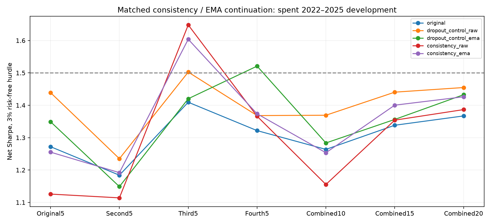

# Consistency regularization and EMA continuation — October 31, 2026

**Completed 320 three-epoch continuation fits and 810 account backtests. 0 candidates pass the primary improvement gate.**



This is a short fine-tuning screen of two training approaches, not a full from-scratch retraining or a test of the proposed architecture, multi-horizon or portfolio-loss changes. Every existing twenty-seed THINK/dynamic pair is retained. Each matched pair starts from the same saved validation-loss-selected checkpoint, resets its optimizer at one-quarter of the original learning rate, and trains three more epochs on the same training fold. All four annual folds and all 1,003 sessions in 2022–2025 are previously inspected development data; no untouched confirmation is claimed.

THINK has no native dropout. Both arms therefore use 10% input dropout and two supervised passes; dynamic retains its internal dropout too. The consistency arm additionally penalizes symmetric KL between eligible cross-sectional softmax(score/0.5) distributions. Both arms use the same seeded dropout draws. EMA decay 0.99 tracks parameters after each update; fixed buffers are copied. This is an R-Drop-inspired stock-ranking adaptation and EMA, not an exact reproduction of either cited paper.

For raw and EMA separately, first-half prior-year supervised validation loss selects among epochs 0–3 with earliest ties. Epoch zero exactly preserves the source. The second validation half is diagnostic only. Every fit and checkpoint locks before new financial account scoring. The unchanged primary portfolio uses 50% training prior, 25% THINK ranks and 25% dynamic ranks, five issuers per cohort, the existing volatility/QQQ hedge rules and equal averaging of cohort targets. Single-family controls retain the same 50% prior, replacing the other 50% with that family.

## Both-family primary comparison

| Method | Minimum ensemble SR | Four-cohort spread | Combined20 SR | Worst SR change | Worst stress SR change | Pass |
|---|---:|---:|---:|---:|---:|---|
| original | 1.184 | 0.225 | 1.367 | +0.000 | +0.000 | False |
| dropout_control_raw | 1.235 | 0.267 | 1.455 | +0.046 | +0.042 | False |
| dropout_control_ema | 1.149 | 0.372 | 1.433 | -0.035 | -0.042 | False |
| consistency_raw | 1.114 | 0.534 | 1.387 | -0.146 | -0.142 | False |
| consistency_ema | 1.192 | 0.412 | 1.426 | -0.017 | -0.020 | False |

## All family and singleton diagnostics

| Mixture | Method | Min ensemble SR | Singleton min / median SR | Singleton SR SD | Mean SR change versus matched dropout control |
|---|---|---:|---|---:|---:|
| both | original | 1.184 | 0.751 / 1.103 | 0.186 | +0.000 |
| both | dropout_control_raw | 1.235 | 0.830 / 1.147 | 0.161 | +0.000 |
| both | dropout_control_ema | 1.149 | 0.738 / 1.119 | 0.195 | +0.000 |
| both | consistency_raw | 1.114 | 0.686 / 1.136 | 0.166 | -0.094 |
| both | consistency_ema | 1.192 | 0.679 / 1.087 | 0.173 | -0.001 |
| think | original | 0.960 | 0.938 / 1.050 | 0.069 | +0.000 |
| think | dropout_control_raw | 0.947 | 0.927 / 1.040 | 0.071 | +0.000 |
| think | dropout_control_ema | 0.951 | 0.967 / 1.032 | 0.070 | +0.000 |
| think | consistency_raw | 0.938 | 0.860 / 1.057 | 0.089 | -0.008 |
| think | consistency_ema | 0.966 | 0.948 / 1.035 | 0.079 | +0.016 |
| dynamic | original | 0.533 | 0.240 / 0.753 | 0.221 | +0.000 |
| dynamic | dropout_control_raw | 0.579 | 0.222 / 0.740 | 0.204 | +0.000 |
| dynamic | dropout_control_ema | 0.444 | 0.291 / 0.735 | 0.216 | +0.000 |
| dynamic | consistency_raw | 0.483 | 0.244 / 0.650 | 0.212 | -0.020 |
| dynamic | consistency_ema | 0.456 | 0.268 / 0.646 | 0.210 | -0.044 |

362/640 raw/EMA fit selections choose an epoch after zero; zero selections remain in every account. Selecting zero is a failure to validate additional training, not evidence of a newly learned improvement.

The primary gate requires >=+0.02 net Sharpe versus the original in every seven-group account, four-cohort spread <=0.25, no group worse at double transaction fees and 6% borrowing, and positive mean matched-control improvement for consistency. SR>1.5 across all groups is reported separately. Individual seeds and overlapping pooled ensembles share market dates and are not independent evidence.

All 810 accounts pass independent dollar-position accounting within 8.88e-16 daily-return error. Every selected source checkpoint is hash-pinned, initial validation predictions reproduce within 1e-7, and all fourteen current-strategy reference paths reproduce within 1e-12 daily returns. Raw/EMA state, optimizer, CPU/CUDA RNG, every epoch validation path, selected forecasts, compressed ledgers, daily account paths and effective targets are retained in the dated run.

Tests cover masking/symmetry/gradients, EMA arithmetic and buffer handling, and exact optimizer/RNG/EMA continuation on a stochastic network. That synthetic resume check does not certify bitwise regeneration of every production fit. All source files and input/checkpoint hashes are checked before and after fitting.

## Interpretation and next steps

Passing would justify a separately frozen longer training experiment; this short continuation cannot rule out the approaches under other schedules. Failure does not establish that an architecture or new information source cannot help. Architecture/prior decomposition, auxiliary horizons and execution-aware objectives remain separate untested proposals in this study. No promising seed is excluded, no failed method is hidden, and no production strategy is replaced automatically.

[All account results](METRICS.csv) · [Annual results](PERIOD_METRICS.csv) · [Validation and chosen epochs](VALIDATION.csv) · [Protocol](PROTOCOL.json)

[R-Drop](https://arxiv.org/abs/2106.14448) motivates consistency regularization. [Weight averaging research](https://proceedings.mlr.press/r16/izmailov18a.html) motivates averaging, but this EMA experiment uses a different optimizer and schedule.

```powershell
.\.venv\Scripts\python.exe -m hypershift test test_ndx_consistency_training -v
.\.venv\Scripts\python.exe -m hypershift run run_ndx_consistency_retraining --stage preflight
.\.venv\Scripts\python.exe -m hypershift run run_ndx_consistency_retraining --stage freeze
.\.venv\Scripts\python.exe -m hypershift run run_ndx_consistency_retraining --stage train
.\.venv\Scripts\python.exe -m hypershift run run_ndx_consistency_retraining --stage evaluate
.\.venv\Scripts\python.exe -m hypershift run run_ndx_consistency_retraining --stage summarize
```

Completed artifacts are immutable. Training can resume from the same frozen epoch states; a new scientific setup needs a separate run.
