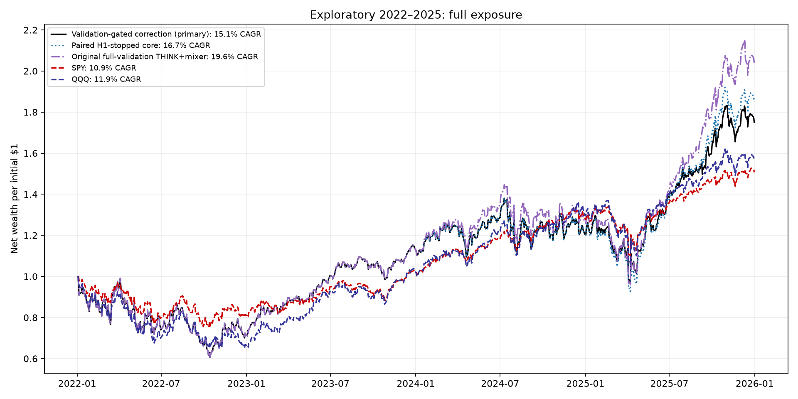
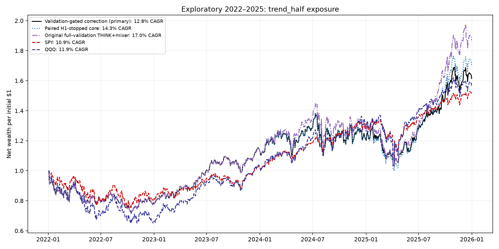
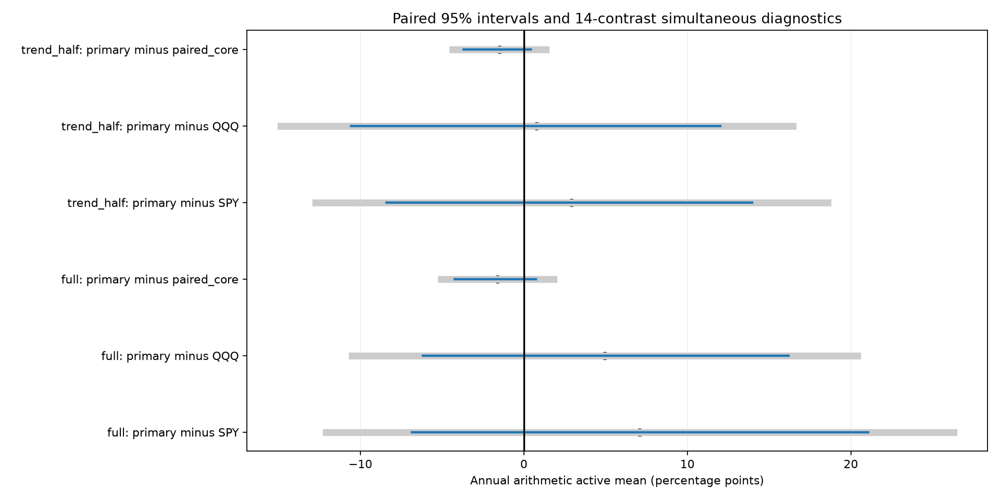

# Frozen-core NASDAQ-100 correction study — October 20, 2026

The primary full-exposure policy returned **15.1% CAGR**, versus **16.7%** for its paired core, **10.9%** for SPY and **11.9%** for QQQ. The second-half validation gate retained a primary correction in 1/4 years. 0/2 risk policies passed the predeclared historical reliability screen. These are development results; reliable future superiority is not established.

All 100 fits, 260 saved checkpoints and 144 continuous accounts are disclosed. Previously inspected 2022–2025 dates remain exploratory. No original checkpoint, prior negative experiment or input dataset was changed.

## Selection and acceptance

Twenty five-feature THINK+mixer cores (five seeds, four annual folds) use the original training origins and train-only graphs/normalization. Each core selects its earliest best MSE checkpoint from January–June of the prior validation year, with H1 labels purged before the first H2 signal. The core is frozen. Eighty shared per-stock adapters add either 128 intraday-window inputs (16 sessions × eight reviewed summaries) or 65 causal rich features. Every feature normalizer uses only eligible training inputs. Each adapter has 16 hidden units, a zero-initialized final layer, no ticker parameters and a centered tanh correction scaled by half the signal-time core-score standard deviation. Zero correction reproduces the paired core. Absolute changes are bounded by one core-score standard deviation.

The two adapter losses are a local LambdaRank-inspired weighted pairwise objective and a softmax SPY-active-return utility with concentration, variance and turnover penalties. Utility returns require complete eligible labels; missing outcomes are never synthesized. The losses are training surrogates, not portfolio accounts. [Microsoft’s LambdaRank overview](https://www.microsoft.com/en-us/research/publication/from-ranknet-to-lambdarank-to-lambdamart-an-overview/) motivates ranking-weight changes; this implementation is not a reproduction or an investment-performance claim.

After all fits, H1 chooses among epochs 5/10/20, shrink factors 0.25/0.5/1 and four feature/loss cells. Zero is always available. The H1 score is mean paired top-ten return improvement less 0.1 times its variance, after a 0.1-percentage-point L1 target-turnover proxy. Fractional boundary ties match the final account engine. Origins with missing labels in either selected basket are omitted and counted. Every annual H1 selection was locked before H2 scoring. H2 can only accept the chosen correction or fall back to the core: at least 12 comparable origins, positive mean paired proxy improvement and wins on at least half those origins. H2 rejection never triggers a search for another primary candidate. Four adapter-specific gated controls follow the same prespecified rules. Ungated rows disclose each cell’s H1 choice before H2 rejection; they cannot replace the primary using test results. The proxy omits price drift, settlement and ADV caps, so the final account is the relevant financial measure.

| Test year | Policy | H1 choice | H2 comparable | Omitted | Mean proxy change | Positive origins | Accepted |
| --- | --- | --- | --- | --- | --- | --- | --- |
| 2022 | Validation-gated correction (primary) | rich_features__net_utility / epoch 5 / shrink 0.5 | 24 | 0 | 0.006 pp | 1/24 | False |
| 2022 | intraday_window / top_rank | zero / core | 24 | 0 | 0.000 pp | 0/24 | False |
| 2022 | intraday_window / net_utility | zero / core | 24 | 0 | 0.000 pp | 0/24 | False |
| 2022 | rich_features / top_rank | zero / core | 24 | 0 | 0.000 pp | 0/24 | False |
| 2022 | rich_features / net_utility | rich_features__net_utility / epoch 5 / shrink 0.5 | 24 | 0 | 0.006 pp | 1/24 | False |
| 2023 | Validation-gated correction (primary) | rich_features__net_utility / epoch 20 / shrink 0.25 | 25 | 0 | 0.050 pp | 10/25 | False |
| 2023 | intraday_window / top_rank | intraday_window__top_rank / epoch 5 / shrink 0.25 | 25 | 0 | -0.012 pp | 3/25 | False |
| 2023 | intraday_window / net_utility | zero / core | 25 | 0 | 0.000 pp | 0/25 | False |
| 2023 | rich_features / top_rank | zero / core | 25 | 0 | 0.000 pp | 0/25 | False |
| 2023 | rich_features / net_utility | rich_features__net_utility / epoch 20 / shrink 0.25 | 25 | 0 | 0.050 pp | 10/25 | False |
| 2024 | Validation-gated correction (primary) | intraday_window__net_utility / epoch 20 / shrink 0.25 | 24 | 0 | -0.126 pp | 9/24 | False |
| 2024 | intraday_window / top_rank | zero / core | 24 | 0 | 0.000 pp | 0/24 | False |
| 2024 | intraday_window / net_utility | intraday_window__net_utility / epoch 20 / shrink 0.25 | 24 | 0 | -0.126 pp | 9/24 | False |
| 2024 | rich_features / top_rank | zero / core | 24 | 0 | 0.000 pp | 0/24 | False |
| 2024 | rich_features / net_utility | zero / core | 24 | 0 | 0.000 pp | 0/24 | False |
| 2025 | Validation-gated correction (primary) | rich_features__net_utility / epoch 20 / shrink 0.5 | 24 | 0 | 0.144 pp | 13/24 | True |
| 2025 | intraday_window / top_rank | intraday_window__top_rank / epoch 10 / shrink 1 | 24 | 0 | 0.085 pp | 15/24 | True |
| 2025 | intraday_window / net_utility | intraday_window__net_utility / epoch 10 / shrink 0.5 | 24 | 0 | 0.021 pp | 10/24 | False |
| 2025 | rich_features / top_rank | rich_features__top_rank / epoch 10 / shrink 0.25 | 24 | 0 | 0.208 pp | 13/24 | True |
| 2025 | rich_features / net_utility | rich_features__net_utility / epoch 20 / shrink 0.5 | 24 | 0 | 0.144 pp | 13/24 | True |

## Continuous accounts

| Model | Exposure policy | Net CAGR | Sharpe | Maximum drawdown |
| --- | --- | --- | --- | --- |
| Validation-gated correction (primary) | full | 15.1% | 0.510 | -39.4% |
| Validation-gated correction (primary) | trend_half | 12.8% | 0.503 | -28.3% |
| Paired H1-stopped core | full | 16.7% | 0.548 | -39.4% |
| Paired H1-stopped core | trend_half | 14.3% | 0.553 | -28.3% |
| intraday_window / top_rank | full | 13.2% | 0.459 | -39.4% |
| intraday_window / top_rank | trend_half | 11.4% | 0.452 | -28.3% |
| intraday_window / net_utility | full | 16.7% | 0.548 | -39.4% |
| intraday_window / net_utility | trend_half | 14.3% | 0.553 | -28.3% |
| rich_features / top_rank | full | 16.5% | 0.546 | -39.4% |
| rich_features / top_rank | trend_half | 14.1% | 0.549 | -28.3% |
| rich_features / net_utility | full | 15.1% | 0.510 | -39.4% |
| rich_features / net_utility | trend_half | 12.8% | 0.503 | -28.3% |
| ungated / intraday_window / top_rank | full | 12.9% | 0.452 | -39.4% |
| ungated / intraday_window / top_rank | trend_half | 11.1% | 0.442 | -28.3% |
| ungated / intraday_window / net_utility | full | 16.5% | 0.546 | -39.4% |
| ungated / intraday_window / net_utility | trend_half | 14.0% | 0.547 | -29.3% |
| ungated / rich_features / top_rank | full | 16.5% | 0.546 | -39.4% |
| ungated / rich_features / top_rank | trend_half | 14.1% | 0.549 | -28.3% |
| ungated / rich_features / net_utility | full | 13.1% | 0.453 | -39.8% |
| ungated / rich_features / net_utility | trend_half | 10.8% | 0.426 | -28.5% |
| Original full-validation THINK+mixer | full | 19.6% | 0.629 | -39.4% |
| Original full-validation THINK+mixer | trend_half | 17.0% | 0.654 | -29.0% |
| momentum126 | full | 2.9% | 0.145 | -38.4% |
| momentum126 | trend_half | 0.9% | 0.046 | -35.3% |
| monthly_basket | full | 6.9% | 0.279 | -30.5% |
| SPY | full | 10.9% | 0.498 | -24.6% |
| QQQ | full | 11.9% | 0.469 | -34.9% |
| QQQ_timing | trend_half | 11.6% | 0.547 | -26.1% |

Historical monthly Nasdaq-100 membership, issuer-aware reviewed Alpaca summaries, next-close frozen orders, $1 million starting cash, 1% ADV order caps and the original modeled fees are retained. Signals and holding periods remain five sessions. The input uses 15-minute bars aggregated into causal summaries; this is not 15-minute trading. Full exposure and the fixed half-exposure-below-QQQ-MA200 rule are both disclosed. Cash earns no interest; Sharpe retains the fixed 3% hurdle. SPY/QQQ are net buy-and-hold references. Original full-validation THINK+mixer is a descriptive historical reference, distinct from the newly H1-stopped core.

| Primary risk policy | Historical screen passed | Years above SPY | Months above SPY | Drawdown within 5 pp | Positive simultaneous comparisons |
| --- | --- | --- | --- | --- | --- |
| full | False | 2/4 | 24/48 | False | 0/7 |
| trend_half | False | 2/4 | 24/48 | True | 0/7 |

The historical screen requires CAGR above SPY at base and double fees, at least 3/4 years and 28/48 months above SPY, and drawdown at most five percentage points worse. This is a development screen, not a confidence guarantee. Confidence comparisons with competing models are separate and shown below.

| Model | Policy | 1× fee CAGR | 2× fee CAGR | 4× fee CAGR |
| --- | --- | --- | --- | --- |
| QQQ | full | 11.9% | 11.9% | 11.8% |
| SPY | full | 10.9% | 10.8% | 10.7% |
| Paired H1-stopped core | full | 16.7% | 14.6% | 10.4% |
| Paired H1-stopped core | trend_half | 14.3% | 12.5% | 9.0% |
| Validation-gated correction (primary) | full | 15.1% | 13.0% | 8.8% |
| Validation-gated correction (primary) | trend_half | 12.8% | 11.0% | 7.5% |
| Original full-validation THINK+mixer | full | 19.6% | 17.5% | 13.3% |
| Original full-validation THINK+mixer | trend_half | 17.0% | 15.2% | 11.8% |

## Seed sensitivity and uncertainty

| Model | Policy | Minimum seed CAGR | Median seed CAGR | Maximum seed CAGR | Seeds above SPY |
| --- | --- | --- | --- | --- | --- |
| intraday_window / net_utility | full | 7.8% | 13.3% | 22.8% | 3/5 |
| intraday_window / net_utility | trend_half | 5.7% | 9.7% | 18.8% | 2/5 |
| intraday_window / top_rank | full | 4.8% | 10.5% | 19.6% | 2/5 |
| intraday_window / top_rank | trend_half | 3.1% | 7.1% | 15.9% | 1/5 |
| Paired H1-stopped core | full | 7.8% | 13.3% | 22.8% | 3/5 |
| Paired H1-stopped core | trend_half | 5.7% | 9.7% | 18.8% | 2/5 |
| Validation-gated correction (primary) | full | 5.5% | 12.4% | 19.5% | 3/5 |
| Validation-gated correction (primary) | trend_half | 3.6% | 8.9% | 15.8% | 2/5 |
| rich_features / net_utility | full | 5.5% | 12.4% | 19.5% | 3/5 |
| rich_features / net_utility | trend_half | 3.6% | 8.9% | 15.8% | 2/5 |
| rich_features / top_rank | full | 6.2% | 11.1% | 21.6% | 3/5 |
| rich_features / top_rank | trend_half | 4.0% | 7.2% | 18.0% | 2/5 |

Matched-seed paths hold the annual five-seed validation choices and gates fixed, then use each seed’s forecast. They diagnose initialization sensitivity, not five independent market histories or independently selected policies.

| Primary comparison | Active mean/year | Paired 95% interval, pp | 14-contrast simultaneous diagnostic, pp |
| --- | --- | --- | --- |
| full: primary minus SPY | 7.09 pp | [-6.84, 21.05] | [-12.11, 26.30] |
| full: primary minus QQQ | 4.95 pp | [-6.17, 16.18] | [-10.49, 20.39] |
| full: primary minus paired_core | -1.63 pp | [-4.22, 0.74] | [-5.07, 1.81] |
| full: primary minus intraday_window__top_rank | 1.85 pp | [-1.46, 5.51] | [-3.00, 6.69] |
| full: primary minus intraday_window__net_utility | -1.63 pp | [-4.22, 0.74] | [-5.07, 1.81] |
| full: primary minus rich_features__top_rank | -1.24 pp | [-2.94, 0.25] | [-3.46, 0.97] |
| full: primary minus rich_features__net_utility | 0.00 pp | [0.00, 0.00] | [0.00, 0.00] |
| trend_half: primary minus SPY | 2.92 pp | [-8.40, 13.96] | [-12.74, 18.58] |
| trend_half: primary minus QQQ | 0.77 pp | [-10.58, 12.01] | [-14.88, 16.43] |
| trend_half: primary minus paired_core | -1.50 pp | [-3.70, 0.43] | [-4.36, 1.36] |
| trend_half: primary minus intraday_window__top_rank | 1.35 pp | [-1.57, 4.53] | [-2.92, 5.62] |
| trend_half: primary minus intraday_window__net_utility | -1.50 pp | [-3.70, 0.43] | [-4.36, 1.36] |
| trend_half: primary minus rich_features__top_rank | -1.19 pp | [-2.67, 0.13] | [-3.15, 0.77] |
| trend_half: primary minus rich_features__net_utility | 0.00 pp | [0.00, 0.00] | [0.00, 0.00] |

Ten thousand paired circular-block samples resample whole daily paths together. The primary block is 20 sessions; 5/60-session sensitivities are included. One family covers both primary risk policies against SPY, QQQ, the paired core and four gated adapters (14 contrasts). Original full-validation reference and ungated diagnostic cells are outside this family. Annual arithmetic active means differ from CAGR gaps. These intervals condition on fitted paths: they omit full research-search, training, vendor-revision and regime uncertainty. More bars within the same market period do not supply independent years or justify artificially narrower intervals.

## Verification and limits

Independent checks reproduced all 260 checkpoints’ validation/test exports, every H1 choice and H2 gate, and replayed 144 continuous accounts. Maximum NAV discrepancy was $0.00000006. Frozen hashes cover source, data, preprocessing, core/adapter links and exports. Unit fixtures cover exact zero corrections, inactive NaNs, permutation symmetry, frozen-core gradients, missing-label utility, boundary ties, train-only normalization and chronological purges.

Acquisition/total-return approximations, missing labels, short effective history and repeated historical inspection still limit inference. The reserved future dates from October 21, 2026 have not occurred in this study. Updated point-in-time data, membership/issuer support and a fixed model/refit policy must be reviewed before any prospective run. No trades or scheduled jobs were created. A higher historical CAGR cannot be promoted as reliable future outperformance.

## Artifacts

[Protocol](PROTOCOL.json) · [Independent audit](AUDIT.json) · [All metrics](metrics.csv) · [Daily curves](curves.csv) · [H1 selections](H1_SELECTION_LOCK.json) · [H2 acceptance gates](VALIDATION_GATES.json) · [Historical screens](historical_screen.csv) · [Annual returns](annual.csv) · [Monthly returns](monthly.csv) · [Seed results](seed_summary.csv) · [All intervals](paired_intervals.csv) · [Ranking](ranking_summary.csv)

Training objects, every adapter checkpoint, normalization and all prediction exports remain under `runs/ndx_corrections_20261020`. The complete prior [Alpaca study](../nasdaq_alpaca_20261019/REPORT.md), [ranking study](../ndx_ranking_20261020/REPORT.md) and [broad feature study](../ndx_broad_20261020/REPORT.md) remain available.
