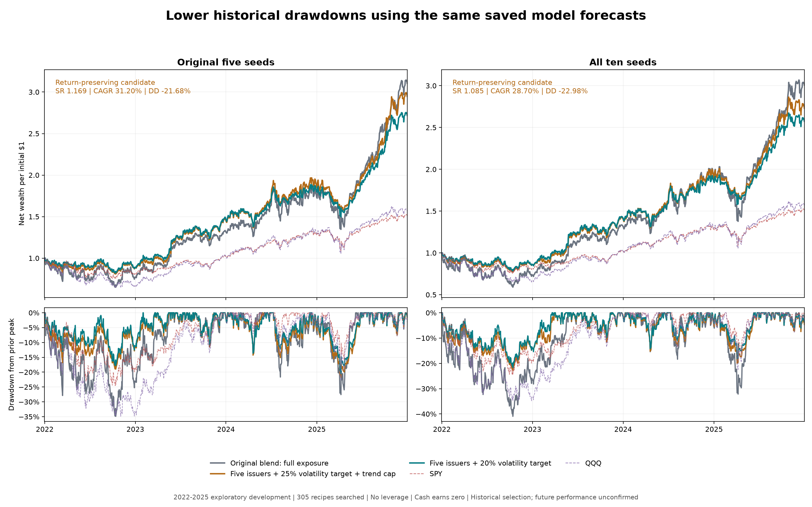
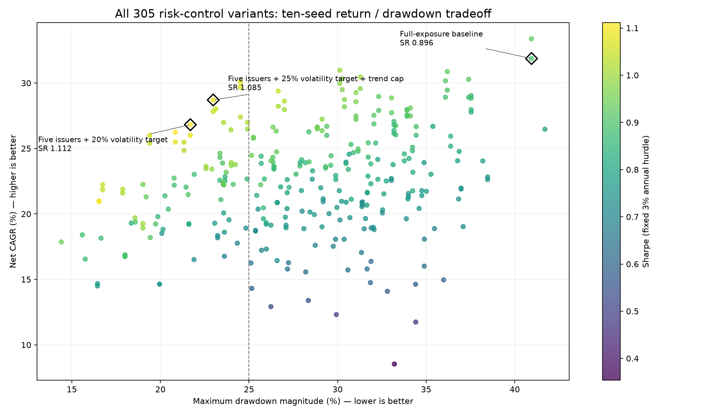

# Drawdown-control research — October 26, 2026

**Six of 305 frozen recipes met the historical return/risk screen.** The return-preserving candidate combines five-issuer selection, a 25% basket-volatility target and a half-exposure QQQ/MA200 cap. It retains 31.20% CAGR in the original seed ensemble while improving Sharpe to 1.169 and reducing maximum drawdown to 21.68%. Across all ten seeds it returns 28.70% CAGR / 1.085 Sharpe / 22.98% maximum drawdown.

**These are selected 2022-2025 development results, not untouched confirmation.** No model was retrained, no 2026 returns were opened, and no orders or automations were created. The existing workbook and frozen studies are unchanged.

## Matched historical comparison

| Variant | Seed group | Sharpe | Net CAGR | Max drawdown |
| --- | --- | --- | --- | --- |
| Original blend: full exposure | original_five | 0.919 | 32.94% | -34.89% |
| Original blend: full exposure | ten_seed | 0.896 | 31.87% | -40.94% |
| Five issuers + 25% volatility target + trend cap | original_five | 1.169 | 31.20% | -21.68% |
| Five issuers + 25% volatility target + trend cap | ten_seed | 1.085 | 28.70% | -22.98% |
| Five issuers + 20% volatility target | original_five | 1.178 | 28.57% | -20.56% |
| Five issuers + 20% volatility target | ten_seed | 1.112 | 26.81% | -21.69% |
| Original selections + 20% volatility target + trend cap | original_five | 1.190 | 28.08% | -17.16% |
| Original selections + 20% volatility target + trend cap | ten_seed | 1.081 | 25.50% | -20.84% |



Original-five and ten-seed accounts are separate rank ensembles on the same history. Compare each new account with its matching full-exposure baseline. The higher-return candidate above has the highest ten-seed CAGR among the six screen passes; the 20% target candidate has the highest ten-seed Sharpe across the grid. These reporting preferences were selected retrospectively.

## What the two leading rules do

1. Keep the original 50:50 THINK+mixer AH+PM / dynamic family percentile-rank blend and its five-session ranking schedule.
2. Rank issuers by their best share-class score, select five issuers, and use equal weights within the equity sleeve. The best class represents each issuer; tied best classes share its budget. GOOG/GOOGL, FOX/FOXA and LBTYA/LBTYK are treated as paired classes.
3. At each rebalance, apply those proposed stock weights to the last 20 daily constituent economic returns. Compute their sample standard deviation and annualize with sqrt(252). This incorporates the basket's past correlations; it does not use subsequent returns.
4. For the return-preserving candidate, stock exposure is min(1, 0.25 / estimated basket volatility, trend cap). The trend cap is 1 above QQQ's trailing 200-session average and 0.5 below it. For the higher-Sharpe candidate, exposure is min(1, 0.20 / estimated basket volatility), with no trend rule.
5. Keep remaining capital in zero-interest cash, matching the existing accounting. No borrowing, options, shorts, or leverage. Weekly decisions use the prior close's risk data and the current 09:15-cutoff AH+PM forecast; orders freeze at 09:20 and fill at the regular close.
6. Retain parent share sizing, modeled costs, 1% ADV caps, cancellations, corporate actions, cash scaling, and terminal liquidation. Targets are not hard limits on realized volatility or drawdown; weights drift between fills.

Example: if the selected basket has 40% estimated annualized volatility, the 25% target permits 62.5% stock exposure in a healthy trend. Below QQQ MA200, the exposure cap lowers that to 50%. A 20% target without a trend filter permits 50%. These are example arithmetic, not additional fitted rules.

The return-preserving account averages approximately 74.8% stock exposure across the ten-seed path; the 20% target account averages 66.6%. Thus the improvement includes materially less time-weighted market exposure, with lower upside in strong markets.

## What was actually tested

The protocol enumerated **305 recipes and 915 base-cost accounts before new financial metrics**. Four allocation families crossed 76 risk rules, plus a top-ten control. The search included unchanged top five, five issuers, issuer inverse-volatility weights, soft-weighted top eight issuers, fixed cash fractions, QQQ moving averages of 100/150/200/250 sessions, multi-trend scaling, 20/60-session basket and QQQ volatility targets, QQQ drawdown thresholds, and trend/volatility combinations. Weekly and daily risk schedules were both tested. Daily rules used a 10-percentage-point target-exposure band.

All original five, new five and ten-seed groups were evaluated. The screen required original-five and ten-seed Sharpe at least 0.9194653, new-five Sharpe at least its 0.6330 baseline, drawdown at most 25% in every group, and ten-seed CAGR at least 23.9%. Daily overlays did not outperform the selected weekly rules. No second batch was needed after the initial grid met the screen.

The nine-account-recipe shortlist, including baseline, was also evaluated across all three groups at 2x and 4x costs: **54 additional unique higher-cost accounts**, beyond the 915 base accounts. Every failed variant remains in [metrics.csv](metrics.csv) and [summary.csv](summary.csv).



## Seed sensitivity

| Variant | Seed group | Sharpe | Net CAGR | Max drawdown |
| --- | --- | --- | --- | --- |
| Original blend: full exposure | original_five | 0.919 | 32.94% | -34.89% |
| Original blend: full exposure | new_five | 0.633 | 20.92% | -34.67% |
| Original blend: full exposure | ten_seed | 0.896 | 31.87% | -40.94% |
| Five issuers + 20% volatility target | original_five | 1.178 | 28.57% | -20.56% |
| Five issuers + 20% volatility target | new_five | 0.677 | 15.77% | -18.34% |
| Five issuers + 20% volatility target | ten_seed | 1.112 | 26.81% | -21.69% |
| Five issuers + 25% volatility target + trend cap | original_five | 1.169 | 31.20% | -21.68% |
| Five issuers + 25% volatility target + trend cap | new_five | 0.643 | 16.32% | -22.07% |
| Five issuers + 25% volatility target + trend cap | ten_seed | 1.085 | 28.70% | -22.98% |

**The new-five half remains much weaker:** the two leaders have approximately 0.643 and 0.677 Sharpe, respectively. They improve base-cost Sharpe and drawdown relative to that half's baseline, but reduce its CAGR from 20.92% to approximately 16.32% and 15.77%. This is not uniform high-Sharpe replication across seeds.

## Component controls: ten seeds

| Recipe | Sharpe | CAGR | Max drawdown |
| --- | --- | --- | --- |
| equal5/full | 0.896 | 31.87% | -40.94% |
| equal5/constant_75 | 0.863 | 24.34% | -31.73% |
| equal5/ma200_off50_weekly | 0.959 | 28.57% | -31.03% |
| equal5/basketvol20_target20_weekly | 1.080 | 26.00% | -21.69% |
| issuer5/full | 0.925 | 33.37% | -40.94% |
| issuer5/basketvol20_target20_weekly | 1.112 | 26.81% | -21.69% |
| issuer5/ma200off50_basketvol20_target25_weekly | 1.085 | 28.70% | -22.98% |

Issuer selection alone does not reduce the 2022 maximum drawdown. Constant 75% exposure reduces drawdown but lowers Sharpe. Basket-volatility scaling supplies most of the historical drawdown improvement. Adding the trend cap to a 20% target has little additional ten-seed Sharpe benefit, while a 25% target plus trend cap retains more return. These component controls are exploratory associations on one history, not causal proof or future guarantees.

## Cost stress: ten seeds

| Variant | Cost multiplier | Sharpe | CAGR | Max drawdown |
| --- | --- | --- | --- | --- |
| Five issuers + 20% volatility target | 1 | 1.112 | 26.81% | -21.69% |
| Five issuers + 20% volatility target | 2 | 1.031 | 24.74% | -22.53% |
| Five issuers + 20% volatility target | 4 | 0.870 | 20.70% | -24.20% |
| Five issuers + 25% volatility target + trend cap | 1 | 1.085 | 28.70% | -22.98% |
| Five issuers + 25% volatility target + trend cap | 2 | 1.007 | 26.44% | -23.80% |
| Five issuers + 25% volatility target + trend cap | 4 | 0.852 | 22.05% | -25.42% |
| Original blend: full exposure | 1 | 0.896 | 31.87% | -40.94% |
| Original blend: full exposure | 2 | 0.830 | 28.96% | -42.18% |
| Original blend: full exposure | 4 | 0.699 | 23.35% | -44.57% |

The two leaders remain ahead of the matched ten-seed baseline in Sharpe and drawdown at 2x and 4x costs, although their CAGR is lower. At 4x costs their Sharpe falls below the original 0.919 headline. The new-five half does not outperform its matched baseline in every cost-stress comparison. Higher fees are not a full market-impact, tax, or execution-capacity test.

## Annual net returns: ten seeds

| Recipe | Year | Calendar-year return | Within-year drawdown |
| --- | --- | --- | --- |
| issuer5/basketvol20_target20_weekly | 2022 | -13.59% | -21.69% |
| issuer5/basketvol20_target20_weekly | 2023 | 65.45% | -9.86% |
| issuer5/basketvol20_target20_weekly | 2024 | 29.58% | -14.22% |
| issuer5/basketvol20_target20_weekly | 2025 | 38.95% | -18.24% |
| issuer5/ma200off50_basketvol20_target25_weekly | 2022 | -13.81% | -22.98% |
| issuer5/ma200off50_basketvol20_target25_weekly | 2023 | 64.71% | -11.47% |
| issuer5/ma200off50_basketvol20_target25_weekly | 2024 | 34.27% | -15.23% |
| issuer5/ma200off50_basketvol20_target25_weekly | 2025 | 43.22% | -19.99% |
| equal5/full | 2022 | -26.07% | -40.94% |
| equal5/full | 2023 | 79.86% | -11.67% |
| equal5/full | 2024 | 43.22% | -18.38% |
| equal5/full | 2025 | 57.92% | -32.15% |

Both leading controls reduce the 2022 loss, but also surrender part of the gains in 2023-2025. The original maximum drawdown and much of the opportunity to improve it are concentrated in one bear-market episode. [Subperiod and leave-one-year-out descriptive sensitivity](subperiod_sensitivity.csv) does not turn the already inspected later years into untouched data.

## Uncertainty and what cannot be concluded

For the return-preserving ten-seed candidate, the pointwise 95% Sharpe interval is [0.191, 1.998]. Its paired Sharpe-difference interval versus its baseline is [-0.146, 0.518], which includes zero. These use 10,000 circular-block draws of 20 sessions.

The uncertainty conditions on fitted paths and excludes selection across these 305 recipes, the earlier 346-strategy search, retraining uncertainty and vendor revisions. No claim of statistically established Sharpe superiority follows from the grid. Search-adjusted evidence is weaker than the displayed pointwise intervals. A 25% historical screen is not a guaranteed future loss limit. The 16.5% drawdown variants at a 15% volatility target retain only about 21% ten-seed CAGR and miss the return/new-seed screen.

The universe remains historical NASDAQ-100 membership and the inherited economic-price, sparse AH/PM, publication-latency, corporate-action, cold-start, fill and capacity limitations remain. Idle cash earns zero; neither Treasury yields nor taxes were added. The confirmation gate remains unactivated. Freeze a complete candidate before collecting any prospective confirmation path.

## Verification and reproducibility

Five meaningful unit tests passed: issuer/tie invariance, capped allocation, no future returns in volatility, parity with parent settlement/cash/cost accounting, and next-close daily-risk execution. All six real-data full-exposure controls matched the saved parent daily paths. The independent auditor recalculated all 915 account metrics, independently rebuilt all 15 allocation/seed-group combinations, and replayed 82 accounts, including all shortlist seed/cost accounts and one daily-risk account. Maximum NAV difference was $0.0000000172.

Run from the repository root with local market inputs and saved checkpoints available:

```powershell
python -m hypershift test test_ndx_drawdown_engine -v
python -m hypershift run run_ndx_drawdown_research
python -m hypershift run audit_ndx_drawdown_research
python -m hypershift run publish_ndx_drawdown_research
```

The runner refuses changed frozen recipes or inputs. Use a new declared batch for further experiments. Full paths and selected ledgers remain under `runs/ndx_drawdown_20261026/batch1/`; this directory supplies portable summaries and focused curves.

[Protocol](PROTOCOL.json) · [Freeze](FREEZE.json) · [Independent audit](AUDIT.json) · [Complete batch](COMPLETE.json) · [All metrics](metrics.csv) · [All recipe summaries](summary.csv) · [Cost stress](cost_stress.csv) · [Annual results](annual.csv) · [Conditional uncertainty](uncertainty.csv) · [Focused daily curves](comparison_curves.csv)

Research motivation: [Moreira and Muir, Volatility-Managed Portfolios](https://amoreira2.github.io/alan-moreira.github.io/VolPortfolios_published.pdf). Their broader results motivate a test; they do not validate this selected model or its targets.
