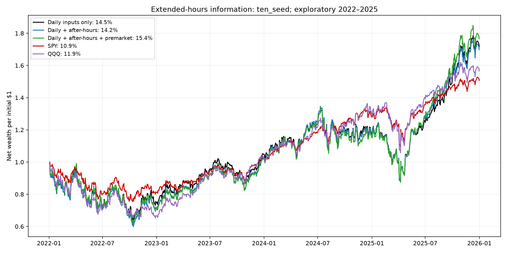
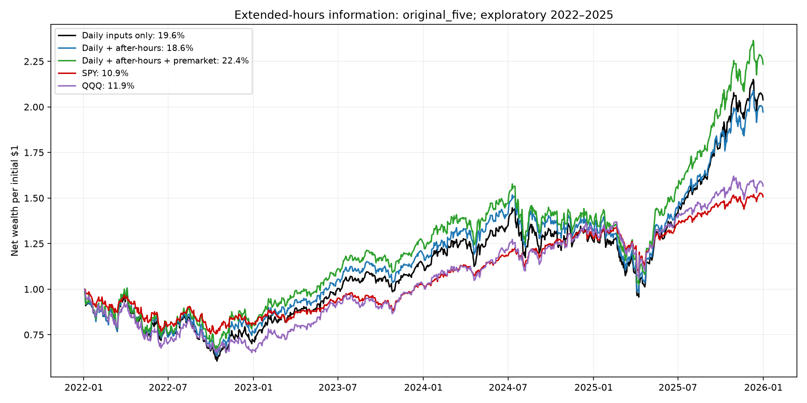

# After-hours and premarket information — October 24, 2026

The primary ten-seed daily control returned **14.5% CAGR**, daily plus after-hours **14.2%**, and daily plus after-hours plus premarket **15.4%**. SPY returned **10.9%** and QQQ **11.9%**. These are previously inspected 2022–2025 development results. No claim of reliable future improvement follows from the highest historical row.

| Information view | Seed group | Sharpe | Net CAGR | Raw-return RankIC | Max drawdown | Pointwise 95% SR interval |
| --- | --- | --- | --- | --- | --- | --- |
| Daily inputs only | ten_seed | 0.496 | 14.5% | 0.0048 | -37.1% | [-0.332, 1.367] |
| Daily + after-hours | ten_seed | 0.488 | 14.2% | 0.0036 | -40.1% | [-0.367, 1.383] |
| Daily + after-hours + premarket | ten_seed | 0.519 | 15.4% | 0.0038 | -38.3% | [-0.345, 1.425] |
| Daily inputs only | original_five | 0.629 | 19.6% | 0.0074 | -39.4% | [-0.186, 1.505] |
| Daily + after-hours | original_five | 0.602 | 18.6% | 0.0063 | -37.2% | [-0.219, 1.475] |
| Daily + after-hours + premarket | original_five | 0.700 | 22.4% | 0.0061 | -35.0% | [-0.139, 1.594] |
| Daily inputs only | new_five | 0.536 | 15.5% | 0.0082 | -31.3% | [-0.321, 1.427] |
| Daily + after-hours | new_five | 0.474 | 13.4% | 0.0061 | -33.1% | [-0.387, 1.381] |
| Daily + after-hours + premarket | new_five | 0.480 | 13.7% | 0.0067 | -34.4% | [-0.382, 1.365] |
| SPY | benchmark | 0.498 | 10.9% | N/A | -24.6% | [-0.367, 1.419] |
| QQQ | benchmark | 0.469 | 11.9% | N/A | -34.9% | [-0.408, 1.394] |
| Monthly equal-weight index basket | benchmark | 0.279 | 6.9% | N/A | -30.5% | [-0.567, 1.158] |

## Timing and the matched experiment

Every view forms its forecast and share order at **09:20 Eastern on the entry session**, using no premarket bar ending after 09:15. Orders fill at that same session’s regular close, including 13:00 early closes. Thus the evening/premarket move is not credited as a return earned before entry. The bookkeeping origin remains the preceding daily session for alignment with earlier studies. Share sizing deliberately uses that known prior regular close’s NAV, marks and ADV; it does not use a future closing price or a synthetic premarket valuation. The timing inventory verifies cutoff < decision < fill for every origin.

After-hours runs from the preceding regular close through 20:00 ET. Early-close sessions start this window at 13:00. Premarket uses 04:00–09:15 of the following EXCHANGE session, skipping weekends and holidays. The 16 daily input slots each align their AH window and following PM window. Only fully elapsed, positive-volume/trade-count, on-grid 15-minute bars enter summaries. No trade-bar forward fill or future-liquidity member deletion is permitted.

The core remains the original five-input THINK+mixer. A shared 320-to-16-to-1 branch takes 16 windows × 20 extended-hours features, with a zero-start, bounded, centered score correction. Augmented cores and branches train jointly using the original raw-return MSE, hyperparameters, chronological batches, train-only graph/scaling and prior-year MSE early stopping. The daily branch is bypassed exactly, preserving the original core without padding its feature-normalization layers. All three models have the same parameter inventory, with unused auxiliary capacity in the daily control. All 40 daily-control annual seed exports and selected epochs reproduced their prior checkpoints.

The primary blend contains ten fixed seeds: the original five and the first five from the previously frozen seed-expansion list, without performance-based selection. Original-five and new-five subgroups are disclosed as diagnostics. No information view, seed, holding count or checkpoint was selected from new test returns. All 120 fits finished and were hash locked before these test metrics were computed. All strategies target equal top ten, full exposure, five-session holdings and $1 million continuous accounts. The original modeled fees, 1% ADV caps, cancellations, cash scaling and acquisition/final-liquidation approximations apply. Cash earns zero interest. No extended-hours orders were simulated or sent.

## Data coverage and limitations

| Segment | Member sessions with at least four active bars | Mean active-bar coverage |
| --- | --- | --- |
| after_hours | 50.3% | 35.2% |
| premarket | 46.2% | 28.1% |

Ten features per segment describe return, range, within-bar realized volatility, close relative to VWAP, log dollar notional, last-hour return, late-volume share, coverage, first-trade delay and last-trade age. At least four active bars are required for numeric summaries. Missing numeric values use training-only means; coverage and activity-age fields expose sparse or absent trading. Delay and age use the first active bar start and last active bar end: they are 15-minute boundary proxies, not exact trade timestamps. Observed activity is not certification that the vendor captured every trade. Detailed stock/year coverage is retained.

AH return anchors to the same-date regular closing bar. PM return is measured within its own session, deliberately omitting the prior-close raw price gap so stock splits/renames cannot create an artificial cross-date return. Consequently this experiment does not test every possible overnight feature. Same-window price ratios and dollar-notional volume avoid raw split-unit discontinuities. Issuer-date exclusions are inherited from the reviewed literal-ticker study. Trade aggregates omit quotes, spread, depth and exact publication latency; retrospective revisions remain possible. The five-minute availability lag is an assumption, not independently verified first-publication timing.

## Costs, consistency and seed sensitivity

| Primary view | 1× fee CAGR | 2× fee CAGR | 4× fee CAGR |
| --- | --- | --- | --- |
| Daily inputs only | 14.5% | 12.7% | 9.2% |
| Daily + after-hours | 14.2% | 12.6% | 9.4% |
| Daily + after-hours + premarket | 15.4% | 13.8% | 10.6% |

| Primary view | Years above SPY | Months above SPY |
| --- | --- | --- |
| Daily inputs only | 2/4 | 23/48 |
| Daily + after-hours | 2/4 | 25/48 |
| Daily + after-hours + premarket | 2/4 | 25/48 |

| View | Minimum seed CAGR | Median | Maximum | Seeds above SPY | Seeds above their paired daily control |
| --- | --- | --- | --- | --- | --- |
| Daily + after-hours | 0.5% | 8.5% | 20.8% | 3/10 | 3/10 |
| Daily + after-hours + premarket | 3.8% | 9.2% | 20.8% | 3/10 | 5/10 |
| Daily inputs only | 5.8% | 9.1% | 21.2% | 3/10 | 0/10 |

The seed accounts share one market history. More seeds and more bars are not additional independent years. A higher CAGR accompanied by unstable seeds, costs or monthly outcomes does not establish a dependable improvement.

## Paired uncertainty

| Primary ten-seed contrast | Arithmetic active mean/year | Paired 95% interval, pp | Nine-contrast simultaneous diagnostic, pp |
| --- | --- | --- | --- |
| daily minus SPY | 6.47 pp | [-7.88, 20.80] | [-12.34, 25.28] |
| daily minus QQQ | 4.32 pp | [-7.00, 15.78] | [-10.69, 19.34] |
| after_hours minus SPY | 6.19 pp | [-8.62, 20.73] | [-13.38, 25.75] |
| after_hours minus QQQ | 4.04 pp | [-7.60, 15.80] | [-11.42, 19.50] |
| after_hours_premarket minus SPY | 7.21 pp | [-8.08, 22.21] | [-12.85, 27.27] |
| after_hours_premarket minus QQQ | 5.06 pp | [-6.93, 17.07] | [-10.75, 20.87] |
| after_hours minus daily | -0.28 pp | [-3.71, 2.77] | [-4.62, 4.05] |
| after_hours_premarket minus daily | 0.74 pp | [-3.10, 4.39] | [-4.18, 5.66] |
| after_hours_premarket minus after_hours | 1.02 pp | [-2.01, 4.03] | [-3.00, 5.05] |

Ten thousand common-date circular-block resamples use 5/20/60-session blocks, with 20 primary. One nine-contrast family covers the three ten-seed views against SPY/QQQ and all three information increments. Subgroup families are separate diagnostics. Absolute Sharpe intervals use the same fixed 3% annual hurdle and block method as the prior workbook; they are not intervals for benchmark superiority. All intervals condition on fitted paths and do not account for the complete prior research search, retraining uncertainty, vendor revisions or future regimes. Arithmetic active means differ from CAGR gaps.

## Verification and artifacts

The audit verified all 1,288 raw chunk hashes, reconstructed 80 real-data feature samples with a separate scalar implementation, reproduced all 120 checkpoint exports and 40 old daily baselines, checked train-only normalization and every information/decision/fill timestamp, and independently replayed 66 accounts. Maximum NAV difference was $0.00000007. Unit tests cover early closes, DST, sparse trading, future-bar perturbation, split-unit invariance, next-exchange-session alignment, inactive NaNs and exact original-core initialization.

[Protocol](PROTOCOL.json) · [Input review](INPUT_REVIEW.json) · [Audit](AUDIT.json) · [All metrics](metrics.csv) · [Daily paths](curves.csv) · [RankIC](ranking.csv) · [Per-seed forecast quality](prediction_quality.csv) · [Monthly returns](monthly.csv) · [Annual returns](annual.csv) · [Seed summary](seed_summary.csv) · [Primary paired intervals](ten_seed_intervals.csv) · [Original-five diagnostics](original_five_intervals.csv) · [New-five diagnostics](new_five_intervals.csv) · [Absolute Sharpe intervals](sharpe_intervals.csv) · [Coverage](coverage.csv) · [Decision clock](TIMING.csv) · [Independent feature samples](independent_feature_samples.csv)

Sources, feature snapshots, checkpoints and integrity locks remain under the versioned data/run directories. Previous reports and checkpoints are unchanged. No forward 2026 returns, trades or scheduled jobs were introduced.
