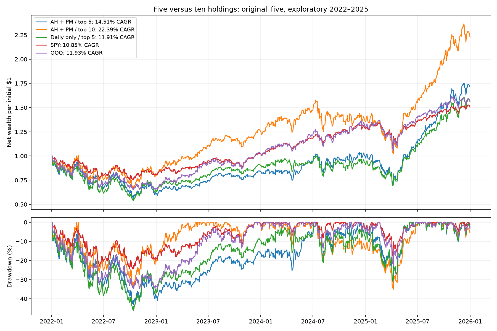
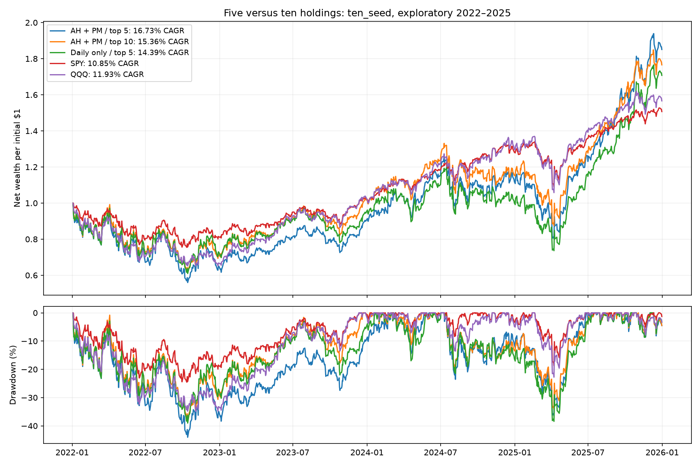
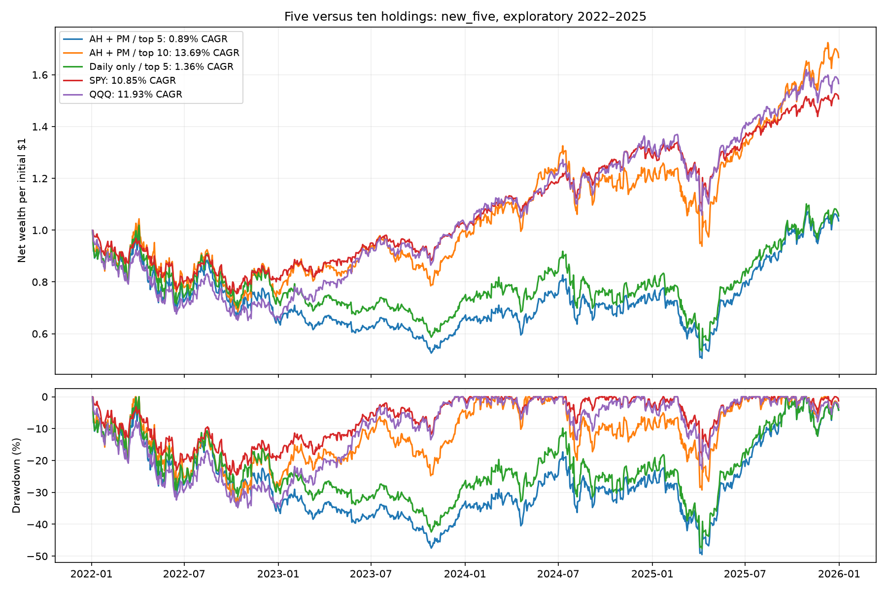

# After-hours + premarket: five versus ten holdings

October 24, 2026. Allocation-only follow-up on previously inspected 2022–2025 history. Saved forecasts are unchanged; zero new model fits.

| Seed group | Holdings | CAGR | Sharpe | Max drawdown | RankIC | 95% SR interval |
| --- | ---: | ---: | ---: | ---: | ---: | --- |
| original_five | 5 | 14.51% | 0.485 | -43.13% | 0.0061 | [-0.379, 1.392] |
| original_five | 10 | 22.39% | 0.700 | -35.01% | 0.0061 | [-0.139, 1.594] |
| ten_seed | 5 | 16.73% | 0.531 | -44.05% | 0.0038 | [-0.360, 1.467] |
| ten_seed | 10 | 15.36% | 0.519 | -38.32% | 0.0038 | [-0.345, 1.425] |
| new_five | 5 | 0.89% | 0.106 | -49.51% | 0.0067 | [-0.713, 0.975] |
| new_five | 10 | 13.69% | 0.480 | -34.40% | 0.0067 | [-0.382, 1.365] |

All groups use their original saved rank ensembles. Top-five targets approximately 20% per security versus 10% for top-ten, with fractional ties, 1% ADV share caps, cash scaling, missing-fill cancellation, modeled fees and terminal liquidation unchanged. RankIC describes the unchanged stock forecasts and therefore is identical across holding counts.

AH + PM bars end by 09:15 Eastern, decision is 09:20 on entry day, and fixed shares fill at that session’s regular close. Shares are sized from the known preceding close. The account engine’s origin-date field is bookkeeping alignment, not a claim the forecast existed before the premarket features. No overnight move before entry is earned.

## Paired holding-count differences

| Group | CAGR difference | Paired 95% interval | Sharpe difference | Paired 95% interval |
| --- | ---: | --- | ---: | --- |
| original_five | -7.88 pp | [-19.69, 4.15] pp | -0.215 | [-0.523, 0.087] |
| ten_seed | +1.37 pp | [-8.31, 14.72] pp | +0.012 | [-0.233, 0.267] |
| new_five | -12.80 pp | [-25.37, -0.02] pp | -0.374 | [-0.751, -0.010] |

Intervals use 10,000 paired circular-block resamples. Twenty sessions is primary; five and sixty are disclosed. Twelve contrasts cover all three groups against matched top-ten, SPY, QQQ and matched daily-only top-five. CSVs include simultaneous diagnostics. These fitted-path intervals omit prior research-search, retraining and future-regime uncertainty. No winning group or holding count is promoted as an unseen validation result.

## Annual returns for the requested original-five ensemble

| Year | AH + PM / top 5 | AH + PM / top 10 | Daily / top 5 | SPY | QQQ |
| --- | ---: | ---: | ---: | ---: | ---: |
| 2022 | -37.63% | -19.14% | -35.10% | -18.70% | -33.27% |
| 2023 | 35.11% | 56.52% | 40.05% | 26.18% | 54.86% |
| 2024 | 16.91% | 7.26% | 0.85% | 24.89% | 25.58% |
| 2025 | 74.06% | 64.60% | 70.71% | 17.63% | 20.69% |

## Cost stress

| Group | Holdings | Base-cost CAGR | 2x fees | 4x fees |
| --- | ---: | ---: | ---: | ---: |
| original_five | 5 | 14.51% | 11.90% | 6.88% |
| original_five | 10 | 22.39% | 20.24% | 16.07% |
| ten_seed | 5 | 16.73% | 14.29% | 9.57% |
| ten_seed | 10 | 15.36% | 13.76% | 10.63% |
| new_five | 5 | 0.89% | -0.99% | -4.64% |
| new_five | 10 | 13.69% | 12.07% | 8.89% |

## Wealth and drawdown comparisons

## Individual-seed checks

Top-five CAGR exceeded its paired top-ten in 8/10 individual runs. All twenty individual accounts are disclosed alongside the ensemble and fee-stress accounts.

## Verification

All 62 accounts were independently replayed. All 37 matching prior paths reproduced, including the original daily top-five control. Six rank ensembles were independently reconstructed. Three accounts’ 10,000 bootstrap replicates were materialized to verify the optimized calculations. Maximum account NAV difference was $0.00000007. Parent model/data/source hashes were checked before evaluation.

[All metrics](metrics.csv) · [Daily returns](curves.csv) · [Annual returns](annual.csv) · [Monthly returns](monthly.csv) · [Absolute SR intervals](sharpe_intervals.csv) · [Paired CAGR and SR differences](paired_intervals.csv) · [Arithmetic active-return intervals](active_mean_intervals.csv) · [Protocol](PROTOCOL.json) · [Audit](AUDIT.json)
