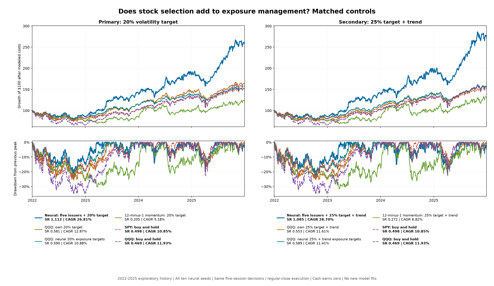

# Matched benchmark controls and prospective candidate freeze

October 27, 2026. Same 1,003 exchange sessions in 2022–2025; repeatedly inspected development history. Exactly 29 predeclared strategies and 87 cost accounts. No network retrained.

The fixed primary ten-seed candidate has **1.112 Sharpe / 26.81% CAGR / -21.69% drawdown**. QQQ with its own 20% volatility target has **0.581 / 12.87% / -25.79%**; the matched momentum control has **0.205 / 5.18% / -30.39%**. These are historical comparisons, not confirmation.

| Strategy | Sharpe | Net CAGR | Max drawdown | Mean stock exposure |
| --- | ---: | ---: | ---: | ---: |
| Neural: five issuers + 20% target | 1.112 | 26.81% | -21.69% | 66.7% |
| Neural: five issuers + 25% target + trend | 1.085 | 28.70% | -22.98% | 74.8% |
| Neural: prior full-exposure blend | 0.896 | 31.87% | -40.94% | 99.8% |
| QQQ: weekly full exposure | 0.469 | 11.93% | -34.87% | 100.0% |
| QQQ: own 20% target | 0.581 | 12.87% | -25.79% | 87.3% |
| QQQ: own 25% target + trend | 0.553 | 11.61% | -25.37% | 84.4% |
| QQQ: neural 20% exposure targets | 0.590 | 10.88% | -19.72% | 66.6% |
| QQQ: neural 25% + trend exposure targets | 0.589 | 11.41% | -20.48% | 74.8% |
| 12-minus-1 momentum: full exposure | 0.321 | 8.27% | -43.63% | 99.8% |
| 12-minus-1 momentum: 20% target | 0.205 | 5.18% | -30.39% | 66.5% |
| 12-minus-1 momentum: 25% target + trend | 0.272 | 6.82% | -31.62% | 69.9% |
| SPY: buy and hold | 0.498 | 10.85% | -24.55% | Buy and hold |
| QQQ: buy and hold | 0.469 | 11.93% | -34.87% | Buy and hold |

All neural rows above use all ten seeds. Original-five and new-five accounts remain in the full metrics file; they are diagnostics, not independent market replications. Exposure averages exclude the final liquidation session.

## What each comparison isolates

- QQQ own-risk controls use QQQ’s trailing 20-session volatility under the same target/cap and five-session execution calendar. This tests a simple passive exposure-management alternative.
- QQQ replay controls apply the neural basket-derived target exposure exactly. This holds intended stock/cash timing fixed while changing the assets. Realized exposure drift, beta, correlations and costs still differ, so it is not a proof of factor-adjusted alpha.
- Momentum uses the prior signal close’s price 21 sessions earlier divided by its price 252 sessions earlier, minus one. It selects five issuers with the same tie/share-class handling and applies each rule to its own selected basket. No lookback or weighting search was conducted.
- The weekly full-exposure QQQ control uses lagged fixed-share sizing like the model. Buy-and-hold SPY/QQQ anchors retain the parent’s first-close available-dollar investment. Both use the same first fill date, costs and terminal liquidation; their sizing conventions are explicitly different.

Momentum lacked endpoint history for a mean of **0.4** otherwise neural-eligible securities per decision (maximum **1**). Those names are excluded only from momentum; the neural universe is unchanged. [Per-date support](momentum_support.csv).

## Paired uncertainty: primary 20-session blocks

Eight comparisons were declared before control results. The active-mean intervals below are simultaneous across those eight comparisons. Sharpe-difference intervals are pointwise. Neither adjusts the extensive earlier model/risk-rule search, retraining uncertainty, or input-vintage uncertainty. Active mean is an annualized arithmetic daily return difference, not a CAGR difference.

| Candidate | Comparator | Annual active mean | Simultaneous 95% active-mean interval | Paired 95% SR-difference interval |
| --- | --- | ---: | --- | --- |
| Primary | SPY: buy and hold | 13.97% | [-1.03%, 28.97%] | [0.028, 1.177] |
| Primary | QQQ: buy and hold | 11.82% | [-2.51%, 26.16%] | [0.135, 1.126] |
| Primary | QQQ: own 20% target | 12.02% | [0.06%, 23.98%] | [0.068, 0.980] |
| Primary | QQQ: neural 20% exposure targets | 14.55% | [2.80%, 26.29%] | [0.102, 0.917] |
| Primary | 12-minus-1 momentum: 20% target | 18.59% | [-3.38%, 40.56%] | [0.090, 1.732] |
| Secondary | QQQ: own 25% target + trend | 15.41% | [2.46%, 28.35%] | [0.063, 0.982] |
| Secondary | QQQ: neural 25% + trend exposure targets | 15.90% | [2.95%, 28.85%] | [0.068, 0.901] |
| Secondary | 12-minus-1 momentum: 25% target + trend | 18.38% | [-6.21%, 42.98%] | [0.006, 1.614] |

Positive point estimates do not establish superiority when the corresponding interval includes zero. Five/60-session block sensitivity and paired CAGR intervals are retained in [uncertainty.csv](uncertainty.csv).

## Trading-cost stress

| Strategy | Cost multiple | Sharpe | Net CAGR | Max drawdown |
| --- | ---: | ---: | ---: | ---: |
| Neural: five issuers + 20% target | 1x | 1.112 | 26.81% | -21.69% |
| Neural: five issuers + 20% target | 2x | 1.031 | 24.74% | -22.53% |
| Neural: five issuers + 20% target | 4x | 0.870 | 20.70% | -24.20% |
| QQQ: own 20% target | 1x | 0.581 | 12.87% | -25.79% |
| QQQ: own 20% target | 2x | 0.573 | 12.69% | -26.00% |
| QQQ: own 20% target | 4x | 0.556 | 12.34% | -26.43% |
| QQQ: neural 20% exposure targets | 1x | 0.590 | 10.88% | -19.72% |
| QQQ: neural 20% exposure targets | 2x | 0.564 | 10.48% | -19.98% |
| QQQ: neural 20% exposure targets | 4x | 0.512 | 9.68% | -20.48% |
| 12-minus-1 momentum: 20% target | 1x | 0.205 | 5.18% | -30.39% |
| 12-minus-1 momentum: 20% target | 2x | 0.151 | 4.00% | -31.50% |
| 12-minus-1 momentum: 20% target | 4x | 0.046 | 1.68% | -33.66% |

Cost multipliers are applied to each account’s own trades, including ETF controls. Cash earns zero; taxes and a full auction/market-impact model remain excluded. Higher modeled fees do not constitute a live-capacity test.

## Frozen prospective policy

The primary ten-seed five-issuer/20% candidate was frozen at **2026-10-27T05:48:31.889867+00:00**, before this control study’s metrics. Its choice is retained regardless of the results here. The return-preserving 25%/trend variant is secondary. [Complete policy](PROSPECTIVE_POLICY.json).

The policy fixes the architectures, ten seeds, 50:50 rank blend, issuer/tie rules, 20% exposure target, annual chronological refit/checkpoint rules, feature cutoffs, share sizing, costs and execution calendar. Unsupported eligible stock IDs stop collection rather than receiving random mixer weights or being silently dropped.

The first signal must follow actual activation and the freeze, no earlier than October 28, 2026. One formal evaluation occurs after 252 completed exchange sessions. The primary endpoint is net arithmetic active return versus QQQ with its own 20% volatility target; paired Sharpe/CAGR, other controls, seed diagnostics and block-length checks are secondary. No interim return-based stopping or tuning is permitted. A year may remain statistically underpowered.

**Prepared, not activated:** reviewed local observations and model exports used here stop in 2025. Fresh point-in-time membership/actions and AH/PM inputs, supported stock-ID handling, current-year model refits, a future-date inference audit, a verified exchange calendar, and append-only predictions with a pre-outcome timestamp anchor are still required. No prospective performance has been collected. The older confirmation gate is unchanged. [Activation readiness](READINESS.json).

## Verification and limitations

The independent audit recalculated all **87** account metrics and replayed all **87** accounts; maximum NAV discrepancy was **$0.0000000172**. All 12 neural base-cost paths and both buy-and-hold ETF paths reproduced the parent records. Momentum, issuer weights and exposure rules were independently reconstructed. Future-price perturbation did not affect earlier momentum scores.

The inherited adjusted-unit dividend/acquisition approximations, reconstructed monthly membership, sparse extended-hours observations, missing publication-vintage guarantees, concentrated top-five risk and daily-close drawdown resolution remain. Audit success verifies the declared simulation; it does not independently validate vendor prices or establish executable/live returns.

[Protocol](PROTOCOL.json) · [Freeze](FREEZE.json) · [Audit](AUDIT.json) · [All 87 accounts](metrics.csv) · [Annual returns](annual.csv) · [Daily curves](comparison_curves.csv) · [Exact exposure targets](target_exposures.csv)

Reproduce: `python -m hypershift run run_ndx_matched_controls --stage freeze`, then `--stage run`; audit with `python -m hypershift run audit_ndx_matched_controls`; publish with `python -m hypershift run publish_ndx_matched_controls`. Completed studies refuse recomputation or changed seals.
