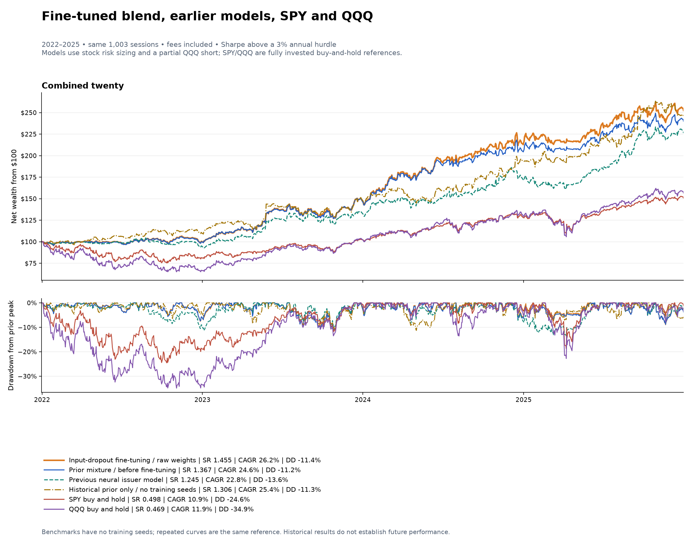
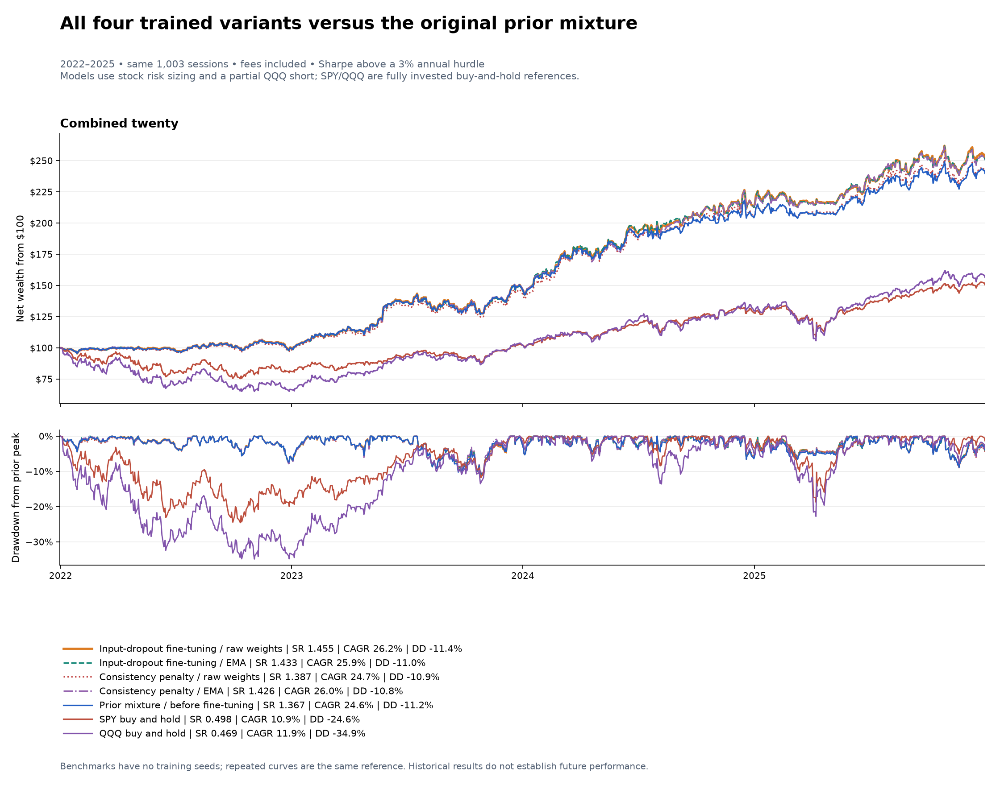
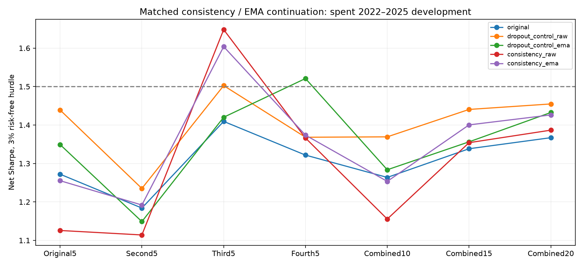
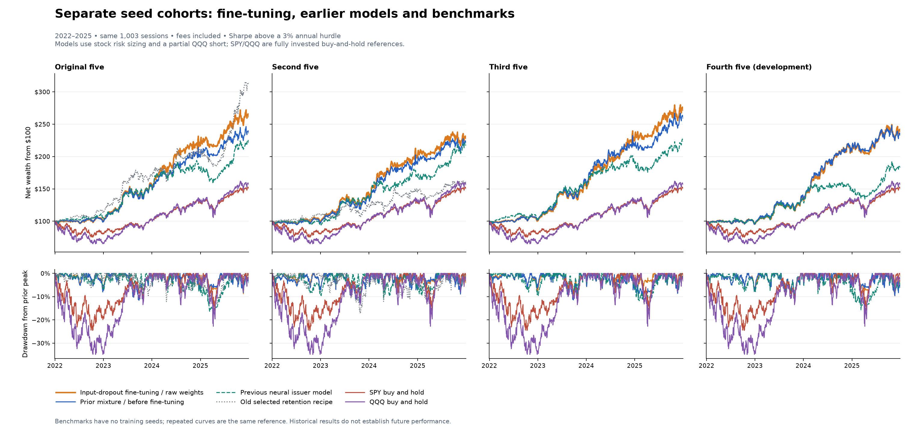
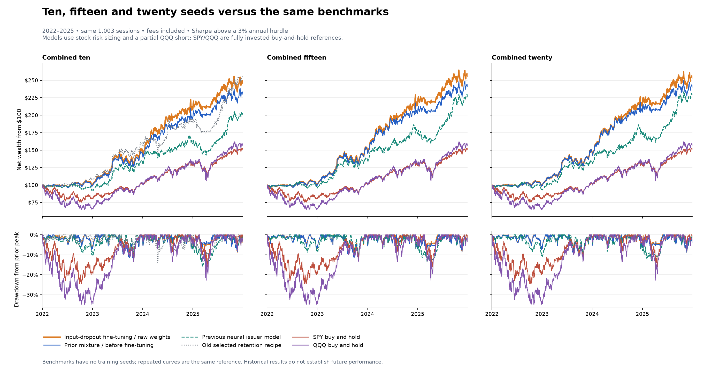

# Current model results, with SPY and QQQ — October 31, 2026

- **Higher average SR in the latest training comparison: input-dropout fine-tuning, raw weights.** Twenty-seed SR **1.455**, CAGR **26.20%**, worst drawdown **-11.37%**. Mean SR across the seven overlapping ensemble groups rises **1.308 → 1.401**. All seven improve, while the strict cohort-spread gate fails.
- **Earlier seed-confirmed reference: the original prior mixture.** Twenty-seed SR **1.367**, CAGR **24.60%**, worst drawdown **-11.20%**. Four separate five-seed groups score **1.272 / 1.184 / 1.409 / 1.322**. Its last group was scored after that candidate was fixed; this confirmation does not transfer to subsequent fine-tuning.
- **Strong simple alternative: the historical-prior model alone.** SR **1.306** with five-security retention, or **1.251** with five issuers. It has no neural training randomness. This is one deterministic control, not repeated independent seed evidence.
- **Highest selected historical peak: the old retention recipe.** SR **1.731** on the original five, **0.648** on the second five and **1.381** across ten. Its peak is higher; its initialization consistency is much weaker. The current mixture does not beat that old recipe in every available group.

**No evaluated strategy has achieved SR>1.5 in every predefined ensemble.** The fine-tuned model is the latest higher-average-SR candidate; the original mixture retains its separately dated seed-confirmation evidence. All use repeatedly inspected 2022–2025 history.



| Strategy / reference | Sharpe | CAGR | Annual volatility | Worst drawdown |
|---|---:|---:|---:|---:|
| Input-dropout fine-tuning / raw weights / twenty seeds | 1.455 | 26.20% | 14.71% | -11.37% |
| Input-dropout fine-tuning / EMA / twenty seeds | 1.433 | 25.94% | 14.81% | -10.96% |
| Consistency penalty / raw weights / twenty seeds | 1.387 | 24.73% | 14.58% | -10.93% |
| Consistency penalty / EMA / twenty seeds | 1.426 | 25.96% | 14.89% | -10.78% |
| Original prior mixture / twenty seeds | 1.367 | 24.60% | 14.72% | -11.20% |
| Previous neural issuer / twenty seeds | 1.245 | 22.77% | 15.01% | -13.55% |
| Neural retention / cohort targets / twenty seeds | 1.237 | 21.92% | 14.49% | -12.78% |
| Historical prior alone / five securities | 1.306 | 25.39% | 16.04% | -11.27% |
| Historical prior alone / five issuers | 1.251 | 24.19% | 15.97% | -11.35% |
| Old selected retention / original five | 1.731 | 33.11% | 15.52% | -13.36% |
| Old selected retention / second five | 0.648 | 12.31% | 15.14% | -17.11% |
| SPY buy and hold | 0.498 | 10.85% | 18.01% | -24.55% |
| QQQ buy and hold | 0.469 | 11.93% | 23.67% | -34.87% |

Sharpe measures daily return above a 3% annual hurdle relative to how bumpy the path is. CAGR is compound growth per year; worst drawdown is the largest fall from an earlier account peak. The simple prior has higher CAGR than the original mixture and lower CAGR than the fine-tuned blend, with a bumpier path than either. Different portfolio rules are present: the simple retention control and old strategy select securities, while both prior-mixture versions count companies/issuers.

## New trained models — October 31, 2026

**The fine-tuned raw-weight blend has the highest mean Sharpe in the latest five-method comparison: 1.401 across seven ensembles, versus 1.308 before fine-tuning.** This is a descriptive mean of overlapping groups, not the Sharpe of an averaged return path. The combined-twenty account is separately computed from its executed portfolio.

| Training variant | Mean SR over seven groups | Minimum SR | Four-cohort spread | Combined-20 SR | Stressed combined-20 SR |
|---|---:|---:|---:|---:|---:|
| Original prior mixture | 1.308 | 1.184 | 0.225 | 1.367 | 1.236 |
| Input-dropout fine-tuning / raw weights | 1.401 | 1.235 | 0.267 | 1.455 | 1.319 |
| Input-dropout fine-tuning / EMA | 1.359 | 1.149 | 0.372 | 1.433 | 1.296 |
| Consistency penalty / raw weights | 1.307 | 1.114 | 0.534 | 1.387 | 1.254 |
| Consistency penalty / EMA | 1.358 | 1.192 | 0.412 | 1.426 | 1.291 |

The study completed **320 three-epoch continuation fits and 810 accounts**, keeping all twenty seeds. Both training arms use two 10% input-dropout passes and a lower/reset optimizer. One arm adds a ranking-distribution consistency penalty; both also test exponentially averaged parameters (EMA). Dropout is applied during fitting; reported forecasts use evaluation mode. Raw and EMA checkpoints are selected by prior-year first-half supervised validation loss, with the unchanged source checkpoint available as epoch zero. The recipe bundles additional training, optimizer changes and input dropout; their separate contributions are not isolated.

**All seven blended ensembles improve with raw-weight fine-tuning**, including doubled fees and 6% borrowing. Four disjoint cohort Sharpes become **1.439 / 1.235 / 1.503 / 1.368**. The original prior, 50:25:25 rank blend, top-five-issuer committees, target averaging and risk/execution rules remain the same.

**The frozen strict gate still fails:** cohort spread increases **0.225 → 0.267**, above its 0.25 limit. Only **11/20 individual seeds improve**, although their minimum/median/SD moves **0.751 / 1.103 / 0.186 → 0.830 / 1.147 / 0.161**. The conditional pointwise 95% interval for combined-twenty Sharpe improvement is **[−0.019, +0.206]** and includes zero. Consistency penalties and EMA do not improve reliably on the matched control, and standalone-family portfolios do not share the blend’s improvement. All twenty seeds are development for this continuation; no new reserved-seed or market confirmation is supplied.





[Fine-tuning findings](../ndx_consistency_retraining_20261031/FINDINGS.md) · [All 810 accounts](../ndx_consistency_retraining_20261031/METRICS.csv) · [Individual seed changes](../ndx_consistency_retraining_20261031/SEED_CHANGES.csv) · [Paired intervals](../ndx_consistency_retraining_20261031/PAIRED_INTERVALS.csv) · [Training and resume audit](../ndx_consistency_retraining_20261031/TRAINING_AUDIT.json).

## How the prior-mixture models work, in everyday terms

1. **Make a historical report card.** For each stock, use only the fold's training period and ask how well its returns ranked against other stocks on average. Recent training observations get more weight: an observation 26 decision-weeks older has half the weight. Limited histories are pulled toward a neutral score. The report card is fixed for the annual fold; it does not use that evaluation year's outcomes. For the 2025 fold, this prior ends in 2023, before 2024 validation.
2. **Ask two neural models for their stock orderings.** THINK and the dynamic-hypergraph model use daily, after-hours and premarket inputs to rank stocks. Each seed starts another version of each network. A five-seed group therefore contains five versions of each neural model, not five stocks.
3. **Combine the votes.** The common historical report card receives 50% of the ranking score; mean THINK rank gets 25% and mean dynamic-model rank 25%. For example, report card 85, THINK 90 and dynamic 70 give an overall 82.5. This is an ordering score, not an 82.5% return forecast.
4. **Build and risk-size a portfolio.** About every five trading sessions, each five-seed committee selects five companies. Counting issuers stops GOOG and GOOGL from using two company slots. When the chosen basket has been more volatile, the stock allocation is reduced. A partial QQQ short uses the permitted remaining gross budget. It tends to gain when QQQ falls and lose when QQQ rises. If 70% of the target budget is long stocks, at most 30% can be short QQQ under this rule. The 75% short limit is a ceiling, not a permanent position. The 20% stock-volatility target guides sizing; actual account volatility can differ.
5. **Combine portfolios for larger ensembles.** A committee means one fixed five-seed ensemble. Twenty seeds form four such ensembles. Each builds its own top-five-company portfolio; the account equally averages their signed target weights and trades the net order. All predefined seeds are retained.

The construction below applies to both versions. Its allocation example and 1.367 Sharpe refer to the original account; the fine-tuned account has updated stock selections and 1.455 Sharpe.

## Top-k still applies: five companies per five-seed ensemble

**A committee is one fixed five-seed ensemble.** Each contains five THINK networks and five dynamic-hypergraph networks, one of each per seed. The twenty-seed strategy has four such ensembles, using the original, second, third and reserved groups of five. These groups are fixed; their historical Sharpe does not determine their weight.

There are two averaging steps. **Within each ensemble**, average its five THINK percentile rankings and its five dynamic-model percentile rankings. Combine those with the shared training-history prior: **50% prior + 25% mean THINK rank + 25% mean dynamic rank**. Select the top **k = 5 companies**, then apply that ensemble's stock-volatility sizing and QQQ hedge. **Across ensembles**, equally average those completed portfolio target weights and execute the net orders in one account.

```text
Original five seeds -> rank stocks -> top 5 companies -> risk-sized targets A
Second five seeds   -> rank stocks -> top 5 companies -> risk-sized targets B
Third five seeds    -> rank stocks -> top 5 companies -> risk-sized targets C
Reserved five seeds -> rank stocks -> top 5 companies -> risk-sized targets D
Combined twenty     -> (A + B + C + D) / 4 -> one trading account
```

A target is a fraction of account value: positive for a stock holding and negative for a QQQ short. Average each security's signed weight, using zero when an ensemble does not hold it. Risk sizing happens before this averaging, so selected stocks can have different final weights. Every ensemble receives equal weight, including the weaker historical performers.

| Prior-mixture construction (both training versions) | Five-seed portfolios averaged | Portfolio construction |
|---|---:|---|
| Each separate five-seed group | 1 | Its own top-five-company portfolio |
| Combined ten | 2 | Original + second, each with 50% weight |
| Combined fifteen | 3 | Original + second + third, each with one-third weight |
| Combined twenty | 4 | Original + second + third + reserved, each with 25% weight |

**The combined account can hold more than five companies.** GOOG and GOOGL share one company slot within each ensemble. The combined-twenty Sharpe of 1.367 is calculated from the daily returns of the resulting single account after modeled trading and borrowing costs. It is not the average of the four Sharpe ratios or four saved return series.

**Original prior-mixture example: January 6, 2025.** The original, second and reserved ensembles selected Adobe, Costco, Cintas, Meta and Nvidia; each targeted 92.05% in stocks and 7.95% short QQQ. The third ensemble selected Intuit instead of Cintas and targeted 97.92% in stocks and 2.08% short QQQ. Averaging their targets produced:

| Position | Combined-twenty target |
|---|---:|
| Adobe (ADBE) | +18.70% |
| Costco (COST) | +18.70% |
| Meta (META) | +18.70% |
| Nvidia (NVDA) | +18.70% |
| Cintas (CTAS) | +13.81% |
| Intuit (INTU) | +4.90% |
| QQQ | -6.48% |

Cintas receives three ensembles' allocations divided by four; Intuit receives one ensemble's allocation divided by four. Four shared names receive allocations from all four ensembles. The unrounded stock targets total 93.52%, alongside a 6.48% QQQ short. These are decision targets; execution prices and constraints can change realized closing weights.

**Reading the comparisons:** the previous neural issuer baseline pools all participating seeds' rankings first, then selects one top-five-company portfolio. The current prior mixture builds each five-seed portfolio first and averages its targets. The historical-prior-only control has no seed ensembles to combine. These construction rules are specific to their labeled strategies; they should not be inferred for every curve in the historical gallery.

The simple historical-prior control skips the neural votes. Its stock preference list is mostly fixed within each annual fold; eligibility, retention and risk sizing can still change positions. It uses a 13-decision-week half-life, compared with 26 for the neural mixture. The five-security retention control can count share classes separately; its five-issuer counterpart consolidates them. Its strong result means a simple training-history strategy remains an important competitor. These results do not establish a statistically significant advantage for the more complex ensemble.

## Comparison across every seed ensemble

| Ensemble | Fine-tuned blend SR | Original prior mixture SR | Previous neural SR | Old selected recipe SR | SPY SR | QQQ SR |
|---|---:|---:|---:|---:|---:|---:|
| Original five | 1.439 | 1.272 | 1.171 | 1.731 | 0.498 | 0.469 |
| Second five | 1.235 | 1.184 | 1.147 | 0.648 | 0.498 | 0.469 |
| Third five | 1.503 | 1.409 | 1.200 | — | 0.498 | 0.469 |
| Reserved five | 1.368 | 1.322 | 0.877 | — | 0.498 | 0.469 |
| Combined ten | 1.369 | 1.264 | 1.023 | 1.381 | 0.498 | 0.469 |
| Combined fifteen | 1.441 | 1.338 | 1.235 | — | 0.498 | 0.469 |
| Combined twenty | 1.455 | 1.367 | 1.245 | — | 0.498 | 0.469 |

SPY and QQQ have no training seeds. Their repeated columns/curves are the same two buy-and-hold references, not extra experiments. Dashes mean the old recipe was not fitted for that group; no missing old result is extrapolated. The same cost formula, price convention, 1,003 sessions and 3% Sharpe hurdle apply. Benchmarks buy at the first common fill close and liquidate at the last; the active models trade repeatedly and additionally pay short borrowing.





**These are strategy comparisons, not a pure test of neural prediction skill.** SPY/QQQ stay fully invested; the active models select stocks, adjust exposure and partially short QQQ. Their market exposure and volatility differ. Higher historical Sharpe does not establish future superiority.

## Why the original prior mixture is more consistent than the old 1.7 result

The old retention rule gave last week's selected names a small score bonus before choosing five securities. That encourages keeping a near-tied name. It does not correct arbitrary model rankings, and it can count two share classes as separate slots.

The old result had a specific initialization problem. In the inspected 2023 fold, THINK's stock ordering correlated about 0.995 with its stock-specific output biases; those biases retained about 0.999 rank correlation with their random starting values. In plain language, some stocks began with arbitrary head starts that training barely changed. The lucky original group also held a large combined GOOG/GOOGL position. That is evidence for one initialization mechanism, not proof that every year or every part of the network was untrained.

The newer training starts those stock-specific output weights/biases neutrally, gives dynamic stock filters a common start, and trains on relative stock rankings rather than mainly fitting the common market-return level. Validation is separated chronologically for checkpoint selection and diagnostics. These training changes were bundled, so their individual causal contributions are not isolated.

The October 30 improvement is an anchor built from training data: half of the final score comes from the same historical report card in every seed group. Random starts still affect the neural half. Portfolio averaging further limits the effect of borderline top-five changes. The October 31 fine-tuned variants retain that anchor and portfolio construction.

The reserved cohort is the clearest comparison: the newer neural issuer baseline scores 0.877 and the fixed prior mixture 1.322. Because this group contains only one five-seed committee, portfolio averaging cannot explain that gain; the ranking prior changes the stock choices. Across all four disjoint groups, baseline SR spread falls 0.323 → 0.225. The older 1.731 → 0.648 gap was 1.084 under a different recipe/training generation.

Consistency improved at a cost to the old selected peak. We retained all seeds and exposed the weak cohort instead of choosing the original five. Removing the stock-specific mixer entirely,using longer shared-feature forests,selecting different family weights or applying more beta hedging did not solve the problem; those failed curves and full grids remain below in the master gallery.

## What remains unproven

All cohorts share the repeatedly inspected 2022–2025 market history, and pooled groups overlap their constituent models. The original prior mixture was selected on development results, then frozen before the reserved cohort's financial outcomes. Its secondary seed-confirmation test passes; its original stricter 0.15 spread gate remains failed. The new fine-tuning study uses all twenty seeds as development and fails its separate 0.25 spread gate. The all-ensemble 1.5 target remains unmet. A deterministic control has no initialization lottery but can still overfit the market history used to choose it. None of this is an untouched-market validation.

[Full experiment history and verification](../ndx_seed_robustness_20261030/REPORT.md) · [Headline metrics](HEADLINE_METRICS.csv) · [Seed comparison](SEED_COMPARISON.csv) · [Benchmark replay](BENCHMARK_REPLAY.csv) · [Provenance](MANIFEST.json)
