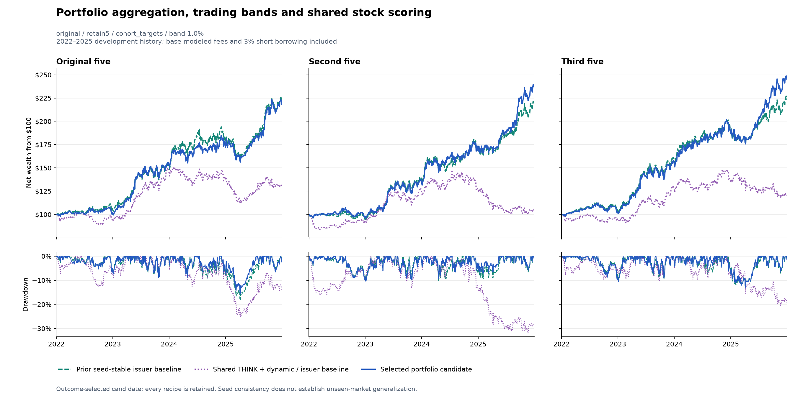

# Portfolio robustness and shared THINK — October 30, 2026

Completed **60 shared-THINK fits and 540 fixed accounts**. **0** recipes pass the predefined historical improvement/stability goal; **0** exceed SR>1.5 in all five ensembles.

This is development on repeatedly inspected 2022–2025 data. A new seed group can confirm initialization robustness, not out-of-time market performance.

Displayed candidate: **original / retain5 / cohort_targets / 1.0% NAV band**. No candidate passed; this is only the highest observed minimum-SR row, not a success claim.




| Ensemble | Prior stable issuer SR | Shared THINK + dynamic SR | Candidate SR | Candidate CAGR | Candidate max DD | Candidate vol |
|---|---:|---:|---:|---:|---:|---:|
| Original five | 1.171 | 0.304 | 1.170 | 21.65% | -15.56% | 15.22% |
| Second five | 1.147 | -0.054 | 1.283 | 23.89% | -10.42% | 15.31% |
| Third five | 1.200 | 0.179 | 1.358 | 25.26% | -12.99% | 15.27% |
| Combined ten | 1.023 | 0.266 | 1.281 | 23.09% | -10.87% | 14.76% |
| Combined fifteen | 1.235 | 0.205 | 1.336 | 23.79% | -11.58% | 14.56% |

## Reserved-seed confirmation

Predefined confirmation passed: **False**. Four disjoint cohort SR spread: **0.491**.

[Exact frozen recipe and seeds](CONFIRMATION_PROTOCOL.json) · [All confirmation accounts](CONFIRMATION_METRICS.csv) · [Result](CONFIRMATION_RESULT.json).

This separate follow-up froze the original no-band retention/cohort-target proposal before new-seed fitting; it is not the displayed1%band development representative. The expanded twenty-seed check uses every seed without filtering. No choice changes after these outcomes. The pooling-specific confirmation also fails: reserved-fiveSR0.854 and four-cohortspread0.491. [Pooling result](POOLING_CONFIRMATION.json). The later prior-regularized candidate has its own separately frozen confirmation in the [current overview](../ndx_seed_robustness_20261030/REPORT.md).

## What changed and what is controlled

- **Portfolio targets:** compare rank pooling with averaged individually risk-sized seed portfolios and averaged consecutive five-seed-cohort portfolios. The final combined account nets orders and pays its own fees. Return-series averaging is never substituted for execution. No leverage is added after averaging; exposure, volatility and concentration can differ, and are reported.
- **Actual-holdings bands:** fixed 0%, 1%, 2.5% NAV per-component thresholds use preceding-close holdings/NAV and marks. Ineligible exits and gross budget take priority. Kept proposals exceeding gross1 are scaled. ADV/funding limits, fill prices, costs, events and terminal liquidation remain inherited.
- **Shared scorer:** remove THINK's stock-ID dense residual mixer, retaining its existing shared THINK stock output and AH/PM branch. Construct the matched model first so every retained initialized tensor exactly matches the corresponding old seed. Same optimizer, loss, dates, seed list, 12epochs and first-half validation loss selection. Reuse the original dynamic family unchanged. This is a controlled architecture ablation; it is not a new paper replication.
- **Every case retained:** two architectures × two allocations × three aggregation rules × three bands × five groups × three cost regimes =540 accounts. Cohort averaging equals rank pooling for a single five-seed cohort, so some paths duplicate; they are not independent evidence.
- **Improvement gate:** every base-cost group must beat the prior loss/issuer5/cap75 SR by>=0.01; minimum across all5>1.10; disjoint-five spread<=0.15; stressed-cost worst-group SR must not fall below that prior baseline. Separately report the harder all-group1.5 target.

## Verification and limitations

Source/input hashes are frozen before scoring; all zero-band accounts match the original signed engine. Original rank-pool/no-band targets and daily paths also reproduce the completed source accounts. Every account passes independent dollar-position replay using the actual executed decision targets. Eligibility, gross budgets and final liquidation are checked.

A first attempt failed its baseline-parity gate before accepting an account: averaging per-seed family blends first changed floating-point ties versus the original family-first averaging. The failed frozen source/run is preserved; v2 restores exact family-first association. No result-driven rule change followed from that failure.

A transient Windows progress-file replacement error interrupted one worker after its epoch8 checkpoint. The execution amendment retries that atomic file replacement and preserves all scientific source and complete-prefix hashes. An actual replay from epoch7 to8 matches model parameters and validation forecasts exactly (zero maximum absolute error). Every seed remains included.

The same market years have been repeatedly inspected. Historical recipe selection remains exposed to multiple testing; a seed reserve only checks initialization. No untouched-period or live-execution evidence is supplied. Borrow, impact, vendor vintages and broker margin assumptions remain inherited. Actual-holdings bands can leave small positions in eligible stocks outside the new top five.

[All540accounts](METRICS.csv) · [All108recipe/cost summaries](CONSISTENCY.csv) · [Frozen protocol](PROTOCOL.json) · [Selection](SELECTION.json)

## Reproduction

```powershell
.\.venv\Scripts\python.exe -m hypershift run run_ndx_portfolio_robustness_v2 --stage freeze
.\.venv\Scripts\python.exe -m hypershift run run_ndx_portfolio_robustness_v2 --stage accounts --arm original
.\.venv\Scripts\python.exe -m hypershift run run_ndx_portfolio_robustness_v2 --stage train
.\.venv\Scripts\python.exe -m hypershift run run_ndx_portfolio_robustness_v2 --stage accounts --arm shared
.\.venv\Scripts\python.exe -m hypershift run run_ndx_portfolio_robustness_v2 --stage summarize
# If a candidate qualifies: confirmation freeze, train, evaluate, then publish.
.\.venv\Scripts\python.exe -m hypershift run report_ndx_portfolio_robustness
```

Existing runs are preserved; these commands expect an absent run for the freeze stage.
