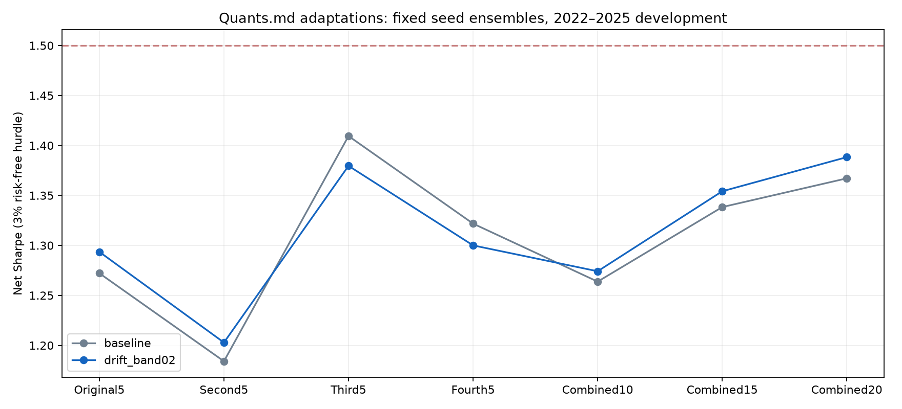
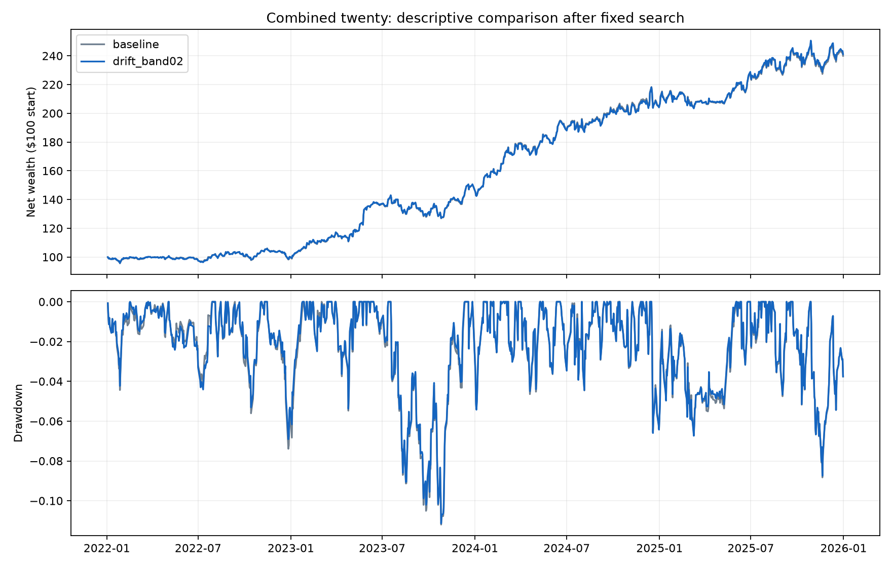

# Quants.md strategy adaptations — October 31, 2026

**14 frozen recipes, 756 accounts, twenty existing seeds, no new training.** 0 recipes pass the declared all-group improvement gate; 0 reach Sharpe >1.5 across every ensemble.



The reference is the current prior26 mixture with five issuers per fixed five-seed cohort and equal target averaging. Every result uses the same 1,003 sessions in 2022–2025, 3% annual risk-free hurdle, zero cash interest, modeled transaction costs, calendar-day borrow and next-close execution. Twenty singleton models are additional initialization diagnostics. All market history and these seeds were already inspected before this study; there is no untouched confirmation.

## Descriptive strongest worst-ensemble result

`drift_band02` has minimum seven-ensemble Sharpe 1.203 and four-disjoint-cohort spread 0.177. Declared gate passed: **False**. This label is chosen after the fixed search; it is not a prospective performance estimate.

| Ensemble | Baseline SR | Candidate SR | Change | Candidate CAGR | Candidate max DD |
|---|---:|---:|---:|---:|---:|
| Original5 | 1.272 | 1.294 | +0.021 | 24.20% | -11.35% |
| Second5 | 1.184 | 1.203 | +0.019 | 22.21% | -12.82% |
| Third5 | 1.409 | 1.380 | -0.030 | 26.11% | -11.14% |
| Fourth5 | 1.322 | 1.300 | -0.022 | 23.03% | -9.80% |
| Combined10 | 1.264 | 1.274 | +0.010 | 23.18% | -12.23% |
| Combined15 | 1.338 | 1.354 | +0.016 | 24.58% | -11.67% |
| Combined20 | 1.367 | 1.388 | +0.021 | 24.76% | -11.14% |



## Every fixed recipe

| Recipe | Minimum ensemble SR | Disjoint spread | Groups +0.02 | Worst stress SR change | Singleton min / median / max SR | Pass |
|---|---:|---:|---:|---:|---|---|
| drift_band02 | 1.203 | 0.177 | 2/7 | -0.026 | 0.738 / 1.072 / 1.435 | False |
| baseline | 1.184 | 0.225 | 0/7 | +0.000 | 0.751 / 1.103 / 1.456 | False |
| drift_band05 | 1.145 | 0.221 | 1/7 | -0.111 | 0.758 / 1.068 / 1.448 | False |
| trend200_half | 1.096 | 0.210 | 0/7 | -0.086 | 0.709 / 1.039 / 1.381 | False |
| inverse_vol63 | 1.090 | 0.246 | 0/7 | -0.197 | 0.679 / 0.904 / 1.302 | False |
| invvol_band02 | 1.087 | 0.205 | 0/7 | -0.186 | 0.677 / 0.906 / 1.257 | False |
| capped_erc63 | 1.053 | 0.233 | 0/7 | -0.220 | 0.680 / 0.888 / 1.267 | False |
| erc_band02 | 1.045 | 0.205 | 0/7 | -0.203 | 0.697 / 0.889 / 1.255 | False |
| momentum252_25 | 1.030 | 0.145 | 0/7 | -0.379 | 0.892 / 1.072 / 1.217 | False |
| reversal21_25 | 1.026 | 0.358 | 1/7 | -0.492 | 0.459 / 0.994 / 1.494 | False |
| trend200_cash | 0.965 | 0.241 | 0/7 | -0.216 | 0.636 / 0.937 / 1.259 | False |
| momentum252_erc | 0.898 | 0.217 | 0/7 | -0.502 | 0.740 / 0.962 / 1.102 | False |
| momentum126_25 | 0.653 | 0.112 | 0/7 | -0.655 | 0.226 / 0.573 / 0.745 | False |
| momentum126_invvol | 0.532 | 0.126 | 0/7 | -0.757 | 0.052 / 0.480 / 0.662 | False |

## What was adapted

- Inverse volatility: 63-session estimates, 10% annualized volatility floor, 30% issuer cap, same selected five companies.
- Capped ERC: 63-session covariance with 50% diagonal shrinkage, then 30% issuer cap. Capping can break exact equal risk contributions.
- Momentum/reversal: 25% current percentile rank of 126/252-session return or negative 21-session return, plus 75% current baseline ranking. Unsupported endpoints receive neutral ranks.
- Trend: QQQ below its 200-session SMA reduces the entire signed sleeve to half or cash at the next scheduled weekly decision. Cash earns zero; the hedge is reduced too.
- Drift bands: retain actual holdings when changes stay within 2 or 5 percentage points, after averaging cohort targets. Eligibility and gross budget take precedence.
- Four combinations were fixed with the individual rules before any new scores. No post-result expansion or seed filtering.

These are adaptations to our NDX inputs, not exact replications of the site ETF strategies. The site uses multi-asset ETF baskets, monthly/quarterly cadences, SPY regimes and different controls. We did not test futures/FX/pairs or add unavailable defensive-asset data. The drift band is not a full tracking-error/annual-turnover gate.

## Robustness and uncertainty

The declared gate requires at least +0.02 Sharpe in all seven groups, disjoint spread <=0.25, and no group losing Sharpe at double trading fees plus 6% annual borrow. The separate >1.5 goal remains explicit. Singletons, overlapping ten/fifteen/twenty groups and shared market dates are not independent observations.

[PERIOD_METRICS.csv](PERIOD_METRICS.csv) retains every year and both two-year halves, using continuous-account returns without resets. [PAIRED_INTERVALS.csv](PAIRED_INTERVALS.csv) gives conditional pointwise 95% Sharpe-change intervals from 2,000 paired circular 20-session block draws for the descriptive strongest candidate. These do not correct for this or the extensive earlier search. Seed consistency does not establish future market consistency.

All 756 accounts pass independent dollar-position replay; maximum daily-return discrepancy 8.88e-16. All 14 reference paths reproduce to <1e-12 daily-return error. The focused tests cover risk-budget mathematics, issuer caps, baseline estimator equivalence, and future-data invariance. Compressed ledgers, effective targets, daily paths, code snapshots and input hashes remain in the dated run directory.

## Sources and reproduction

- [library](https://quants.md/)
- [inverse_vol](https://github.com/QuantJourneyOrg/quantjourney-bt/blob/main/strategies/example_weights_05_monthly_inverse_vol.py)
- [trend](https://github.com/QuantJourneyOrg/quantjourney-bt/blob/main/strategies/example_weights_06_signal_change_defensive.py)
- [risk_parity](https://github.com/QuantJourneyOrg/quantjourney-bt/blob/main/strategies/example_weights_19_risk_parity_multiasset.py)
- [momentum_cost](https://github.com/QuantJourneyOrg/quantjourney-bt/blob/main/strategies/example_weights_11_quarterly_te_cost_gate.py)
- [reversal](https://github.com/QuantJourneyOrg/quantjourney-bt/blob/main/strategies/example_weights_16_cross_sectional_reversal.py)

```powershell
.\.venv\Scripts\python.exe -m hypershift test test_ndx_quants_overlays -v
.\.venv\Scripts\python.exe -m hypershift run run_ndx_quants_experiment --stage freeze
.\.venv\Scripts\python.exe -m hypershift run run_ndx_quants_experiment --stage evaluate
.\.venv\Scripts\python.exe -m hypershift run run_ndx_quants_experiment --stage summarize
```

Freeze/evaluate refuse to overwrite completed work; summarize verifies every sealed output and can be rerun. To reproduce from scratch use a separate dated run path, retaining this frozen study.
