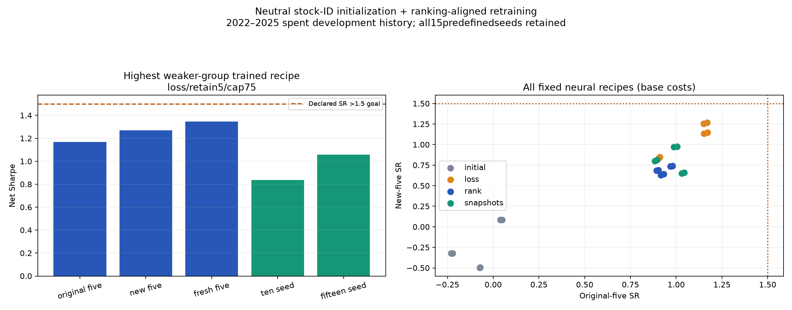

# Stock-ID bias attribution and ranking retraining — October29,2026

Completed **120 fixed fits,12epochs each,15predefinedseeds,576 financial accounts**. **0 trained recipes achieved SR>1.5 in every one of the five declared ensembles** at base costs. The history is repeatedly inspected development data; these findings are not untouched-period confirmation.



## What explained the historical discrepancy

Independent asset attribution reproduces all three old retention paths to6.67e-16 daily-return error. In2023, original-five THINK mean stock forecasts had about0.995 rank correlation with the saved final stock-specific mixer biases. Those biases retain about0.999 rank correlation with their reconstructed initial values across all ten seeds. This is strong descriptive evidence of persistent random stock-ID preferences, not proof that every part of the network is untrained. The original account also carried bothGOOG andGOOGL: together they averaged about32.6% of account NAV at the beginning of trading days in2023. Concentration and favorable realized stocks contribute to the headline; buying those retrospectively identified winners would introduce lookahead. [Asset attribution and initialization checks](../ndx_seed_attribution_20261029/ASSET_CONTRIBUTIONS.csv) accompany the separate diagnostic study.

## Fixed base-cost comparisons

| Method | Allocation | Hedge cap | Original5 SR | New5 SR | Fresh5 SR | Ten SR | Fifteen SR | Goal |
|---|---|---:|---:|---:|---:|---:|---:|---|
| loss | retain5 | 75% | 1.168 | 1.269 | 1.345 | 0.837 | 1.057 | False |
| loss | retain5 | 50% | 1.151 | 1.256 | 1.305 | 0.831 | 1.047 | False |
| loss | issuer5 | 75% | 1.171 | 1.147 | 1.200 | 1.023 | 1.235 | False |
| loss | issuer5 | 50% | 1.153 | 1.133 | 1.157 | 1.016 | 1.228 | False |
| snapshots | issuer5 | 75% | 1.005 | 0.977 | 0.991 | 0.894 | 1.057 | False |
| snapshots | issuer5 | 50% | 0.988 | 0.971 | 0.979 | 0.886 | 1.048 | False |
| loss | retain10 | 75% | 0.911 | 0.849 | 1.127 | 0.891 | 1.074 | False |
| loss | retain10 | 50% | 0.906 | 0.841 | 1.107 | 0.878 | 1.054 | False |
| snapshots | retain10 | 75% | 0.896 | 0.813 | 1.150 | 0.826 | 0.914 | False |
| snapshots | retain10 | 50% | 0.883 | 0.801 | 1.134 | 0.810 | 0.902 | False |
| rank | retain10 | 75% | 0.979 | 0.739 | 1.035 | 0.748 | 0.842 | False |
| rank | retain10 | 50% | 0.969 | 0.736 | 1.028 | 0.736 | 0.833 | False |
| rank | retain5 | 75% | 0.902 | 0.690 | 0.827 | 0.863 | 0.872 | False |
| rank | retain5 | 50% | 0.892 | 0.686 | 0.808 | 0.853 | 0.859 | False |
| snapshots | retain5 | 75% | 1.044 | 0.660 | 1.013 | 0.996 | 1.042 | False |
| snapshots | retain5 | 50% | 1.030 | 0.650 | 0.990 | 0.983 | 1.029 | False |
| rank | issuer5 | 75% | 0.932 | 0.640 | 0.985 | 0.678 | 0.757 | False |
| rank | issuer5 | 50% | 0.915 | 0.631 | 0.961 | 0.668 | 0.745 | False |
| initial | retain10 | 50% | 0.039 | 0.086 | -0.255 | -0.303 | -0.199 | False |
| initial | retain10 | 75% | 0.049 | 0.087 | -0.258 | -0.292 | -0.194 | False |
| initial | retain5 | 50% | -0.222 | -0.322 | -0.251 | -0.342 | 0.130 | False |
| initial | retain5 | 75% | -0.230 | -0.323 | -0.258 | -0.349 | 0.120 | False |
| initial | issuer5 | 75% | -0.071 | -0.496 | -0.255 | -0.131 | 0.057 | False |
| initial | issuer5 | 50% | -0.074 | -0.499 | -0.248 | -0.123 | 0.067 | False |

## Design and limits

The two original model families keep their train-only25-channel inputs and parameter inventories. The THINK stock-specific mixer output matrix/bias start at zero; dynamic stock filters start at one. All parameters remain trainable. Both families optimize a date-balanced, centered/normalized Huber plus pairwise-ranking objective. This bundles objective and initialization changes, so it is not an isolated causal estimate of either intervention. The first half of prior-year validation selects epochs, with crossing labels purged; the second half is diagnostic and never controls selection. Loss, robustRankIC and three-snapshot checkpoint rules share the same fitted paths. Every epoch state and validation forecast is preserved. Epoch0 is an untrained neutral-initialization control, not a qualifying learned strategy.

All three disjoint five-seed groups were fixed before fitting. The additional five seeds are the next five from the October20predeclared list. Ten/fifteen ensembles overlap those groups and all use the same market history. All15single-seed pairs are reported for the fixed retention-five/cap75 policy. Deterministic momentum and training-mean-rank controls appear once each; they are not repeated as artificial seed ensembles. Allocations test five-security retention, ten-security retention and five issuers; fees, borrow, timing and risk controls remain inherited.

Cherry-picking seeds by realized Sharpe would bias paper claims. Report the best case alongside the full distribution and search history; even passing this historical target would not establish future SR>1.5. More seeds do not create independent market periods. [Bailey and Lopez de Prado,Deflated Sharpe Ratio](https://www.davidhbailey.com/dhbpapers/deflated-sharpe.pdf) describes selection-bias concerns.

## Verification and reproduction

All576accounts match independent value-position accounting (maximum daily discrepancy 8.88e-16); all target budgets, masks, chronology and terminal liquidation are checked. Code/data hashes are frozen, and every fit is locked before account scoring. These are saved-export/accounting checks; historical vendor vintage and live broker execution remain assumptions.

[Every account](METRICS.csv) · [Every ensemble and cost regime](CONSISTENCY.csv) · [Selected epochs](SELECTED_EPOCHS.csv) · [Selection/audit metrics](VALIDATION.csv) · [Protocol](PROTOCOL.json) · [Audit](AUDIT.json)

```powershell
.\.venv\Scripts\python.exe -m hypershift run run_ndx_rank_retraining --stage freeze --name ndx_rank_retraining_20261029_fresh
.\.venv\Scripts\python.exe -m hypershift run run_ndx_rank_retraining --stage train --name ndx_rank_retraining_20261029_fresh
.\.venv\Scripts\python.exe -m hypershift run report_ndx_rank_retraining --stage evaluate --name ndx_rank_retraining_20261029_fresh
.\.venv\Scripts\python.exe -m hypershift run report_ndx_rank_retraining --stage report --name ndx_rank_retraining_20261029_fresh
```

Full epoch/checkpoint/prediction/account artifacts are retained in `runs/ndx_rank_retraining_20261029/`. No2026market returns,live trades or prospective activation were used.
