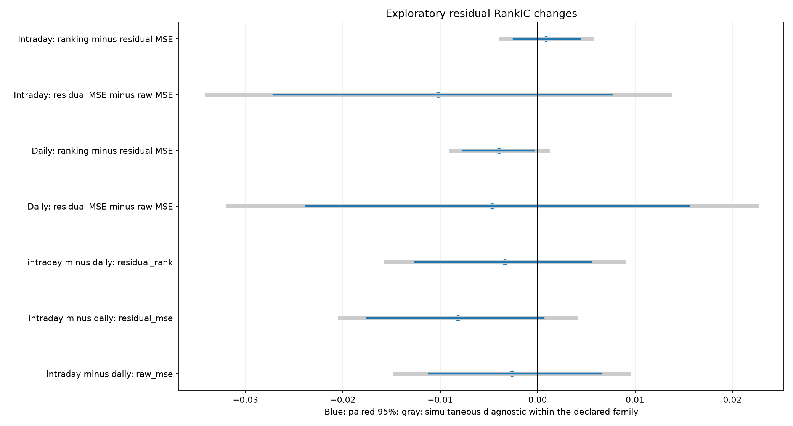
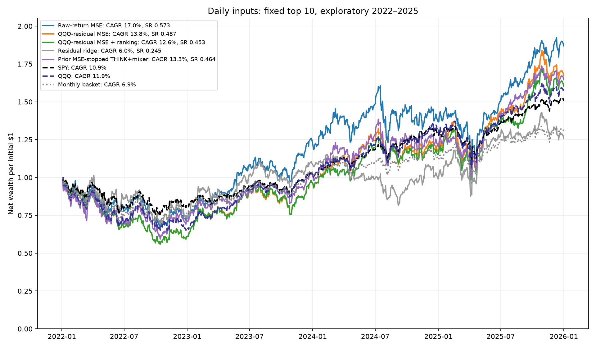
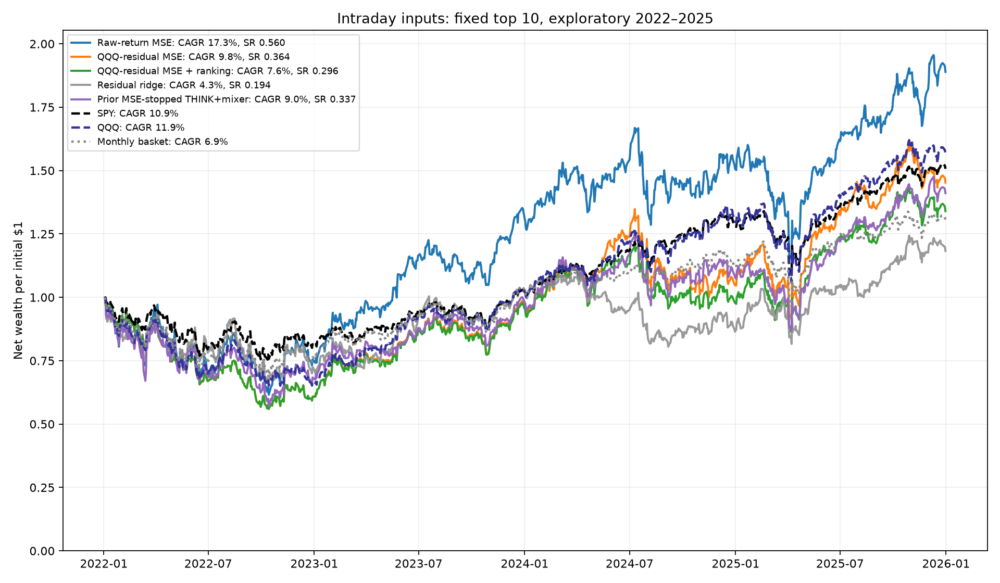
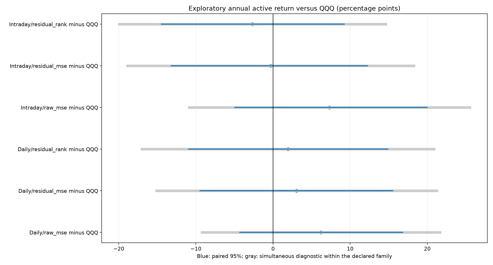

# NASDAQ-100: benchmark-residual targets and ranking-aware validation

**Complete: 120 new neural fits, eight residual-ridge fits and 69 continuous accounts; independent audit passed.**

This finite six-cell experiment compares daily versus intraday inputs under raw-return MSE, QQQ-beta-residual MSE, and residual MSE plus a fixed ranking loss. Every neural checkpoint is selected by prior-year residual RankIC. Existing reviewed membership, the 13-feature THINK+mixer architecture, five seeds, five-session horizon, next-close execution and equal top-10 policy are held fixed.

**2022–2025 had already been inspected before this experiment. These are exploratory development results. No existing historical dates have been relabeled as untouched confirmation.**

0/7 ranking contrasts and 0/12 model-versus-ETF active-return contrasts have positive simultaneous diagnostic lower bounds in their respective primary families. The families are separate, and neither accounts for the earlier research search or training uncertainty.

## What changed and why

At each signal close, estimate each stock’s QQQ beta from at most 126 prior daily returns, requiring 60 paired observations. Shrink the OLS slope halfway toward one and clip to [0, 2]; use beta one when history or benchmark variance is insufficient. The residual label is the next-entry-close to five-session-exit stock economic return minus that signal-time beta times the matching QQQ return. Future QQQ returns are labels only; all split boundaries remain maturity-purged. Beta history is supported for 20,228/20,232 observed test labels (99.98%); fallbacks never remove eligible members.

The ranking arm adds the mean logistic loss on unequal residual-return pairs, with fixed weight one and a fixed one-percentage-point score temperature. Each date receives equal loss weight. There is no rank-weight, beta-window, model-width, portfolio-size or feature-grid search. All three arms select the earliest best validation residual RankIC within 1e-7, with patience six and at most 30 epochs. Constant predictions have RankIC zero. Five eligible-stock rank forecasts are averaged for each ensemble; individual seeds remain disclosed.

Subtracting one common benchmark return would leave cross-sectional label ranks unchanged. Using different causally estimated stock betas makes this an exposure-adjusted selection target. The resulting long-only portfolio is still not beta-hedged or constrained to benchmark weights.

The prior MSE-stopped THINK+mixer rows are frozen references from the completed experiment. New raw-MSE models use equal date weights and ranking-based stopping; their difference from those references cannot be attributed solely to a change in checkpoint criterion.

## Ranking quality

| Input / objective | Raw-return RankIC | Residual RankIC | Top-10 residual return / five sessions | Mean selected lagged beta |
| --- | --- | --- | --- | --- |
| Daily / Raw-return MSE | +0.0211 | +0.0172 | +0.103 pp | 1.11 |
| Daily / QQQ-residual MSE | +0.0151 | +0.0126 | +0.055 pp | 1.07 |
| Daily / QQQ-residual MSE + ranking | +0.0117 | +0.0087 | +0.024 pp | 1.07 |
| Daily / Residual ridge | +0.0050 | +0.0050 | +0.042 pp | 1.03 |
| Intraday / Raw-return MSE | +0.0157 | +0.0146 | +0.178 pp | 1.13 |
| Intraday / QQQ-residual MSE | +0.0076 | +0.0044 | -0.032 pp | 1.07 |
| Intraday / QQQ-residual MSE + ranking | +0.0083 | +0.0053 | -0.070 pp | 1.06 |
| Intraday / Residual ridge | -0.0078 | -0.0022 | +0.041 pp | 1.05 |

RankIC is a cross-sectional Spearman correlation, averaged across 200 complete forecast origins. Bucket returns are gross equal-target-weight label diagnostics, require every selected label to be observed, and are not the realized net account return. The final partial holding period remains in accounts but has no complete five-session ranking label.

| Ranking contrast | Mean RankIC change | Paired 95% interval | Seven-contrast simultaneous diagnostic |
| --- | --- | --- | --- |
| intraday minus daily: raw_mse | -0.0026 | [-0.0112, +0.0065] | [-0.0146, +0.0094] |
| intraday minus daily: residual_mse | -0.0082 | [-0.0175, +0.0006] | [-0.0203, +0.0039] |
| intraday minus daily: residual_rank | -0.0034 | [-0.0126, +0.0055] | [-0.0156, +0.0088] |
| daily_control: residual MSE minus raw MSE | -0.0046 | [-0.0237, +0.0156] | [-0.0318, +0.0225] |
| daily_control: ranking minus residual MSE | -0.0039 | [-0.0077, -0.0004] | [-0.0089, +0.0010] |
| intraday_augmented: residual MSE minus raw MSE | -0.0102 | [-0.0271, +0.0077] | [-0.0340, +0.0135] |
| intraday_augmented: ranking minus residual MSE | +0.0009 | [-0.0025, +0.0044] | [-0.0038, +0.0055] |

## Net portfolio results

| Input / objective | CAGR | Sharpe | Maximum drawdown | QQQ tracking error | Realized QQQ beta |
| --- | --- | --- | --- | --- | --- |
| Daily / Raw-return MSE | 17.0% | 0.573 | -33.0% | 13.6% | 1.15 |
| Daily / QQQ-residual MSE | 13.8% | 0.487 | -44.0% | 12.8% | 1.11 |
| Daily / QQQ-residual MSE + ranking | 12.6% | 0.453 | -44.0% | 12.3% | 1.10 |
| Daily / Residual ridge | 6.0% | 0.245 | -31.8% | 16.6% | 1.09 |
| Daily / Prior MSE-stopped THINK+mixer | 13.3% | 0.464 | -40.7% | 13.8% | 1.17 |
| Intraday / Raw-return MSE | 17.3% | 0.560 | -38.4% | 15.0% | 1.27 |
| Intraday / QQQ-residual MSE | 9.8% | 0.364 | -44.0% | 13.4% | 1.12 |
| Intraday / QQQ-residual MSE + ranking | 7.6% | 0.296 | -44.0% | 12.6% | 1.09 |
| Intraday / Residual ridge | 4.3% | 0.194 | -33.5% | 16.4% | 1.09 |
| Intraday / Prior MSE-stopped THINK+mixer | 9.0% | 0.337 | -43.0% | 15.0% | 1.19 |
| SPY | 10.9% | 0.498 | -24.6% | — | — |
| QQQ | 11.9% | 0.469 | -34.9% | — | — |
| Monthly basket | 6.9% | 0.279 | -30.5% | — | — |

Accounts start at $1 million and carry cash/holdings continuously from January 3, 2022 through December 31, 2025. Costs are 7 bp plus 3 bp times the square root of participation divided by 1%; normal orders are capped at 1% of lagged 20-session average dollar volume. Frozen share orders fill next close, subject to liquidity and cash; unavailable fills cancel. Reviewed daily economic prices and acquisition settlement are retained. Terminal liquidation and 3% fixed Sharpe hurdle are inherited approximations; cash earns no interest. These are five-session strategies using session summaries derived from Alpaca 15-minute bars.

## Consistency and cost sensitivity

| Input / objective | 2022 | 2023 | 2024 | 2025 |
| --- | --- | --- | --- | --- |
| Daily / Raw-return MSE | -26.6% | 70.9% | 9.1% | 36.6% |
| Daily / QQQ-residual MSE | -39.1% | 59.4% | 20.8% | 42.6% |
| Daily / QQQ-residual MSE + ranking | -39.1% | 59.5% | 18.5% | 39.4% |
| Intraday / Raw-return MSE | -24.8% | 79.3% | 11.7% | 25.4% |
| Intraday / QQQ-residual MSE | -39.1% | 61.2% | 6.7% | 38.7% |
| Intraday / QQQ-residual MSE + ranking | -39.1% | 59.9% | 0.5% | 37.0% |
| SPY | -18.7% | 26.2% | 24.9% | 17.6% |
| QQQ | -33.3% | 54.9% | 25.6% | 20.7% |
| monthly_basket | -23.8% | 36.3% | 7.8% | 16.5% |

| Input / objective | Months above QQQ | Months above SPY |
| --- | --- | --- |
| Daily / Raw-return MSE | 25/48 | 25/48 |
| Daily / QQQ-residual MSE | 23/48 | 21/48 |
| Daily / QQQ-residual MSE + ranking | 23/48 | 23/48 |
| Intraday / Raw-return MSE | 23/48 | 23/48 |
| Intraday / QQQ-residual MSE | 23/48 | 22/48 |
| Intraday / QQQ-residual MSE + ranking | 23/48 | 22/48 |

| Input / objective | Minimum seed CAGR | Median seed CAGR | Maximum seed CAGR | Seeds above QQQ |
| --- | --- | --- | --- | --- |
| Daily / Raw-return MSE | 6.9% | 9.9% | 18.6% | 2/5 |
| Daily / QQQ-residual MSE | -3.2% | 2.6% | 9.5% | 0/5 |
| Daily / QQQ-residual MSE + ranking | -2.4% | 5.1% | 7.2% | 0/5 |
| Intraday / Raw-return MSE | 6.6% | 10.0% | 20.0% | 1/5 |
| Intraday / QQQ-residual MSE | -3.2% | 2.6% | 9.4% | 0/5 |
| Intraday / QQQ-residual MSE + ranking | -2.1% | 4.1% | 9.8% | 0/5 |

Seeds share the same market path; their range is a sensitivity diagnostic. Ensemble CAGR is not the average seed CAGR. Annual accounts never reset, and monthly observations are not independent confirmations.

| Input / objective | 1× cost CAGR | 2× cost CAGR | 4× cost CAGR | Base annual traded-notional/NAV |
| --- | --- | --- | --- | --- |
| Daily / Raw-return MSE | 17.0% | 14.8% | 10.6% | 25.7× |
| Daily / QQQ-residual MSE | 13.8% | 11.8% | 8.0% | 23.8× |
| Daily / QQQ-residual MSE + ranking | 12.6% | 10.6% | 6.6% | 24.9× |
| Intraday / Raw-return MSE | 17.3% | 14.4% | 8.9% | 33.9× |
| Intraday / QQQ-residual MSE | 9.8% | 8.2% | 4.9% | 21.1× |
| Intraday / QQQ-residual MSE + ranking | 7.6% | 5.7% | 2.1% | 24.1× |

## Benchmark-relative uncertainty

| Financial contrast | Annual arithmetic mean change | Paired 95% interval | 19-contrast simultaneous diagnostic |
| --- | --- | --- | --- |
| daily_control/raw_mse minus SPY | +8.35 pp | [-5.47, +22.05] pp | [-11.70, +28.40] pp |
| daily_control/raw_mse minus QQQ | +6.20 pp | [-4.31, +16.80] pp | [-9.23, +21.64] pp |
| daily_control/residual_mse minus SPY | +5.20 pp | [-10.40, +21.05] pp | [-17.80, +28.20] pp |
| daily_control/residual_mse minus QQQ | +3.05 pp | [-9.46, +15.51] pp | [-15.12, +21.22] pp |
| daily_control/residual_rank minus SPY | +4.08 pp | [-11.84, +20.47] pp | [-19.59, +27.76] pp |
| daily_control/residual_rank minus QQQ | +1.94 pp | [-10.95, +14.87] pp | [-17.00, +20.87] pp |
| intraday_augmented/raw_mse minus SPY | +9.46 pp | [-7.04, +26.19] pp | [-14.70, +33.62] pp |
| intraday_augmented/raw_mse minus QQQ | +7.31 pp | [-4.96, +19.96] pp | [-10.88, +25.51] pp |
| intraday_augmented/residual_mse minus SPY | +1.84 pp | [-13.93, +18.07] pp | [-21.31, +24.99] pp |
| intraday_augmented/residual_mse minus QQQ | -0.31 pp | [-13.20, +12.24] pp | [-18.87, +18.25] pp |
| intraday_augmented/residual_rank minus SPY | -0.52 pp | [-15.07, +14.31] pp | [-21.72, +20.69] pp |
| intraday_augmented/residual_rank minus QQQ | -2.66 pp | [-14.47, +9.21] pp | [-19.93, +14.61] pp |
| intraday minus daily: raw_mse | +1.11 pp | [-8.90, +11.36] pp | [-13.65, +15.86] pp |
| intraday minus daily: residual_mse | -3.36 pp | [-11.67, +5.12] pp | [-15.55, +8.83] pp |
| intraday minus daily: residual_rank | -4.60 pp | [-13.50, +4.15] pp | [-17.46, +8.26] pp |
| daily_control: residual MSE minus raw MSE | -3.15 pp | [-15.81, +9.30] pp | [-21.43, +15.13] pp |
| daily_control: ranking minus residual MSE | -1.12 pp | [-5.94, +3.25] pp | [-7.76, +5.53] pp |
| intraday_augmented: residual MSE minus raw MSE | -7.62 pp | [-22.00, +6.51] pp | [-28.45, +13.21] pp |
| intraday_augmented: ranking minus residual MSE | -2.35 pp | [-7.02, +2.17] pp | [-9.14, +4.43] pp |

All intervals use 10,000 joint circular-block resamples, preserving contemporaneous dependence across compared strategies. Ranking inference samples whole five-session origins with blocks of 1/4/12 origins; the displayed primary block is four. Financial inference samples whole daily account rows with 5/20/60-session blocks; the displayed primary block is 20. Arithmetic active means are not CAGR differences. The two max-statistic families do not provide joint confirmation across ranking and returns. Block stationarity, annual model changes, past research selection and training uncertainty limit inference. More bars do not add independent market years.

## Untouched confirmation

**Reserved; not started or evaluated.** The earliest permitted future signal is October 21, 2026. No future price or performance is available in this development panel. The frozen protocol requires updated historical membership, identities, corporate actions and both input views to pass review before launch. The fixed 156-node mixer needs an explicit, verified policy for newly admitted securities; it cannot silently omit them.

After that gate, one of the six cells must be chosen using only median five-seed prior-year validation residual RankIC, with ties resolved in protocol order. Choice, data, schema, refit schedule and account rules must be locked before the first signal. The first formal performance read is after 252 future sessions, with no interim promotion. Even that first year may be underpowered. Positive conservative net active-return lower bounds versus both benchmarks and further confirmation are needed before claiming regular outperformance. No automation, future job or trading order was created.

## Verification and limits

The training suite passed 46 tests; 3 additional inference tests passed before evaluation. Independent checks reproduced all 120 new checkpoints and validation/test exports, eight ridge fits, 40 parent forecast exports, 80 causal beta samples and all 69 accounts. Maximum NAV discrepancy: $0.00000005. Input/code hashes preserve the completed Alpaca and older studies.

The prior Alpaca identity and coverage review is reused without changing inputs. Daily adjusted economic accounts are approximations to dividends, raw-share actions and execution. Dense ticker-specific mixers retain cold-start limitations. Short effective time history, concentrated selection, feature missingness and the already-inspected years remain material constraints. A favorable exploratory curve or conditional interval is not evidence of deployable future skill.

## Artifacts

[Protocol and future gates](PROTOCOL.json) · [Audit](AUDIT.json) · [All metrics](metrics.csv) · [Daily paths](curves.csv) · [Ranking by origin](ranking_periods.csv) · [Ranking summary](ranking_summary.csv) · [All ranking intervals](rank_intervals.csv) · [All active-return intervals](active_intervals.csv) · [Seed ranges](seed_summary.csv) · [Annual returns](annual.csv) · [Monthly returns](monthly.csv) · [Benchmark exposure](exposure.csv) · [Training records](training_records.csv) · [Independent beta checks](independent_beta_samples.csv)

Full checkpoints, preprocessing, targets, source snapshots and integrity locks are saved under `runs/ndx_ranking_20261020`. The experiment can be resumed with `.\.venv\Scripts\python.exe run_ndx_ranking.py --stage all --workers 2`.
