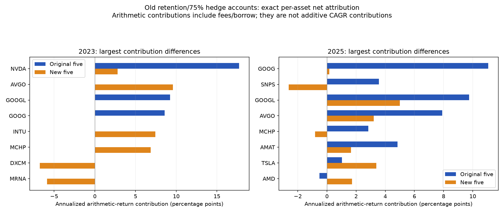

# Why the original-five retention result differs from the new-five result

The old strategy's **1.731 versus 0.648 Sharpe** gap is a substantive robustness
problem. Reporting the favorable five-seed ensemble as representative while
hiding the other ensemble would create selection bias. The best-case result can
be reported with that label, alongside the combined ten-seed SR of 1.381, the
weaker group, costs and the historical search history.

## A specific stock-initialization mechanism

In 2023, the rank correlation between each THINK model's average test forecast
and its stock-specific mixer bias was **0.9947 for the original-five group and
0.9948 for the new-five group**, averaged over the group's five models. The same
relationship appears in their preceding validation forecasts. The ten models'
final bias orderings have mean **0.9991 rank correlation** with bias values
reconstructed from the original seeded constructor. Their mean absolute changes
are approximately 0.0035–0.0040.

Thus, in that fold the forecasts were closely associated with nearly unchanged
random stock-ID preferences. This is strong descriptive evidence of an
initialization-dominated ranking mechanism. It does not establish that all other
parameters were unchanged, nor that every year's profit comes from this effect.
The analogous bias/mean-forecast association is considerably weaker in other
years; the records retain those weaker cases.

The THINK mixer's last layer has a separate output row and intercept for each
security. Its default random initialization can give different stock IDs
different initial scores. A checkpoint chosen after little training on raw-return
MSE can preserve that ordering even when the values fit the common return level
adequately. Random ID preference is distinct from a learned, transferable
relationship between market features and future returns.

The 2023 THINK validation forecasts have average cross-sectional standard
deviation of about 0.146 percentage points, compared with 4.789 points for actual
five-session stock returns. Date-balanced validation MSE is nearly identical
between the original and new groups (38.802 versus 38.817), despite their very
different subsequent financial results. This illustrates why similar raw-return
MSE need not certify useful or stable top-stock ordering. These are descriptive
date-balanced diagnostics, not the differently weighted checkpoint MSE field.

[Validation level/spread/MSE decomposition](MSE_COMPONENTS.csv)

The date-by-date check gives the same result: mean 2023 correlations are 0.99460
for original-five models and 0.99482 for new-five models. The minimum across all
original-five model/dates is 0.98606 and across new-five model/dates is 0.99174.
This is not merely an artifact of averaging forecasts across the whole year.

[Daily bias/forecast correlations](DAILY_BIAS_CORRELATIONS.csv) ·
[Bias/forecast correlations](MIXER_BIAS_DIAGNOSTICS.csv) ·
[Initial/final bias checks for every seed](INITIALIZATION_BIAS_CHECK.csv)

## Favorable holdings and issuer concentration

The original account's 2023 average beginning-of-day NAV exposures included
approximately **15.5% NVDA and 32.6% combined GOOG/GOOGL**. Alphabet's two share
classes together contributed approximately 17.82 percentage points to the
annualized arithmetic return; NVDA contributed approximately 17.73 points.
These are additive daily-NAV-based arithmetic contributions, **not CAGR
contributions**. The same accounting includes transaction and borrow charges.

The five-security rule can allocate two slots to one issuer. This explains part
of why it differs from five-issuer controls and exposes a concentration issue in
interpreting a five-stock result as diversification across five companies.
Buying these names because they subsequently did well would introduce lookahead;
the diagnostic motivates causal architecture/ranking and issuer controls, not a
retrospective winner list.

The new-five portfolio had a different mix of positions: AVGO, INTU and MCHP
were its largest positive contributors in 2023. In 2025 the original account
again obtained substantial contributions from Alphabet's two classes, AVGO and
NVDA. Style summaries show differences in momentum, volatility and QQQ beta, but
they do not identify one causal factor that guarantees reproducing the stronger
account. All historical stock contributions, including losses, are retained.

[All net asset contributions](ASSET_CONTRIBUTIONS.csv) ·
[Prior-close style exposures](CAUSAL_STYLE_EXPOSURES.csv)

## Verification and scope

The instrumented independent dollar-position replay reproduces all three old
retention/75%-cap account paths. Maximum daily-return discrepancy is
6.67e-16. Each day's per-stock profit minus fees and borrowing, divided by the
previous NAV, sums to the account's daily return. The reviewed inputs, saved
targets and execution assumptions are shared with the original study; this is
not independent vendor-data or live broker validation. Bias checks inspect saved
parameters and predictions; they do not claim strict numerical checkpoint
regeneration of the old forecasts.

The separate retraining protocol fixes neutral stock-specific initialization,
a date-centered ranking objective, split validation and an additional predefined
five-seed group. It reports every seed and failure. That experiment must determine
whether the changes help; these diagnostics alone do not show that a robust
SR above 1.5 is attainable.

For paper methodology, see Bailey and López de Prado's
[Deflated Sharpe Ratio](https://www.davidhbailey.com/dhbpapers/deflated-sharpe.pdf)
on selection bias and backtest overfitting. An honest negative or mixed result
is preferable to treating a selected seed ensemble as reliable generalization.
