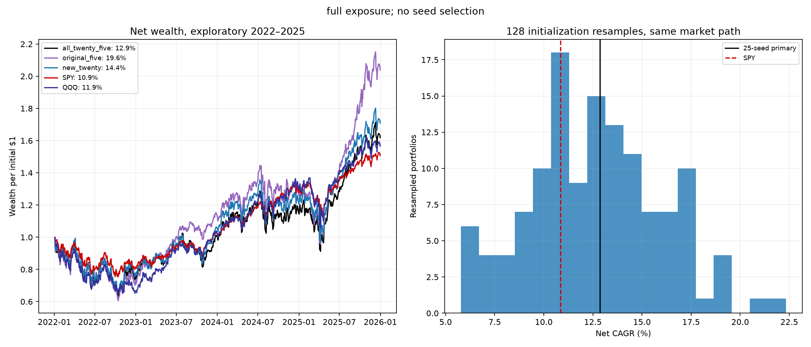
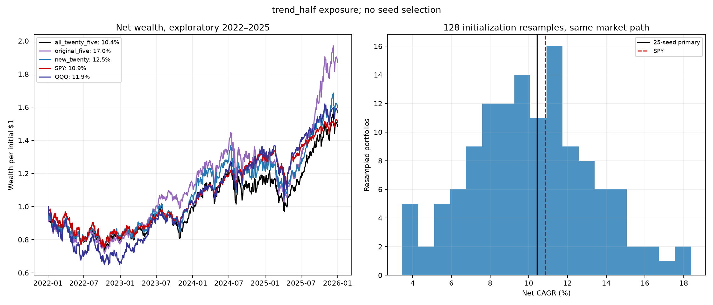

# NASDAQ-100 seed-count expansion — October 20, 2026

The fixed 25-seed primary returned **12.9% CAGR**, versus **19.6%** for the original five, **14.4%** for the twenty new seeds, **10.9%** for SPY and **11.9%** for QQQ. 0/2 exposure policies passed the historical reliability screen. Reliable superiority over SPY and competing models remains unestablished unless supported by independent future evidence; these previously inspected years are exploratory.

The new seeds were generated and locked before any new fits or metrics. Every new seed is retained. Eighty new THINK+mixer fits use the exact original five-feature architecture, train-only normalization/graph, raw-return MSE and prior-year validation-MSE early stopping. Each validation year chooses the earliest best checkpoint within 30 epochs, with patience six. No seed or ensemble weight is selected by test return. The primary is the equal eligible-rank blend of all 25 seeds; original five and new twenty are paired controls. This isolates initialization/ensemble-size sensitivity. The preceding [Alpaca comparison](../nasdaq_alpaca_20261019/REPORT.md) and [bounded intraday correction study](../ndx_corrections_20261020/REPORT.md) test the added intraday information. This particular core uses daily features; it does not imply that 15-minute features improved performance.

## Accounts and consistency

| Ensemble / benchmark | Policy | Net CAGR | Sharpe | Maximum drawdown |
| --- | --- | --- | --- | --- |
| all_twenty_five | full | 12.9% | 0.452 | -36.8% |
| all_twenty_five | trend_half | 10.4% | 0.415 | -26.3% |
| original_five | full | 19.6% | 0.629 | -39.4% |
| original_five | trend_half | 17.0% | 0.654 | -29.0% |
| new_twenty | full | 14.4% | 0.503 | -34.7% |
| new_twenty | trend_half | 12.5% | 0.505 | -24.5% |
| SPY | full | 10.9% | 0.498 | -24.6% |
| QQQ | full | 11.9% | 0.469 | -34.9% |

All accounts use historical monthly membership, the reviewed economic-price panel, five-session signals, frozen next-close orders, $1 million initial cash, 1% ADV caps and modeled fees. Cash earns no interest; Sharpe uses the fixed 3% hurdle. The fixed trend policy holds half stock exposure below the signal-time QQQ MA200. The primary full-exposure policy was declared before metrics; exposure is not selected from test results.

| Policy | Historical screen passed | Years above SPY | Months above SPY | Drawdown within 5 pp | Positive simultaneous contrasts |
| --- | --- | --- | --- | --- | --- |
| full | False | 2/4 | 22/48 | False | 0/110 |
| trend_half | False | 1/4 | 24/48 | True | 0/110 |

The historical screen requires base- and double-fee CAGR above SPY, at least 3/4 years and 28/48 months above SPY, and drawdown at most five percentage points worse. Passing would remain development evidence and would not replace the comparison intervals or future confirmation.

| Ensemble / benchmark | Policy | 1× fee CAGR | 2× fee CAGR | 4× fee CAGR |
| --- | --- | --- | --- | --- |
| QQQ | full | 11.9% | 11.9% | 11.8% |
| SPY | full | 10.9% | 10.8% | 10.7% |
| all_twenty_five | full | 12.9% | 11.1% | 7.6% |
| all_twenty_five | trend_half | 10.4% | 8.9% | 5.9% |
| new_twenty | full | 14.4% | 12.8% | 9.5% |
| new_twenty | trend_half | 12.5% | 11.1% | 8.3% |
| original_five | full | 19.6% | 17.5% | 13.3% |
| original_five | trend_half | 17.0% | 15.2% | 11.8% |

## Initialization sensitivity

| Seed group / resample | Policy | Minimum / 2.5th percentile | Median | Maximum / 97.5th percentile | Paths above SPY |
| --- | --- | --- | --- | --- | --- |
| original_five | full | 8.5% | 12.4% | 21.2% | 3/5 |
| new_twenty | full | 2.8% | 9.1% | 18.2% | 9/20 |
| 128 resampled 25-seed blends | full | 6.2% | 12.7% | 19.2% | 89/128 |
| original_five | trend_half | 6.2% | 9.3% | 17.0% | 1/5 |
| new_twenty | trend_half | 1.8% | 7.9% | 15.8% | 5/20 |
| 128 resampled 25-seed blends | trend_half | 4.1% | 10.1% | 16.2% | 52/128 |

Individual-seed rows report minimum/median/maximum. Resampled-blend rows report 2.5/50/97.5 percentiles from 128 seed-resampled accounts. Each draw samples 25 seed positions with replacement, keeps the same draw across annual folds/policies, recomputes the rank blend and runs the full account. These are initialization diagnostics conditional on the same historical market path, data, validation rules and checkpoints. They are not 128 independent investment histories or a future-return confidence interval.

## Paired market-path and model comparisons

| Primary contrast | Active mean/year | Paired 95% interval, pp | Broad-family simultaneous diagnostic, pp |
| --- | --- | --- | --- |
| full: primary minus SPY | 4.79 pp | [-8.65, 18.21] | [-18.39, 27.96] |
| full: primary minus QQQ | 2.64 pp | [-8.09, 13.59] | [-16.03, 21.31] |
| full: primary minus original_five | -6.22 pp | [-14.99, 2.38] | [-21.28, 8.84] |
| full: primary minus new_twenty | -1.10 pp | [-4.99, 2.81] | [-7.75, 5.55] |
| trend_half: primary minus SPY | 0.73 pp | [-10.82, 11.97] | [-18.69, 20.14] |
| trend_half: primary minus QQQ | -1.42 pp | [-12.77, 10.18] | [-20.83, 17.99] |
| trend_half: primary minus original_five | -5.93 pp | [-14.15, 2.01] | [-19.93, 8.06] |
| trend_half: primary minus new_twenty | -1.68 pp | [-4.88, 1.39] | [-7.05, 3.69] |

The broad family includes 106 prior base-cost ensemble reference paths plus SPY, QQQ and both seed-count controls for each primary exposure policy. There are 220 joint contrasts. Every available original/Alpaca/ranking equal-top-ten ensemble path and every broad/correction ensemble policy path is retained, including unsuccessful and ungated diagnostic policies. Other exposure policies remain explicitly labeled. No best reference or test year is selected. Previously retired 2026-selected universes are excluded. Exact reference names, source paths and metrics are in the reference inventory; the full interval table includes every contrast. Ten thousand whole-day paired circular-block samples use 5/20/60-session blocks; 20 is primary. These fitted-path intervals omit the full prior research search, data revision and training/selection uncertainty. Repeated seed or time resampling cannot create additional independent years.

| Primary policy | Reference | Pointwise joint seed/time 95% diagnostic, primary block |
| --- | --- | --- |
| full | SPY | -9.53 to 19.42 pp |
| full | QQQ | -10.00 to 14.93 pp |
| full | original_five | -17.37 to 4.33 pp |
| trend_half | SPY | -11.66 to 12.81 pp |
| trend_half | QQQ | -14.26 to 10.74 pp |
| trend_half | original_five | -16.20 to 3.38 pp |

The additional diagnostic first draws one of the 128 seed-resampled accounts, then resamples paired daily blocks against a fixed reference (10,000 replicates). It allows a finite approximation to initialization variation and market-path sampling together, but is pointwise, conditions on fixed checkpoints/choices and does not cover the full historical search. It must not be substituted for a corrected superiority claim. Arithmetic active-return means differ from CAGR gaps.

## Verification and remaining evidence

All 80 new checkpoints and validation/test exports were reproduced. Twenty original annual forecast exports were hash checked and their independent rank aggregation verified. All 330 new accounts, including 256 seed-bootstrap accounts, were independently replayed; the maximum NAV discrepancy was $0.00000006. Every prior reference’s bytes, exact calendar and independent return metrics were verified against its preserved account output; its earlier checkpoint/account audit remains the provenance. The original studies and model checkpoints remain unchanged. Tests verify seed uniqueness, fixed resampling, weighted rank equivalence and combined uncertainty behavior.

The usable test history is four already-inspected calendar years. Corporate-action/total-return approximations, missing labels, revised vendor histories and changing regimes limit inference. More initialization seeds can stabilize an ensemble; they cannot prove a durable economic edge. Future dates reserved from October 21, 2026 were not evaluated. A reviewed updated point-in-time dataset and fixed prospective model/refit/execution policy are still required before those dates can provide confirmation. No orders or recurring jobs were created.

## Artifacts

[Protocol and every seed](PROTOCOL.json) · [Audit](AUDIT.json) · [All metrics](metrics.csv) · [Every daily path](curves.csv) · [References](references.csv) · [All paired intervals](paired_intervals.csv) · [Seed/time diagnostics](seed_time_intervals.csv) · [Historical screens](historical_screen.csv) · [Annual returns](annual.csv) · [Monthly returns](monthly.csv)

Checkpoints, preprocessing, bootstrap draws, prediction exports and integrity locks are under `runs/ndx_seed_expansion_20261020`.
