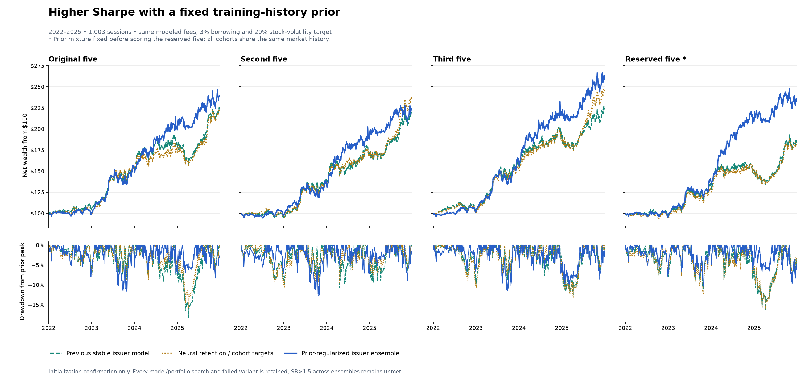
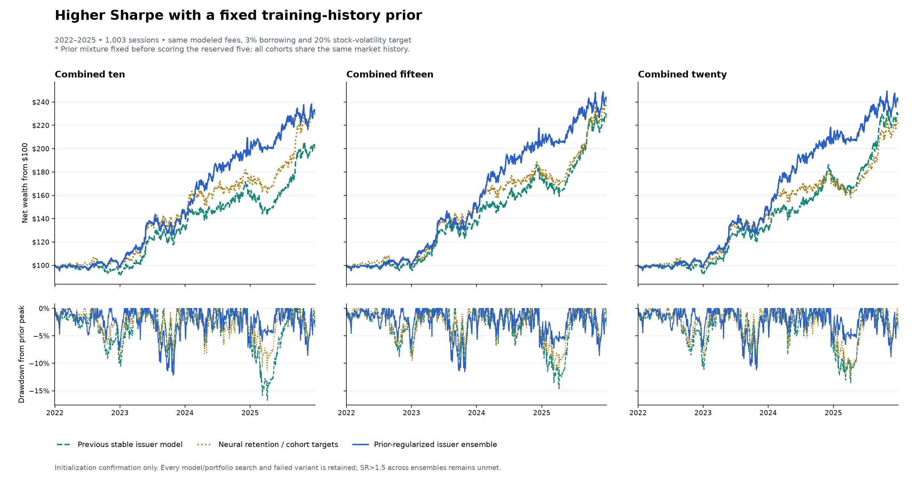

# Seed-robust Sharpe improvement — October 30, 2026

**The prior-regularized ensemble improves Sharpe in all seven evaluated groups, including a reserved five-seed cohort. Consistent SR>1.5 was not achieved.**

Completed **164 additional fits and 1,578 recorded accounts**, retaining all failed candidates, deterministic controls and cost stresses. Maximum independent daily-accounting discrepancy: **8.88e-16**. Counts include overlapping groups and duplicate paths, not1,578independent discoveries.





| Ensemble | Previous stable issuer SR | Prior mixture SR | Change | Prior CAGR | Prior max DD |
|---|---:|---:|---:|---:|---:|
| Original five | 1.171 | 1.272 | +0.101 | 24.13% | -11.58% |
| Second five | 1.147 | 1.184 | +0.037 | 22.11% | -12.80% |
| Third five | 1.200 | 1.409 | +0.210 | 27.04% | -11.45% |
| Reserved five | 0.877 | 1.322 | +0.445 | 23.70% | -10.34% |
| Combined ten | 1.023 | 1.264 | +0.240 | 23.31% | -12.16% |
| Combined fifteen | 1.235 | 1.338 | +0.104 | 24.68% | -11.54% |
| Combined twenty | 1.245 | 1.367 | +0.122 | 24.60% | -11.20% |

All rows use the same1,003market sessions,20%stock-basket volatility target,continuousQQQshort ceiling75%,gross target budget100%,base modeled fees and3%short borrowing. All models retain the predefined seeds equally; none is filtered by its financial result. The baseline is the October29loss-selected five-issuer model, not the older selected1.731retention best case.

## What changed

The candidate combines50%eligible-stock percentile ranks of a training-history stock prior with25%meanTHINKseed ranks and25%mean dynamic-hypergraph seed ranks. The prior averages observed within-date training-return ranks with a26decision-week exponential half-life and20neutral0.5pseudo-observations per stock. It uses only the training portion of each annual fold, ending before its validation year. It is not a current-six-month momentum signal, and no retrospectively identified winners are named or favored. Unsupported stock histories get neutral priors.

## Top-k still applies: five companies per five-seed ensemble

**A committee is one fixed five-seed ensemble.** Each contains five THINK networks and five dynamic-hypergraph networks, one of each per seed. The twenty-seed strategy has four such ensembles, using the original, second, third and reserved groups of five. These groups are fixed; their historical Sharpe does not determine their weight.

There are two averaging steps. **Within each ensemble**, average its five THINK percentile rankings and its five dynamic-model percentile rankings. Combine those with the shared training-history prior: **50% prior + 25% mean THINK rank + 25% mean dynamic rank**. Select the top **k = 5 companies**, then apply that ensemble's stock-volatility sizing and QQQ hedge. **Across ensembles**, equally average those completed portfolio target weights and execute the net orders in one account.

```text
Original five seeds -> rank stocks -> top 5 companies -> risk-sized targets A
Second five seeds   -> rank stocks -> top 5 companies -> risk-sized targets B
Third five seeds    -> rank stocks -> top 5 companies -> risk-sized targets C
Reserved five seeds -> rank stocks -> top 5 companies -> risk-sized targets D
Combined twenty     -> (A + B + C + D) / 4 -> one trading account
```

A target is a fraction of account value: positive for a stock holding and negative for a QQQ short. Average each security's signed weight, using zero when an ensemble does not hold it. Risk sizing happens before this averaging, so selected stocks can have different final weights. Every ensemble receives equal weight, including the weaker historical performers.

| Current prior-mixture result | Five-seed portfolios averaged | Portfolio construction |
|---|---:|---|
| Each separate five-seed group | 1 | Its own top-five-company portfolio |
| Combined ten | 2 | Original + second, each with 50% weight |
| Combined fifteen | 3 | Original + second + third, each with one-third weight |
| Combined twenty | 4 | Original + second + third + reserved, each with 25% weight |

**The combined account can hold more than five companies.** GOOG and GOOGL share one company slot within each ensemble. The combined-twenty Sharpe of 1.367 is calculated from the daily returns of the resulting single account after modeled trading and borrowing costs. It is not the average of the four Sharpe ratios or four saved return series.

**Actual example: January 6, 2025.** The original, second and reserved ensembles selected Adobe, Costco, Cintas, Meta and Nvidia; each targeted 92.05% in stocks and 7.95% short QQQ. The third ensemble selected Intuit instead of Cintas and targeted 97.92% in stocks and 2.08% short QQQ. Averaging their targets produced:

| Position | Combined-twenty target |
|---|---:|
| Adobe (ADBE) | +18.70% |
| Costco (COST) | +18.70% |
| Meta (META) | +18.70% |
| Nvidia (NVDA) | +18.70% |
| Cintas (CTAS) | +13.81% |
| Intuit (INTU) | +4.90% |
| QQQ | -6.48% |

Cintas receives three ensembles' allocations divided by four; Intuit receives one ensemble's allocation divided by four. Four shared names receive allocations from all four ensembles. The unrounded stock targets total 93.52%, alongside a 6.48% QQQ short. These are decision targets; execution prices and constraints can change realized closing weights.

**Reading the comparisons:** the previous neural issuer baseline pools all participating seeds' rankings first, then selects one top-five-company portfolio. The current prior mixture builds each five-seed portfolio first and averages its targets. The historical-prior-only control has no seed ensembles to combine. These construction rules are specific to their labeled strategies; they should not be inferred for every curve in the historical gallery.

On the reserved group there is only one five-seed cohort, so cohort averaging cannot explain the0.877→1.322gain. That comparison isolates the change to ranking through the training prior within the same issuer/risk/execution framework. The twenty-seed comparison additionally changes aggregation. The improvement is in the ranking/portfolio layer; the neural architectures and learned source checkpoints remain unchanged.

## What the confirmation establishes

Four priors and their fixed blends were explored on the first15seeds. The original strict source gate (including a0.15cohort-spread limit) failed. A clearly labeled secondary candidate was selected from configurations improving every source group, then frozen **before** any reserved-seed account was scored. Its source spread0.225exceeded the original0.15limit; the confirmation does not retroactively change that failure.

The reserved five improve **0.877→1.322**; expanded twenty improve **1.245→1.367**. Across all four disjoint groups, the SR spread falls from **0.323** to **0.225**. The original three groups alone had understated the baseline's weakness.

At2×fees and6%borrowing, reserved-five SR improves **0.700→1.166** and expanded twenty **1.067→1.236**. The secondary reserved-seed criterion passes; every stress case is retained in the comparison CSV.

[Exact pre-score candidate and secondary goal](PRIOR_CONFIRMATION_PROTOCOL.json) · [Freeze](PRIOR_CONFIRMATION_FREEZE.json) · [Confirmation result](PRIOR_CONFIRMATION_RESULT.json).

## Failed proposals remain visible

- Portfolio target averaging improves pooled retention SR, but the separately frozen no-band averaging proposal fails its new-seed consistency goal: the reserved cohort scores0.854. It still improves expanded-twenty retention SR1.015→1.237. [Full pooling confirmation](POOLING_CONFIRMATION_RESULT.json).
- The fixed60-fit/540-account shared-THINK/band study fails its stricter improvement gate. Removing the stock-specific mixer greatly reduces financial performance. [All results](../ndx_portfolio_robustness_20261030_v2/REPORT.md).
- Standalone families and validation-only blend weights fail in300additional accounts. [Family comparisons](../ndx_family_robustness_20261030/REPORT.md).
- The64-fit/282-account long-history ExtraTrees/Ridge arm fails; more randomized trees did not create useful financial signal. [Feature models](../ndx_tabular_alpha_20261030/REPORT.md).
- All264prior/control cases are retained, including the source third-five1.652case whose other cohorts are weaker. That high single-cohort result was not selected as representative. [Prior study](../ndx_prior_robustness_20261030/REPORT.md).
- The final168-account risk arm rejects more beta hedging and a lower stock-vol target. All42original-risk reference accounts reproduce. Trailing beta60/120rules sharply reduce SR; no risk variant reaches1.5across allseven groups. Existing risk settings remain in the confirmed candidate. [All risk accounts](RISK_METRICS.csv) · [Risk summaries](RISK_CONSISTENCY.csv) · [Frozen risk protocol](RISK_PROTOCOL.json).

## Limits for the paper

**This is initialization robustness on spent market history, not unseen-market generalization.** All cohorts share2022–2025outcomes; pooled groups overlap their constituents. The reserved seed values were fixed in the October20list and unused in this retraining protocol, not newly chosen by return. The candidate was fixed before their financial outcomes, while later rejected risk diagnostics used them as development. Further choices cannot reuse this cohort as untouched confirmation.

Many strategy/model variants have been inspected. Seed confirmation does not undo selection on market history or provide a multiple-search-adjusted significance claim. [Bailey and López de Prado,Deflated Sharpe Ratio](https://www.davidhbailey.com/dhbpapers/deflated-sharpe.pdf) discusses bias from searching and selecting high historical Sharpe ratios. No livebroker,independentvendor or newmarket evaluation is supplied. The1.5goal remains unmet;1.731remains a selected historical best case with its weaker seed cohort disclosed.

## Verification and reproduction

All164new-fit locks and every referenced file hash verify. All1,578accounts pass independent dollar-position accounting; all63displayed account metrics reconstruct from saved daily returns. Fourteen new core tests passed, covering actual-holdings causality/budgets,zero-band replay,matched shared-head initialization,causal features,training-only scaling/labels,forest reproducibility,prior labels/decay and beta-risk causality/caps. The interrupted shared fit resumes exactly (zero parameter/prediction discrepancy); its file-retry amendment changes logging only.

[Every account check](ALL_ACCOUNT_CHECKS.csv) · [Fit/account audit](AUDIT.json) · [All comparison metrics/costs](COMPARISON_METRICS.csv) · [Provenance](MANIFEST.json)

The source studies retain code/input freezes and complete checkpoint/model/forecast/ledger artifacts under their dated runs. This overview only republishes verified daily paths:

```powershell
.\.venv\Scripts\python.exe -m hypershift run publish_ndx_seed_robustness
```
