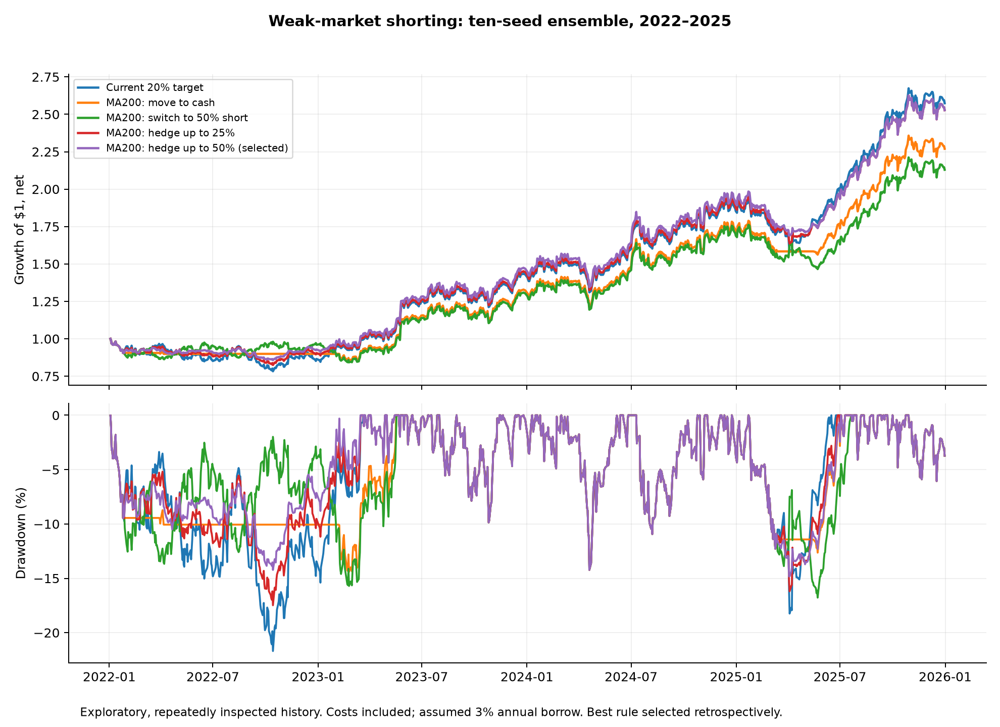

# Weak-market shorting experiment — October 27, 2026

The highest observed short-rule Sharpe was **1.234**, with **26.24% net CAGR** and **-14.82% maximum drawdown**, for `vol20/ma200/hedge50`. Its matching long/cash baseline was 1.112 Sharpe / 26.81% CAGR / -21.69% drawdown. This is a retrospective selection within 30 short rules, not a confirmed improvement.

**6 of 30 short rules improved Sharpe and drawdown in all three seed ensembles; 0 improved CAGR as well in all three.** The groups share the same market history and overlap in seeds; they are sensitivity checks, not independent market replications.

## Main matched results

All figures are after modeled trading costs and an assumed 3% annual borrow fee, on a continuous $1m reference account. Sharpe uses the inherited 3% annual hurdle. The primary strategy remains five issuers, a 20% basket volatility target and the fixed 50:50 THINK+mixer AH+PM / restricted dynamic-hypergraph rank blend.

| Rule | Net CAGR | Sharpe | Max drawdown | Average short exposure |
| --- | --- | --- | --- | --- |
| full/baseline | 33.37% | 0.925 | -40.94% | 0.00% |
| vol20/baseline | 26.81% | 1.112 | -21.69% | 0.00% |
| vol25trend/baseline | 28.70% | 1.085 | -22.98% | 0.00% |
| vol20/ma200/cash | 22.87% | 1.118 | -14.41% | 0.00% |
| vol20/ma200/switch25 | 21.71% | 1.032 | -15.36% | 7.47% |
| vol20/ma200/switch50 | 20.92% | 0.928 | -16.78% | 14.53% |
| vol20/ma200/switch100 | 19.00% | 0.794 | -20.13% | 19.27% |
| vol20/ma200/hedge25 | 26.23% | 1.185 | -17.48% | 7.41% |
| vol20/ma200/hedge50 | 26.24% | 1.234 | -14.82% | 13.35% |
| vol25trend/ma200_mom63/hedge25 | 27.96% | 1.124 | -20.75% | 6.34% |

`switch25/50/100` exits the stock basket and shorts QQQ while weak, at the smaller of the named NAV cap and a 20% QQQ volatility target. `hedge25/50` keeps the baseline stock sleeve and shorts only within its unused capital budget, also respecting the named cap and QQQ volatility target. `cash` exits the basket with no short. `vol25trend` is the pre-existing secondary 25% target with half exposure below MA200. `full` is unchanged issuer selection at full exposure.

## What “weak” means

We cannot know future weakness. The rules use QQQ's preceding close relative to its trailing 100- or 200-session average; the third requires MA200 weakness plus a negative prior 63-session return. Targets update only on the inherited five-session rebalance calendar. Prices through signal close feed the rule, shares freeze using that close's NAV/marks/ADV, and the orders fill at the following regular close. AH+PM rankings retain the 09:15 cutoff/09:20 decision before that fill. No hindsight bear-market labels or same-close fills are used.

| Signal | Weak signals | Total signals | Fraction weak | QQQ rose after weak signal | Mean next holding-period QQQ return |
| --- | --- | --- | --- | --- | --- |
| ma200 | 60 | 201 | 29.85% | 46.67% | 0.16% |
| ma100 | 63 | 201 | 31.34% | 49.21% | 0.27% |
| ma200_mom63 | 51 | 201 | 25.37% | 45.10% | 0.17% |

The next holding-period QQQ returns above are descriptive outcomes measured after the rule was fixed. Positive QQQ periods lose money for a short before fees. The final holding period is partial. A weak trend signal does not imply the following week will decline.

## Seed sensitivity

| Rule | Seeds | Net CAGR | Sharpe | Max drawdown |
| --- | --- | --- | --- | --- |
| vol20/baseline | new_five | 15.77% | 0.677 | -18.34% |
| vol20/baseline | original_five | 28.57% | 1.178 | -20.56% |
| vol20/baseline | ten_seed | 26.81% | 1.112 | -21.69% |
| vol20/ma200/hedge25 | new_five | 15.48% | 0.715 | -18.34% |
| vol20/ma200/hedge25 | original_five | 27.81% | 1.253 | -18.27% |
| vol20/ma200/hedge25 | ten_seed | 26.23% | 1.185 | -17.48% |
| vol20/ma200/hedge50 | new_five | 15.79% | 0.757 | -18.34% |
| vol20/ma200/hedge50 | original_five | 28.10% | 1.315 | -17.05% |
| vol20/ma200/hedge50 | ten_seed | 26.24% | 1.234 | -14.82% |
| vol20/ma200/switch50 | new_five | 9.57% | 0.420 | -18.36% |
| vol20/ma200/switch50 | original_five | 22.54% | 1.006 | -17.74% |
| vol20/ma200/switch50 | ten_seed | 20.92% | 0.928 | -16.78% |

## Trading-cost and borrow sensitivity

Each of 39 recipes was run for original-five, new-five and ten-seed ensembles at 1x/2x/4x trading costs: 351 accounts. Each of 30 actual short rules also ran at assumed 1% and 10% annual borrow, with base trading costs: 180 more accounts, **531 total**. The borrow and transaction stresses are separate, not a full joint stress grid. Cash interest and short-proceeds rebates remain zero, matching the parent controls. All accounts are disclosed in [metrics.csv](metrics.csv).

| Rule | Trading cost | Borrow rate | Net CAGR | Sharpe | Max drawdown |
| --- | --- | --- | --- | --- | --- |
| vol20/baseline | 1 | 3.00% | 26.81% | 1.112 | -21.69% |
| vol20/baseline | 2 | 3.00% | 24.74% | 1.031 | -22.53% |
| vol20/baseline | 4 | 3.00% | 20.70% | 0.870 | -24.20% |
| vol20/ma200/switch50 | 1 | 3.00% | 20.92% | 0.928 | -16.78% |
| vol20/ma200/switch50 | 2 | 3.00% | 19.31% | 0.858 | -17.17% |
| vol20/ma200/switch50 | 4 | 3.00% | 16.15% | 0.718 | -18.11% |
| vol20/ma200/switch50 | 1 | 1.00% | 21.27% | 0.943 | -16.65% |
| vol20/ma200/switch50 | 1 | 10.00% | 19.69% | 0.875 | -18.64% |
| vol20/ma200/hedge25 | 1 | 3.00% | 26.23% | 1.185 | -17.48% |
| vol20/ma200/hedge25 | 2 | 3.00% | 24.13% | 1.094 | -18.43% |
| vol20/ma200/hedge25 | 4 | 3.00% | 20.03% | 0.912 | -20.29% |
| vol20/ma200/hedge25 | 1 | 1.00% | 26.42% | 1.193 | -17.19% |
| vol20/ma200/hedge25 | 1 | 10.00% | 25.58% | 1.157 | -18.48% |
| vol20/ma200/hedge50 | 1 | 3.00% | 26.24% | 1.234 | -14.82% |
| vol20/ma200/hedge50 | 2 | 3.00% | 24.06% | 1.135 | -15.31% |
| vol20/ma200/hedge50 | 4 | 3.00% | 19.83% | 0.938 | -17.45% |
| vol20/ma200/hedge50 | 1 | 1.00% | 26.58% | 1.249 | -14.77% |
| vol20/ma200/hedge50 | 1 | 10.00% | 25.07% | 1.181 | -16.17% |

## Annual attribution

| Rule | Year | Year return |
| --- | --- | --- |
| vol20/baseline | 2022 | -13.59% |
| vol20/baseline | 2023 | 65.45% |
| vol20/baseline | 2024 | 29.58% |
| vol20/baseline | 2025 | 38.95% |
| vol20/ma200/cash | 2022 | -10.06% |
| vol20/ma200/cash | 2023 | 47.13% |
| vol20/ma200/cash | 2024 | 29.59% |
| vol20/ma200/cash | 2025 | 32.36% |
| vol20/ma200/switch50 | 2022 | -3.95% |
| vol20/ma200/switch50 | 2023 | 35.69% |
| vol20/ma200/switch50 | 2024 | 29.59% |
| vol20/ma200/switch50 | 2025 | 26.09% |
| vol20/ma200/hedge25 | 2022 | -9.68% |
| vol20/ma200/hedge25 | 2023 | 60.01% |
| vol20/ma200/hedge25 | 2024 | 29.58% |
| vol20/ma200/hedge25 | 2025 | 34.96% |
| vol20/ma200/hedge50 | 2022 | -7.29% |
| vol20/ma200/hedge50 | 2023 | 58.36% |
| vol20/ma200/hedge50 | 2024 | 29.58% |
| vol20/ma200/hedge50 | 2025 | 32.88% |

These annual breakdowns show whether protection in the 2022 decline was offset by foregone stock gains or losing shorts during later rebounds. These calendar years have already been inspected repeatedly; none is a new holdout.

## Uncertainty

The 54 fixed ten-seed contrasts comprise all 36 conditional cash/short rules versus the matching pre-existing baseline, plus all 18 stock-to-short switches versus their identical signal's cash exit. Joint circular-block bootstrap uses 10,000 draws at block lengths 5/20/60 sessions; 20 is primary. Simultaneous intervals on annualized arithmetic active means cover this 54-comparison family. Paired Sharpe and CAGR intervals are pointwise. **0 of 54 primary simultaneous intervals have a positive lower bound.** Neither calculation adjusts the earlier model/risk-rule searches, data revisions, fitted-model uncertainty, or the fact that 2022–2025 was already used for development. See every result in [uncertainty.csv](uncertainty.csv).

## Accounting, verification and limits

Gross target exposure never exceeds 100% of NAV, and short proceeds never enlarge the target budget. Realized positions drift; the maximum observed gross exposure over every cost/seed/borrow case was 1.135x. This is not a hard intraday leverage or drawdown limit. Actual margin calls, collateral rules, locates, recalls and short execution restrictions are not modeled. Borrow rates are assumptions, not historical QQQ fee quotes.

Short positions use the parent's adjusted economic-price units. Their signed price changes embed the total-return/dividend obligation approximation; adding another dividend debit would double-count it. This is an economic-price simulation, not a broker execution reconstruction. Short sales can incur borrowing fees and dividend obligations; see the [SEC investor bulletin](https://www.investor.gov/introduction-investing/general-resources/news-alerts/alerts-bulletins/investor-bulletins-51).

Six synthetic tests passed, covering no future information, long-only parity, short gains/losses and calendar borrow, next-close fixed quantities, settlements/missing prices, and cash-funded residual shorts. All nine base-cost baseline paths reproduce parent daily paths; the two risk baselines also reproduce the parent cost-stress endpoints. Every one of 531 paths was remeasured and daily NAV/P&L reconciled. A separate dollar-position implementation rebuilt all 117 target schedules and replayed **33 accounts**, including cash, shorts, hedges, seed groups and stress cases; maximum NAV discrepancy was **$0.000000018**. See [independent audit](INDEPENDENT_AUDIT.json).

The initial attempt stopped at account 80 because cash-scaled covering left a tiny short whose subsequent $0.118 borrow fee exceeded its remaining cash by $0.064. That attempt's protocol and source snapshots are preserved under `runs/ndx_weak_market_short_20261027/`. Corrected batch2 holds a reserve equal to 28 calendar days of borrow on the short value before positive trades. This provides a buffer for the five-session rebalance interval and gaps; it is a simulation funding convention, not a guaranteed bound under extreme moves. The 39 recipes and forecasts did not change. Some partial account results were visible during debugging; the repair was accounting-driven, with no return-based grid changes.

The prospective long/cash policy remains unchanged and unactivated. No model was retrained, no 2026 observations used, no trades placed and no recurring jobs created. Existing master workbook and prior studies remain unchanged.

## Reproduce and inspect

Run `.\.venv\Scripts\python.exe -m hypershift test test_ndx_weak_market_short -v`. The new study runner supports `--stage freeze` then `--stage run` and refuses changed locks or completed-run overwrites. Run `audit_ndx_weak_market_short` for the separate replay and `report_ndx_weak_market_short` for this report. Use the repository's `python -m hypershift run` launcher. Existing data and parent saved forecast artifacts are required.

[Frozen protocol](PROTOCOL.json) · [Freeze](FREEZE.json) · [All recipe summaries](summary.csv) · [All 531 accounts](metrics.csv) · [Paired point estimates](paired_point_estimates.csv) · [All annual results](annual.csv) · [Target exposures](targets.csv) · [Uncertainty](uncertainty.csv) · [Signal diagnostics](regime_diagnostics.csv) · [Independent replay](INDEPENDENT_AUDIT.json) · [Focused daily curves](comparison_curves.csv)
