# Three fresh random samples per exchange

NYSX is the passive Global X NYSE 100 ETF. It launched March 25, 2026 and has no tradable 2022–2025 history. Its index covers technology and growth companies across exchanges, not the 100 largest NYSE-listed companies. NYSX performance is unavailable here. NYSE historical charts use the simulated equal-weight cohort basket (scheduled rebalances and modeled costs), not an ETF. NASDAQ charts retain QQQ; SPY supplies broad-market context. [Issuer and inception](https://www.globalxetfs.com/funds/nysx/) and [prospectus](https://assets.globalxetfs.com/funds/documents/nysx/prospectus-regulatory/Summary-Prospectus_NYSX.pdf).

Three 100-name draws per exchange were fixed with seeds 101, 202 and 303 before fetching histories. Each neural model uses training seeds 7, 19 and 42, and annual 2022–2025 tests. All 288 neural fits completed. The four neural variants isolate THINK, THINK+mixer, and their Huber counterparts. Ridge, momentum, reversal and passive controls accompany each draw. No missing issuer was replaced. Fresh trials use five-session forecasts. Original and top-100 daily paths were audited and retained; daily models were not retrained on these new draws.

The primary comparison fixes equal top-10 allocation. Secondary comparisons preserve the original prior-validation-only K/allocation search. All draws and training seeds remain visible. Dates are identical across draws, and source names can overlap; these are dependent sensitivity trials, not independent new market histories. Averaging reduces sensitivity to a particular ticker draw but cannot remove missing delistings, universe bias or hindsight from previously inspected test years.

[Mean and spread across draws](mean_across_draws.csv) · [Every draw](pooled.csv) · [Every training seed](seed_fixed_k10.csv) · [Paired differences](paired_differences.csv) · [Coverage](coverage.csv) · [Dated paths](curves.csv)

126-session momentum ranks past six-month adjusted returns. Ridge fits regularized linear forecasts on training-only lagged features. Neither optimizes test returns. Strong results on the current top-100 cohort do not imply the same results on these historical samples.

## NYSE: all draws

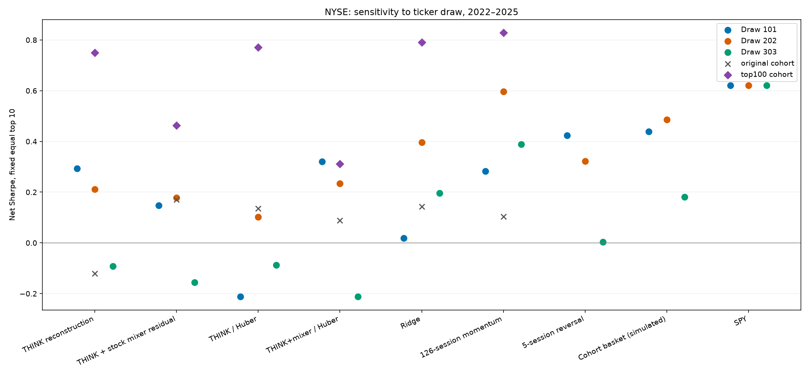

| Model | Draw 101 SR | Draw 202 SR | Draw 303 SR | Mean SR | SD across draws | Mean annualized return |
|---|---:|---:|---:|---:|---:|---:|
| THINK reconstruction | 0.294 | 0.211 | -0.092 | 0.138 | 0.203 | 3.6% |
| THINK + stock mixer residual | 0.147 | 0.178 | -0.156 | 0.056 | 0.185 | 1.9% |
| THINK / Huber | -0.212 | 0.103 | -0.087 | -0.065 | 0.159 | -0.3% |
| THINK+mixer / Huber | 0.320 | 0.234 | -0.212 | 0.114 | 0.286 | 3.2% |
| Ridge | 0.019 | 0.397 | 0.196 | 0.204 | 0.189 | 5.4% |
| 126-session momentum | 0.283 | 0.596 | 0.389 | 0.423 | 0.159 | 10.2% |
| 5-session reversal | 0.424 | 0.323 | 0.003 | 0.250 | 0.220 | 6.1% |
| Cohort basket (simulated) | 0.438 | 0.486 | 0.181 | 0.368 | 0.164 | 8.3% |
| SPY | 0.621 | 0.621 | 0.621 | 0.621 | 0.000 | 13.4% |

| Paired comparison | Mean ΔSharpe | Exploratory 95% interval | Draws with advantage |
|---|---:|---:|---:|
| THINK + stock mixer residual minus THINK reconstruction | -0.081 | [-0.418, 0.262] | 0/3 |
| THINK+mixer / Huber minus THINK / Huber | 0.179 | [-0.170, 0.529] | 2/3 |
| 126-session momentum minus Ridge | 0.219 | [-0.223, 0.681] | 3/3 |

### Draw 101: 58/100 histories recovered; eligibility 43–48

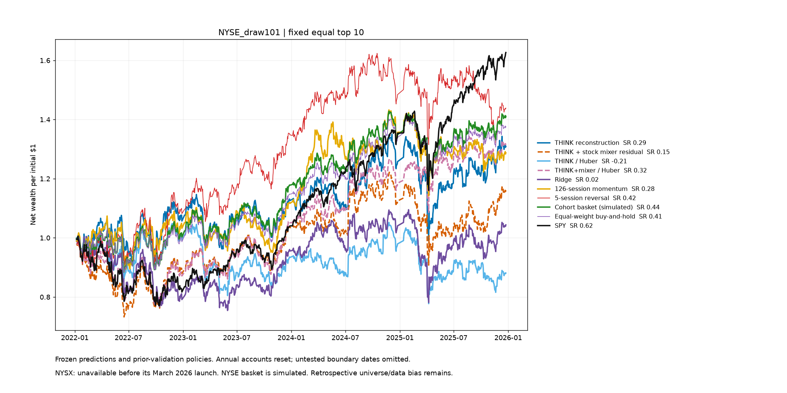

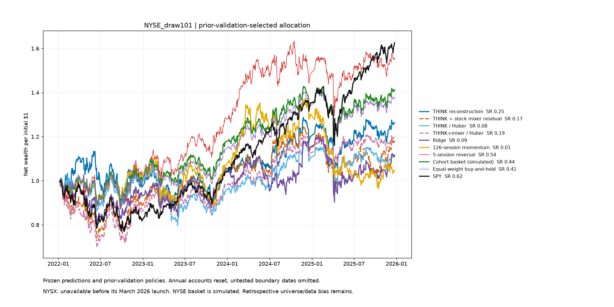

### Draw 202: 62/100 histories recovered; eligibility 49–58

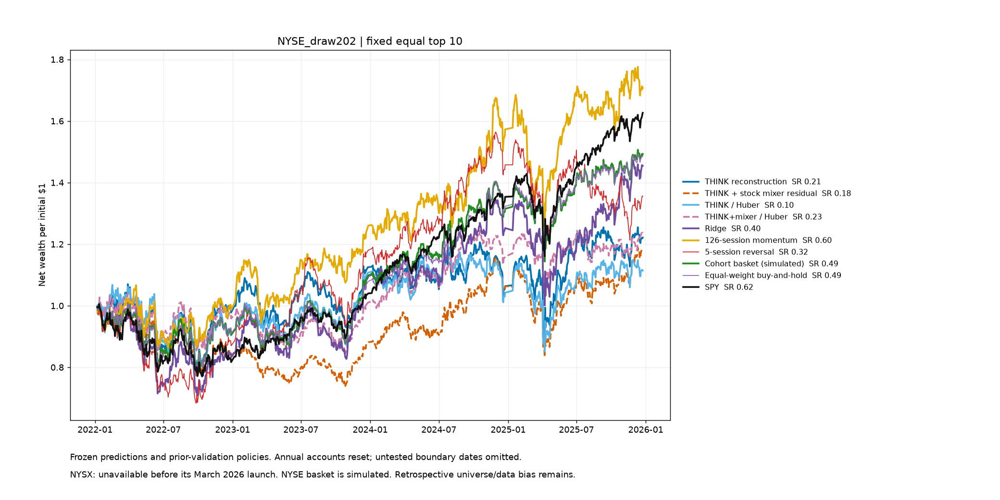

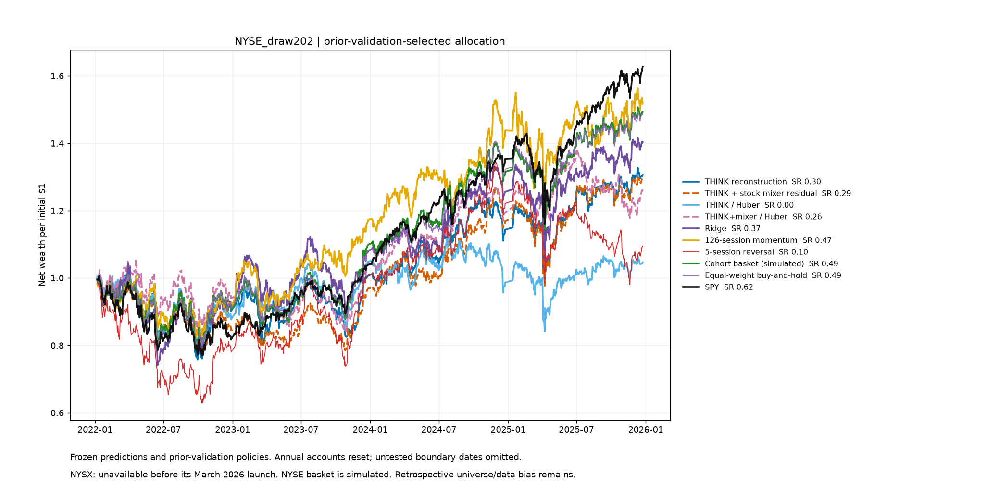

### Draw 303: 63/100 histories recovered; eligibility 47–59

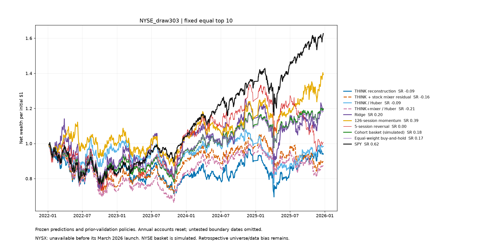

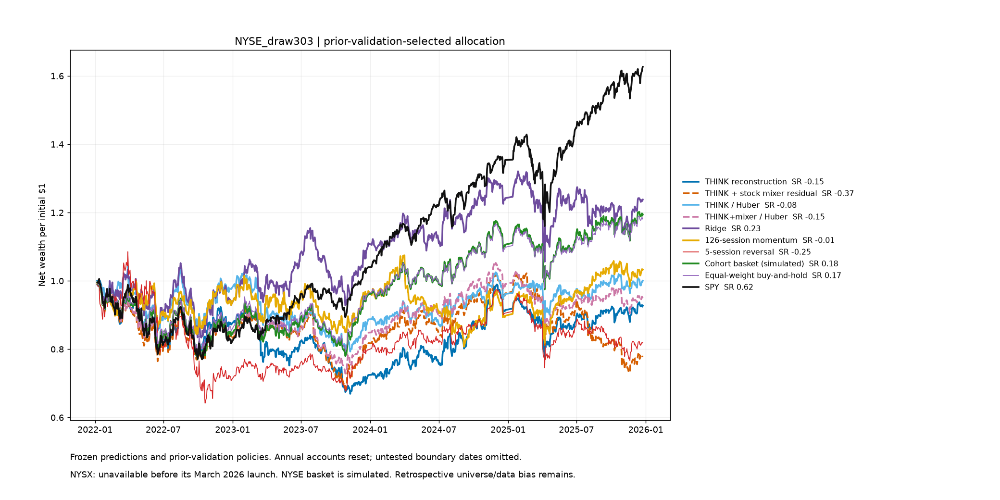

## NASDAQ: all draws

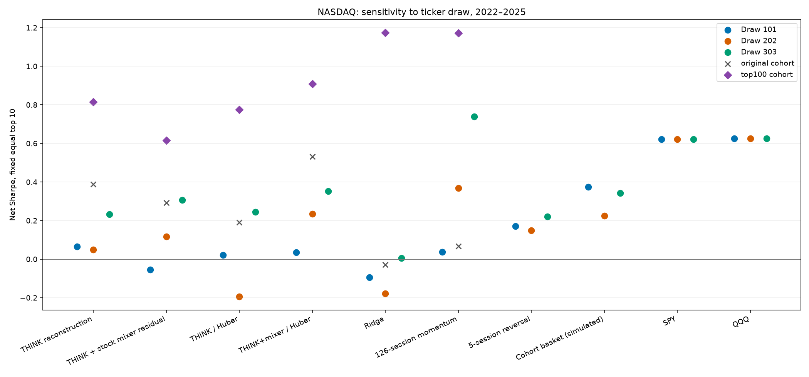

| Model | Draw 101 SR | Draw 202 SR | Draw 303 SR | Mean SR | SD across draws | Mean annualized return |
|---|---:|---:|---:|---:|---:|---:|
| THINK reconstruction | 0.065 | 0.049 | 0.233 | 0.116 | 0.102 | 3.0% |
| THINK + stock mixer residual | -0.056 | 0.116 | 0.307 | 0.123 | 0.181 | 3.0% |
| THINK / Huber | 0.021 | -0.195 | 0.244 | 0.023 | 0.220 | 1.4% |
| THINK+mixer / Huber | 0.036 | 0.234 | 0.352 | 0.207 | 0.160 | 5.3% |
| Ridge | -0.095 | -0.179 | 0.005 | -0.090 | 0.092 | -2.6% |
| 126-session momentum | 0.038 | 0.368 | 0.739 | 0.382 | 0.351 | 9.8% |
| 5-session reversal | 0.170 | 0.148 | 0.220 | 0.180 | 0.037 | 4.5% |
| Cohort basket (simulated) | 0.374 | 0.225 | 0.343 | 0.314 | 0.079 | 7.6% |
| SPY | 0.621 | 0.621 | 0.621 | 0.621 | 0.000 | 13.4% |
| QQQ | 0.626 | 0.626 | 0.626 | 0.626 | 0.000 | 16.2% |

| Paired comparison | Mean ΔSharpe | Exploratory 95% interval | Draws with advantage |
|---|---:|---:|---:|
| THINK + stock mixer residual minus THINK reconstruction | 0.007 | [-0.345, 0.338] | 2/3 |
| THINK+mixer / Huber minus THINK / Huber | 0.184 | [-0.190, 0.556] | 3/3 |
| 126-session momentum minus Ridge | 0.471 | [0.086, 0.888] | 3/3 |

### Draw 101: 54/100 histories recovered; eligibility 43–52

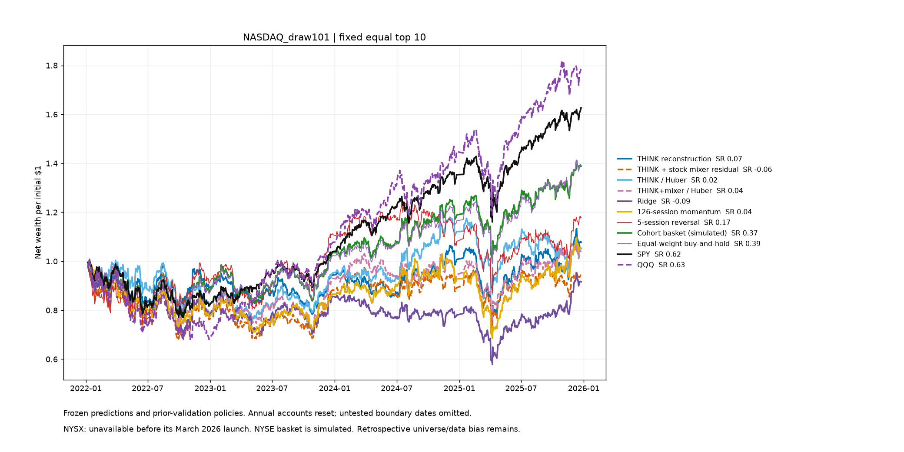

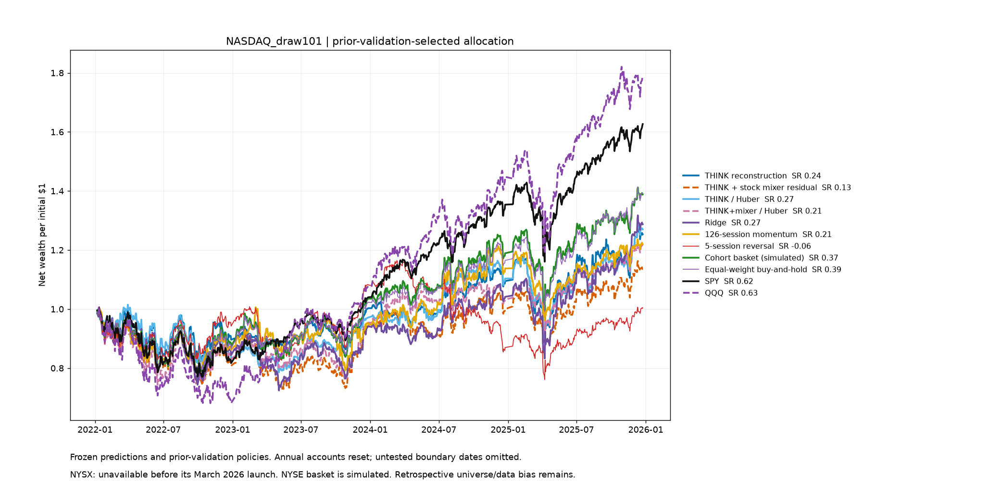

### Draw 202: 65/100 histories recovered; eligibility 49–62

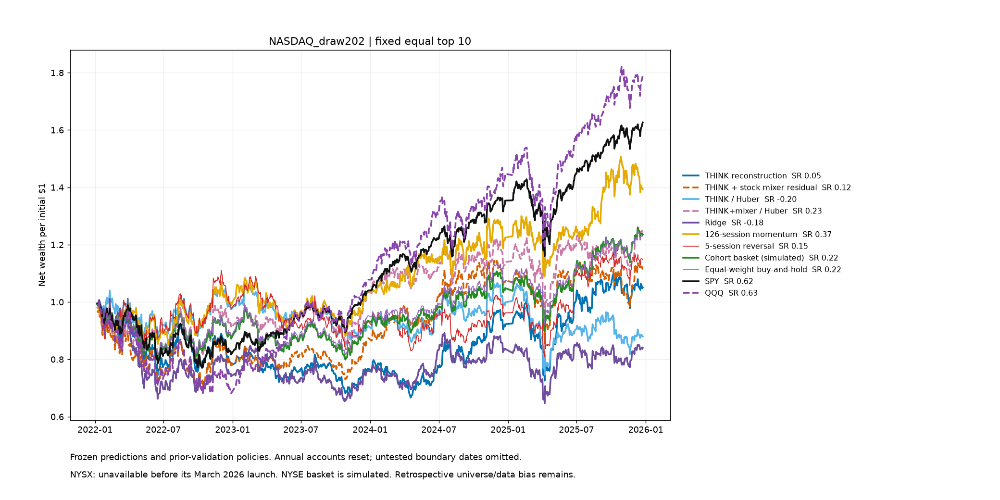

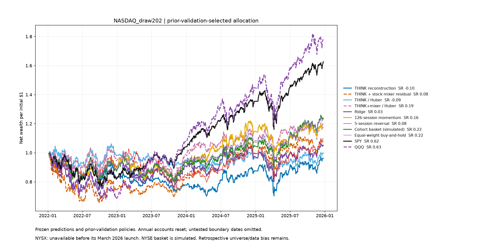

### Draw 303: 70/100 histories recovered; eligibility 52–62

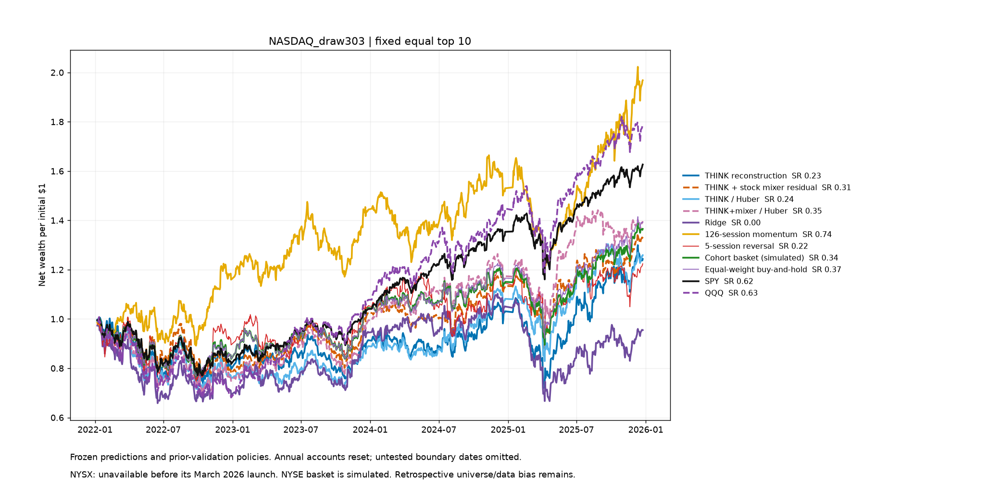

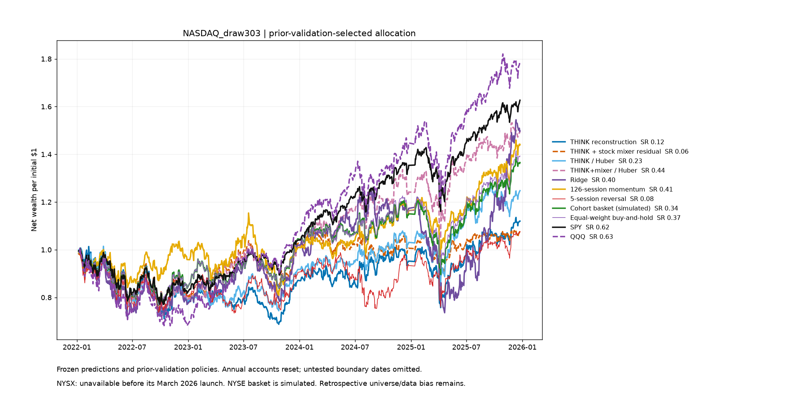

## How to interpret the averages

Mean Sharpe is the arithmetic mean of the three separately computed draw Sharpes. It is a descriptive statistic, not the Sharpe of a tradable pooled portfolio. The same-date block resamples are shared across draws when computing paired intervals, preserving their common market shocks. Three draws give a first sensitivity check; more draws would improve the sampling estimate but still use the same observed years. A convincing next test needs a frozen rule on unseen dates and a point-in-time universe with delisted returns.

The old cohorts and current top-100 cohort also differ in training backend (CPU versus GPU). These fresh neural fits run on CPU with PyTorch 2.14.0+cu130; the original CPU fits used 2.14.0+cpu. The device class matches, while the wheel build differs. Architecture claims should rely on comparisons within the same draw and backend.
