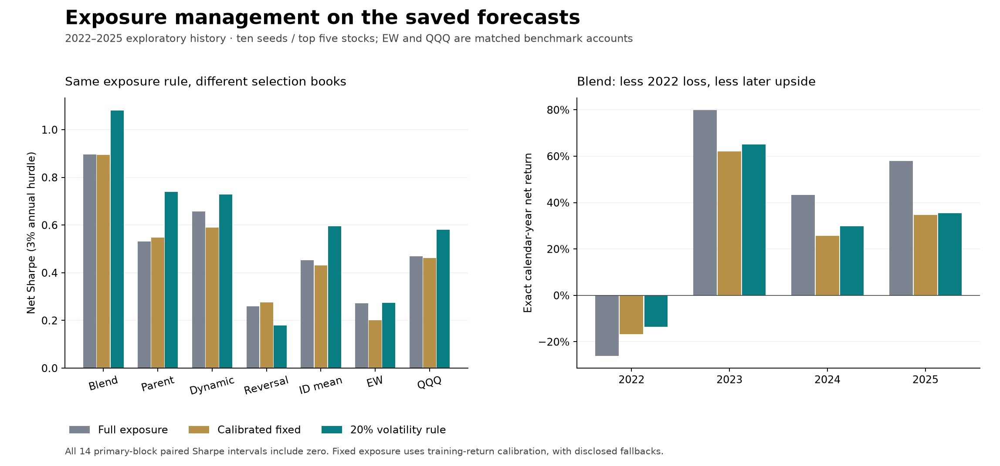
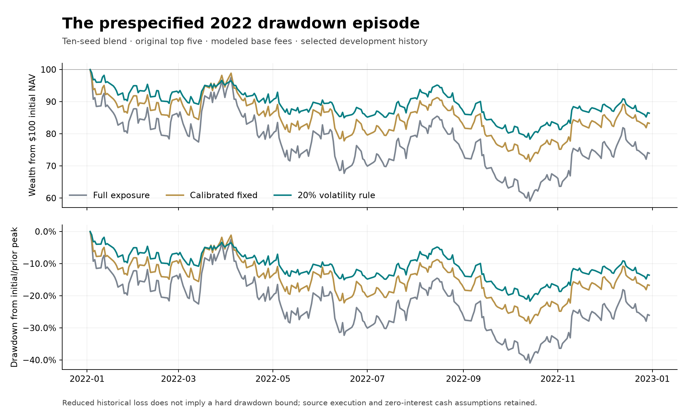

# Why the selected historical Sharpe exceeds one

2026-10-27. Research_Plan Phase E, frozen protocol `14a910f`, initial implementation `d77f55a`. Verified saved forecasts; no neural fitting or new checkpoint claim. This completes the frozen 75-policy/525-account exposure-and-cost batch, not the full research program. All 2022–2025 results remain exploratory on repeatedly inspected history.

The higher Sharpe combines the blend's stock selection with variable exposure. The exposure rule also helps several simpler books, so that improvement is not unique evidence of learned relations. Its historical timing benefit over calibrated fixed exposure is uncertain: all 14 primary-block paired Sharpe intervals include zero. Headline Sharpe is also sensitive to seed group and execution costs.

## 1. Exactly what was reproduced

All 30 matching original allocation/exposure accounts reproduce their source daily returns exactly, including original-five 1.199 and ten-seed issuer 1.112 leaders. Source metrics, original saved-control paths and dates also match. The full new matrix contains 525 accounts and 526,575 daily observations: 75 policies × modeled participation costs 1/2/4, flat 10/20/30 bp per side, and zero cost. All paths compound to recorded NAV, all terminal equity is zero, and cash is nonnegative within source numerical tolerance. Maximum normalized NAV discrepancy 1.59e-14; minimum cash−5.35e-10 dollars is floating-point residue, not economic borrowing.

Unchanged source execution retains frozen share quantities, next regular-close fills, 1% ADV limits, missing-fill cancellation, cash scaling, settlement approximation and terminal liquidation. Risk estimates use trailing 20 session basket returns and known decision-time selections. The prior-close index is a sizing timestamp: AH/PM rankings only become available at 09:20 before the entry-close fill. Original first-provider-publication latency is still assumed rather than independently certified.

## 2. Separate selection from exposure

Ten-seed blend, base modeled costs:

| Exposure | Original top 5 SR / CAGR / MDD | Issuer 5 SR / CAGR / MDD |
|---|---|---|
| Full |0.896 /31.87% /−40.94%|0.925 /33.37% /−40.94%|
| Constant 75% |0.863 /24.34% /−31.73%|0.893 /25.43% /−31.73%|
|20% basket-vol target |1.080 /26.00% /−21.69%|1.112 /26.81% /−21.69%|
|QQQ/MA200 cap 50% |0.959 /28.57% /−31.03%|0.977 /29.27% /−31.03%|
|25% target plus MA200 cap |1.055 /27.82% /−22.98%|1.085 /28.70% /−22.98%|

Issuer selection changes which stocks receive capital; exposure changes how much capital remains invested. The issuer increment under full exposure is +0.029 SR; under the 20% rule it is +0.032. These are conditional differences, not additive percentages of Sharpe explained. The risk-overlay increment is larger here, but cannot be assigned a causal fraction of the selected leader's Sharpe.

Seed sensitivity persists. Under original top 5/20% target, original-five SR 1.199, CAGR 28.96%; new-five 0.678, 15.80%; ten-seed 1.080, 26.00%. Under issuer 5/20%, values are 1.178/28.57%,.677/15.77%, 1.112/26.81%. Issuer selection helps the ten-seed headline and slightly hurts the original-five headline. Neither subgroup provides an independent market history.

## 3. The same rule on matched selection books

Full, 20% vol-managed, and training-return-calibrated fixed-exposure Sharpe:

| Selection | Full | 20% target | Fixed |
|---|---:|---:|---:|
| Blend E |0.896|1.080|0.894|
| Parent B |0.531|0.739|0.549|
| Dynamic D |0.657|0.728|0.590|
| Five-session reversal |0.259|0.180|0.276|
| Training-label stock mean |0.453|0.595|0.431|
| Eligible EW, weekly |0.273|0.274|0.201|
| QQQ, weekly |0.469|0.581|0.462|

The blend, parent, dynamic model, identity control and QQQ improve descriptively; EW is nearly unchanged and reversal loses Sharpe. Thus volatility management is neither exclusive to the neural model nor universally helpful. E still has the highest managed point estimate among these fixed cells, but the present comparison does not establish its residual forecast mechanism.

All stock selectors use top 5; EW equally weights the same inference-eligible members and is rebalanced on the shared five-session clock. It is not the older monthly-index benchmark. QQQ is a one-ETF account with the same calendar, sizing/cash/fee/cap conventions. Simple-control seed-group duplicates are retained but are not extra evidence.

The fixed rule freezes each year's first-decision basket and calibrates its volatility using only training-origin return windows. It does not match exposure or volatility using future realized outcomes. At least 30 usable windows are required. All four EW years and three REV5 group/year cells use the declared 0.30 risk fallback; no other candidates do. EW's fixed comparator is therefore a fallback control, not a precise matched-risk estimate. Exact clocks/counts/fallbacks are in FIXED_CALIBRATION.csv and CALIBRATION_TIMING.csv.

For E, average actual equity exposure is 99.72% full, 66.79% vol-managed and 68.22% fixed. Net QQQ loading falls from 1.299 full to 0.739 managed versus 0.873 fixed. Variable exposure therefore changes the timing of market loading beyond a comparable average exposure; it does not identify relational stock alpha.

## 4. Calendar and arithmetic attribution

Exact calendar-year net returns for the ten-seed original-top 5 blend:

| Year | Full | Fixed | 20% target |
|---|---:|---:|---:|
|2022|−26.07%|−16.75%|−13.59%|
|2023|+79.86%|+62.14%|+65.07%|
|2024|+43.22%|+25.71%|+29.87%|
|2025|+57.92%|+34.73%|+35.46%|

The overlay reduces 2022 loss and later upside relative to full exposure. Its four-year CAGR 26.00% is lower than full 31.87%, alongside lower volatility and drawdown. These are compounded calendar returns, not annualized subperiod means. All 525 accounts' calendar/log-growth rows are retained; log-growth sums reconcile to complete paths.

For zero-fee E, using previous-day actual managed equity exposure and the full-frictionless account return:

`mean(e*r_full) = mean(e)*mean(r_full) + cov(e, r_full)`.

Annual arithmetic units: 23.83 pp mean-exposure component +2.99 pp covariance =26.82 pp scaled-full mean. The actual managed frictionless account earns 26.86 pp; drift/cap/execution residual +0.04 pp reconciles it. This avoids pretending that multiplying a baseline path exactly reproduces a traded account. Positive covariance occurs in the selected historical path; it is not a validated market-timing forecast. Reversal's corresponding covariance is negative (−1.31 pp/year), consistent with its different overlay behavior.

ACCOUNT_METRICS.csv's downside_covariance_annual is a globally centered crossproduct averaged over QQQ returns below their full-sample mean. DOWNSIDE_ZERO_THRESHOLD.csv adds globally centered conditional/unconditional crossproducts for actual QQQ return<0. These are not within-down-session-centered covariances. Both definitions remain visible; the additional attribution view changes no account, primary contrast or selection.

## 5. Costs and feasibility

Ten-seed original-top 5/20% target:

| Fee view | SR | CAGR | MDD |
|---|---:|---:|---:|
| Modeled 1× |1.080|26.00%|−21.69%|
| Modeled 2× |1.001|23.99%|−22.53%|
| Modeled 4× |0.844|20.06%|−24.20%|
| Flat 10 bp/side |1.050|25.25%|−22.00%|
| Flat 20 bp/side |0.942|22.51%|−23.15%|
| Flat 30 bp/side |0.834|19.83%|−24.29%|
| Zero |1.158|28.05%|−20.84%|

The ten-seed issuer 5 leader falls from 1.112 to 0.971 SR under flat 20 bp/side. Base modeled fees consume about 1.62 pp/year of preceding-NAV-normalized fees for original-top 5/vol20, versus 4.44 pp under 20 bp. This fee statistic is not directly a CAGR subtraction because costs also change share sizing, cash and compounding. Flat fees replace the modeled fee function; they are separate execution views, not additions or mislabeled copies of the base account. All seven views retain cap/cash feasibility at $1 million. These tests do not certify real auction liquidity, capacity at other AUM or provider arrival latency.

Cash earns zero; Sharpe retains the canonical 3% annual hurdle. No Treasury yield, leverage, borrow or margin benefit is invented. No hedge was traded.

## 6. Uncertainty and mechanical limits

20% target minus full and 20% target minus fixed form one 14-test descriptive SR family across E, B, D,REV5, Hlabel, EW, QQQ. 10, 000 synchronized stationary draws, primary expected block 21, 5/63 sensitivities. Every primary paired SR interval includes zero; all primary Holm p values are 1.0. No comparison passes 5% at either sensitivity (minimum Holm p across all sensitivities 0.811). For E versus fixed, SR difference +0.186 with 95% interval [−0.130, +0.485]. Selected-history point improvements do not establish a future timing advantage. The earlier ten-seed/top 10 mean-primary mechanism tests remain unchanged and do not authorize financial retraining.

Mechanics tests verify future-return mutation cannot affect training calibration or trailing risk, insufficient-history fallback, issuer/share-class order invariance, cap/cash/fill/settlement parity, and cancellation without reranking when a newly selected name cannot fill. A synthetic 50% gap while the source warmup leaves 2/3 equity exposure causes approximately 33.33% account loss before a reduced-exposure order fills. The 20% target is an annualized trailing-volatility rule, not a drawdown stop or hard risk bound. The initial test assumption of full exposure was corrected to the specified 0.30 warmup/weekly clock; no engine or policy was changed.

Seven new risk tests plus five source-engine tests pass. Independent review found no substantive timing/accounting/statistical blocker and prompted precise crossproduct terminology. An audit found object-typed dates in the first generated NPZ; the original archive is preserved, and PATHS_PORTABLE.npz uses explicit Unicode axes with identical numeric paths. The regression test fails before the export-helper fix and passes after. No financial account was rescored for this metadata repair. The original run-code hash/commit, current adapter hashes and source-engine hash are retained.

## 7. What this resolves and what remains

This batch resolves the plan's fixed allocation × exposure matrix, matched 20% rule, calibration using available historical returns, account/exposure/cost/calendar decomposition, cost stresses and specified mechanical checks under the canonical $1 million model. It strengthens the answer to HOW the headline is produced: persistent concentrated stock choices, rank-blend selection, and favorable historical exposure management all contribute descriptively. It does not identify WHY a trained neural component produces a useful changing signal.

The full plan remains active. Strict checkpoint reproduction/Hpred/surrogate/component interventions remain unresolved; causal style/seed-bundle and paired selection diagnostics remain open. Original first-publication evidence is absent. Prospective readiness and any capital decision are unactivated. Capacity at other AUM is a separate model sensitivity, not established by the present feasibility checks. Do not close those requirements using this report.

Evidence: execution_batch8_risk/{ACCOUNT_METRICS.csv,CALENDAR_ATTRIBUTION.csv,FIXED_CALIBRATION.csv,CALIBRATION_TIMING.csv,FRICTIONLESS_COVARIANCE.csv,DOWNSIDE_ZERO_THRESHOLD.csv,PAIRED_RISK_CONTRASTS.csv,SOURCE_REPLAY.csv,ACCOUNT_AUDIT.json,RESULTS.json}. Larger original/portable paths and detailed ledgers are in results/RISHI_MECHANISM_RISK_20261027/. The illustrative figure uses only these frozen result rows and was visually checked.
