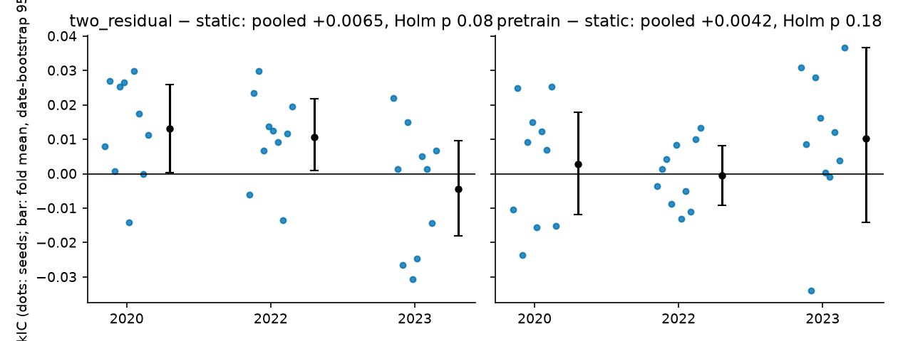

# Deep ablations — two_residual and pretrain (primary), hybrid (exploratory), random_graph (calibration)

**Status: exploratory.** The evaluation years 2020, 2022 and 2023 have all been inspected before in this repository. The verdict words (STRONG / SEED-ROBUST ONLY / NO EVIDENCE) follow the decision rule predeclared in `RESEARCH_SCREENING_PLAN.md` (deep-test amendment). They are not confirmatory claims.

## Design (predeclared before any deep number)

- **Primary family:** the only two arms that passed the v3 gate, F `two_residual` and H `pretrain`, each against `static`. Holm correction runs over these 2.
- **Post-hoc additions:** added after the platform check but before any deep number (plan, post-hoc addendum).
  - C `hybrid` is an exploratory third candidate. Holm over 3 is reported as a sensitivity only.
  - `random_graph` (random hyperedges) is a known-null calibration arm. It enters no decision.
- **Folds:** 2020 (validate 2019; the COVID crash falls inside the evaluation year), 2022 and 2023. 2024+ stays reserved.
- **Seeds:** 10 (7 19 42 101 202 303 404 505 606 707).
- **Code and data:** identical v3 source (hash-verified in each kernel), data and CLI.
- **Compute:** all 150 fits ran on Kaggle CPU kernels (torch 2.11): 7 kernels, 0 failed. Output is in `results/SCREEN_SP500_20261019_v3_deep`.
- **Decision rule, per candidate:**
  - The 30 (fold, seed) paired deltas ΔRankIC = RankIC(candidate) − RankIC(static) get a two-sided Wilcoxon signed-rank test, Holm-adjusted.
  - The v3 date bootstrap gives a pooled CI (stationary, block 10, B = 5000, equal-weight fold mean).
  - **STRONG** = Holm p < .05, the CI excludes 0 and all fold means are > 0. **SEED-ROBUST ONLY** = Holm p < .05 only. **NO EVIDENCE** = otherwise.

## Primary result (`deep_TABLES.md`, `deep_PAIRED.csv`)

| Candidate | Pooled ΔRankIC [95% CI] | Fold means 2020 / 2022 / 2023 | Seeds positive | Wilcoxon p | Holm p (family of 2) | Verdict |
|---|---|---|---|---|---|---|
| F two_residual | +0.0065 [−0.0005, +0.0137] | +0.0132 / +0.0107 / **−0.0045** | 8/10, 8/10, 6/10 | 0.038 | **0.077** | **NO EVIDENCE** |
| H pretrain | +0.0042 [−0.0061, +0.0149] | +0.0029 / −0.0004 / +0.0102 | 6/10, 5/10, 8/10 | 0.184 | 0.184 | **NO EVIDENCE** |

Absolute RankIC (seed mean):

| Arm | 2020 | 2022 | 2023 |
|---|---|---|---|
| static | +0.0047 | −0.0031 | +0.0173 |
| two_residual | +0.0179 | +0.0076 | +0.0128 |
| pretrain | +0.0076 | −0.0035 | +0.0274 |

two_residual fails all three conditions of the rule:
- Holm p is 0.077.
- The CI includes 0.
- The 2023 fold mean is negative.

Its unadjusted Wilcoxon p (0.038) is not a finding. It does not survive the predeclared correction, and the budget probe below reverses the direction of the effect.

## Exploratory and calibration arms (`deep_sens3_TABLES.md`, `deep_calib_TABLES.md`)

| Arm | Role | Pooled ΔRankIC [95% CI] | Fold means 2020 / 2022 / 2023 | Seeds positive | Wilcoxon p | Verdict |
|---|---|---|---|---|---|---|
| C hybrid (MSE + 0.1·ListNet) | exploratory | +0.0023 [−0.0022, +0.0069] | +0.0014 / −0.0002 / +0.0058 | 7/10, 3/10, 9/10 | 0.100 (Holm over 3: 0.201) | NO EVIDENCE |
| random_graph | known-null calibration | +0.0028 [−0.0036, +0.0095] | +0.0027 / **+0.0067** / −0.0010 | 7/10, 8/10, 5/10 | 0.124 | (calibration; NO EVIDENCE) |

Under Holm over 3, two_residual's adjusted p is 0.115 and pretrain's is 0.201. The verdicts do not change.

## What the calibration arm shows

- **A random hypergraph "beats" static by +0.0028 pooled.** That is the same size as pretrain (+0.0042) and hybrid (+0.0023), with similar Wilcoxon p (0.12 vs 0.18 and 0.10). So effects of that size are indistinguishable from what a structure-free perturbation of static produces. Only two_residual (+0.0065, more than 2× the null) clearly exceeds the null arm's effect size, and only modestly. Its 2023 mean is negative. This comparison is descriptive: random_graph and hybrid were not session-matched to their static parent (see Reproducibility).
- **2022 is a weak-parent fold.** Deep static's 2022 RankIC is −0.0031, and random_graph beats it there by +0.0067. two_residual's 2022 delta (+0.0107) is inflated by the same weak parent. This matches the budget probe (DIAGNOSTIC §2b): a better-trained static gains +0.023 in 2022, and against that parent two_residual's edge becomes −0.0048 (2022 −0.0073, 2023 −0.0023; 2/6 seeds positive; 3 seeds, laptop).
- **3-seed per-fold patterns are not reliable.** Seeds 7/19/42 of hybrid are bit-identical between v3 and deep (same Kaggle numerics; see below). Even so, a rerun of the parent alone flips seed signs: 2022 seed 19 goes from +0.0004 to −0.0009, and 2023 seed 42 from −0.0005 to +0.0012. With 7 more seeds and the rerun parent, hybrid's fold pattern reverses between v3 and deep:
  - 2023 goes from 1/3 seeds positive in v3 to 9/10 in deep;
  - 2022 goes from 2/3 positive to 3/10.

  The v3 'Promising' gate is built from exactly these 3-seed patterns, which supports the screen's conclusion that the gate is fragile near its threshold.

## Reproducibility

The deep design reruns seeds 7/19/42 for 2022/2023, so 30 runs can be compared with v3, and 6 static runs with the Kaggle static rerun (`v3_platform_static`).

| Pair | Runs | Bit-identical | Mean \|ΔRankIC\| | Max \|ΔRankIC\| | Min prediction corr |
|---|---|---|---|---|---|
| Kaggle deep vs laptop v3: static | 6 | 0 | 0.0008 | 0.0018 | 0.953 |
| Kaggle deep vs laptop v3: two_residual | 6 | 0 | 0.0021 | 0.0066 | 0.934 |
| Kaggle deep vs laptop v3: pretrain | 6 | 0 | 0.0035 | 0.0091 | 0.813 |
| Kaggle deep vs Kaggle v3: hybrid | 6 | 6 | 0 | 0 | 1.000 |
| Kaggle deep vs Kaggle v3: random_graph | 6 | 6 | 0 | 0 | 1.000 |
| Kaggle deep static vs Kaggle static rerun | 6 | 2 (seed 42, kernel d2) | 0.0012 | 0.0060 | 0.973 |

- **Laptop reruns are bit-identical.** Within a machine, a run is deterministic.
- **Across machines the runs drift numerically.** Laptop and Kaggle never match, and two Kaggle sessions sometimes don't either: kernel d1, seeds 7/19, has 4/4 runs differ. A tiny numeric difference can send a fit down a different early-stopping path, as with pretrain 2022 seed 7: −0.0024 vs +0.0067.
- The likely cause is different CPU hardware and BLAS code paths. This was not verified.
- The drift is the same size as seed noise.
- **Session matching differs by arm:**
  - The primary contrasts (two_residual, pretrain) are matched seed by seed: candidate and static ran in the same kernel (d1–d5).
  - hybrid (d6) and random_graph (d7) are paired against static from d1–d5, i.e. different sessions. In v3, swapping the static session moved contrasts by about 0.0015, half of random_graph's +0.0028. Their deltas may partly reflect session drift.

Files:
- `deep_REPRO.csv`: the primary candidates vs v3;
- `deep_REPRO_vs_v3_all_arms.csv`;
- `deep_REPRO_vs_kaggle_static.csv`.

## Conclusions

1. **No candidate is established.** Both predeclared candidates are NO EVIDENCE. The exploratory hybrid is NO EVIDENCE too.
2. **two_residual is the closest to an effect, and it is still not credible.**
   - It has the largest pooled delta and 22/30 seeds positive.
   - But it fails Holm, its 2023 fold is negative, and it loses to a better-trained static in the budget probe.
   - Its 2022 gain is about what a random graph also gets there.
3. **pretrain and hybrid are indistinguishable from the random-graph null.**
4. **No combination tests were run.** The brief allows combinations only after single effects are measured, and none is established.

## Caveats

- Survivorship bias (2026 constituents traced back to 2015) and current GICS labels.
- Simplified adaptations, not reproductions: two_residual is not a published deep-hypergraph method, masked reconstruction ≠ CI-STHPAN, and ListNet ≠ LapSum.
- One target (h5), one model size (hidden 16), one selection rule (validation RankIC). A different budget changes the parent (DIAGNOSTIC §2b).
- hybrid and random_graph were added after the v3 numbers were seen. They are labelled post hoc and kept out of the primary family.
