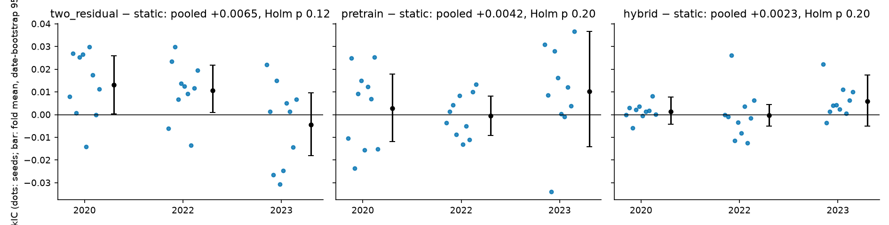
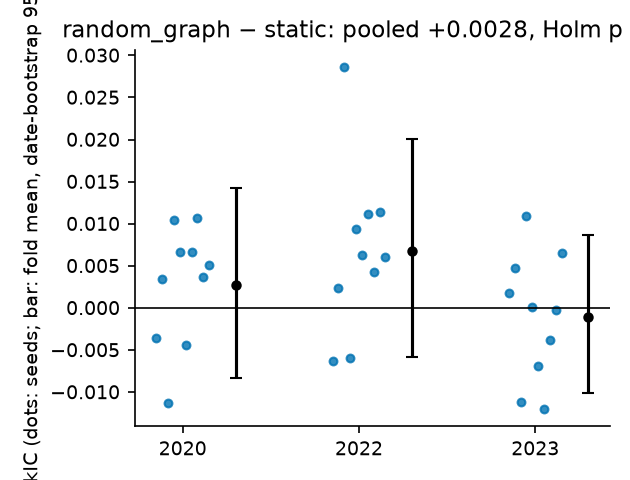
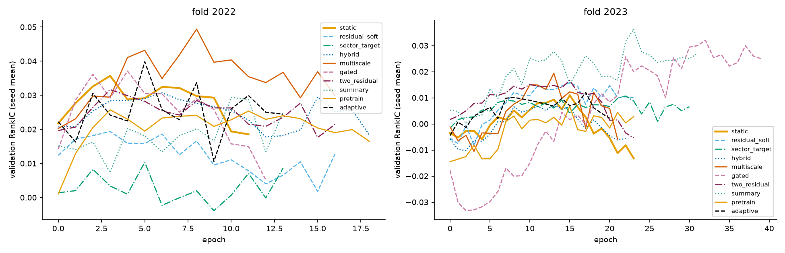
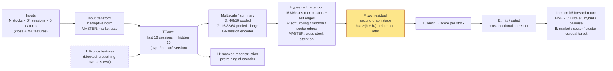

# Executive summary — HyperShift research screen (2026-10-19 → 2026-10-21)

**Exploratory screen. Not confirmatory. Nothing here is a production recommendation.**

## Answer in one paragraph

We screened 10 research directions (A–J) plus MASTER- and MDGNN-inspired arms against one common THINK-style baseline. Every arm used the same data, folds, seeds and selection rule. Data: 462 current S&P 500 stocks, daily, evaluated on 2022 and 2023.

**No direction beats the baseline after multiple-testing correction.** The two arms that passed the screen gate, F two-stage residual hypergraph and H masked pretraining, were deep-tested with 10 seeds × 3 folds (2020/2022/2023). Both are **NO EVIDENCE** under the predeclared rule. An exploratory third candidate (C, hybrid listwise loss) is also NO EVIDENCE. A random-hypergraph null arm produces an "effect" the same size as pretrain and hybrid. The baseline itself cannot be separated from simple models (no graph, MLP, 16-day reversal, Ridge). Diagnostics point to weak learnable signal, not undertraining.

**Study X (added 2026-10-21):** pairwise (clique) and star expansion of the cluster graph are both NO EVIDENCE as neural arms. Pairs trading on the same groups is NO EVIDENCE, and no grouping beats random groups. See `X_PAIRWISE_STAR_REPORT.md`.

## Numbers that matter

| | Value |
|---|---|
| Fits run | 340: 171 screen + 150 deep + 12 budget probe + 6 platform control + 1 lr check. 0 failed. |
| Screen: arms beating static after Holm | **0 of 9** primary comparisons (all Holm p = 1.00) |
| Baseline pooled RankIC | static 0.007 · no-graph 0.011 · MLP 0.011 · reversal 0.011 · Ridge 0.006 · random 0.000 |
| Deep F two_residual − static | +0.0065 [−0.0005, +0.0137], Holm p 0.077, 2023 fold −0.0045 → **NO EVIDENCE** |
| Deep H pretrain − static | +0.0042 [−0.0061, +0.0149], Holm p 0.184 → **NO EVIDENCE** |
| Deep C hybrid − static (exploratory) | +0.0023 [−0.0022, +0.0069], p 0.100 → NO EVIDENCE |
| Deep random_graph − static (null calibration) | +0.0028 [−0.0036, +0.0095], p 0.124 |
| Budget probe: two_residual − better-trained static | −0.0048 (2/6 seeds positive) |
| Factor-neutral RankIC, every arm | pooled ≤ 0.009 |

## All methods (screen, ΔRankIC vs parent, 95% CI)

## Ranking quality (RankIC, neutral RankIC, NDCG)

## Deep tests (dots = seeds; bar = fold mean with date-bootstrap CI)

## Training curves (validation RankIC peaks early; the fits barely leave initialisation)

## Architecture: the common baseline and where each direction plugs in

The baseline is temporal convolution, then hypergraph attention, then temporal convolution. It is Euclidean, hidden 16, and reads the last 16 sessions of 5 features. Its hyperedges are 16 correlation clusters plus self edges. Each direction modifies one stage. F two_residual is the strongest-scoring proposal, and it is still NO EVIDENCE.

## Measured vs untested

| Direction | Status | Result |
|---|---|---|
| A learned / dynamic hyperedges | Measured (screen) | Neutral. **The mechanism was not really tested**: soft assignments collapsed to uniform in every fit. Rolling, random and sector graphs are all ≈ static. |
| B factor-residual targets | Measured (screen) | Negative on raw RankIC (by construction); mixed on neutral RankIC. |
| C listwise / top-K loss | Measured (screen + exploratory deep) | Neutral; deep hybrid NO EVIDENCE. LapSum not implemented (ListNet stand-in). |
| D multiscale temporal | Measured (screen) | Neutral; the v2 'Promising' label did not replicate. TimeMixer not reproduced. |
| E gated mixing | Measured (screen) | Neutral; mix and gated overfit. |
| F graph depth | Measured (screen + deep, primary) | **NO EVIDENCE** (Holm p 0.077); the edge vanishes against a better-trained parent. |
| G long context | Measured (screen) | Neutral / slightly negative. |
| H self-supervised pretraining | Measured (screen + deep, primary) | **NO EVIDENCE** (Holm p 0.184). CI-STHPAN not reproduced. |
| I regime adaptation | Measured (screen) | Neutral. The frozen model's +0.022 is factor tilt. DoubleAdapt not reproduced. |
| J Kronos foundation features | **Untested: blocked** | Pretraining (to 2024-06) overlaps 2022/23. A clean test needs 2024-07+ evaluation, which is the user's decision. |
| MASTER-inspired | Measured (screen) | Neutral; simplified, not a reproduction. |
| MDGNN-inspired | Partly measured (via A) | Neutral; no multi-relational dynamic graph was built. |
| X1 clique vs star graph expansion | Measured (Study X, 5 seeds × 3 folds, session-matched) | **NO EVIDENCE** vs static. clique +0.0020 (Holm 0.890); star +0.0080 (Holm 0.146). Star only reaches the no-graph level (star − none −0.0001). In this run, static is nominally below no-graph (raw p 0.048, not significant after Holm). See `X_PAIRWISE_STAR_REPORT.md`. |
| X2 pairs trading (pairwise vs star; cluster / sector / all) | Measured (Study X) | **NO EVIDENCE** for every variant after 10 bp costs. No grouping beats random groups; star does worse than pairwise. |
| Combinations of directions | **Untested by design** | No single effect is established, so combinations are not justified. |
| Reserved 2024+ period | **Never scored** | Kept for a future confirmatory test. |
| Richer inputs (volume, fundamentals), other targets or model sizes | **Untested** | Out of this screen's scope; this is the recommended next direction. |
| Rishi's `feat-rs` model/data | **Untested** | Unavailable. |

## Caveats that bound every number

- **Survivorship bias:** 2026 S&P 500 constituents are traced back to 2015. GICS labels are current, not point-in-time.
- **Simplified adaptations** of each paper's mechanism, not reproductions.
- **Trading results are optimistic:** close-of-signal entry, no delisting payouts, costs only as turnover × bp. Net Sharpe of 0.7–1.8 for every non-random baseline in 2023 reflects the year and the survivorship bias, not skill.
- **Numerical drift across compute sessions** (laptop vs Kaggle, and sometimes Kaggle vs Kaggle) is the same size as seed noise. The primary deep contrasts are session-matched seed by seed. The hybrid and random_graph contrasts are not.
- **Post-hoc arms:** hybrid and random_graph were added to the deep tests after the v3 numbers were seen. They are kept out of the primary family.

## Read next

`FINAL_RECOMMENDATIONS.md` (what to do) · `DEEP_ABLATIONS.md` · `SCREENING_REPORT.md` · `DIAGNOSTIC_REPORT.md` · `BASELINE_REPORT.md` · `DATA_AUDIT.md` · `RESEARCH_SCREENING_PLAN.md` · data: `SCREENING_RESULTS.csv`, `deep_PAIRED.csv`.
