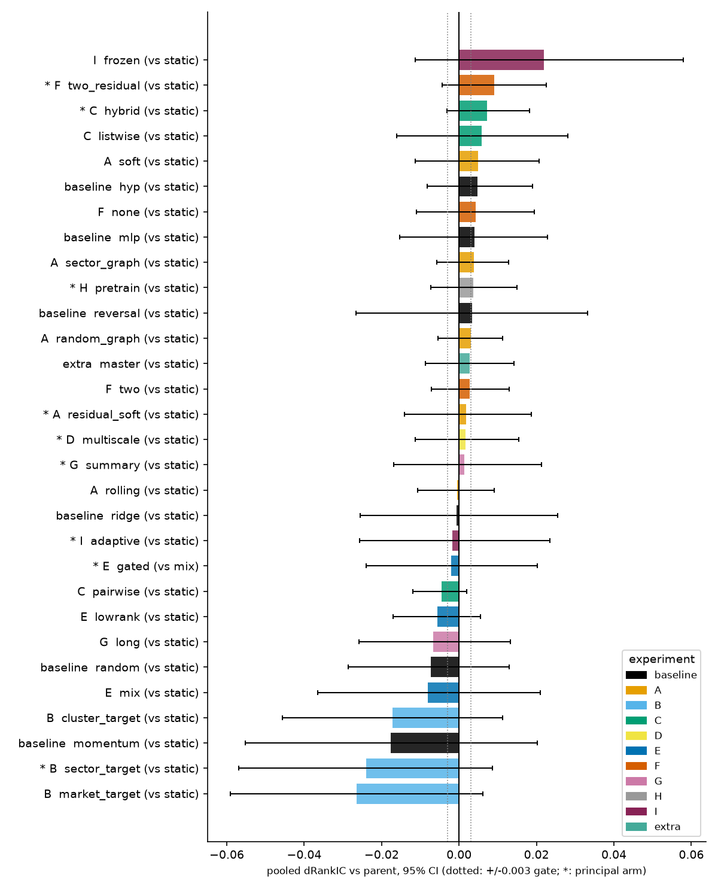
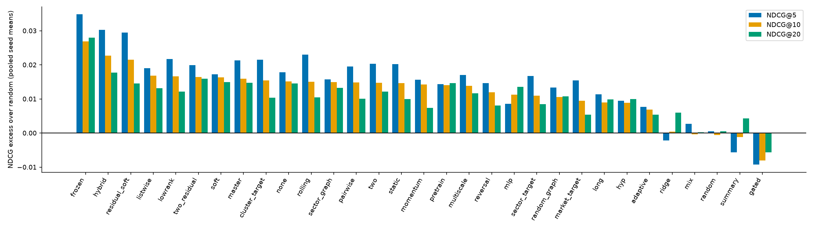

# Screening report — HyperShift broad research screen (v3, primary)

**Status: exploratory triage.** Nothing here is confirmatory: every evaluation year has been inspected before in this repository. The verdict words below are the screen's triage labels (Promising / Neutral / Negative preliminary result / Inconclusive / blocked), not the project's confirmatory verdicts.

## What was run

- **Data.** 462 current S&P 500 constituents from yfinance, daily 2015–2026, with five MA/close features and 11 GICS sectors (`DATA_AUDIT.md`, `SP500_INPUT_MANIFEST.json`). Strong survivorship bias.
- **Folds.** Evaluate 2022 (validate on 2021) and 2023 (validate on 2022). 2024 onward is reserved and was never scored.
- **Protocol.** Identical for every arm and predeclared before any v3 number (`RESEARCH_SCREENING_PLAN.md`, v3 amendment).
  - h5 forward-return target; 64-session eligibility; stride-1 training.
  - Checkpoint selection on validation RankIC; seeds 7, 19, 42.
  - Hidden 16; Adam lr 1e-3 with weight decay 0; at most 40 epochs, patience 8.
- **Inventory.** 31 arms; 171/171 runs complete, 0 failed (`v3_INVENTORY.md`).
  - 51 fits ran on the laptop CPU (torch 2.14): static, hyp, two, two_residual, rolling, master, pretrain, long, frozen.
  - 120 ran on 4 Kaggle CPU kernels (torch 2.11). Each kernel verified the source hashes before training.
  - Each run's platform is the `platform` column of `SCREENING_RESULTS.csv`.
- **Statistics.**
  - Paired contrasts use matched seeds and common dates.
  - The CI is a stationary bootstrap (block 10, B = 5000) of the seed-averaged daily ΔRankIC, pooled as an equal-weight mean of the fold means.
  - Holm correction covers the nine primary comparisons.
  - Gate for 'Promising': both fold means > 0, ≥ 2/3 seeds positive in each fold, and pooled ΔRankIC ≥ 0.003.
  - The CI omits training-seed variance. The deep tests add a seed-level Wilcoxon for that reason.

## Results by direction (principal arm vs parent; pooled ΔRankIC [95% CI])

| ID | Question | Principal arm (simplified adaptation) | ΔRankIC [95% CI] | Holm p | Triage | Controls and notes |
|---|---|---|---|---|---|---|
| A | Learned or dynamic hyperedges | residual_soft: static + soft prototype hyperedges | +0.0018 [−0.014, +0.019] | 1.00 | Neutral | Soft assignment stays at uniform entropy (log 16) in every fit, so the learned edges never differentiate (DIAGNOSTIC §2c). Rolling-correlation −0.001, random graph +0.003, GICS sector graph +0.004, soft-only +0.005: none separable from static. |
| B | Factor-residual targets | sector_target: beta-market residual, then sector demeaned | −0.0240 [−0.057, +0.009] | 1.00 | Negative preliminary result | market_target −0.026, cluster_target −0.017. Scored on raw RankIC. Sector-neutral RankIC is mixed (better in 2022, worse in 2023): the raw loss is mostly the factor tilt that residual targets remove by design. |
| C | Listwise / top-K losses | hybrid: MSE + 0.1·ListNet | +0.0072 [−0.003, +0.018] | 1.00 | Neutral | Fails the gate (2023: 1/3 seeds positive). Pure ListNet +0.006 (2022 −0.015, 2023 +0.026); pairwise logistic −0.005. ListNet ≠ LapSum. |
| D | Multiscale temporal | multiscale: residual fusion of 4/8/16-session pooled features | +0.0017 [−0.011, +0.015] | 1.00 | Neutral | The v2 'Promising' label (+0.008) does not replicate on v3. Pooled fusion ≠ TimeMixer. |
| E | Gated mixing | gated vs its mix parent | −0.0020 [−0.024, +0.020] | 1.00 | Neutral | mix vs static −0.008; low-rank adapter −0.006. mix and gated overfit: training loss −0.2 to −0.45 while validation MSE rises. |
| F | Graph depth | two_residual: two graph stages with initial residual | **+0.0090 [−0.004, +0.023]** | 1.00 | **Promising** (gate only) | Per fold: 2022 +0.018 (seeds −0.006 / +0.030 / +0.030), 2023 **+0.0004** (+0.022 / +0.006 / −0.028). Passes 2023 on a technicality. Two plain stages +0.003; zero stages (`none`) +0.004. |
| G | Long context | summary: residual 16/32/64-session summaries | +0.0013 [−0.017, +0.021] | 1.00 | Neutral | Full 64-session encoder (`long`) −0.007. Ridge on window summaries has little signal. |
| H | Self-supervised pretraining | pretrain: 20% masked reconstruction, 5 epochs | **+0.0036 [−0.007, +0.015]** | 1.00 | **Promising** (gate only) | Per fold: 2022 +0.006 (+0.005 / +0.004 / +0.008), 2023 +0.002 (+0.029 / +0.007 / −0.031). Masked reconstruction ≠ CI-STHPAN. |
| I | Regime adaptation | adaptive: signal-local adaptive normalisation | −0.0017 [−0.026, +0.023] | 1.00 | Neutral | frozen (2022-fold model scored on 2023) +0.022 raw, Inconclusive. Its neutral RankIC is lower than retrained static, so the gain is factor tilt (DIAGNOSTIC §2c). Adaptive norm ≠ DoubleAdapt. |
| J | Foundation-model features (Kronos) | — | not run | — | **Data/resource blocked** | Kronos pretraining runs to June 2024 and covers NASDAQ, so 2022/23 evaluation is contaminated. A clean test needs evaluation in the reserved ≥ 2024-07 period; that is the user's decision. |
| MASTER-inspired | Market gate + cross-stock attention | master (standalone) | +0.0028 [−0.009, +0.014] | — | Neutral | Not a MASTER reproduction. Most expensive arm (1,024 s/fit). |
| MDGNN-inspired | Dynamic multi-relational graphs | covered by A (soft and rolling) | see A | — | Neutral | Minimal relation-learning test only; no MDGNN reproduction. |

Full tables: `v3_SCREENING_TABLES.md`. Per-seed paired deltas: `v3_PAIRED.csv`. All runs: `SCREENING_RESULTS.csv`.

## What the screen shows

1. **Nothing is statistically distinguishable from the baseline.** Holm p = 1.00 for all nine primary comparisons, and every 95% CI includes 0.
2. **The common baseline is weak and not separable from simpler models.** Pooled RankIC: static 0.007, no-graph 0.011, MLP 0.011, reversal(16) 0.011, Ridge 0.006, random 0.000 (`BASELINE_REPORT.md`). Graph structure gives no measurable benefit here: correlation clusters, GICS sectors and random groups all look the same.
3. **The models barely leave initialisation.** The selected epoch has a median of 5, training loss falls by about 0.01–0.03, and predictions track the market move (correlation 0.8–0.9). A training-budget probe (patience 20, lr 3e-3) is running as a diagnostic (DIAGNOSTIC §2b).
4. **The screen is noise-limited.** Per-fold seed-to-seed ΔRankIC spread is ±0.02–0.03, against mean effects ≤ 0.009. With 3 seeds, the 'Promising' gate is a weak filter.
5. **Two arms pass the gate: F two_residual and H pretrain.** Both, and their parent, ran on the laptop, so their v3 contrasts are platform-matched. They go to the predeclared deep test (10 seeds × folds 2020/2022/2023, all on one platform; `DEEP_ABLATIONS.md`). No other arm is promoted. The list was not padded to 3–5.
6. **Negative preliminary results:** B residual targets on raw RankIC; pairwise loss; mix, low-rank and long context (descriptive). Every one of these CIs also includes 0. Treat them as "not supported here", not as refuted.

## Caveats

- **Survivorship bias** (2026 constituents traced back to 2015) and **current GICS labels**. Comparisons are only like-for-like across arms.
- **Platform.** 22 arms ran on Kaggle (torch 2.11) and are paired against the laptop static (torch 2.14). A Kaggle rerun of static measures the platform offset (DIAGNOSTIC §2e).
- **Simplified adaptations, not reproductions:** ListNet ≠ LapSum; pooled fusion ≠ TimeMixer; masked reconstruction ≠ CI-STHPAN; adaptive normalisation ≠ DoubleAdapt; master ≠ MASTER; soft/rolling ≠ MDGNN.
- **Optimistic trading backtest:** close-of-signal entry, no delisting payouts, costs only as turnover × bp.
- These results do not transfer automatically to Rishi's `feat-rs` model or data, which remain unavailable.
- **v2** (RSR NASDAQ 2013–17) is kept only as a failed-to-learn diagnostic (DIAGNOSTIC §1). None of its labels is carried forward.
