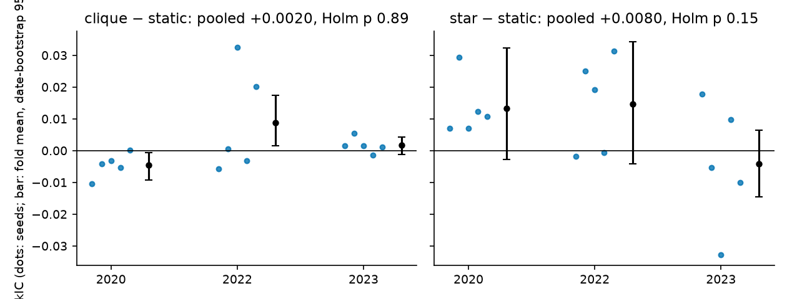
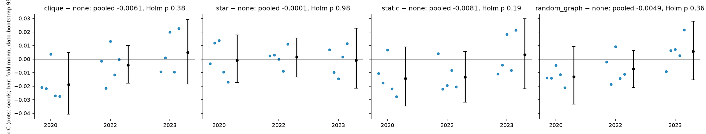
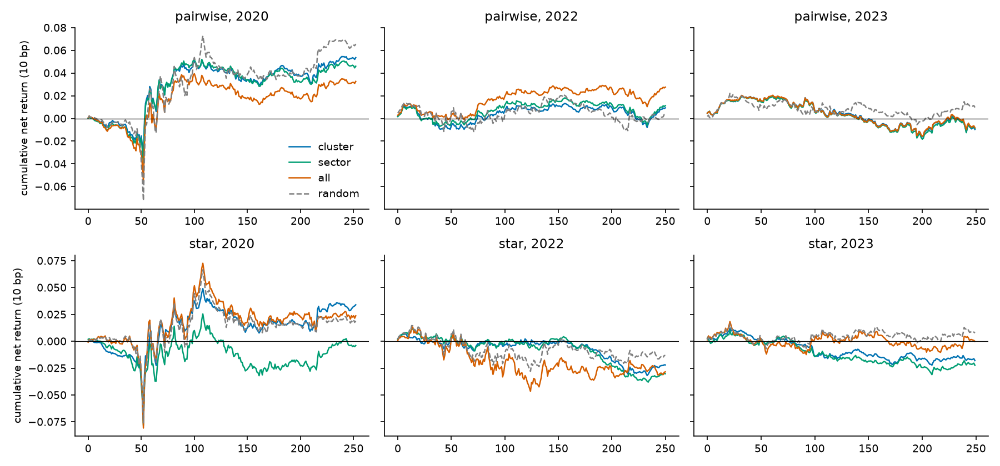

# Study X — pairwise (clique) vs star expansion, and pairs trading (2026-10-21)

**Exploratory. Every year used has been inspected before in this repository.** Design and decision rules were predeclared in the "Study X amendment" at the top of `RESEARCH_SCREENING_PLAN.md` (commit ce43edd) before any X number existed.

The request "Pairwise Trading / Star Expansion — do this and see if it works" was tested in both readings:
- **X1 (neural):** turn the 16 correlation clusters into a graph by clique (pairwise) expansion or by explicit star expansion, inside the screen baseline.
- **X2 (trading):** classic distance-method pairs trading with all within-group pairs (pairwise) or each stock vs its group centre (star).

## Bottom line

**Neither works on this panel.**
- **X1:** clique and star are both **NO EVIDENCE** against the static hypergraph baseline (Holm p 0.890 and 0.146). Descriptively, star lands exactly at the no-graph model's level (star − none −0.0001, p 0.978) and clique sits below it (−0.0061). Neither expansion adds anything over no graph at all.
- **X2:** no pairs-trading variant is distinguishable from zero after costs, and no grouping beats random groups. Star does worse than pairwise in every grouping.
- **Together:** group structure does not help on this panel, whichever way it is expanded.

## X1 — neural clique vs star expansion

**Setup:**
- Same panel, protocol, selection (validation RankIC) and hidden size as the v3 screen.
- Folds: 2020, 2022, 2023. Seeds: 7, 19, 42, 101, 202.
- Arms:
  - `static`: the baseline, 16 KMeans-cluster hyperedges plus self edges;
  - `clique`: every within-cluster pair as a 2-node hyperedge plus self edges, in the same attention layer;
  - `star`: one hub per cluster, node→hub mean, hub→node linear map, own self map; replaces the attention layer;
  - `none`: no graph;
  - `random_graph`: static with permuted cluster labels.
- 75 fits, 0 failed. One Kaggle CPU kernel per seed, all on Intel Xeon @ 2.20GHz with torch 2.11, so **every paired contrast is session-matched**.
- Before launch, the code change was confirmed to leave the static output bit-identical to v3 (`results/SCREEN_SP500_20261021_x_neutralcheck`).

### Primary family (Holm over {clique, star} vs static)

| Candidate | Pooled ΔRankIC [95% CI] | Fold means 2020 / 2022 / 2023 | Seeds positive | Wilcoxon p | Holm p | Verdict |
|---|---|---|---|---|---|---|
| clique | +0.0020 [−0.0010, +0.0054] | −0.0045 / +0.0089 / +0.0017 | 1/5 · 3/5 · 4/5 | 0.890 | 0.890 | **NO EVIDENCE** |
| star | +0.0080 [−0.0014, +0.0176] | +0.0133 / +0.0147 / −0.0041 | 5/5 · 3/5 · 2/5 | 0.073 | 0.146 | **NO EVIDENCE** |

Star would also fail the STRONG fold condition, because its 2023 fold is negative.

### Absolute RankIC (seed mean)

| Arm | 2020 | 2022 | 2023 |
|---|---|---|---|
| static | +0.0007 | −0.0061 | +0.0182 |
| clique | −0.0039 | +0.0028 | +0.0199 |
| star | +0.0140 | +0.0086 | +0.0141 |
| none | +0.0149 | +0.0072 | +0.0150 |
| random_graph | +0.0018 | −0.0002 | +0.0206 |

### Descriptive contrasts (no verdicts; point estimate, CI, raw p)

The Holm columns printed in `x1_desc_TABLES.md`, `x1_vs_none_TABLES.md` and `x1_star_vs_clique_TABLES.md` come from ad-hoc families. Ignore them; these contrasts were declared descriptive.

| Contrast | Pooled Δ [95% CI] | Fold means 2020 / 2022 / 2023 | raw p |
|---|---|---|---|
| star − none | −0.0001 [−0.0102, +0.0107] | −0.0009 / +0.0015 / −0.0009 | 0.978 |
| clique − none | −0.0061 [−0.0175, +0.0061] | −0.0187 / −0.0043 / +0.0049 | 0.188 |
| star − clique | +0.0060 [−0.0030, +0.0153] | +0.0179 / +0.0058 / −0.0058 | 0.208 |
| none − static | +0.0081 [−0.0050, +0.0204] | +0.0142 / +0.0132 / −0.0032 | 0.048 |
| random_graph − static (noise floor) | +0.0032 [−0.0045, +0.0112] | +0.0012 / +0.0058 / +0.0025 | 0.389 |

### Reading

- **Star ≈ no graph.** Star's gain over static (+0.0080) is the same size as no-graph's gain over static (+0.0081). Their predictions are not the same: the median correlation is 0.75. But their RankIC levels match fold by fold.
- **Why star scores like no graph is not established.** Star replaces the attention layer as well as the expansion (predeclared confound). So "dropping attention" and "using hubs" cannot be separated. Weights were not saved, so we cannot check whether the hub path is used. That star helps only by removing attention is a hypothesis, not a finding.
- **Clique barely moves the model.** Its predictions correlate 0.94 (median) with static. Clique also dilutes each stock's self-edge weight to about 1/k in the segment softmax (predeclared confound).
- **Static is nominally below no-graph** (raw p 0.048, uncorrected, descriptive; 2023 reverses). In this 5-seed run, the static hypergraph is if anything slightly worse than no graph. This does not contradict the screen's statement that the baseline cannot be separated from no-graph, because it does not survive correction (Holm 0.096 or 0.192, depending on family).

### Reproducibility

- The static and random_graph arms were rerun here and compared with the deep-test root `SCREEN_SP500_20261019_v3_deep`. 23 of 30 matching runs have identical predictions.
- The 7 runs that differ are static seed 7 (all 3 folds), static seed 19 (all 3 folds) and static seed 101 in 2023. Max |ΔRankIC| is 0.006 (2023 seed 19); the rest are below 0.001.
- This is the same session-level drift reported in `DEEP_ABLATIONS.md`. It does not affect X1 contrasts, which are all within one kernel. Per run: `x1_REPRO.csv`.

## X2 — pairs trading, pairwise vs star

**Setup:** Gatev–Goetzmann–Rouwenhorst distance method.
- 252-session formation and 126-session trading; a new portfolio each month, with overlapping portfolios averaged.
- Enter at |z| > 2, exit when z crosses 0, execute one day after the signal. 10 bp per leg per side.
- Pairwise: top 20 within-group pairs by SSD. Star: top 20 stocks by SSD against the mean of the other group members.
- Groupings: correlation clusters, GICS sectors and all stocks, each against a null of 20 random partitions with the same group sizes.
- Script: `scripts/pairs_trading.py`; full tables: `x2_PAIRS_TABLES.md`.

| Family | Grouping | Ann. net return [95% CI] | vs random null |
|---|---|---|---|
| pairwise | cluster | +0.018 [−0.018, +0.060] | −0.009 |
| pairwise | sector | +0.016 [−0.021, +0.059] | −0.010 |
| pairwise | all | +0.017 [−0.021, +0.060] | — |
| pairwise | random (null) | +0.026 | — |
| star | cluster | −0.002 [−0.042, +0.041] | −0.007 |
| star | sector | −0.019 [−0.062, +0.025] | −0.023 |
| star | all | −0.002 [−0.058, +0.057] | — |
| star | random (null) | +0.004 | — |

- Every variant is **NO EVIDENCE**: Holm p = 1.000 on absolute returns, and 1.000 on structure vs random except star-sector at 0.550.
- Star − pairwise is negative in every grouping (sector −0.035, p 0.064).
- Across all sensitivities (same-close execution, 0/25 bp, top 50), only top-50 / 0 bp / all-pairs has a CI above zero: +0.045 [+0.004, +0.090]. It ignores grouping and does not survive 10 bp.
- Checks: the 2022 Sharpe recomputes by hand, and the top-20 all-pairs selection matches scipy `pdist`.

## Already measured elsewhere (context)

- **Screen C `pairwise` loss** (MSE + 0.1 × pairwise logistic): −0.005 vs static in the v3 screen; neutral, CI includes 0 (`SCREENING_REPORT.md`).
- **Phase 1 THINK reproduction:** hypergraph vs clique vs none was never established either way (see `docs/PHASE1_TRACKER.md`).

## Caveats

- **Survivorship bias:** 2026 S&P 500 constituents are traced back to 2015, with current GICS labels. Pairs that blew up through bankruptcy or delisting are missing, so X2 absolute returns are an upper bound.
- **Simplified adaptations:** star here is a minimal hub layer. Clique uses the repository's 2-node hyperedge attention.
- **5 seeds × 3 folds** gives 15 deltas per contrast.
- **Not transferable:** these results do not carry over to the THINK reproduction data or to other universes.

## Files

- **X1 tables:** `x1_TABLES.md` (primary), `x1_desc_TABLES.md`, `x1_vs_none_TABLES.md`, `x1_star_vs_clique_TABLES.md`.
- **X1 per-run data:** `x1*_PAIRED.csv`, `x1_REPRO.csv`.
- **X1 figures:** `figures/x1*_seed_deltas.png`.
- **X2:** `x2_PAIRS_TABLES.md`, `x2_PAIRS_RESULTS.csv`, `figures/x2_pairs_cumulative.png`.
- **Runs:** `results/SCREEN_SP500_20261021_x` (Kaggle kernels `hypershift-screen-x-s{7,19,42,101,202}`) and `results/PAIRS_SP500_20261021`.
