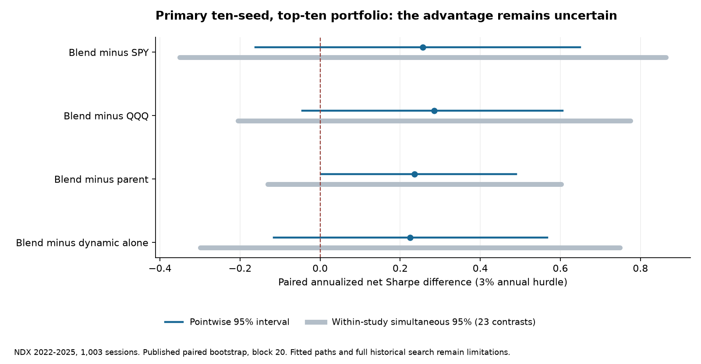
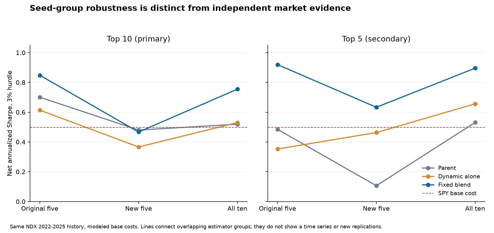

# Scientific evidence synthesis

**Recommendation: investigate fixed ensemble complementarity beyond persistent exposures.** The current record supports a bounded identification experiment; it does not establish an investable strategy or a dynamic-hypergraph mechanism.

## What holds across the record

Model choice, prediction quality and economic performance are different questions. Repeatedly, portfolio returns improve without a whole-universe ranking improvement. A stock-ID mixer can persistently favor a few winners; a seed blend can move names across the top-k boundary; a risk rule can reduce market exposure; a favorable time period can reward a concentrated portfolio. Each can change Sharpe while leaving average RankIC similar. A genuine tail-specific signal is another possibility and deserves a direct paired test.

Large initialization variability is not solved merely by reporting a favorable ensemble. The fixed ensemble is a legitimate estimator, but choosing its size or members from portfolio outcomes adds selection. Seeds share the same market history. The 20-seed transfer shows seed-count-dependent CAGR and substantial disagreement in holdings. It does not disprove every ensemble; it makes a frozen seed rule and a separate market-time uncertainty calculation necessary.

Execution and data identity are central. Tom's PIT re-evaluation removes a large survivor-universe advantage; the exact SR drop also changes training, classification and exit handling, so the whole change cannot be causally attributed to survivorship alone. The corporate-action/identity fixes and first-reported filing availability are reusable findings. Rishi's share/cash accounting and immutable fit locks are similarly valuable. Ethan now explicitly models delayed orders and actual notional turnover, while honestly disclosing missing microstructure.

## What the latest dynamic result changes

It changes the priority, but not the evidential status. The current restricted dynamic model's RankIC≈.0307 exceeds its parent≈.0038; the fixed blend's primary top 10 net SR is.755 versus parent.519. Top 5 ten-seed SR .896 remains positive under 4× modeled costs (.699). This is a stronger specific hypothesis than “try another graph.” The old generalization that no learned model even descriptively exceeds reversal is too broad for this new summary table.

However, the blend's primary SR increment+.236 has unadjusted 95% interval[.004,.490] and within-batch simultaneous interval[−.131,.602]. The latter does not adjust the entire prior research search. The new-five primary blend is slightly worse than its matched parent. Dynamic standalone has better ranking but lower SR than the blend. No dynamic/static/no-graph twin isolates the architecture. Raw per-stock predictions remain absent. Thus a positive economic candidate survives as **unresolved**, not confirmed or dismissed.

Tom's correlation-HG null and Rishi's transferred SPF blend are not contradictory matched experiments. They differ in universe, dates, features, neural architecture, graph construction and pooling. The former's random-peer equality argues against that simple relational mechanism. It neither reproduces nor refutes the latter. Its synthetic 16 day/market 60 day mismatch further limits what one can infer from the null.

## Which previous positive stories weakened

| Initial story | Better-controlled reading |
|---|---|
| THINK reproduction SRnear 2 | Ranking and geometry advantages not reproduced under validation selection; market/static exposure and evaluator choices matter |
| Star gains+.008 RankIC | The gain is versus static; star and no-graph are essentially equal. CI and Holm .146 belong to star−static |
| Neural grouping enables pairs trading | Cluster pairs 1.8%/yr does not beat random 2.6%; costs and uncertainty remain |
| Residual targets establish LightGBM superiority | Corrected-feature contrast differs from original; matched styles explain part; original weak learner could miss planted incremental information |
| Survivor style book SR 1.19 | PIT retrainSR.11 and uncertainty across zero; several protocol differences confound attribution |
| Stable reporting is a validated edge | Post-hoc diagnostic; preregistered avoidanceIR−.01 failed; a future hypothesis must be separate |
| Original five-seed ensemble is representative | Larger seed sets and new-five halves materially weaken some economic results |
| .919 equals a 272-trial expected maximum | Withdrawn: dependence and a nonzero equity benchmark invalidate that shortcut |

## Mechanisms supported, plausible and unestablished

**Supported within audited settings:** future dividend-adjusted price levels can leak information into dollar-volume features; point-in-time security eligibility changes historical economics; nonlinear rank/top-k aggregation can create seed-dependent holdings; traded-notional costs penalize rapid turnover; simple rankers are strong controls.

**Plausible but unresolved:** cross-family complementarity improves implementable tail selection; stock-specific persistent tilts explain a material fraction of neural portfolio gains; slow fundamentals add incremental information (positive point estimate but no winning net book).

**Unestablished:** dynamic membership is the cause of the blend gain; root alignment reliably improves equity tail selection; Ethan's quoted strategy has tradable alpha; any discovered market condition reliably improves the full-calendar net strategy. “Not established” is not evidence of zero or impossibility.

## Conditional performance is not the next primary experiment

There is no verified team-wide result showing a predefined state improves paired net performance out of sample. Favorable 2023/25 returns or a weak 2022 do not identify a causal, tradable regime. Nor does significance in one state and non-significance in another demonstrate an interaction.

The existing factor-conditioning feasibility study found an indicative RankIC increment SE.0108 and MDE≈.030, above the useful+.010 increment. Those values pertain to its 21 day fundamental/price design; they are warnings, not a measured power calculation for every new dynamic model. A new regime hypothesis requires its own covariance/power simulation, preregistered causal state, matched portfolio and full-calendar test. Splitting roughly 200 weekly NDX decisions into several states now would sacrifice evidence before basic attribution is resolved.

## Strongest credible findings

For **historical economic promise**, the fixed ten-seed dynamic blend is first, with a published primarySR.755 and secondarySR.896. “Credible” here means a coherent documented candidate with costs and declared checks, not independently verified investability.

For **independently recomputable arithmetic**, this audit confirms 204 older saved paths. For **controlled mechanism evidence**, the most useful work is the matched null/identity/data-integrity infrastructure rather than a positive graph claim. For **new-information promise**, first-reported fundamentals remain DEFER, not a validated strategy.

All numerical provenance and qualifications are in `HYPERSHIFT_FULL_TEAM_AUDIT.md` and `RECOMPUTED_EVIDENCE.json`. The next decision must depend on newly available artifacts or future dates, not a more persuasive narrative around the best historical cell.

## Figures restricted to the matched NDX protocol

Figure 1. Published paired intervals for the ten-seed/top 10 fixed blend. Within-study simultaneous intervals include zero; the pointwise parent contrast alone is insufficient for a superiority claim. These intervals are taken from committed summaries, not recomputed from the unavailable new daily paths.

Figure 2. Original-five, new-five and all-ten estimator groups share the same 2022–25 NDX history. The primary top 10 gain is inconsistent across seed halves; top 5 is secondary. Connected points indicate estimator sensitivity, not a time series or independent market replications.
